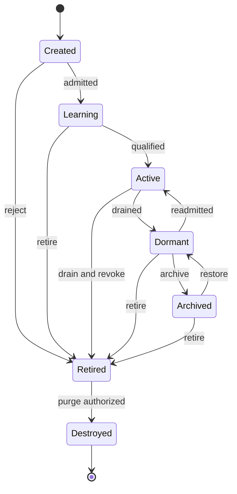

# Lifecycle management and dynamic fractal swarms

## Required lifecycle states

The requested ten labels are supported, but activity and lifecycle are not forced into a contradictory single scalar. Durable lifecycle is Created, Learning, Active, Dormant, Archived, Retired or Destroyed. Busy, Reviewing and Collaborating are activity substates of admitted execution. The API exposes a primary display_state from this composition plus all concurrent activities. An agent can review one task while collaborating on another under concurrency limits; no information is lost by choosing a display label.

| State | Entry requirement | Allowed departures and cleanup |
|---|---|---|
| Created | Identity allocated idempotently, template pinned; no execution grant yet | Learning after admission; Archived/Retired if never activated |
| Learning | Approved evaluation/training objective and finite budget | Active after required competency gates; Dormant on pause; Retired if rejected |
| Active | Admitted template, valid grants, healthy runtime availability | Busy/Reviewing/Collaborating; Learning for approved adaptation; Dormant/Archived/Retired after quiesce |
| Busy | Leased task attempt and resource reservation | Active after attempt closes; Reviewing/Collaborating as assigned; Dormant/Retired only through drain/cancel |
| Reviewing | Independent review assignment and readable evidence | Active/Busy/Collaborating after review receipt; cannot approve own artifact |
| Collaborating | Authorized collaboration session with member scope | Active/Busy/Reviewing after bounded session; subscriptions removed on exit |
| Dormant | No new dispatch; checkpointed work and revoked attempt leases | Active after readmission/grant freshness; Archived/Retired |
| Archived | No execution, searchable retained identity/evidence; scoped memory remains | Dormant after explicit restore/readmission; Retired |
| Retired | Permanent identity retirement, grants revoked, descendants handled | Destroyed after retention/legal disposition; no reactivation of same principal |
| Destroyed | Authorized purge completed for eligible content and secrets | Terminal tombstone; no reuse of identity; lawful minimal audit evidence may remain |

Retired expertise can be instantiated under a new identity with new admission and provenance, never resurrected with old credentials. Archived restores preserve identity but increment generation and revalidate modules, policy, source grants and memory restrictions. Destroyed is not a promise that legal audit evidence or third-party copies vanish; destruction receipts state what was purged, held or externally requested.

Lifecycle transition guards include expected resource_version, current generation, grant validity, no uncontrolled active effects and retention disposition. A quiescing condition blocks new claims while existing attempts checkpoint or cancel. State change to Dormant does not mean a dispatched deployment stopped; external operations reconcile separately. Unknown effect outcomes prevent unsafe replay regardless of agent state.

Busy/Reviewing/Collaborating transitions are represented by activity assignments beneath Active, rather than adding misleading terminal states to this lifecycle diagram. This supersedes the earlier production document's short lifecycle notation for agents; its leased/executing/checkpointed/completed states apply to task attempts, not principal lifetime.

## Dynamic swarm graph

A swarm is an objective-scoped collaboration object with swarm_id, member assignments, objective references, coordinator, context manifest, admission policy, budget reservation, deadline, communication channels, review rules and lifecycle. Agents may belong to multiple swarms with distinct target grants. Peer membership and shared objectives form a graph; there is no immutable department tree. Temporary experts and nested swarms remain normal admitted principals with expiry and lineage.

Creation lineage is a DAG for audit and cost inheritance; collaboration is a potentially cyclic graph. Cost has exactly one financial root per charged attempt and a versioned allocation lineage, even when an agent joins several teams. Sponsorship cannot be ambiguous or double-charged. “No fixed hierarchy” means reassignable organization and no fixed schema nesting depth; it does not remove accountable owners, scoped delegation or finite execution ceilings.

## Fractal operations

| Operation | Procedure | Conserved invariant |
|---|---|---|
| Create Agent | Validate template, need, owner, grant, root budget and idempotency key | New principal with no broader authority than applicable delegation |
| Spawn Swarm | Bind objective/member roles and reserve aggregate resources | Root fanout/concurrency/cost/deadline caps survive nesting |
| Temporary Expert | Time-limited specialist identity with narrow evidence/tool selectors | Expiry cancels future dispatch and transfers retained evidence safely |
| Investigation Team | Proposer, evidence collector, independent diagnostician and verifier | Team conclusions preserve uncertainty and competing hypotheses |
| Emergency Team | Preapproved incident roster/runbook, controlled preemption | Incident severity does not bypass target policy |
| Merge Agents | Create candidate composite expertise; drain sources if requested; evaluate new identity | Never union permissions automatically or erase authorship/conflicts |
| Retire Agents | Revoke grants, quiesce attempts, reassign objectives and retention | Caller needs retirement authority; agents cannot retire critics to win debates |
| Transfer Knowledge | Reference/export reviewed memories within recipient grants | Source restrictions and provenance survive transfer |
| Clone Expertise | Clone immutable skill/module profile into new admitted identity | No copying credentials, trust history, votes or private memory beyond grants |

Swarm reorganization considers task dependency/locality, competence, reviewer independence, workload and cost. Model proposes topology; deterministic controller validates policy, DAG/cost lineage, membership conflicts and open reviews. Rebalance at checkpoints; running effectful attempts keep ownership/fence until reconciled. Objective authority remains singular per generation. Cross-cell collaboration uses delegated messages/tasks and consented evidence references, not shared unrestricted database state.

Allocation uses iterative traversal with paginated descendants, bounded fixed-point planning and an aggregate fanout limit per root. Spawn loops are detected by repeating objective/template/context signatures and declining marginal evidence. Cooldowns and admission queues prevent agent explosions. Agent recursion cannot reset deadline, maximum turns, money or review independence.
