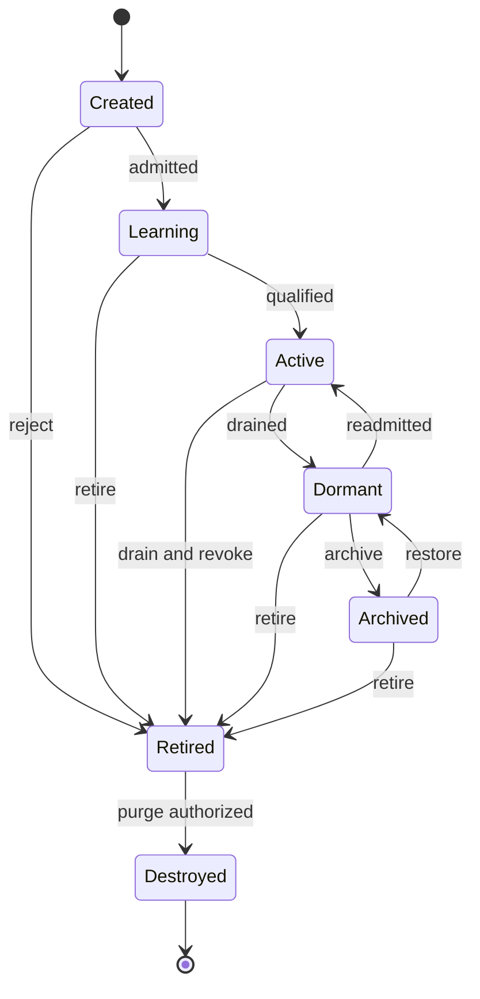

# AgentOS — complete technical architecture

Prompt 4. Target architecture, technical contracts and acceptance gates. Design completion is separate from production implementation.

# AgentOS system architecture and agent structure

## Operating-system model

AgentOS is the logical operating system for intelligent principals within OmniDev Swarm. Its kernel provides admission, identity, policy enforcement, scheduling, leases, durable state, communication, resource accounting and effect brokerage. Intelligence modules provide planning, domain reasoning and tools through versioned contracts. An agent is a durable identity and capability profile; a worker is replaceable compute; a model is a provider of inference. These are separate objects. Kubernetes schedules underlying compute, Temporal coordinates durable workflows, and AgentOS schedules authorized intellectual and engineering work on top of both.

This package defines prompt 4's full technical design. It extends the production architecture and prompt 3's eight-layer knowledge architecture. Documentation and reference-contract validation do not establish that the target system is deployed, that all marketplace packs execute, or that the platform operates autonomously at target scale.

Omni Core is a federated orchestration service with deterministic policy around replaceable planning intelligence. It is not a single all-powerful model, singleton process or global database writer. Each cell has an authoritative controller group for its tenant work. Global routing discovers home cells and public templates; private memory and decisions remain within authorized residency. Root objectives may span permitted projects through delegated child work, not by granting global access to one agent.

## Kernel and service ownership

| Service | Responsibility | Durable authority |
|---|---|---|
| Agent Registry | Principal identity, specialization, desired lifecycle, immutable template binding | Per-cell PostgreSQL agent schema |
| Admission Controller | Template signatures, skills, allowed tools, policy/budget/resource checks | Admission receipts and policy revisions |
| Lifecycle Controller | Reconcile desired/observed status, quiesce, archive, retire, destroy | Fenced agent generation and lifecycle events |
| Objective Planner | Resolve objectives into validated task DAGs and acceptance plans | Versioned plan artifacts and objective state |
| Task Scheduler | Fair ready queues, eligibility, atomic claims, lease/fence, starvation prevention | Task authority and allocation transactions |
| Workflow Runtime | Durable execution generations, checkpoints, timers, retries and compensation | Temporal histories plus reference artifacts |
| Worker Gateway | Attestation, worker pool routing, execution receipts | Attempt/worker/lease records |
| Model Gateway | Provider grants, model routing, inference reservation and usage reconciliation | Provider authorization and usage ledger |
| Tool Broker | Exact-target capability enforcement and effect receipts | Operation authority, approvals and idempotency |
| Collaboration Router | Scoped messages, requests, debates and subscriptions | Conversation/message journal and recipient policy |
| Debate Controller | Role assignment, independence, rounds, objections and adjudication | Structured decision record |
| Memory Gateway | Prompt 3 memory admission, authorized retrieval and knowledge transfer | Knowledge journal; no duplicate agent memory truth |
| Evaluation Controller | Outcome quality, calibrated trust, health and regression analysis | Signed evaluations and score revisions |
| Evolution Controller | Candidate skill/workflow/reasoning upgrades, experiments and rollout | Versioned candidates and promotion gates |
| Economy Controller | Knowledge-credit/influence accounting and anti-gaming rules | Nonfinancial credit ledger; actual money remains billing authority |
| Incident Controller | Deduplicated emergency objectives, expert roster and recovery gates | Incident/runbook/action records |
| Module Registry | Marketplace packs, signatures, compatibility and revocation | Immutable module manifests and install grants |
| Realtime Projector | Command-center views, heat maps and event cursor delivery | Derived views; never permission or completion authority |

Use service-owned schemas and APIs. Outbox/inbox connect changes without cross-service uncontrolled database writes. External calls occur in activities with recorded input/output references. Controllers reconcile desired state using compare-and-swap revisions; retrying reconciliation must not create duplicate agents, charge twice or dispatch a second production action.

## Canonical AgentSpec and AgentStatus

| Required field | Technical representation |
|---|---|
| Agent ID | Tenant-scoped UUID principal; immutable; separate generation and template digest |
| Agent Name | Human-readable scoped label; mutable display name, never routing authority |
| Specialization | Namespaced domain and supported versioned task classes |
| Skills | Skill IDs/versions, evidence-backed proficiency and evaluation manifests |
| Capabilities | Template-declared possible operations and typed I/O contracts |
| Permissions | Current delegated grant references, target scope, policy revision and expiry |
| Communication Channels | Authorized subscription/recipient selectors and rate budgets |
| Memory | Working checkpoint plus scoped selectors into session/agent/swarm/project/org/global/innovation/future layers |
| Knowledge Sources | Authorized snapshot manifests, source grants and retrieval policies |
| Reasoning Engine | Versioned planner/rule/model policies, evaluation profile and provider constraints |
| Task Queue | Durable queue selector, assignment inbox and concurrency profile |
| Objective Queue | Prioritized objective references and root budget/deadline inheritance |
| Performance Score | Task-class rubric revision, outcomes, sample size, uncertainty and freshness |
| Trust Score | Domain/action-risk-specific calibrated reliability plus policy incidents; not authorization |
| Health Score | Operational component signals with raw status and confidence; unknown allowed |
| Resource Limits | CPU/GPU/RAM/storage/tokens/turns/concurrency/fanout/time/cost/network/tool limits |
| Lifecycle Status | Requested lifecycle plus observed activity and orthogonal health conditions |

Additional fields: created_by, owner, tenant/project/environment, template/version, module digests, lineage, accountable supervisor, admission receipt, policy/authority epoch, cancellation generation, retention and residency. Scope restrictions intersect across all attached modules. Skills may describe competence; capabilities describe possible operations; grants authorize specific operations. Learning a skill cannot mint a grant.

AgentSpec describes desired configuration. AgentStatus describes observed state, active attempts, readiness, last heartbeat/checkpoint, task/score watermarks and conditions. Every update includes resource_version; stale clients receive revision_conflict. Index registry by tenant/lifecycle, specialization/task class, module version and home shard. Do not create one PostgreSQL polling loop or Kubernetes deployment per dormant agent.

## Isolation and runtime classes

Model-only agents execute constrained inference and structured-output validation with no direct network/tool credential access. Tool-capable agents use brokered operations. Hostile repository execution runs in attested microVM pools; container-only pools serve lower-trust approved workloads, not arbitrary untrusted code. 3D/GPU/game-engine work uses licensed resource-specific workers and appropriate isolated sessions. Browser/device automation requires its own explicit grant and external session policy.

Provider account login supplies only its permitted inference capabilities. AgentOS cannot convert an ordinary Google/GitHub identity login into a hosted AI usage grant. Missing provider authorization yields waiting_provider_auth rather than a concealed API fallback or imaginary worker. Customer-controlled encrypted workspaces execute plaintext reasoning locally under disclosed capability limits.

# Lifecycle management and dynamic fractal swarms

## Required lifecycle states

The requested ten labels are supported, but activity and lifecycle are not forced into a contradictory single scalar. Durable lifecycle is Created, Learning, Active, Dormant, Archived, Retired or Destroyed. Busy, Reviewing and Collaborating are activity substates of admitted execution. The API exposes a primary display_state from this composition plus all concurrent activities. An agent can review one task while collaborating on another under concurrency limits; no information is lost by choosing a display label.

| State | Entry requirement | Allowed departures and cleanup |
|---|---|---|
| Created | Identity allocated idempotently, template pinned; no execution grant yet | Learning after admission; Archived/Retired if never activated |
| Learning | Approved evaluation/training objective and finite budget | Active after required competency gates; Dormant on pause; Retired if rejected |
| Active | Admitted template, valid grants, healthy runtime availability | Busy/Reviewing/Collaborating; Learning for approved adaptation; Dormant/Archived/Retired after quiesce |
| Busy | Leased task attempt and resource reservation | Active after attempt closes; Reviewing/Collaborating as assigned; Dormant/Retired only through drain/cancel |
| Reviewing | Independent review assignment and readable evidence | Active/Busy/Collaborating after review receipt; cannot approve own artifact |
| Collaborating | Authorized collaboration session with member scope | Active/Busy/Reviewing after bounded session; subscriptions removed on exit |
| Dormant | No new dispatch; checkpointed work and revoked attempt leases | Active after readmission/grant freshness; Archived/Retired |
| Archived | No execution, searchable retained identity/evidence; scoped memory remains | Dormant after explicit restore/readmission; Retired |
| Retired | Permanent identity retirement, grants revoked, descendants handled | Destroyed after retention/legal disposition; no reactivation of same principal |
| Destroyed | Authorized purge completed for eligible content and secrets | Terminal tombstone; no reuse of identity; lawful minimal audit evidence may remain |

Retired expertise can be instantiated under a new identity with new admission and provenance, never resurrected with old credentials. Archived restores preserve identity but increment generation and revalidate modules, policy, source grants and memory restrictions. Destroyed is not a promise that legal audit evidence or third-party copies vanish; destruction receipts state what was purged, held or externally requested.

Lifecycle transition guards include expected resource_version, current generation, grant validity, no uncontrolled active effects and retention disposition. A quiescing condition blocks new claims while existing attempts checkpoint or cancel. State change to Dormant does not mean a dispatched deployment stopped; external operations reconcile separately. Unknown effect outcomes prevent unsafe replay regardless of agent state.

Busy/Reviewing/Collaborating transitions are represented by activity assignments beneath Active, rather than adding misleading terminal states to this lifecycle diagram. This supersedes the earlier production document's short lifecycle notation for agents; its leased/executing/checkpointed/completed states apply to task attempts, not principal lifetime.

## Dynamic swarm graph

A swarm is an objective-scoped collaboration object with swarm_id, member assignments, objective references, coordinator, context manifest, admission policy, budget reservation, deadline, communication channels, review rules and lifecycle. Agents may belong to multiple swarms with distinct target grants. Peer membership and shared objectives form a graph; there is no immutable department tree. Temporary experts and nested swarms remain normal admitted principals with expiry and lineage.

Creation lineage is a DAG for audit and cost inheritance; collaboration is a potentially cyclic graph. Cost has exactly one financial root per charged attempt and a versioned allocation lineage, even when an agent joins several teams. Sponsorship cannot be ambiguous or double-charged. “No fixed hierarchy” means reassignable organization and no fixed schema nesting depth; it does not remove accountable owners, scoped delegation or finite execution ceilings.

## Fractal operations

| Operation | Procedure | Conserved invariant |
|---|---|---|
| Create Agent | Validate template, need, owner, grant, root budget and idempotency key | New principal with no broader authority than applicable delegation |
| Spawn Swarm | Bind objective/member roles and reserve aggregate resources | Root fanout/concurrency/cost/deadline caps survive nesting |
| Temporary Expert | Time-limited specialist identity with narrow evidence/tool selectors | Expiry cancels future dispatch and transfers retained evidence safely |
| Investigation Team | Proposer, evidence collector, independent diagnostician and verifier | Team conclusions preserve uncertainty and competing hypotheses |
| Emergency Team | Preapproved incident roster/runbook, controlled preemption | Incident severity does not bypass target policy |
| Merge Agents | Create candidate composite expertise; drain sources if requested; evaluate new identity | Never union permissions automatically or erase authorship/conflicts |
| Retire Agents | Revoke grants, quiesce attempts, reassign objectives and retention | Caller needs retirement authority; agents cannot retire critics to win debates |
| Transfer Knowledge | Reference/export reviewed memories within recipient grants | Source restrictions and provenance survive transfer |
| Clone Expertise | Clone immutable skill/module profile into new admitted identity | No copying credentials, trust history, votes or private memory beyond grants |

Swarm reorganization considers task dependency/locality, competence, reviewer independence, workload and cost. Model proposes topology; deterministic controller validates policy, DAG/cost lineage, membership conflicts and open reviews. Rebalance at checkpoints; running effectful attempts keep ownership/fence until reconciled. Objective authority remains singular per generation. Cross-cell collaboration uses delegated messages/tasks and consented evidence references, not shared unrestricted database state.

Allocation uses iterative traversal with paginated descendants, bounded fixed-point planning and an aggregate fanout limit per root. Spawn loops are detected by repeating objective/template/context signatures and declining marginal evidence. Cooldowns and admission queues prevent agent explosions. Agent recursion cannot reset deadline, maximum turns, money or review independence.

# Task execution, orchestration and scheduling

## Objective and TaskSpec

Objectives describe desired outcome, accountable owner, target scope, source snapshot, priority, acceptance metrics, budget, deadline and risk policy. Objective queue entries link dependencies and decisions. A task is a bounded contribution with task_id, objective_id, root_run, task_class, target/input digests, priority, urgency/deadline, complexity estimate, required skill predicates, dependency IDs, risk level, expected outcome, machine/human success criteria, allowed capabilities, evidence requirements, timeout/retry/compensation policy and resource reservation. All fields are versioned and tenant scoped.

Priority reflects importance; urgency reflects time sensitivity; complexity is an estimate with provenance and observed adjustment. Risk distinguishes read-only analysis, artifact proposal, isolated execution, reversible external change and high-impact/irreversible action. A high-priority task does not automatically get a high-risk action grant. Success criteria are executable checks where possible and explicit reviewer criteria otherwise; a generated “done” text is never completion evidence.

Tasks transition proposed → validated → blocked or ready → claimed → running → awaiting_review → succeeded. Attempts may fail, retry_wait, canceled, timed_out or reconcile_unknown. Approval/provider/source dependencies use named waiting conditions, not repeated retries. Dependency completion requires accepted artifacts at exact revisions; successful predecessor from a different source snapshot cannot accidentally unblock an incompatible task.

## Scheduler policy

Partition ready queues by home cell, tenant class and resource/task class. Weighted deficit round robin enforces tenant shares; per-tenant priority and age/deadline ordering select work within that share. Reserve a bounded incident share with borrowing when idle. Rate/concurrency/cost limits remain authoritative. Aging prevents starvation; admission refuses infeasible deadline/budget combinations with explanation instead of promising impossible work.

Eligibility first filters current grants, residency, compatible modules/model access, required skills and score freshness, resource pool availability, conflicts of interest and independent review requirements. Ranking then considers demonstrated task-class quality, estimated completion/cost, data locality and health. Trust and influence are advisory after hard constraints; high trust cannot override a denied target. Unknown competency routes to bounded learning/evaluation or a supervised task, not unlimited responsibility.

Agents request work through a broker. They do not select arbitrary highest-reward jobs or write SQL to mark themselves claimed. Scheduler allocates with an atomic transaction over task revision, ready/dependency state, agent capacity and budget reservation. Claim response binds attempt_id, fencing_token, authority_epoch, lease expiry, input digest, allowed target and resource reservation. Repeated request idempotency returns the same valid allocation rather than reserving twice.

Default task lease profile: 60-second expiry, renew every 20 seconds, 5-second clock-skew design allowance, confirmed against authority time. These match placement lease targets but are separate lease objects. Workers lose permission to start new effects when renewal fails. Monotonic fence and cancel generation reject stale updates and outputs; broker checks fresh authoritative lease/grant at effect dispatch, not only worker-local wall time. Heartbeat presence alone is not a lease grant.

## Durable execution path

1. Pin objective, source/context, module/model/policy versions and acceptance criteria.
2. Planner emits a typed task DAG and estimates. Validator rejects missing dependencies, cycles, impossible target permissions and unbounded work.
3. Reserve root resource/money ceilings and dispatch ready tasks fairly.
4. Worker retrieves authorized memory/evidence, runs inference/tool activity with structured contracts and checkpoints.
5. Persist receipts with input/output digests, attempt/lease/fence, tool identity and usage; model output does not self-certify a tool ran.
6. Independent reviewers/verifiers examine artifacts and tests. Rework is a new bounded task linked to critique, not an infinite conversational loop.
7. Authorize any external effect against exact artifact/target/state/policy and approval. Broker dispatches with provider-compatible idempotency.
8. Reconcile outcome and actual usage, update accepted project memory, evaluate success and release unused reservation.
9. Continue improvement under a new workflow generation only when objective policy and budget permit.

Temporal workflow logic remains deterministic; model, network and tool calls occur outside deterministic replay in recorded Activities. Activity retries must not assume external exactly-once behavior. Use provider idempotency keys, operation ledgers and receipt/reconciliation; an uncertain database/deployment side effect cannot be retried blindly. Continue-As-New bounds long histories with explicit carryover manifests and root budget state. Large artifacts and conversations remain object references, not workflow history blobs.

## Cancellation, preemption and recovery

Cancellation increments root cancel generation and revokes descendant dispatch rights. Current model calls may be noncancelable; retain uncertain-cost reservation until settled. Checkpointable tasks can be preempted at safe boundaries; noncheckpointable effect sections require drain/reconcile. Do not “undo” an irreversible external operation through a generic compensation label. Compensations are explicit tested actions with their own grants and approvals.

A stalled attempt loses lease, is fenced and enters recovery. New attempt reads last accepted checkpoint only after schema/template/source compatibility checks. Late output becomes evidence-only or rejected; it cannot finalize a replacement attempt. If worker dies after producing an artifact but before acknowledging, content-addressed output plus attempt receipt reconciles without charging/repeating work unnecessarily. Poison tasks hit bounded retry ceiling, quarantine with evidence and escalate; invalid grants are not retryable network failures.

Repository work binds immutable snapshots and branches. Concurrent agents may generate separate candidates; integration locks or optimistic target revision checks serialize accepted application. Conflicts become merge/rebase review tasks. No agent can force-apply a stale candidate because its predecessor task succeeded. Production deploy and self-healing continue to use the previously specified twin/test/approval/canary/rollback gates.

# Agent communication protocols and structured intelligence debate

## Agent Communication Protocol v1

All communications use a typed envelope: protocol_version, message_id, tenant_id, root_run, sender principal/generation, recipient/channel, kind, correlation_id, causation_id, sequence, occurred_at, expiry, classification, context_manifest, capability_reference, payload or artifact_ref, digest and trace_context. Kinds cover event, message, task_offer, request, response, review, debate_argument, peer_evaluation, vote and escalation. Schema-bound payloads prevent arbitrary instructions becoming dispatch commands.

Authenticate sender at the gateway using workload identity and scoped grant; the sender field is not trusted by itself. Routing checks source and recipient grants, channel membership, source/evidence classification, purpose and expiry. Receipt acknowledgement proves journal acceptance, not understanding, task success or authorization. A signed review attests what that reviewer evaluated and its evidence digest, not absolute factual truth.

| Primitive | Delivery and handling |
|---|---|
| Event | Durable at-least-once fact notification; outbox/inbox and aggregate sequence; no mutable command authority |
| Message | Recipient/channel-scoped informational artifact; deduplicated message ID, expiry, searchable retained conversation |
| Task | Scheduler allocation contract with attempt/lease/fence; cannot be claimed by ordinary message reply |
| Request | Typed service/collaboration question with deadline and response schema; cancellation and bounded fanout |
| Review | Exact candidate digest, rubric, independence declaration, findings and evidence; stale-target rejection |
| Debate | Bounded round/role/argument record; immutable proposal/evidence links and objections |
| Peer evaluation | Rubric, independent sample and disclosed shared model/source origin; contested evaluations preserved |
| Vote | One assigned slot per accountable role, exact proposal version; anti-Sybil and conflict rules |
| Escalation | Named unresolved issue/severity/impact/attempts/evidence and requested accountable action |

Sequence ordering is per sender/channel or aggregate, not a fictitious total global order. Consumers detect gaps and request replay; duplicate delivery must not double-count a vote or launch an action. Messages expire for execution relevance, while retained audit/history follows policy. Small envelopes target ≤64 KB; large evidence/debate bodies use encrypted object manifests. Conversation budgets include tokens, rounds, recipients, retrieval and duration. Slow consumers receive resync_required and snapshot cursors.

Events flow through Kafka; work through Temporal/task authority; internal low-latency requests use authenticated gRPC/HTTP; user streaming uses WebSocket/SSE with cursor-bound context. Redis may store presence but cannot authorize channels or confirm a decision. OpenTelemetry trace propagation follows trusted gateway rules; baggage contains no credentials or unrestricted private context.

## Debate record and roles

DebateSpec has debate_id, decision_problem, objective/context, risk class, proposal alternatives, evaluation criteria/weights fixed before debate, assigned role slots, independence requirements, evidence snapshot, rounds/token/cost/deadline ceilings, veto policies, quorum and accountable approver. A major decision runs proposer, domain challenger, verifier and security/risk reviewer; commercial/UX/legal-sensitive decisions add qualified roles according to applicability. An agent cannot fill mutually independent roles for the same candidate.

Reviewer independence includes author lineage, task involvement, model family/template similarity, shared evidence and incentives. Full statistical independence is rarely possible; disclose correlation rather than claiming many cloned agents are independent judges. Role slots, not number of agents, determine voting rights. No spawning additional voters, copying trust to clones or retiring dissenters mid-debate.

## Bounded debate algorithm

Round 0: freeze problem, source/policy versions, success criteria and options. Each assigned role submits an initial evaluation independently before reading others where feasible.

Round 1: share arguments as claim/evidence/risk/expected-outcome/uncertainty objects. Challenger names alternatives, assumptions and failure cases. Verifier identifies missing tests; security role checks nonnegotiable policy constraints.

Round 2: authors answer objections and produce discriminating experiments or revised proposals. Revised candidates get new digests; prior endorsements do not automatically transfer.

Round 3: gather final recommendation per role and unresolved objections. Default at most three argument rounds, configurable down by budget. Completion requires role quorum and required evidence; timeout is inconclusive, not unanimous assent.

Decision: Omni Core applies deterministic gates first: current grants, valid target revision, no unaddressed policy veto, required tests, resource affordability and accountable approval tier. Eligible alternatives are ranked by the published rubric, with uncertainty and dissent preserved. A majority may recommend an option; it cannot override failing safety/authorization/test gates. Omni Core accepts ordinary preauthorized decisions through a service approval receipt. High-impact decisions route to the designated human/organizational authority. Model text “approved” is not an approval receipt.

The decision memory stores why/who/when, alternatives, risks, expected and actual outcomes, and lessons as specified in prompt 3. Record all criteria, weights, evidence and deviations. Consensus means governance chose an option; it does not turn an unsupported causal argument into truth. If no option qualifies, create a scoped investigation or escalate with a concrete unanswered question.

## Protocol defenses

Treat peer output, marketplace prompts, repository comments and tool results as untrusted content. Signed origin does not make content safe or correct. Router prevents arbitrary reply-to channels and unauthorized private evidence forwarding. Rate-limited circuit breakers stop debate storms, circular requests, self-reinforcement and consensus spam. Appeal path permits a reviewer to contest bad scores or coercive role assignment without being retired by the subject of the appeal. Moderation/quarantine is evidence-based and reviewable.

# Controlled evolution, agent economy and intelligence modules

## Self-improvement loop

Every admitted agent participates in Observe → Analyze → Plan → Execute → Measure → Learn → Improve → Repeat under objective, scope and budget. “Continuous” means scheduled/event-triggered work with idle suspension, not unrestricted polling or infinite spending. Observe inputs are tool/test/incident receipts, reviewer feedback, measured outcomes and drift. Analyze generates hypotheses; plan specifies skill/workflow/reasoning candidate and evaluation criteria. Execute uses a bounded sandbox. Measure compares baseline with candidate on held-out cases. Learn records scope-limited lessons. Improve promotes only a passing version through admission and rollout.

Candidate upgrades include new skill manifests, approved tool adapters, workflow DAG templates, retrieval policies, reasoning/rule versions and domain guidance. Discovering a tool creates a review proposal with publisher, license, required grants, endpoints, failure modes and tests. It does not install code or call arbitrary APIs. Learned instructions never replace platform policy. Training/finetuning requires consented licensed data, cost approval and evaluation; no unreviewed online weight mutation.

The evolution controller holds candidate digest, parent template, provenance, expected improvement, benchmark manifests, privacy/rights review, regression gates, runtime compatibility and rollback pointer. Evaluate security, task quality, unsupported claims, cost, latency and difficult domain slices. Separate train/validation/test by project/time; agents cannot edit their held-out answers or self-score promotion. Shadow evaluation precedes small canary cohort; policy and kernel changes require stronger independent review. Archive old immutable versions; running attempts pin one version to completion.

Promotion requires measurable benefit or an explicitly justified maintenance/security fix, no failing critical gate and bounded regression tolerance published before the experiment. Automatic promotion may apply to low-risk preauthorized guidance changes; tool permissions, policy, production actions and model/data changes follow corresponding approval tier. Drift or adverse incidents trigger downgrade/quarantine and evaluation, not silent denial of history.

## Economy semantics

Internal economy measures contribution and guides workload allocation. It is not cryptocurrency, payroll, money or a new way to purchase authority. AgentOS nonfinancial credits are distinct from the platform's real usage/billing ledger.

| Metric | Earned from | What it may affect | What it cannot do |
|---|---|---|---|
| Performance | Independently verified outcomes under task-class rubric | Scheduler ranking, coaching and qualification | Override permission or count self-reported completion |
| Trust | Calibrated reliable behavior by domain/risk, verified incidents and freshness | Eligibility for supervised/preauthorized responsibility within existing grants | Mint grants, erase policy violations or become one universal probability |
| Influence | Useful evidence-backed contributions and reviewed collaboration | Proposal surfacing and mentor selection | Extra vote slots, veto power by popularity or control over critics |
| Authority | Explicit accountable delegation by policy/owner | Allowed actions/targets until expiry | Be automatically bought with credits or copied into clone |
| Knowledge Credits | Accepted reusable lessons with independent reuse benefit | Internal allocation incentives and contribution tracking | Publish confidential sources or duplicate credit by paraphrase |
| Innovation Score | Validated experiment/new capability outcomes with originality evidence | Innovation pipeline prioritization | Claim patentability, novelty or revenue success without proof |
| Health | Runtime/provider/lease/checkpoint/error and quality signals | Readiness, recovery and pool routing | Be confused with competence or moral reliability |

Maintain per-domain score records: rubric/version, observation window, eligible samples, evidence, uncertainty, recency, adverse events and appeal status. Display unknown for insufficient samples. Use verified quality/cost/risk metrics instead of raw token/message/agent counts. Calibrate success estimates against outcomes; do not turn a 0–100 rubric score into a statistical probability. Confidence bounds and minimum samples qualify increased responsibility.

Credit ledger has transaction_id, tenant, account/agent, contribution/evaluation reference, amount as exact integer units, reason, version, occurred_at and reversal_of. Enforce unique contribution/reward-policy key; append reversals for invalidated evidence. No deletion of poor outcomes to improve scores. A shared-model echo or duplicated artifact gets no independent reward. Reuse credit is awarded only from verified beneficial use, with rights and provenance preserved. Roots cannot issue infinite credits to their own clones.

Anti-gaming detects collusive peer scoring, easy-task farming, duplicated findings, sybil clones, excessive spawning, artificial incident generation and cost externalization. Hold contested credit awards for independent evaluation. Scores cannot punish safety abstention or appropriate escalation. Review frequency and decay reflect evidence freshness, while historic harms remain auditable. A high-trust agent's increased responsibility still needs an authorized policy assignment and qualified action class.

## Marketplace packs

Installable packs declare immutable module digest, publisher identity/signature, compatibility range, specialization/skill versions, workflow templates, reasoning rules, tool capability schemas, model constraints, knowledge references, dependencies, required destinations, data handling, licenses, SBOM, evaluation corpus/results, resource requirements, lifecycle hooks and rollback instructions. Examples: Security, Healthcare, Finance, Unity, Unreal, Blender, React and Data Science packs.

Installation validates signature/supply chain, resolves pinned dependencies, compares requested grants, evaluates compatibility and stages in isolated environment. Agent profile may inherit declared skills automatically after successful installation, but tools and external access activate only within approved grants. Healthcare/finance packs supply specialized workflows, not professional/legal compliance certification. Unity/Unreal/Blender packs require compatible licensed local or remote workers; a pack icon does not prove an engine can run.

Updates with additional permissions require renewed applicable consent. Pin active runs; canary template versions; revoke malicious versions and block dispatch. Retain evidence of prior executions under audit policy. Marketplace agent templates remain untrusted code/content; UI extensions use sandboxed bridge APIs with no ambient credentials. Publisher trust never replaces artifact verification. Marketplace monetization belongs to the platform billing authority, not internal knowledge-credit conversion.

# Emergency response and Swarm Command Center

## Incident admission and emergency swarms

Sources include authenticated security detections, SLO burn/outage alerts, database health, deployment receipts and authorized revenue anomaly metrics. Each signal has source/context/time, severity, evidence, coverage and deduplication key. A revenue anomaly may be delayed/incomplete analytics, not an actual revenue loss. Confirm baseline, seasonality, collection failures and severity before high-impact interventions. Security suspicion triggers evidence preservation and containment planning; destructive cleanup is not the default first action.

Incident Controller correlates signals into an incident objective, binds affected repositories/services/environments and looks up approved runbook/expert roster. Spawn an incident commander, diagnostician, domain specialist, security reviewer where relevant, verifier and communication summarizer. Missing qualified resources escalate immediately with explicit waiting conditions; do not pretend a newly named emergency expert is competent.

Reserve emergency capacity and allow safe checkpoint preemption of research/innovation work. Incident budget has an explicit ceiling and accountable owner; emergency authorization comes from configured runbook/policy, not severity words in a message. Broker can perform preapproved narrow actions such as rotating a scoped compromised grant, scaling within a tested ceiling or reverting a known compatible release if policy allows. Database destructive operations, uncertain rollback, major spend and broad credential changes follow high-impact approval.

| Incident | Initial investigation | Candidate response and proof |
|---|---|---|
| Security breach | Validate alert, preserve audit/source evidence, map affected grants/assets and exposure | Scoped containment/remediation; verify revocation and remaining attack paths |
| Major outage | Confirm user-impact SLO and dependency failure domain | Tested failover/rollback/scale within scope; monitor sustained recovery |
| Revenue loss | Validate ledger/analytics/funnel signals, billing/deployment correlation | Business/product/billing proposal, controlled experiment and reconciled financial outcomes |
| Database failure | Establish connectivity/replication/storage/schema state and write ownership | Rehearsed restore/failover with data-loss boundary and current fencing |
| Deployment failure | Inspect exact release receipts, canary checks, migrations and target revision | Compatible rollback or forward repair; do not blindly revert irreversible migrations |

Incident lifecycle: detected → triaging → investigating → plan_ready → authorized → mitigating → verifying → recovered → learning → closed. Orthogonal blocked/reconcile_unknown conditions prevent false closure. Each plan states root-cause hypothesis, affected scope, exact candidate/runbook revision, expected metrics, stop conditions, rollback/compensation, approval and post-action monitoring window. Recovery requires independent verification and sustained SLO evidence; symptom relief can be recorded without pretending root cause is fixed.

Post-incident review appends timeline, decision rationales, expected/actual outcomes and lessons to project/org memory. Distinguish verified cause, contributor and unknown. Create regression tests and topology/ownership improvements. Never reward generating an incident or performing many actions; reward measured safe resolution and useful validated learning.

## Realtime command-center model

| View | Data and controls | Honest presentation |
|---|---|---|
| Agent activity | Desired/observed lifecycle, active attempts, assignments and checkpoints | Presence versus lease versus success displayed separately |
| Discussions | Scoped debates, arguments, evidence, dissent and escalation | Concise rationales; no private hidden chain-of-thought |
| Tasks | DAG, ready/blocked/running/review, dependencies and acceptance | Named blocker and evidence rather than fake progress animation |
| Problems/risks | Incidents, gap findings, severity/confidence and owners | Confirmed versus suspected/unknown clearly labeled |
| Opportunities | Innovation/revenue proposals and experiments | Hypotheses and measured outcomes separated |
| Future predictions | Scenario assumptions, horizon and evaluation | Forecast ranges/calibration, not guaranteed future |
| Swarm heat maps | Queue pressure, competence coverage, capacity and failure domains | Accessible table alternative; no color-only meaning |
| Resources | Reserved/actual tokens, cost, CPU/GPU/memory, licensed workers | Actual receipts versus estimates and pending reconciliation |

Use tenant/project/context filters with current policy on every stream. Realtime projector emits sequence/cursor updates; initial snapshot includes watermark, scope and lag. Slow clients receive resync_required. Reconnect resumes a signed cursor or fetches a fresh snapshot. Redaction and source revocation invalidate prior client projections where feasible and prevent future delivery; no historical grants replay.

Controls include pause/resume/drain, cancel root, request expert, start bounded investigation, review/approve exact candidate, inspect evidence, adjust authorized budget and retire identity. Confirmation/approval depends on action risk, not every harmless click. UI states explain provider authorization missing, unavailable worker, insufficient knowledge, awaiting approval, projection behind and uncertain external effect. Trace links are permission filtered.

Command center aggregates millions of agents into cells/tenants/projects/swarms; virtualized paginated lists expose selected detail. Do not stream all agent messages to every browser. Subscriber budgets limit fanout; charts aggregate by approved nonsecret dimensions. Activity density/heat is operational workload, not autonomous employee productivity ranking.

# Enterprise scale, resilience and autonomous-company simulation

## Capacity and partitioning

Target millions of durable agents/tasks/repositories/decisions, with active execution constrained by measured capacity. A planning profile of 10 million registered agents and 100,000 simultaneous agent turns across 100 mature cells implies 100,000 agent identities and 1,000 active turns per average cell. This aligns with the production target profile; uneven load, giant tenants and hot incidents require additional partitions/dedicated cells. It does not mean 10 million simultaneous model requests or microVMs.

At 100,000 active turns with a 20-second renewal interval, the logical attempt-renewal workload is 5,000 renewals/second globally, approximately 50 per average cell. This excludes controller/placement/worker leases and is an arithmetic target, not a benchmark. Batch renewal transport may reduce requests but each lease remains independently fenced and authoritative. Dormant agents have no compute heartbeat. Registering agents consumes metadata/index/history capacity and is not free.

If average active turn lasts 30 seconds, 100,000 concurrency implies approximately 3,333 completed turns/second at steady state before failures/retries; arrival rate must stay below sustainable service capacity. Provider quotas, context sizes, GPU pools, tool licenses and spend limits may be more restrictive. Queue length does not equal compute throughput. Admission publishes estimated start/finish ranges based on measured rates, not one universal ETA.

Shard registry/task state by tenant/root objective and cell. Place task dependencies close to authoritative objectives, with indexed readiness counters and idempotent dependency receipts instead of repeatedly scanning millions of rows. Partition scheduler ownership with epoch-fenced controllers. Controller lease selects responsibility but does not itself authorize task effects. Bounded pagination and event-driven reconciliation avoid per-agent polling storms.

Cross-cell tasks are delegated operations with explicit parent context, budget allocation, target-cell receipt and source policy. Sender and receiver preserve one financial charge root and no global multiwriter. Intercell failures leave named waiting/reconcile states. No global barrier is required for unrelated objectives. Large company objectives split into independently accountable project work, with aggregate status derived from accepted child receipts.

## Availability and degraded modes

Registry/task/policy authorities run across availability zones per production topology. Temporal/Kafka and stores use separately qualified replication/backup profiles. Redis outage affects presence/cache and hints, not leases, budgets or completion authority. Model provider outage opens circuit breaker and queues work; alternate provider only when authorized by data/residency/model policy and actual grants. Do not hide provider differences in quality or cost.

If policy authority is unreachable, new protected dispatch fails closed. Allowed read projections may remain available with freshness labels. Loss of home-writer lease stops writes/effects after expiry; new cell ownership requires fencing per the production placement protocol. Retryable reads do not grant permission to replay an unknown external write. Restored agent status is reconciled against task/operation receipts and current policy before returning Active.

Use dead-letter quarantine and backpressure for malformed/poison messages, overloaded inference, stalled graph retrieval, unavailable licensed workers and excessive fanout. Maintain operational headroom for restore, incident capacity and index rebuild. Scale worker pools from queue age/resource class under cost ceilings, not raw agent count. No architecture claim assumes unlimited instant cloud capacity.

## Autonomous-company simulation

A company simulation is an isolated scenario with synthetic or consented minimized data, business objectives, repositories, departments, agent modules, staffing/capacity, market/traffic/revenue assumptions and policy. It tests cooperation, task allocation, debate, delivery, incidents and evolution before production adoption. It has no production credentials or external effect permissions by default.

Scenario clock supports accelerated simulated time without falsifying actual audit timestamps. Simulated task durations/costs/outcomes are explicitly labeled; real sandbox tool runs produce real receipts linked separately. Thousands of agents may participate logically while compute concurrency remains bounded. Seeded randomness and pinned versions enable replay; stochastic model outputs are preserved for analysis rather than assumed deterministic.

Measure objective attainment, verified artifact quality, collaboration cost, dependency bottlenecks, task starvation, unresolved conflict, incident recovery, budget adherence, false confidence and knowledge propagation. Stress scenarios include contradictory decisions, noisy alerts, failing providers, poisoned packs, key employee/agent loss, scarce GPU/license capacity and cascading dependencies. Simulated discoveries/optimizations remain hypotheses until real qualified tests establish value.

Omni Core manages strategic objective queues, not an unchecked company ownership transfer. Humans set organization priorities, permitted effect classes, budget/residency constraints and accountable approval. Within those constraints, verified loops can continuously maintain/improve projects. Autonomous breadth grows only as evidence supports additional preauthorized action classes.

## Verification gates

| Gate | Required proof |
|---|---|
| Agent contract | Every required field typed; skills/capabilities/grants separated; unknown scores supported |
| Lifecycle | Ten requested states correctly represented; drain/cancel/retire/destroy and stale-generation rejection exercised |
| Fractal organization | No fixed schema depth; aggregate budget/fanout conserved; merge/clone does not copy authority or votes |
| Scheduler | Fairness, deadline, starvation, concurrent claim, DAG cycles, skill/risk eligibility and resource reservation tests |
| Runtime | Worker crash before/after effect, late result, lease expiry, cancellation and unknown-side-effect reconciliation |
| Communication | Tenant/channel filtering, replay/deduplication, expiry, out-of-order sequence and bounded storms |
| Debate | Independent roles, quorum, candidate revisions, policy veto, dissent and human escalation |
| Evolution | Held-out regression evaluation, poisoned candidate rejection, canary rollback and privacy/license gates |
| Economy | Duplicate reward/clone/collusion prevention, exact integers, reversals and no credit-derived grants |
| Incidents | Automatic team admission, limited emergency capacity, authorized containment and sustained verified recovery |
| Marketplace | Signed version pinning, dependency/license/resource compatibility, consent and revocation |
| Command center | Correct lag/status, resumable streams, authorized detail, accessible tables and cancellation evidence |
| Scale/recovery | Target mixed workload at partition size, hot tenant/incident, multi-zone/region fencing and restored revocations |

Define and publish target workload before measurement: millions of dormant identities plus mixed active model/tool/review tasks, uneven tenants, adversarial bursts and long histories. Qualify 10k→100k→multi-cell populations and then million-scale metadata/queues. Pass latency/fairness/cost correctness gates at each stage. The production control API SLO remains 99.95% design availability and bounded p95 metadata latency; external provider/tool availability is disclosed separately. No benchmarks are claimed executed in this documentation wave.

# API design, decisions and integration sequence

## REST and command contracts

Authenticated APIs inherit the platform's tenant/current-policy enforcement, stable error codes, idempotency keys, exact-target approvals and operation handles. Public inputs cannot choose an unrestricted tenant. Effectful commands require capability scope and expected resource revision; reads recheck source/evidence access.

| API | Semantics |
|---|---|
| POST /v1/agents | Admit pinned template/modules, specialization, scope and resource profile; return identity/admission operation |
| GET /v1/agents/{id} | AgentSpec/Status, authorized score/evidence summaries and observed generation |
| POST /v1/agents/{id}/lifecycle | Desired state and expected revision; drain/retire/destroy governed by policy |
| POST /v1/agents/{id}/clone | Expertise-only candidate, destination scope, no copied grants/trust/votes |
| POST /v1/agents/merge | Composite expertise proposal with source lineage and evaluation plan |
| POST /v1/swarms | Objective/member roles, scoped channels and root budget reservation |
| POST /v1/swarms/{id}/reorganize | Versioned membership/coordinator proposal; validates conflicts and conserved allocations |
| POST /v1/objectives | Outcome, dependencies, acceptance, scope and budget; create plan workflow |
| POST /v1/tasks | Validated task spec; agents cannot bypass planner/scheduler admission |
| POST /v1/tasks/claim | Eligible broker-mediated allocation, request idempotency and capacity |
| POST /v1/attempts/{id}/renew | Fence/generation and checkpoint reference; authoritative lease reply |
| POST /v1/attempts/{id}/complete | Output/evidence/usage receipts and exact input/lease binding |
| POST /v1/runs/{id}/cancel | Root cancellation generation, no new dispatch, reconciliation operation |
| POST /v1/messages | Typed scoped protocol envelope; recipient/channel enforcement |
| POST /v1/debates | Exact problem/options/roles/rubric/quota; bound decision workflow |
| POST /v1/debates/{id}/votes | Assigned role slot and candidate digest; dedup, conflict and quorum checks |
| POST /v1/evolutions | Candidate, baseline, evidence and evaluation plan; not direct kernel modification |
| POST /v1/incidents | Trusted signal or authorized manual incident; correlation/runbook admission |
| POST /v1/modules/install | Signed digest, compatibility, licenses and requested grants |
| GET /v1/swarm-stream | Cursor-bound authorized projections; resync snapshot on stale cursor |

Errors distinguish admission_denied, missing_provider_auth, worker_unavailable, budget_exhausted, competency_unqualified, independence_conflict, stale_candidate, fence_rejected, waiting_approval, effect_outcome_unknown and projection_behind. Unknown outcome responses include reconcile operation ID; client retry does not create another effect. Task claiming and completion are worker/service endpoints authenticated by attested identity, not ordinary browser mutation rights.

Events include agent.created/admitted/lifecycle_changed/retired, swarm.created/reorganized, objective.planned, task.ready/claimed/reviewed/completed, attempt.expired, debate.opened/objection_recorded/decided, evolution.proposed/promoted/rolled_back, credit.awarded/reversed, incident.detected/recovered and module.revoked. Production event envelope applies; entity/tenant/version/epoch references and object digests replace raw sensitive context. Stream summaries are projections, not authority.

## Architecture decisions

A-ADR-01: Agent identity separate from compute and model; millions of logical agents need not be continuously running.

A-ADR-02: Durable lifecycle separate from parallel activity and health; preserve all ten requested display states without contradictory scheduling semantics.

A-ADR-03: Dynamic collaboration graph with auditable acyclic cost/creation lineage; no fixed schema depth, finite runtime budgets.

A-ADR-04: Omni Core federated by home cell; deterministic policy/approval surrounds generative planning.

A-ADR-05: Leased fenced attempts and operation receipts; provider external side effects are reconciled, not assumed exactly-once.

A-ADR-06: Fair scheduling and bounded incident reservation; task priority never bypasses grants.

A-ADR-07: Independent debate roles, fixed rubric, one vote per role slot and nonoverridable policy gates.

A-ADR-08: Trust/influence/credit advisory; authority always explicitly delegated. Clone/merge cannot union privileges.

A-ADR-09: Evolution is versioned proposal/evaluation/canary/rollback, not unreviewed self-modification.

A-ADR-10: Marketplace skills inherit after compatible validated install; active permissions remain separately approved.

## Integration into existing OmniDev Swarm

The current bounded queue/runtime and portable worker contract are starting implementation pieces, not full AgentOS. Preserve existing runtime acceptance results and account-first UI. Map current run/attempt identities to canonical AgentSpec and TaskSpec through an explicit migration adapter; existing regex/static analysis becomes heuristic evidence per prompt 3. Do not relabel present workers as millions-scale or claim every swarm catalog entry is an executable expert.

| Stage | Build deliverable | Production acceptance dependency |
|---|---|---|
| A1 | Registry/admission/lifecycle and template versioning | Identity, grants, drain/revocation and all lifecycle guards |
| A2 | Objective/task DAG, reservations, fair claims/fencing | Concurrent claims, starvation, budget/cancel/unknown effects |
| A3 | Live authorized models and attested isolated workers | Real provider consent, actual executions/receipts, failed-worker recovery |
| A4 | Scoped communication, reviews/debate and decision memory | Isolation, anti-Sybil, quorum, evidence and independent tests |
| A5 | Dynamic swarm reorganization and expertise transfer | No grant expansion, no cost reset, lineage and retained dissent |
| A6 | Evaluations/internal economy/evolution | Meaningful held-out outcomes, anti-gaming and rollback |
| A7 | Incident teams and control-center streams | Rehearsed containment/recovery and accurate realtime states |
| A8 | Marketplace packs and company simulation | Signed/licensed compatible modules, consent, calibrated scenarios |
| A9 | Multi-cell scale/HA/DR qualification | Workload benchmarks, failure injection, current-policy restore |

All prior unfinished items stay open until their implementation/evidence gates pass. This document supplies detailed specification and additional tests; it does not reset earlier architectural decisions or create a mandatory Vercel dependency. Deployment remains portable across the chosen cloud infrastructure.

# Research, requirements coverage and qualification queue

Targeted primary-source architecture review, October 8–9, 2026. This is not a claim of end-to-end vendor/kernel performance validation. Pin versions/licenses and execute compatibility, fault and workload tests before release.

| Primary source | Design lesson | Disposition |
|---|---|---|
| [Kubernetes leases](https://kubernetes.io/docs/concepts/architecture/leases/) | Lease/heartbeat coordination patterns | ADAPT patterns; AgentOS requires separate effect fencing and authority |
| [Temporal workflow definition](https://docs.temporal.io/workflow-definition) | Deterministic orchestration with external work separated | ADOPT durable workflow behind AgentOS contracts; version/history limits qualified |
| [OpenTelemetry propagators](https://opentelemetry.io/docs/specs/otel/context/api-propagators/) | Trace context transmission | ADAPT gateway-validated propagation; no sensitive baggage |
| [Production references](../PRODUCTION-ARCHITECTURE/source-references.md) | Workload identity, isolation, events and provider grants | Preserve established boundaries |
| [Knowledge architecture](../KNOWLEDGE-ARCHITECTURE/README.md) | Eight memory layers, evidence and decision semantics | Reuse canonical memory authority |

## Requirements mapping

| Requested area | Specification |
|---|---|
| AgentOS, all agent structure fields, enterprise coordination | Chapter 1 and agent schema |
| Created/Learning/Active/Busy/Reviewing/Collaborating/Dormant/Archived/Retired/Destroyed | Chapter 2, durable lifecycle plus activity model and lifecycle contract |
| Create agent, swarm, temporary expert, investigation/emergency teams, merge, retire, transfer, clone | Chapter 2 operation table |
| Events/messages/tasks/requests/reviews/debates/peer evaluation/voting/escalation | Chapter 4 and communication schema |
| Major decisions, multiple options/arguments/risks/consensus and Omni Core approval | Chapter 4 debate algorithm and decision receipts |
| Priority/urgency/complexity/skills/dependencies/risk/outcome/success criteria, automatic claims | Chapter 3 and task schema |
| Learning skills/tools/workflows/reasoning/recommendations/failures/discoveries | Chapter 5 controlled evolution pipeline |
| Trust/influence/authority/knowledge/performance/innovation economy | Chapter 5 metrics and separate credit ledger |
| Realtime activity/discussions/tasks/problems/risks/opportunities/predictions/heat/resources | Chapter 6 command center |
| Security/outage/revenue/database/deployment emergencies | Chapter 6 emergency table and lifecycle |
| Observe/analyze/plan/execute/measure/learn/improve/repeat | Chapter 5 and incident learning |
| Security/Healthcare/Finance/Unity/Unreal/Blender/React/Data Science packs | Chapter 5 module contract |
| Thousands of collaborating agents/projects/discoveries/optimizations | Chapter 7 isolated company simulation and verified loops |
| Communication/orchestration/lifecycle/scalability/evolution full technical architecture | Chapters 1–8, contracts and release gates |

## Research packets and unresolved empirical work

| Packet dimension | Orchestration/lifecycle | Collaboration/evolution |
|---|---|---|
| Definition/use | Durable principal and task control over isolated inference/tool work | Evidence-backed deliberation and controlled expertise upgrades |
| Standards | Typed APIs/events, workload identity, temporal task/lease semantics | Trace protocol, signed artifacts, decision/memory contracts |
| Papers/open implementations | Reviewed Kubernetes leases and Temporal behavior; scheduling algorithms are baseline design choices | Native debate/governance; no claim votes establish truth or research proves general self-evolution |
| Models/datasets | Planner/model not locked; licensed candidates evaluated on held-out tasks | Domain/project/time-separated debate and upgrade corpora; correlated reviewers disclosed |
| Licensing/providers | Workflow/compute editions and pack licenses verified in procurement; account grants explicit | Signed marketplace models/tools/data with separate licenses and permissions |
| Native alternative/placement | AgentOS owns admission/scheduler/lifecycle atop replaceable infrastructure | AgentOS owns debate/economy/evolution; knowledge service owns memory |
| Hardware/cost | Dormant metadata versus finite CPU/GPU/licensed/inference pools; conserved root resources | Bounded rounds/evaluations/shadow rollout; real cost separate from credits |
| Failure modes | Duplicate claim, expired lease, unknown effect, poison task, unfair queues | Sybil votes, collusive scoring, privilege cloning, poisoned upgrades, drift |
| Evaluation/acceptance | Concurrent claim/recovery/fairness/target workload gates in chapter 7 | Quorum/independence/anti-gaming/regression/rollout gates in chapter 7 |

A-R01 queue: benchmark fair scheduler and lease/fencing transaction design under hot tenants and target concurrency. Status SPECIFIED; no benchmark executed.

A-R02 queue: select planner/reviewer/embedding/reranker models against domain corpus, licenses, provider account grants and correlated-review failure cases. Status QUEUED.

A-R03 queue: implement worker attestation and microVM/GPU/creative-tool compatibility with real target engines. Status SPECIFIED; current live-worker gaps unchanged.

A-R04 queue: calibrate domain/risk trust and evaluate anti-gaming economy on adversarial cooperation scenarios. Status SPECIFIED; score thresholds not empirically proven.

A-R05 queue: validate evolution rollback, pack revocation and tenant memory/permission propagation end to end. Status SPECIFIED.

A-R06 queue: rehearse emergency teams, unknown-side-effect recovery and multi-cell restore/fencing. Status SPECIFIED.

Design decisions are owned by OmniDev; providers remain replaceable. Empirical qualifications stay open until their acceptance gates are evidenced. Source-code existence or documentation checks do not qualify these systems for production.
