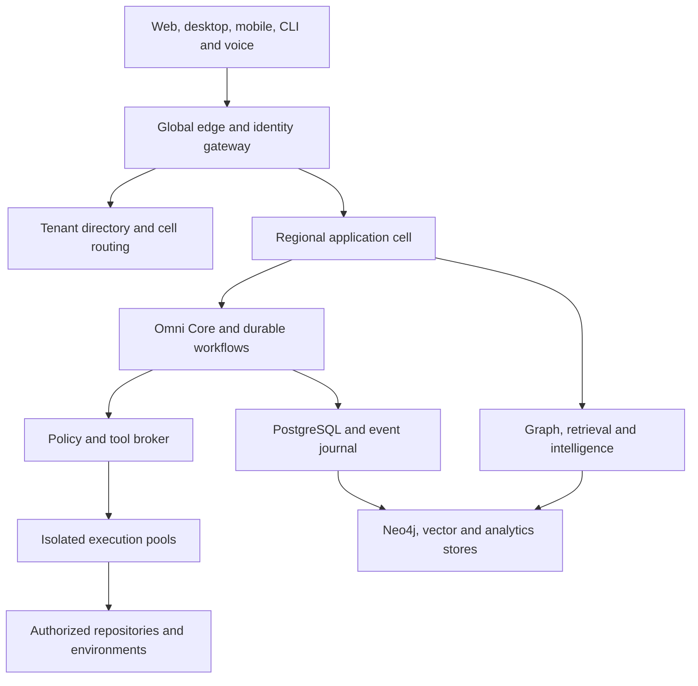
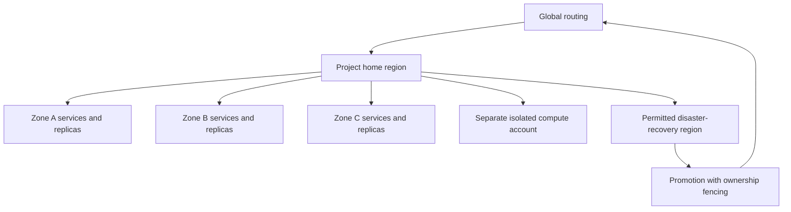
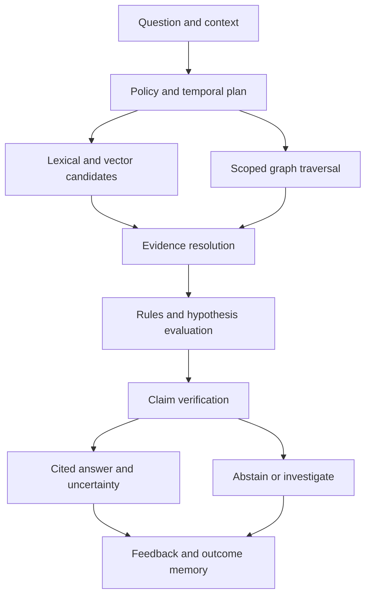
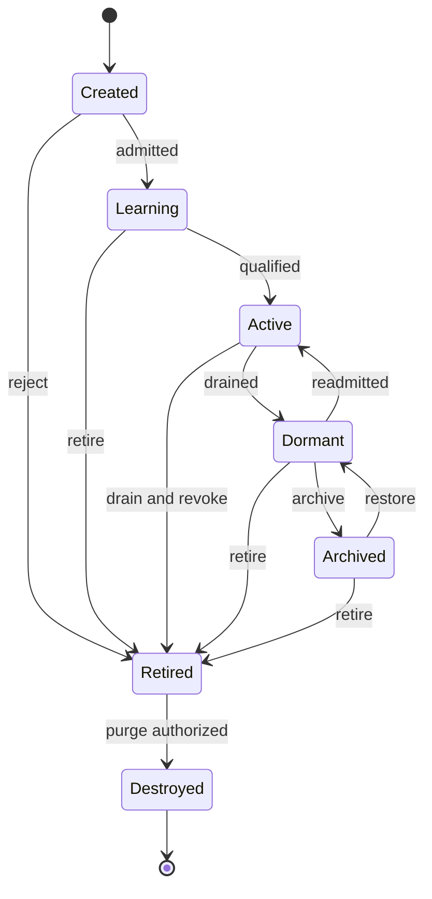

# OMNIDEV SWARM — DEFINITIVE BUILD BIBLE

Prompt 8 • Integrated target architecture • 2026-10-09

Authoritative design consolidation of prompts 1–8. Implementation and production qualification remain separately evidenced. Company perspectives are hypothetical analytical lenses. The complete specifications are incorporated below without shortening. C01–C35 and the handoff contracts take precedence over conflicting earlier design text.

## Reading order

Part I: audits generated before consolidation. Part II: all forty requested outputs. Part III: complete specialized specifications. Part IV: source-anchored hostile reviews. Part V: complete canonical development backlog and contracts.


---

# Final Omniscient Audit — additions before consolidation

“Omniscient” is the requested review name, not a claim of complete knowledge. The following additions challenge the existing design and are mandatory integration decisions for this version. Unknown unknowns remain an ongoing discovery process.

## A01 — Capability certification envelope

**Blind spot:** A platform can look universal while supporting only one language and test command.

**Integrated design:** Publish per connector/language/model/tool supported versions, permitted operations, parser coverage, evaluation cohort and expiry. Unsupported requests become explicit gaps.

**Accountable role:** QA platform lead. **Acceptance:** Reference unsupported cases fail without silent fallback.

## A02 — Evidence trust root

**Blind spot:** A signed report can still be signed by the same compromised worker that created the artifact.

**Integrated design:** Separate workload identity, attestation verification, artifact hashing and evaluation identity. Bind evidence to exact attempt, candidate, image and test manifest.

**Accountable role:** Security lead. **Acceptance:** Forged/stale/mismatched reports cannot authorize effects.

## A03 — Data withdrawal convergence

**Blind spot:** Deleting a source can leave summaries, vectors, caches, backups and model weights carrying it.

**Integrated design:** Use a derivation registry, immediate deny tombstones, bounded purge workflow, subscriber receipts and restore-time deletion replay. Training contracts declare model withdrawal strategy.

**Accountable role:** Data lead. **Acceptance:** Deleted material is denied immediately; purge convergence and restored-copy denial are measured.

## A04 — Control-plane bootstrap recovery

**Blind spot:** Policy, KMS and directory services can become mutually dependent during a total recovery.

**Integrated design:** Maintain independently protected recovery identities, ordered restore runbooks, signed last-known-good manifests and tested key recovery.

**Accountable role:** SRE lead. **Acceptance:** Cold-region restore succeeds without relying on the failed control plane.

## A05 — Evaluator independence and capture

**Blind spot:** Millions of agents can manufacture consensus through cloned reviewers or a poisoned grader.

**Integrated design:** Assign independent role slots; freeze evaluator/dataset versions; measure lineage/provider correlation; keep adversarial challenge sets and human calibration.

**Accountable role:** Research lead. **Acceptance:** Clone votes do not increase effective independence; evaluator tampering is rejected.

## A06 — Human accountability and appeals

**Blind spot:** Autonomous mistakes can leave no person responsible or no correction channel.

**Integrated design:** Every action class has accountable owner, appeal/correction workflow, understandable evidence and reversible authority. Design workforce/privacy impact review.

**Accountable role:** Product lead. **Acceptance:** A user can challenge a finding, stop a run and track resolution without exposing hidden data.

## A07 — Supply-chain build provenance

**Blind spot:** Package scripts and mutable images can subvert perfectly reviewed source.

**Integrated design:** Pin build inputs, attest builder and materials, quarantine imports, isolate approved mirrors and verify provenance before release.

**Accountable role:** Security lead. **Acceptance:** Poisoned image/package/attestation fails admission.

## A08 — Support and incident access

**Blind spot:** Enterprise isolation can be bypassed by support tooling and telemetry.

**Integrated design:** Use just-in-time scoped support sessions with owner authorization where required, dual review for sensitive access and redacted observability.

**Accountable role:** Enterprise lead. **Acceptance:** Support access is denied without valid ticket/scope and appears in audit.

## A09 — Independent economy and demand model

**Blind spot:** ARR targets can hide free-user inference, failed-run costs, working capital and consumption workload.

**Integrated design:** Link paid execution units to actual workload, include quality-adjusted successful-task margin, customer acquisition capacity, cash collection and liabilities.

**Accountable role:** Finance lead. **Acceptance:** Overage workload raises costs; cash and earned revenue reconcile separately.

## A10 — Competitive outcome benchmark

**Blind spot:** Feature count does not show a reason to switch from established tools.

**Integrated design:** Measure time to validated repair, recurrence, audit preparation, context reconstruction and total cost on matched workflows.

**Accountable role:** Founder. **Acceptance:** A paid pilot demonstrates incremental value beyond an existing coding agent.

## A11 — Blast-radius containment of learning

**Blind spot:** A popular but incorrect lesson can propagate globally faster than it is corrected.

**Integrated design:** Limit lesson rollout by scope and rate, track affected releases, quarantine disputed knowledge and propagate signed withdrawal.

**Accountable role:** Evolution lead. **Acceptance:** Poisoned lesson cannot reach every tenant before detection; rollback is demonstrated.

## A12 — Cross-cell budget conservation

**Blind spot:** Parent and child workflows in separate regions can reserve the same remaining spend.

**Integrated design:** Keep a root reservation authority; transfer signed allocations with durable debit before credit and reconcile uncertain handoff.

**Accountable role:** Runtime lead. **Acceptance:** Network partition cannot multiply available funds or release unresolved liability.

## A13 — Residency-local placement authority

**Blind spot:** A global quorum can violate residency or block independent regional operation.

**Integrated design:** Separate global non-content locator from per-residency ownership authority. Transfer across boundaries only under explicit policy with fencing.

**Accountable role:** Infrastructure lead. **Acceptance:** Loss of another residency domain does not grant or revoke local authority incorrectly.

## A14 — Disconnected and local mode contract

**Blind spot:** Offline enterprise or desktop features can imply stale privileged authority.

**Integrated design:** Declare read-only cached mode by default; scoped expiring offline grants and local budgets are opt-in; reconcile conflicts on reconnect.

**Accountable role:** Enterprise lead. **Acceptance:** Expired/offline credentials cannot authorize cloud effects.

## A15 — Licensed content and export feasibility

**Blind spot:** 3D/CAD datasets, proprietary sources and market feeds may forbid the proposed processing.

**Integrated design:** Registry for code/model/dataset/content/tool licenses and permitted inference/training/export. Unsupported licensed runtime stays unavailable.

**Accountable role:** Compliance lead. **Acceptance:** Artifact export and training check rights independently.

## A16 — Long-lived compatibility and ownership succession

**Blind spot:** Decades of jobs can outlive vendors, signatures and maintainers.

**Integrated design:** Contract deprecation windows, migration replay, cryptographic inventory, portable exports, key rotation and successor stewardship.

**Accountable role:** Architecture lead. **Acceptance:** Historical releases can be reconstructed and verified after provider replacement.

## A17 — Customer concentration and provider collapse

**Blind spot:** One model, cloud, customer or marketplace publisher can dominate economics and uptime.

**Integrated design:** Measure concentration; maintain tested alternatives, cash stress scenarios, model outage routing and export pathways.

**Accountable role:** CEO. **Acceptance:** Loss of largest provider/customer has a bounded documented response.

## A18 — Experiment interference and causal claims

**Blind spot:** Concurrent repairs and business experiments confound apparent improvements.

**Integrated design:** Track assignment units, simultaneous interventions, treatment provenance, holdouts and outcomes; suspend causal claims when interference is unresolved.

**Accountable role:** Research lead. **Acceptance:** Revenue/latency attribution reports known confounders.

## A19 — Operational readiness of the company

**Blind spot:** A technical platform still fails without support, procurement, contracts and escalation coverage.

**Integrated design:** Create trust center, customer onboarding/offboarding, vendor assessment, insurance/procurement review, incident communications and support staffing.

**Accountable role:** Operations lead. **Acceptance:** A real pilot rehearses escalation, export, billing dispute and incident notification.

## A20 — Option-based future readiness

**Blind spot:** No design is future-proof against AGI or paradigm shifts.

**Integrated design:** Fund reversible options with invalidation triggers; test model/tool/compiler/schema replacement instead of predicting inevitable dominance.

**Accountable role:** Strategy lead. **Acceptance:** Each future scenario maps to a reversible experiment and stop rule.


---

# Final Super Audit — eleven company lenses

These are hypothetical engineering perspectives based on the requested lenses. They are not statements, endorsements or private knowledge from these companies. Product facts require current primary documentation; the improvements below are OmniDev design judgments.

## Microsoft

**Lens:** Enterprise identity and lifecycle.

**Likely criticism to test:** The product cannot sell enterprise trust while relying only on an owner-private gateway.

**Improvement integrated:** Separate organization identity, SCIM lifecycle, entitlement, project ABAC and provider grants; add support access governance and compatibility commitments.

**Different build emphasis:** Build a cohesive enterprise administration plane and audited private marketplace.

**Integration references:** A06,A08,A14,A19.

## Google

**Lens:** Measured distributed systems and research discipline.

**Likely criticism to test:** Scale arithmetic and model confidence are not workload benchmarks or calibrated science.

**Improvement integrated:** Use per-residency cells, workload-shaped capacity tests, error budgets, dataset lineage and independent challenge evaluations.

**Different build emphasis:** Build reproducible evaluation and fleet placement before global growth claims.

**Integration references:** A01,A05,A13,A18.

## Amazon

**Lens:** Operational ownership and unit economics.

**Likely criticism to test:** Too many logical services can outstrip a small team; every uncertain effect becomes an operational burden.

**Improvement integrated:** Start a modular monolith with explicit service ownership, reserved budgets, reconciliation queues and tested restore runbooks.

**Different build emphasis:** Build runbooks and chargeback along with features; split services by demonstrated bottleneck.

**Integration references:** A04,A09,A12,A19.

## OpenAI

**Lens:** Capability evaluation and safe tool use.

**Likely criticism to test:** Provider identity is not inference consent; self-reported agent success does not prove reliability.

**Improvement integrated:** Version model capabilities, typed tool contracts, independent outcomes, current authorization and prompt-injection tests.

**Different build emphasis:** Build a model-independent evidence and tool-execution plane with measured fallback quality.

**Integration references:** A01,A02,A05.

## Anthropic

**Lens:** Constrained agency and feedback quality.

**Likely criticism to test:** Recursive agents and constitutional language can obscure actual privilege boundaries and noisy preference signals.

**Improvement integrated:** Make deterministic policy external to model output, distinguish satisfaction from accuracy, constrain autonomous scope and evaluate instruction/data separation.

**Different build emphasis:** Build inspectable plans, task-specific evaluation and explicit permission intersections.

**Integration references:** A05,A06,A11.

## NVIDIA

**Lens:** Heterogeneous compute efficiency.

**Likely criticism to test:** An all-cloud CPU assumption fails for 3D, inference and training with licensed/GPU dependencies.

**Improvement integrated:** Separate GPU/render/training queues, image and driver compatibility, utilization budgets, model memory envelopes and artifact validation.

**Different build emphasis:** Build reproducible heterogeneous compute classes with cost and scheduling telemetry.

**Integration references:** A01,A07,A15.

## Palantir

**Lens:** Ontology-to-action traceability.

**Likely criticism to test:** A graph of files is not a governed operational model with accountable business decisions.

**Improvement integrated:** Link objects to actions, decisions, business invariants, current permissions and source evidence; make human correction and operational lineage first-class.

**Different build emphasis:** Build governed operational workflows and decision evidence rather than a decorative graph.

**Integration references:** A03,A06,A18.

## SpaceX

**Lens:** Systems verification and configuration control.

**Likely criticism to test:** Generic rollback claims are unsafe when state changes are irreversible or operating conditions drift.

**Improvement integrated:** Bind exact configurations, test failure modes, rehearse recovery, classify reversible versus forward-recovery changes and preserve incident learning.

**Different build emphasis:** Build hardware-style configuration discipline for software release manifests and fault testing.

**Integration references:** A02,A04,A07,A16.

## Anduril

**Lens:** Degraded operation and decisive accountability.

**Likely criticism to test:** Real-time control fails if global dependencies or unclear incident authority block response.

**Improvement integrated:** Use scoped local authority, offline-mode limits, incident command, reserved emergency capacity and stale-data visibility.

**Different build emphasis:** Build resilience under disconnection without granting uncontrolled autonomy.

**Integration references:** A04,A06,A13,A14.

## GitHub

**Lens:** Repository-native delivery and developer confidence.

**Likely criticism to test:** A new dashboard that creates code without branch/test/review evidence loses to existing workflows.

**Improvement integrated:** Honor branch protections, exact base/candidate digests, draft PR handoff, independent tests, provenance and provider-side receipt reconciliation.

**Different build emphasis:** Build reviewable changes directly into the customer workflow before expanding surfaces.

**Integration references:** A02,A07,A10.

## Cloudflare

**Lens:** Edge routing with bounded regional authority.

**Likely criticism to test:** Edge distribution alone does not provide global transactional correctness or tenant isolation.

**Improvement integrated:** Keep edge/BFF composition separate from home-cell writes, fail closed on stale epochs, protect egress and expose degraded panels.

**Different build emphasis:** Build fast scoped reads with explicit origin/authority and blast-radius control.

**Integration references:** A03,A08,A13.


---

# Contradiction detection and normative resolutions

All 35 identified conflicts have design resolutions. Runtime completion remains separate.

## C01 — Infinite nesting versus finite execution

**Compared sources:** Founder vision; production/AgentOS limits.

**Binding resolution:** Schema extensibility is unlimited; runtime fanout, depth, time and spend are bounded.

**Runtime gate:** RUN-02; remains open until acceptance evidence.

## C02 — Never forget versus deletion and consent

**Compared sources:** Knowledge/evolution memory.

**Binding resolution:** Retain permitted history; immediate access denial and tracked purge/withdrawal override retention aspirations.

**Runtime gate:** DATA-02; remains open until acceptance evidence.

## C03 — Global knowledge versus private tenant strategy

**Compared sources:** Knowledge/evolution propagation.

**Binding resolution:** Private data stays scoped; global patterns require rights and privacy-reviewed consent or public/licensed evidence.

**Runtime gate:** AUD-03; remains open until acceptance evidence.

## C04 — Server E2EE versus server-side reasoning

**Compared sources:** Production security; experience.

**Binding resolution:** Provide distinct local/client E2EE and server-assisted modes with truthful plaintext boundaries.

**Runtime gate:** SEC-02; remains open until acceptance evidence.

## C05 — Identity sign-in versus model entitlement

**Compared sources:** Account-first requirement; providers.ts.

**Binding resolution:** Provider-supported identity/resource/model grants are distinct; no fake universal Google inference grant.

**Runtime gate:** AUTH-02; remains open until acceptance evidence.

## C06 — Multi-cloud HA versus single writer

**Compared sources:** Production regional design.

**Binding resolution:** One authority per aggregate; per-residency quorum grants fenced epochs; uncertain writes stop.

**Runtime gate:** AUD-13; remains open until acceptance evidence.

## C07 — Consensus versus independent correctness

**Compared sources:** AgentOS debate; evolution.

**Binding resolution:** Votes are assigned role slots, not clone counts; independent outcomes and policy veto govern.

**Runtime gate:** AUD-05; remains open until acceptance evidence.

## C08 — Autonomous evolution versus immutable governance

**Compared sources:** Evolution Omega.

**Binding resolution:** Agents may improve scoped capabilities, not rewrite constitutional policy or expand grants.

**Runtime gate:** AUD-11; remains open until acceptance evidence.

## C09 — Snapshot repair versus production self-healing

**Compared sources:** Current code; production healing.

**Binding resolution:** Snapshot maintenance remains labeled; production healing requires target telemetry, grants, tests and health receipts.

**Runtime gate:** OPS-02; remains open until acceptance evidence.

## C10 — Catalog connector versus functioning integration

**Compared sources:** Catalog; universal connectivity.

**Binding resolution:** Capability envelope reports versioned authorized operations and actual evidence.

**Runtime gate:** AUD-01; remains open until acceptance evidence.

## C11 — Graph everything versus browser complexity

**Compared sources:** Knowledge; experience.

**Binding resolution:** Use partitioned bounded queries, summaries and accessible neighborhoods, not all-node rendering.

**Runtime gate:** GRAPH-01; remains open until acceptance evidence.

## C12 — Twin descriptor versus real-time simulation

**Compared sources:** Production twins; current scenarios.

**Binding resolution:** Declare fidelity/calibration and unsupported questions; descriptor alone is not a calibrated twin.

**Runtime gate:** TWIN-01; remains open until acceptance evidence.

## C13 — Version number versus calendar year

**Compared sources:** Strategy; future engine.

**Binding resolution:** Version gates and year horizons are separate axes; no automatic V10 at year10.

**Runtime gate:** FUT-01; remains open until acceptance evidence.

## C14 — Agent lifecycle versus activity states

**Compared sources:** Original prompt; AgentOS.

**Binding resolution:** Durable lifecycle plus concurrent activity overlays; flattened status compatibility mapping explicit.

**Runtime gate:** RUN-02; remains open until acceptance evidence.

## C15 — Reference SQL versus deployed database

**Compared sources:** Production/knowledge contracts; db/schema.ts.

**Binding resolution:** Reference contracts are design; D1 remains current until tested single-writer migration.

**Runtime gate:** DATA-01; remains open until acceptance evidence.

## C16 — Microservices versus minimum team

**Compared sources:** Production service catalog; MVP team.

**Binding resolution:** Logical contracts can co-deploy in a modular monolith; separate execution/isolation immediately and split by evidence.

**Runtime gate:** OPS-04; remains open until acceptance evidence.

## C17 — Trust inheritance versus clone expertise

**Compared sources:** AgentOS; genetics.

**Binding resolution:** Copy validated modules, never credentials, trust, grants, consent or vote eligibility.

**Runtime gate:** AUD-05; remains open until acceptance evidence.

## C18 — Successful checks versus proved product

**Compared sources:** Validation reports; runtime evidence.

**Binding resolution:** Keep design/reference, stubbed route, live integration, isolation and production outcomes as separate evidence classes.

**Runtime gate:** QA-01; remains open until acceptance evidence.

## C19 — Every interaction improves versus noisy learning

**Compared sources:** Evolution mission; engineering reality.

**Binding resolution:** Each authorized interaction may yield evidence; promotion requires regression/harm evaluation.

**Runtime gate:** AUD-11; remains open until acceptance evidence.

## C20 — Always rollback versus irreversible writes

**Compared sources:** Development/twin/healing.

**Binding resolution:** Require forward recovery and explicit irreversible-state handling where rollback cannot restore safety.

**Runtime gate:** OPS-03; remains open until acceptance evidence.

## C21 — Open marketplace versus security economics

**Compared sources:** Launch strategy; marketplace architecture.

**Binding resolution:** Ship curated/private evaluated packs first; open supply after review/revocation/settlement costs are viable.

**Runtime gate:** AUD-21; remains open until acceptance evidence.

## C22 — Overage revenue versus unchanged workload

**Compared sources:** Strategy model original.

**Binding resolution:** Link consumption to explicit additional paid jobs and apply model/worker costs to total workload; preserve old forecast version.

**Runtime gate:** AUD-09; remains open until acceptance evidence.

## C23 — Account plan versus double-billed API usage

**Compared sources:** Provider access; pricing.

**Binding resolution:** Display actual model billing path and charge only authorized separate platform resources; no silent fallback.

**Runtime gate:** AUD-22; remains open until acceptance evidence.

## C24 — Immutable source versus new target baseline

**Compared sources:** Candidate/delivery.

**Binding resolution:** Bind review/test to exact digests; stale target requires regeneration and renewed evidence.

**Runtime gate:** DEV-02; remains open until acceptance evidence.

## C25 — Canceled job versus already dispatched effect

**Compared sources:** Workflow; provider effects.

**Binding resolution:** Cancel future authority and reconcile receipts/compensations; never claim all effects undone.

**Runtime gate:** RUN-03; remains open until acceptance evidence.

## C26 — Evolution routes versus /v1 public API

**Compared sources:** Evolution shorthand; production API.

**Binding resolution:** All public resources use /v1; unprefixed examples are shorthand only.

**Runtime gate:** AUD-23; remains open until acceptance evidence.

## C27 — Global quorum versus residency autonomy

**Compared sources:** Production placement.

**Binding resolution:** Non-content global locator separate from per-residency write authority.

**Runtime gate:** AUD-13; remains open until acceptance evidence.

## C28 — Declared no increase in heuristics versus behavioral correctness

**Compared sources:** lib/runtime-contract.ts.

**Binding resolution:** Static heuristic checks do not satisfy application tests; evidence requirements vary by action class.

**Runtime gate:** QA-02; remains open until acceptance evidence.

## C29 — Financial target customers versus measured acquisition

**Compared sources:** Strategy model.

**Binding resolution:** End-customer targets define an illustrative scenario; independent funnel/capacity forecast must validate demand.

**Runtime gate:** AUD-09; remains open until acceptance evidence.

## C30 — Future-proof and uncopyable versus uncertainty

**Compared sources:** Moat/future requirements.

**Binding resolution:** Build tested replacement options and earned evidence moats; no guarantee against copying or paradigm change.

**Runtime gate:** AUD-20; remains open until acceptance evidence.

## C31 — Learning qualification versus Active-only activity contract

**Compared sources:** Agent lifecycle prose/diagram/JSON.

**Binding resolution:** The default learning pattern uses an Active independent evaluator on a Learning candidate that cannot claim production tasks. Specialized Learning execution is allowed only through a separately versioned training/evaluation grant and task-class registry. Generate lifecycle table/diagram/API from the same transition registry.

**Runtime gate:** AUD-23; remains open until acceptance evidence.

## C32 — Global publication policy versus weak propagation helper

**Compared sources:** Knowledge/Evolution reference canPropagate.

**Binding resolution:** Reference helper is illustrative, not production authorization. Require signed publication receipt, current object access, destination scope/purpose, withdrawal generation and receiving-side admission even within one tenant.

**Runtime gate:** AUD-03; remains open until acceptance evidence.

## C33 — Nonfinancial credits versus spending authority

**Compared sources:** AgentOS/evolution economy.

**Binding resolution:** Credits advise allocation priority within already authorized/reserved money; they cannot create, enlarge or transfer monetary entitlement or permission.

**Runtime gate:** AUD-12; remains open until acceptance evidence.

## C34 — Inconsistent assertion modality enums

**Compared sources:** Knowledge/Evolution answer and fact schemas.

**Binding resolution:** Separate epistemic modality, evidence environment and admission state. Versioned legacy adapters preserve original labels and synthetic provenance; recorded_decision is presentation sourced from a decision record.

**Runtime gate:** AUD-23; remains open until acceptance evidence.

## C35 — Forecast job usage versus production monetary allowance

**Compared sources:** Strategy pricing/model; billing design.

**Binding resolution:** Expected monthly jobs are utilization hypotheses; production entitlements use immutable quantity/money tariffs with explicit provider billing path, overage consent and reserved ceilings.

**Runtime gate:** AUD-22; remains open until acceptance evidence.


---

# Detailed gap report

Gaps are classified by design, contract, implementation, integration or verification. The accompanying hostile review dossiers provide source-level findings beyond this cross-domain register. All listed runtime tasks remain open.

| Gap | Existing foundation | Remaining gap | Required proof | Task |
|---|---|---|---|---|
| A01 Capability certification envelope | Relevant target design exists; implementation maturity varies | A platform can look universal while supporting only one language and test command. | Reference unsupported cases fail without silent fallback. | AUD-01 |
| A02 Evidence trust root | Relevant target design exists; implementation maturity varies | A signed report can still be signed by the same compromised worker that created the artifact. | Forged/stale/mismatched reports cannot authorize effects. | AUD-02 |
| A03 Data withdrawal convergence | Relevant target design exists; implementation maturity varies | Deleting a source can leave summaries, vectors, caches, backups and model weights carrying it. | Deleted material is denied immediately; purge convergence and restored-copy denial are measured. | AUD-03 |
| A04 Control-plane bootstrap recovery | Relevant target design exists; implementation maturity varies | Policy, KMS and directory services can become mutually dependent during a total recovery. | Cold-region restore succeeds without relying on the failed control plane. | AUD-04 |
| A05 Evaluator independence and capture | Relevant target design exists; implementation maturity varies | Millions of agents can manufacture consensus through cloned reviewers or a poisoned grader. | Clone votes do not increase effective independence; evaluator tampering is rejected. | AUD-05 |
| A06 Human accountability and appeals | Relevant target design exists; implementation maturity varies | Autonomous mistakes can leave no person responsible or no correction channel. | A user can challenge a finding, stop a run and track resolution without exposing hidden data. | AUD-06 |
| A07 Supply-chain build provenance | Relevant target design exists; implementation maturity varies | Package scripts and mutable images can subvert perfectly reviewed source. | Poisoned image/package/attestation fails admission. | AUD-07 |
| A08 Support and incident access | Relevant target design exists; implementation maturity varies | Enterprise isolation can be bypassed by support tooling and telemetry. | Support access is denied without valid ticket/scope and appears in audit. | AUD-08 |
| A09 Independent economy and demand model | Relevant target design exists; implementation maturity varies | ARR targets can hide free-user inference, failed-run costs, working capital and consumption workload. | Overage workload raises costs; cash and earned revenue reconcile separately. | AUD-09 |
| A10 Competitive outcome benchmark | Relevant target design exists; implementation maturity varies | Feature count does not show a reason to switch from established tools. | A paid pilot demonstrates incremental value beyond an existing coding agent. | AUD-10 |
| A11 Blast-radius containment of learning | Relevant target design exists; implementation maturity varies | A popular but incorrect lesson can propagate globally faster than it is corrected. | Poisoned lesson cannot reach every tenant before detection; rollback is demonstrated. | AUD-11 |
| A12 Cross-cell budget conservation | Relevant target design exists; implementation maturity varies | Parent and child workflows in separate regions can reserve the same remaining spend. | Network partition cannot multiply available funds or release unresolved liability. | AUD-12 |
| A13 Residency-local placement authority | Relevant target design exists; implementation maturity varies | A global quorum can violate residency or block independent regional operation. | Loss of another residency domain does not grant or revoke local authority incorrectly. | AUD-13 |
| A14 Disconnected and local mode contract | Relevant target design exists; implementation maturity varies | Offline enterprise or desktop features can imply stale privileged authority. | Expired/offline credentials cannot authorize cloud effects. | AUD-14 |
| A15 Licensed content and export feasibility | Relevant target design exists; implementation maturity varies | 3D/CAD datasets, proprietary sources and market feeds may forbid the proposed processing. | Artifact export and training check rights independently. | AUD-15 |
| A16 Long-lived compatibility and ownership succession | Relevant target design exists; implementation maturity varies | Decades of jobs can outlive vendors, signatures and maintainers. | Historical releases can be reconstructed and verified after provider replacement. | AUD-16 |
| A17 Customer concentration and provider collapse | Relevant target design exists; implementation maturity varies | One model, cloud, customer or marketplace publisher can dominate economics and uptime. | Loss of largest provider/customer has a bounded documented response. | AUD-17 |
| A18 Experiment interference and causal claims | Relevant target design exists; implementation maturity varies | Concurrent repairs and business experiments confound apparent improvements. | Revenue/latency attribution reports known confounders. | AUD-18 |
| A19 Operational readiness of the company | Relevant target design exists; implementation maturity varies | A technical platform still fails without support, procurement, contracts and escalation coverage. | A real pilot rehearses escalation, export, billing dispute and incident notification. | AUD-19 |
| A20 Option-based future readiness | Relevant target design exists; implementation maturity varies | No design is future-proof against AGI or paradigm shifts. | Each future scenario maps to a reversible experiment and stop rule. | AUD-20 |

## Core operational gap inventory

| System | Current evidence | Missing production proof |
|---|---|---|
| Model-account execution | Fixed-origin API adapters; primary account-first UI | Approved supported no-key inference and usage authorization |
| GitHub delivery | OAuth/import/draft-PR source and stubbed boundary tests | Live owner consent, target read-back and revocation |
| Worker | Portable fixed-command Docker runner; argument tests | Actual isolated execution, attestation, cleanup and supervision |
| Agent organization | 47 definitions; bounded root/two-review workflow | Durable evaluated specialists, exact evidence and quota conservation |
| Knowledge/memory | Snapshot heuristic graph and D1 records | Semantic extractors, authorized hybrid retrieval, temporal/withdrawal guarantees |
| Healing/twins | Snapshot README/integrity repair; illustrative scenarios | Runtime telemetry, calibrated staging, permitted deployment and observed recovery |
| UI | Built owner-private console; static design atlas | Real critical-journey browser/mobile/assistive testing and correction flows |
| Enterprise/global | Target cell/identity/security architecture | App-level tenancy, support controls, load/failover/restore evidence |
| Business | Editable corrected scenarios and pricing hypotheses | Paid demand, contribution, capacity/acquisition and cash collection evidence |
| Marketplace/evolution | Design contracts/reference guards | Real independent evaluation, release control, quality supply and settlement |

No missing department is solved by assigning a name alone. Security, SRE, finance, research/evaluation, support/enterprise operations, experience and product accountability must be staffed or explicitly assigned for the launch scope. Some roles can share a person in an MVP; independence-sensitive approval cannot be self-review.


---

# Audit method, coverage and precedence

## Reviewed source

The pre-review inventory captures the seven design packages' repository equivalents, canonical unfinished work, implementation/status files and selected code/contracts. Prompt 1's vision is also preserved in the user requirements and domain/integration inventories. Reviewers read the consolidated specialized packages and relevant source chapters; source-level checks focused on execution/evidence/admission, provider boundaries, storage and worker behavior. This is an architectural/contract/code audit, not an exhaustive penetration test or proof that every source path has run.

The full appendices incorporate the original detailed production, knowledge, AgentOS, experience, execution and evolution specifications. The execution model is corrected with a preserved v1 archive. The pre-review hash manifest describes the starting state; post-review files intentionally differ. Do not use the old hashes as the release manifest for corrected artifacts.

## Ten-phase review mapping

| Phase | Audit deliverable | Integration result |
|---|---|---|
| Global review | Gap register, twenty additions and three review dossiers | Added capability envelope, evidence trust root, support, withdrawal, recovery and company operations |
| Contradiction detection | C01–C35 decisions | Normative precedence resolves unlimited/finite, memory/deletion, consensus/evidence, billing/workload and authority conflicts |
| Red team | Security, enterprise, infrastructure, scaling, competitor, investor, research and founder lenses | Runtime release blockers and independent acceptance gates |
| Missing moat | Chapter 28 and business dossier | Rights-based useful evidence and trusted outcomes; no uncopyable-feature claim |
| Supreme swarm | Chapters 5/9/11/34 and agent dossier | Lifecycle/activity mapping, bounded spawning, independent votes, budget conservation |
| Knowledge review | Chapters 6/7/12/35 | Scoped provenance, poisoning containment, withdrawal and temporal/current-rights enforcement |
| Business review | Chapters 19–28 and corrected model | Overage workload costs, target-demand caveats, pilot value and operating gates |
| Future reality | Chapters 24/32/33 | Replaceable capabilities, crypto agility, disconnected modes and reversible options |
| Civilization review | Chapter 34 and evolution appendix | Governance, bounded economics, knowledge rights and measured coordination |
| Unknown unknowns | Twenty additions and chapter 35 | Ongoing discovery/assumption register rather than a claim of exhaustive foresight |

## Authority rules

This integrated Bible supersedes conflicting target statements in prior packages through C01–C35 and the engineering handoff. It does not rewrite user authorization, grant unavailable access or override actual implementation evidence. Historical checkpoints retain their dates and scope. The source packages' baseline hashes are historical, not the current release HEAD.

Priority among design sources: user-approved scope/constraints → final explicit resolutions → detailed source specifications → illustrative examples. If a new unresolved conflict appears, record a new ADR and task instead of silently guessing. Failed or inconclusive evaluation stays in evidence. A task closes only when its defined implementation/integration/verification gate is met.

## Research boundary

Official GitHub, NIST, EDPB, W3C and European Commission sources were inspected for targeted design facts. This run did not perform complete fresh research on every product at all eleven companies. Their review lenses are hypothetical engineering judgments and do not imply endorsement or private company opinion. Detailed dependency licensing, procurement, provider account eligibility and jurisdiction-specific legal conclusions remain qualified implementation work.


---

# Engineering handoff and implementation contracts

## Normative invariants

1. Private state has a tenant/project owner and current-access enforcement at every data boundary.
2. Consequential effects have one owner, immutable intent, current capability, reserved resources, exact evidence and reconciliation.
3. Historical facts, inferred claims, simulations and forecasts are different assertion types.
4. Agent creation and model confidence cannot grant permission or credit.
5. Code/build/test/review receipts bind immutable digests and current attempt authority.
6. Derived views may lag and disclose their generation; they cannot authorize a stale release.
7. Source withdrawal immediately blocks use even while physical purge converges.
8. Experiments and learning are bounded; candidate-controlled code cannot modify policy or graders.
9. Sensitive unknown outcomes remain reconciling; cancellation is not proof of reversal.
10. Product claims are limited by current implementation and real evidence, regardless of specification completeness.

## Workstream contracts

| Workstream | Inputs | Outputs | Mandatory failure behavior |
|---|---|---|---|
| Account/resource authorization | Provider registration, owner consent, selected resources | Versioned connection/grant metadata and protected vault handle | Decline/revoke/expiry stops new use; no fallback identity inference |
| Ingestion | Current grant, source revision, extraction manifest | Immutable snapshot, coverage, journal events | Checkpoint pagination/rate limit; classify denied/stale/incomplete |
| Agent planning | Objective, snapshot, capability envelope, budget | Typed dependency plan and expected artifacts | Unsupported skill becomes gap; no invented execution |
| Execution | Claim/attempt/fence, image, artifact and test manifest | Signed outcome/evidence, resource receipts | Timeout/cancel/resource breach stops work and reports cleanup |
| Review/delivery | Exact candidate and tests, independent roles | Review disposition and draft PR/target intent | Stale source invalidates evidence; unknown provider write reconciles |
| Memory/retrieval | Source claims/rights and current requester | Cited authorized answer and coverage | Filter before expansion and after assembly; revoked source denied |
| Billing | Root reservation, dispatch rate card and receipts | Usage settlement and balanced journal | Unknown liability retained; duplicate receipt cannot double-charge |
| Healing | Telemetry, incident scope and repair policy | Diagnosis, scoped plan, outcome | Missing fresh health or irreversible risk blocks automatic deploy |
| Evolution | Curated evidence, immutable baseline, experiment plan | Scoped capability release or rejected candidate | Harm veto, contamination, rights failure or budget breach blocks promotion |
| Marketplace | Signed artifact, rights and declared capabilities | Pinned tenant installation | Permission expansion requires new grant; revoked digest cannot run |

## Action classes

A snapshot edit is an owner-reviewed draft change to imported text; static/integrity checks may be displayed but are not behavioral approval. A validated change requires relevant application tests and independent evidence on exact source/candidate/test/image digests. Deployment additionally requires target grant, digest-bound review, recovery plan, fresh health baseline and provider read-back. A mutable boolean “tests passed” without binding cannot satisfy these contracts.

## Worker receipt contract

Fields: receipt_id, tenant_id, project_id, run_id, task_id, attempt_id, candidate_digest, source_digest, image_digest, test_manifest_digest, execution_identity, attestation_ref, started_at, completed_at, fence_epoch, cancellation_generation, exit_status, test_results_uri, resource_usage, cleanup_status and signature. The verifier validates identity/attestation/signature outside the worker; an unverified self-assertion is not sufficient. Accept only current leased attempt and matching immutable inputs; duplicates are idempotent, changed payload under the same ID conflicts. Store rejection evidence without overwriting the current result.

## Budget transfer contract

The root reservation owns total approved spend. A cross-cell allocation first creates a durable debit and allocation ID in root authority; only a signed grant for that ID enables child dispatch. An uncertain delivery may be retried with the same ID, not a second allocation. Settlement receipts deduplicate by allocation/operation/provider request. Return unspent balance only after terminal reconciliation. Ledger accounting and resource reservation are separate systems with explicit mappings.

## Data withdrawal contract

States: requested, denied_for_use, enumerating_derivations, purging, verifying, completed or blocked_by_named_obligation. Immediate policy tombstone precedes index purge. Track generation/cell/subscriber receipts, backup restore handling and model-training lineage. Completion reports what was erased, what remains lawfully restricted and why. Define measured convergence SLOs before selling them; immediate deny targets and purge times are not yet achieved.

## Release manifest

A release pins source/candidate, build materials, image, tests, evaluators, policy/grants, target, cost reservation, model/prompt/genome versions and rollback/forward-recovery artifacts. Deployment/failover/research releases use different risk policies but the same provenance discipline. Compatibility checks include API/event/ontology/embedding generations and long-running workflow versions.

## Acceptance evidence format

For each task record requirement ID, exact source revision, test environment, inputs/fixtures, observed outputs, negative cases, artifacts/provider receipts, owner, date and remaining limitations. A fixture test verifies its fixture contract; a live integration verifies its provider path; a fault drill verifies its measured failure envelope. Preserve all three labels. No approval or review waives a critical access, secret, isolation, financial or ownership invariant.

## Ownership and development order

Founder owns value/scope/funding; platform/runtime owns durable execution; security owns policy/isolation/provenance; data owns memory/retrieval/withdrawal; research owns evaluation quality; experience owns consent/accessibility/correction; SRE owns restore/incident/capacity; finance owns usage/accounting; enterprise operations owns contracts/support. A small team may hold multiple roles, but high-risk independent reviews cannot collapse into the candidate author signing their own work.

The first milestone is the authorized behavior-tested draft-PR loop. Next: concurrent orchestration/evidence hardening and scoped data controls. Then: team operations/billing/support, richer intelligence, telemetry-backed healing, tested cells and evaluated ecosystem/evolution. Independent research/contracts continue while live provider/host prerequisites remain unavailable.


---

# Review finding-to-task map

All 49 source-anchored reviewer findings are preserved as open nested work packages in the canonical 156-task backlog. BP-01 has a passed reference-model correction while paid demand and economic validation remain open. No additional competing task ledger is created.

| Finding | Parent engineering task | Source |
|---|---|---|
| AK-01 | AUD-23 | [BUILD-BIBLE/reviews/agents-knowledge.md](reviews/agents-knowledge.md) |
| AK-02 | AUD-03 | [BUILD-BIBLE/reviews/agents-knowledge.md](reviews/agents-knowledge.md) |
| AK-03 | AUD-12 | [BUILD-BIBLE/reviews/agents-knowledge.md](reviews/agents-knowledge.md) |
| AK-04 | AUD-23 | [BUILD-BIBLE/reviews/agents-knowledge.md](reviews/agents-knowledge.md) |
| AK-05 | AUD-12 | [BUILD-BIBLE/reviews/agents-knowledge.md](reviews/agents-knowledge.md) |
| AK-06 | AUD-05 | [BUILD-BIBLE/reviews/agents-knowledge.md](reviews/agents-knowledge.md) |
| AK-07 | QA-03 | [BUILD-BIBLE/reviews/agents-knowledge.md](reviews/agents-knowledge.md) |
| AK-08 | RUN-02 | [BUILD-BIBLE/reviews/agents-knowledge.md](reviews/agents-knowledge.md) |
| AK-09 | AUD-01 | [BUILD-BIBLE/reviews/agents-knowledge.md](reviews/agents-knowledge.md) |
| AK-10 | AUD-01 | [BUILD-BIBLE/reviews/agents-knowledge.md](reviews/agents-knowledge.md) |
| AK-11 | AUD-03 | [BUILD-BIBLE/reviews/agents-knowledge.md](reviews/agents-knowledge.md) |
| AK-12 | AUD-11 | [BUILD-BIBLE/reviews/agents-knowledge.md](reviews/agents-knowledge.md) |
| AK-13 | GRAPH-01 | [BUILD-BIBLE/reviews/agents-knowledge.md](reviews/agents-knowledge.md) |
| AK-14 | SEC-02 | [BUILD-BIBLE/reviews/agents-knowledge.md](reviews/agents-knowledge.md) |
| AK-15 | QA-03 | [BUILD-BIBLE/reviews/agents-knowledge.md](reviews/agents-knowledge.md) |
| AK-16 | DATA-02 | [BUILD-BIBLE/reviews/agents-knowledge.md](reviews/agents-knowledge.md) |
| AK-17 | AUD-02 | [BUILD-BIBLE/reviews/agents-knowledge.md](reviews/agents-knowledge.md) |
| AK-18 | AUD-05 | [BUILD-BIBLE/reviews/agents-knowledge.md](reviews/agents-knowledge.md) |
| AK-19 | AUD-01 | [BUILD-BIBLE/reviews/agents-knowledge.md](reviews/agents-knowledge.md) |
| AK-20 | AUD-27 | [BUILD-BIBLE/reviews/agents-knowledge.md](reviews/agents-knowledge.md) |
| AK-21 | AUD-23 | [BUILD-BIBLE/reviews/agents-knowledge.md](reviews/agents-knowledge.md) |
| AK-22 | FUT-01 | [BUILD-BIBLE/reviews/agents-knowledge.md](reviews/agents-knowledge.md) |
| AK-23 | AUD-20 | [BUILD-BIBLE/reviews/agents-knowledge.md](reviews/agents-knowledge.md) |
| SI-01 | SEC-02 | [BUILD-BIBLE/reviews/security-infrastructure.md](reviews/security-infrastructure.md) |
| SI-02 | AUD-02 | [BUILD-BIBLE/reviews/security-infrastructure.md](reviews/security-infrastructure.md) |
| SI-03 | AUD-24 | [BUILD-BIBLE/reviews/security-infrastructure.md](reviews/security-infrastructure.md) |
| SI-04 | AUD-25 | [BUILD-BIBLE/reviews/security-infrastructure.md](reviews/security-infrastructure.md) |
| SI-05 | AUD-26 | [BUILD-BIBLE/reviews/security-infrastructure.md](reviews/security-infrastructure.md) |
| SI-06 | AUD-13 | [BUILD-BIBLE/reviews/security-infrastructure.md](reviews/security-infrastructure.md) |
| SI-07 | DATA-01 | [BUILD-BIBLE/reviews/security-infrastructure.md](reviews/security-infrastructure.md) |
| SI-08 | AUD-04 | [BUILD-BIBLE/reviews/security-infrastructure.md](reviews/security-infrastructure.md) |
| SI-09 | QA-03 | [BUILD-BIBLE/reviews/security-infrastructure.md](reviews/security-infrastructure.md) |
| SI-10 | AUD-19 | [BUILD-BIBLE/reviews/security-infrastructure.md](reviews/security-infrastructure.md) |
| BP-01 | AUD-09 | [BUILD-BIBLE/reviews/business-product.md](reviews/business-product.md) |
| BP-02 | AUTH-02 | [BUILD-BIBLE/reviews/business-product.md](reviews/business-product.md) |
| BP-03 | AUD-22 | [BUILD-BIBLE/reviews/business-product.md](reviews/business-product.md) |
| BP-04 | AUD-28 | [BUILD-BIBLE/reviews/business-product.md](reviews/business-product.md) |
| BP-05 | AUD-10 | [BUILD-BIBLE/reviews/business-product.md](reviews/business-product.md) |
| BP-06 | UX-01 | [BUILD-BIBLE/reviews/business-product.md](reviews/business-product.md) |
| BP-07 | AUTH-04 | [BUILD-BIBLE/reviews/business-product.md](reviews/business-product.md) |
| BP-08 | SEC-02 | [BUILD-BIBLE/reviews/business-product.md](reviews/business-product.md) |
| BP-09 | AUD-19 | [BUILD-BIBLE/reviews/business-product.md](reviews/business-product.md) |
| BP-10 | AUD-21 | [BUILD-BIBLE/reviews/business-product.md](reviews/business-product.md) |
| BP-11 | UX-01 | [BUILD-BIBLE/reviews/business-product.md](reviews/business-product.md) |
| BP-12 | UX-02 | [BUILD-BIBLE/reviews/business-product.md](reviews/business-product.md) |
| BP-13 | AUD-10 | [BUILD-BIBLE/reviews/business-product.md](reviews/business-product.md) |
| BP-14 | BIZ-02 | [BUILD-BIBLE/reviews/business-product.md](reviews/business-product.md) |
| BP-15 | AUD-19 | [BUILD-BIBLE/reviews/business-product.md](reviews/business-product.md) |
| BP-16 | QA-03 | [BUILD-BIBLE/reviews/business-product.md](reviews/business-product.md) |


# Part II — Forty required outputs


---

# 1. Executive Summary

OmniDev Swarm is an evidence-driven engineering intelligence platform. Its commercial wedge is durable repository understanding plus validated, reviewable changes. Its long-term scope remains cross-domain orchestration, research, simulation and evolution. The current owner-private application is a foundation, not the million-tenant target.

The decisive audit result is conditional: continue building, but do not sell autonomous production repair, universal model-account access, calibrated revenue forecasts or enterprise isolation until their evidence gates pass. Existing 94 route/storage checks used stubbed provider/GitHub HTTP; they cannot certify live authorization, worker isolation or operational outcomes. Architecture checks are a different evidence class.

The Build Bible replaces ambiguity with three records: normative target design, actual implementation evidence and open engineering work. The Final Omniscient Audit adds twenty explicit controls; the Super Audit applies eleven hypothetical company lenses. Eight hostile review roles are represented in the review dossiers. New findings do not disappear because a corresponding paragraph already exists in a design. A specification can resolve a design contradiction while leaving its runtime defect open.

## Incorporated detailed specification

- [PRODUCTION-ARCHITECTURE/18-verification-and-production-gates.md](../PRODUCTION-ARCHITECTURE/18-verification-and-production-gates.md)
- [UNFINISHED-WORK/current-state.md](../UNFINISHED-WORK/current-state.md)


---

# 2. Final Vision Statement

Every authorized project becomes a versioned, understandable ecosystem of source, architecture, operations, decisions and outcomes. Omni Core coordinates specialized agents through AgentOS; humans retain accountable authority, understandable controls and ownership of private data. Software can be analyzed, improved, tested and delivered through bounded workflows with attributable evidence.

“Living intelligence” means continuously maintained models and learning workflows, not consciousness or guaranteed intelligence growth. “Nothing isolated” means entities connect to known owning scope and evidence-backed relationships; missing links are gaps, not invented facts. “Unlimited expansion” means extensible schemas and specialist registration, never infinite runtime or spending.

All original specialist domains and integration families remain in scope. Staging protects the full vision from premature operational commitments: retain future capabilities in the roadmap and backlog while shipping narrow, valuable, verified workflows. Product truth is a differentiator: show what ran, what was only proposed, what is unknown and what requires consent.

## Incorporated detailed specification

- [PRODUCTION-ARCHITECTURE/01-system-and-scale.md](../PRODUCTION-ARCHITECTURE/01-system-and-scale.md)
- [UNFINISHED-WORK/11-specialist-domains.md](../UNFINISHED-WORK/11-specialist-domains.md)


---

# 3. Complete Platform Architecture

Use a modular control plane initially, with logical service contracts that can later split by scale, isolation and ownership. Core domains are identity/workspaces, policy, connections/vault, ingestion, source intelligence, graph/memory/retrieval, AgentOS, model gateway, tool broker, sandbox control, change delivery, findings, healing, twins, research/futures, marketplace, billing, analytics and experience. Each owns its authoritative aggregate; cross-domain updates use APIs and an outbox.

Global edge routes requests to the project home cell. Global services contain non-content placement and public release metadata; tenant-private sources stay in approved residency. A per-residency authority domain grants single-writer epochs. The global locator cannot mint write authority. A scope transfer must fence its predecessor and preserve durable operation identities.

Models generate proposals; deterministic services authorize and enforce. Tasks reference immutable snapshots and capability manifests. Long work is asynchronous, cancellable and budgeted. Derived graph/search/score views may lag and expose watermarks. Intelligence outages should degrade panels without corrupting task authority. Sensitive actions stop when policy, grants, financial authority or ownership becomes uncertain.

## Incorporated detailed specification

- [PRODUCTION-ARCHITECTURE/02-services-and-boundaries.md](../PRODUCTION-ARCHITECTURE/02-services-and-boundaries.md)
- [PRODUCTION-ARCHITECTURE/17-decisions-evolution-and-migration.md](../PRODUCTION-ARCHITECTURE/17-decisions-evolution-and-migration.md)


---

# 4. Complete Infrastructure Architecture

Deploy one bounded region before claiming multi-cloud resilience. Regional cells use multiple zones where sold availability requires it; execution pools are separate from API/control workloads. Hostile repository code needs a reviewed isolation boundary such as disposable microVMs or equivalent attested isolation. Docker on a dedicated host can serve a narrowly evaluated owner-only stage, but is not automatically a public hostile multi-tenant boundary.

Platform primitives are PostgreSQL authority, immutable object storage, Neo4j graph partitions, Qdrant vector generations, Redis transient state, a workflow engine, event journal and regional observability. Managed or self-hosted choices follow measured capacity, recovery, licensing and cost; the target stack is not a mandate to operate every service during MVP.

IaC must pin versions and image digests, separate environment identities and include deny-default egress. Package installation uses reviewed mirrors and isolated builds. Restore bootstrap must not depend circularly on unavailable policy/KMS/directory services. Protect independent recovery credentials and test their use. Cloud portability is a capability and migration contract, not identical behavior across providers.

## Incorporated detailed specification

- [PRODUCTION-ARCHITECTURE/09-cloud-deployment-and-recovery.md](../PRODUCTION-ARCHITECTURE/09-cloud-deployment-and-recovery.md)


---

# 5. Complete AgentOS Design

An agent is an identity, specialization and versioned capability record, distinct from a model and worker. AgentOS owns durable task assignment, lifecycle, communication, memory selectors, trust/health, quotas and evidence. Created/Learning/Active/Dormant/Archived/Retired/Destroyed are durable lifecycle states; Busy/Reviewing/Collaborating are activity overlays. Compatibility APIs may expose flattened status only with an explicit mapping.

Claims use compare-and-swap version, attempt ID, lease token, fencing epoch and cancellation generation. Heartbeats cannot resurrect expired authority. A worker result binds the exact candidate digest, test manifest, source revision, image and attempt. Result acceptance checks current job state and authority in one transaction. The current shared-bearer report interface lacks that full binding and remains a release blocker.

Agent spawning intersects parent, template, target policy and current grant. Skill inheritance transfers tested modules, not credentials, consent, trust or vote eligibility. Drain tasks before retirement/merge. Task priorities incorporate urgency, risk and fair-share scheduling. Retries consume the same root resource reservation; cross-cell allocations debit before credit. Debate slots are independently assigned and cannot multiply through cloning.

## Incorporated detailed specification

- [AGENTOS-ARCHITECTURE/FULL-AGENTOS-ARCHITECTURE.md](../AGENTOS-ARCHITECTURE/FULL-AGENTOS-ARCHITECTURE.md)


---

# 6. Complete Knowledge Graph Design

The universal ontology represents organizations, projects, repositories, files, symbols, services, infrastructure, databases, APIs/events, users/teams/customers, discussions/decisions, designs/3D assets, models, agents, outputs and business objectives. Entity identity combines stable scoped ID with source locators and revision lineage. Facts carry valid and transaction time, evidence, confidence, access policy and assertion type.

PostgreSQL and immutable source journal preserve authoritative claim history; Neo4j materializes queryable partitions. Cross-project traversal occurs only through authorized bounded federation. An owning-scope edge connects incompletely mapped entities; a gap marks unknown relationships. Never conflate similar names across tenants. Evidence-backed entity merges preserve aliases and undo history.

Ontology changes use registered semantic versions, shadow generations, translation views and query regression tests. Graph queries require time cutoff, traversal/path limits, policy filtering and current access recheck. Query counts, hidden neighbors and cache keys must not reveal inaccessible objects. Partial extraction reports coverage and failed parsers rather than an optimistic health score.

## Incorporated detailed specification

- [KNOWLEDGE-ARCHITECTURE/01-intelligence-model.md](../KNOWLEDGE-ARCHITECTURE/01-intelligence-model.md)
- [KNOWLEDGE-ARCHITECTURE/03-time-and-indexing.md](../KNOWLEDGE-ARCHITECTURE/03-time-and-indexing.md)


---

# 7. Complete Memory Design

Session, Agent, Swarm, Project, Organization, Global Pattern, Innovation and Future memory share a typed evidence envelope with explicit scope. Decisions preserve rationale, actor/time, alternatives, risks, expected and actual outcomes and lessons. Research evidence and scenario forecasts are distinct records. Retrieval applies current authorization even to historical data.

Memory consolidation is versioned and reversible. Conflicts remain visible with supporting/contrary evidence. Indefinite retention is a policy aspiration constrained by rights, deletion, residency and cost. Backups are not permission to resurrect deleted source. A withdrawal registry immediately denies use, then purges derivations, vectors, summaries, caches and permitted archives through a tracked convergence workflow.

Global learning uses public/licensed or consented privacy-reviewed patterns. Redaction alone does not establish anonymity. Training manifests track source rights; trained models need an explicit withdrawal response, possibly retirement or retraining. Source deletion cannot be treated as complete merely because a graph node disappeared. Company strategies and private customer behavior remain organization memory unless separately permitted.

## Incorporated detailed specification

- [KNOWLEDGE-ARCHITECTURE/02-memory-and-decisions.md](../KNOWLEDGE-ARCHITECTURE/02-memory-and-decisions.md)
- [EVOLUTION-ARCHITECTURE/04-knowledge-propagation-and-graph-evolution.md](../EVOLUTION-ARCHITECTURE/04-knowledge-propagation-and-graph-evolution.md)


---

# 8. Complete Security Architecture

Separate human identity, organization membership, resource grants, model usage authorization and execution capabilities. Use enterprise federation/MFA where required, service workload identities and per-action RBAC/ABAC. Provider OAuth consent is not a general-purpose AI grant. No consumer browser-session copying or hidden API-key fallback. Secrets stay in vault handles and never enter model context or client read-back.

Enforce tenant context in databases, graph/vector queries, objects, caches, queues, logs, backups and support workflows. Support access uses a ticket, just-in-time scope, expiry and audit; sensitive assistance has owner-controlled approval. Untrusted repositories, tools and agent outputs cannot redefine policy. Parse/archive/package risks are isolated before execution.

Controls include supply-chain provenance, secret/advisory/configuration scanning, egress policy, attested worker identity, signed evidence, least-privilege target adapters and independent review. E2EE is a distinct client/local processing mode; server-assisted plaintext computation is not server-blind encryption. Emergency controls live outside candidate code and revoke new claims while reconciling effects already dispatched.

## Incorporated detailed specification

- [PRODUCTION-ARCHITECTURE/05-security-auth-and-isolation.md](../PRODUCTION-ARCHITECTURE/05-security-auth-and-isolation.md)


---

# 9. Complete Swarm Architecture

Retain the 47 master-domain definitions as a capability taxonomy. Operational swarms group relevant specialists around tasks and projects; hierarchy need not be permanent. Temporary experts, investigations and incident teams use the same scoped lifecycle, knowledge and budget contracts. Dedicated 3D, business and legal domains require actual tools, versions and domain evaluations before claiming capability.

Swarm messages are typed events, requests, assignments, reviews, arguments, decisions and escalations. They reference artifacts and evidence rather than repeatedly broadcasting all private context. Task responsibility remains singular; collaboration does not create multiple unrestricted writers. Routing honors required skills, current evidence, fairness and provider availability.

Consensus is not truth. Independent role slots, correlation measures and policy vetoes replace raw majority of spawned agents. High-risk unresolved disagreement escalates. Trust is domain-specific and evidence-based; internal credits fund bounded exploration without buying authority. Dynamic reorganization shadows routing, drains leases, preserves memory provenance and verifies that no work loses its accountable owner.

## Incorporated detailed specification

- [AGENTOS-ARCHITECTURE/04-communication-and-debate.md](../AGENTOS-ARCHITECTURE/04-communication-and-debate.md)
- [AGENTOS-ARCHITECTURE/05-evolution-economy-and-marketplace.md](../AGENTOS-ARCHITECTURE/05-evolution-economy-and-marketplace.md)


---

# 10. Complete Digital Twin Architecture

A twin descriptor is required for every connected project, but fidelity is explicit: inventory, executable staging, telemetry-calibrated and continuously reconciled. Pin source, configuration, schema/data fixtures, workloads, dependency contracts, images, cost inputs and calibration revision. Show unsupported questions instead of false numeric results.

Baseline and candidate simulations use the same workload/seed where useful, repeated trials, controlled fault injection and immutable measurement manifests. Production endpoints are not silently reused. Database snapshots require lawful minimization/sanitization or synthetic fixtures. Model CPU/GPU, latency/error/integrity/security and cost separately. Revenue effects require customer evidence and causal experiment design.

Calibration tracks error distribution, drift and validity range. Release decisions require the appropriate real behavior tests even if simulations look favorable. A twin is not a substitute for target read-back or live health. Expensive high-fidelity simulations use budgets and admission. Simulation failure, incomplete coverage and stale telemetry are first-class outcomes.

## Incorporated detailed specification

- [PRODUCTION-ARCHITECTURE/11-digital-twins-futures-and-innovation.md](../PRODUCTION-ARCHITECTURE/11-digital-twins-futures-and-innovation.md)


---

# 11. Complete Evolution Architecture

Evolution follows finite cycles: collect authorized observations, curate lessons, propose candidates, sandbox, evaluate independently, approve by policy, canary, measure and promote or roll back. Each interaction may add evidence; improvement is not guaranteed. Genome manifests contain knowledge/reasoning/skill/workflow/decision modules with immutable hashes and acyclic lineage. Credentials/trust/permissions are non-inheritable.

Independent evaluators freeze baselines, datasets, metrics, contamination checks and stopping rules. Candidates cannot edit graders or Omega policy. Promotions enforce absolute safety/privacy constraints, improvement or noninferiority bounds and scope-specific rights. Control learning blast radius through release cohorts, propagation rates and withdrawal subscriptions.

Meta-reasoning evaluates concise rationale, evidence and tool traces, not mandatory private chain-of-thought. Prompt/retrieval/workflow updates are separately versioned from provider weights. Qualified skill growth and validated user outcomes matter more than raw agent/node counts. Pause, simplify or retire capabilities when evidence says that is better.

## Incorporated detailed specification

- [EVOLUTION-ARCHITECTURE/FULL-EVOLUTION-ARCHITECTURE.md](../EVOLUTION-ARCHITECTURE/FULL-EVOLUTION-ARCHITECTURE.md)


---

# 12. Complete Research Architecture

Permanent research swarms maintain approved source universes, freshness, source rights and reproducible dossiers. Prioritize by user need, information gain, urgency, uncertainty and cost. Record primary evidence, vendor claim and inference separately. Publications and popularity do not establish deployability, licensing or superiority.

A dossier includes capability decomposition, standards, implementations/models/datasets, license, hardware, APIs, native alternatives, cost, failure modes, evaluation and architecture placement. Unknown prerequisites remain research tasks. Reproduction occurs in isolated compute with approved materials; proprietary datasets and tools require actual rights.

Research quality is judged by useful verified discoveries and reduced uncertainty. Track contradictory results and negative experiments. A discovery becomes a capability only through typed specification, evaluation and release. Monitor scientific/AI/software/cloud/business changes without granting every newly discovered tool network or production rights.

## Incorporated detailed specification

- [EVOLUTION-ARCHITECTURE/06-research-invention-and-future-exploration.md](../EVOLUTION-ARCHITECTURE/06-research-invention-and-future-exploration.md)
- [KNOWLEDGE-ARCHITECTURE/research-and-decisions.md](../KNOWLEDGE-ARCHITECTURE/research-and-decisions.md)


---

# 13. Complete Innovation Architecture

The invention pipeline is problem evidence → alternatives/prior-art search → hypothesis → feasibility → prototype → experiment → adoption decision → observed outcome. Preserve authorship, rights, search scope, counterevidence and rejected ideas. Claims of novelty remain conditional; qualified review handles patentability and legal ownership.

Maintain core-platform, customer-specific and speculative portfolios with separate budgets. Rank opportunity by problem severity, customer demand, defensible differentiation, technical feasibility, downside and time-to-value. A thousand ideas is not a thousand innovations. Stop duplicate or low-value work and retain lessons.

A native opportunity is an evidence-linked architecture migration or business experiment that ordinary source completion misses. Proposed additions include a knowledge withdrawal radar, change-impact evidence passport, cross-tool decision reconstruction and quality-adjusted repair economics. These are candidate features, not proven unprecedented inventions. Customer testing must establish whether they outperform simpler alternatives.

## Incorporated detailed specification

- [PRODUCTION-ARCHITECTURE/11-digital-twins-futures-and-innovation.md](../PRODUCTION-ARCHITECTURE/11-digital-twins-futures-and-innovation.md)
- [EVOLUTION-ARCHITECTURE/06-research-invention-and-future-exploration.md](../EVOLUTION-ARCHITECTURE/06-research-invention-and-future-exploration.md)


---

# 14. Complete Marketplace Architecture

Marketplace modules include agent templates, connectors, parsers/scanners, isolated tools, UI extensions, evaluators and twin models. Every release is immutable, signed and declares digest, permissions, tool schemas, versions, data destinations, licenses, cost and evaluation. Purchasing a pack does not grant production authority.

Publisher onboarding, provenance/SBOM checks, independent domain evaluation, malware/egress testing, installation consent and monitored execution precede trust. Permission-expanding upgrades require fresh authorization. UI extensions are isolated with typed bridges and no ambient session tokens. Emergency revocation blocks future dispatch and identifies affected outputs.

Start with curated/private packs before an open marketplace. Review costs and quality incentives must fit unit economics. Detect reciprocal ratings, cloned endorsements and contribution gaming. Financial settlement uses separate tax/payment onboarding, refund/chargeback reserves and immutable ledger. Marketplace effects are a future moat only when trusted supply attracts measurable demand.

## Incorporated detailed specification

- [PRODUCTION-ARCHITECTURE/13-plugins-marketplace-and-domain-framework.md](../PRODUCTION-ARCHITECTURE/13-plugins-marketplace-and-domain-framework.md)


---

# 15. Complete API Architecture

REST /v1 owns resource commands; GraphQL composes bounded authorized reads; SSE/WebSockets stream scoped progress; internal service contracts are versioned. SDKs use the same policy as first-party clients. Never expose raw Cypher, arbitrary command shells or unrestricted tool endpoints.

Effectful POSTs require idempotency key and normalized payload hash; updates use expected version/If-Match. Accepted work returns an operation handle, not a success claim. Operation states include dispatched, reconciling, succeeded, failed, compensated and canceled. Provider timeouts remain unknown until receipt/read-back establishes outcome.

Schemas declare sizes, pagination/cursors, errors, model/tool capabilities, access scope and deprecation. AgentOS and evolution endpoints use /v1 consistently; prior unprefixed evolution routes are resource shorthand, not a competing public namespace. Event envelopes include event ID, tenant/project/cell, aggregate version, schema version, trace/causation, policy/epoch and artifact pointer. At-least-once delivery requires deduplication and state-machine checks.

## Incorporated detailed specification

- [PRODUCTION-ARCHITECTURE/07-api-and-sdk.md](../PRODUCTION-ARCHITECTURE/07-api-and-sdk.md)
- [AGENTOS-ARCHITECTURE/08-apis-decisions-and-migration.md](../AGENTOS-ARCHITECTURE/08-apis-decisions-and-migration.md)


---

# 16. Complete Database Design

PostgreSQL owns identity/policy, tasks, operations, budgets, evidence metadata, decisions and financial ledger. Composite tenant keys, service identities and enforced row-level policy prevent cross-tenant references. Connection pooling must reset tenant context safely. Neo4j, vectors, lexical search and analytics are derived projections, not alternate financial/task authorities.

Core aggregates include organization/workspace/project, connection/grant, agent/template/genome, task/attempt/run, operation/receipt, artifact/evaluation, finding, memory/assertion/decision, twin/scenario/forecast, plugin/install, reservation/usage/journal and withdrawal. Every mutation has version and provenance; large payloads live in encrypted content-addressed objects.

No distributed transaction is assumed across PostgreSQL, graph, vectors and external providers. Outbox and reconciliation maintain materialized generations. Migrations use expand/contract, compatibility, checksums and single-writer cutover. Existing D1 generic records are the current implementation, not production PostgreSQL migrations. Complete service schemas are build tasks; reference SQL must be tested on the selected engine before release.

## Incorporated detailed specification

- [PRODUCTION-ARCHITECTURE/16-relational-schema-and-data-lifecycle.md](../PRODUCTION-ARCHITECTURE/16-relational-schema-and-data-lifecycle.md)
- [KNOWLEDGE-ARCHITECTURE/07-contracts-and-delivery.md](../KNOWLEDGE-ARCHITECTURE/07-contracts-and-delivery.md)


---

# 17. Complete UI/UX Architecture

Global navigation groups Command, Projects, Swarms, Intelligence, Operations, Strategy and Administration. The home screen answers what needs attention with prioritized evidence, risks, blockers and recommendations. Progressive disclosure makes novice tasks simple while preserving expert controls and executive views.

The Omni command bar routes reads immediately where permitted; consequential commands become reviewable intent with targets, scope, budget and evidence. Voice produces an editable text transcript. No fake universal-login buttons. Connection states distinguish configured, authorized, discovered, fresh and write-enabled.

Desktop/mobile/CLI/voice share domain states and resumable activity. Graph and swarm views zoom through bounded neighborhoods with accessible tables. Design tokens, components, wireframes and interaction details are retained in the experience appendix. Add disputes/corrections, support access, data export/deletion and cost-liability surfaces. Require keyboard, screen-reader, reduced-motion, zoom, mobile interruption and real backend state testing; visual contrast checks alone do not establish accessibility.

## Incorporated detailed specification

- [EXPERIENCE-DESIGN/FULL-EXPERIENCE-DESIGN.md](../EXPERIENCE-DESIGN/FULL-EXPERIENCE-DESIGN.md)


---

# 18. Complete Dashboard Architecture

Executive, Engineering, Architecture, Security, Research, Innovation, Project Visualization, Realtime Swarm, Operations and Cost dashboards share evidence envelopes. Every metric carries scope, observation time, source/version, coverage, confidence and methodology. Unknown does not become zero or green.

The BFF composes bounded panels with deadlines and partial failure states. Dashboard actions invoke owning APIs with current grants; charts cannot write directly. Stream reconnect resumes from durable cursors with fresh access checks. Score rollups never hide critical vetoes or mix uncalibrated forecasts with observations.

Add an execution truth panel showing proposed agents versus actually dispatched turns, pending receipts, unresolved cost, excluded files/languages and failed parsers. Add release lineage and active-policy view. Executive modes keep operational proof accessible without displaying sensitive source by default. Mobile prioritizes alert review, pause and status; complex diff/graph editing moves to capable surfaces with preserved context.

## Incorporated detailed specification

- [EXPERIENCE-DESIGN/03-home-project-and-repository.md](../EXPERIENCE-DESIGN/03-home-project-and-repository.md)
- [EXPERIENCE-DESIGN/05-specialized-centers.md](../EXPERIENCE-DESIGN/05-specialized-centers.md)


---

# 19. Complete Product Roadmap

Retain ten gated phases: MVP, Beta, Launch, Growth, Scale, Enterprise, Platform, Ecosystem, Market Leader and Digital Civilization. Calendar estimates are subordinate to evidence gates and funding. Scope is not deleted because it ships later.

MVP proves one authorized repository-to-validated-change workflow. Beta adds durable collaboration/memory/search and bounded automation. Launch adds paid team accounts, verified billing and curated integrations. Growth improves retention and operational quality before broad acquisition. Scale introduces tested cells. Enterprise introduces sold identity/residency/DR contracts. Platform/marketplace require reliable contracts and quality supply. Market leadership and civilization are strategic states to earn, not scheduled guarantees.

Year 1 focuses customer value and trustworthy delivery; Year 2 broadens operational intelligence; Year 3 grows enterprise/cells; Year 5 evaluates ecosystem and calibrated twins; Year 10 preserves optionality across models, devices and organizational workflows. Version numbers and years are separate axes. Every roadmap feature maps to a backlog ID, owner role, prerequisite and measurable exit.

## Incorporated detailed specification

- [EXECUTION-STRATEGY/02-ten-phase-master-roadmap.md](../EXECUTION-STRATEGY/02-ten-phase-master-roadmap.md)
- [EXECUTION-STRATEGY/03-first-year-execution-and-technical-horizons.md](../EXECUTION-STRATEGY/03-first-year-execution-and-technical-horizons.md)


---

# 20. MVP Specification

Target customer: a maintainer or small engineering team repeatedly reconstructing repository context and resolving defects with inadequate change evidence. Primary job: connect a selected repository, understand a supported scope, prioritize a real issue, produce a bounded fix with behavior tests and a reviewable draft PR.

Minimum flow: supported account authorization → immutable snapshot → language-aware map/coverage → evidence-linked findings → scoped objective/plan/budget → isolated candidate → independent behavior/security validation → human review → draft PR receipt/read-back → persistent decision/outcome memory. Do not require all 47 swarms, every integration or the entire target database fleet on day one.

MVP release gates: real provider/resource grants; actual isolated worker; exact evidence binding; concurrent admission/idempotency; no critical secret/access flaw; interruption/revocation paths; restore/export; truthful UX; representative supported-language benchmark and customer-observed value. The prior 16–24-week and staffing/cash assumptions remain estimates until these gates and actual team availability are measured. A paid pilot is preferable to a premature public promise.

## Incorporated detailed specification

- [EXECUTION-STRATEGY/01-company-thesis-and-mvp.md](../EXECUTION-STRATEGY/01-company-thesis-and-mvp.md)
- [UNFINISHED-WORK/implementation-order.md](../UNFINISHED-WORK/implementation-order.md)


---

# 21. Version 1 Specification

Version 1 is a supported team product, not merely the MVP demo. Add organization membership, RBAC/ABAC, connection lifecycle, tenant-scoped authority, durable task fairness, protected artifacts, measured supported-language analysis, context retrieval and reviewable multi-file changes. Define a narrow compatibility matrix instead of claiming arbitrary projects.

Operate billing/subscription entitlement, root spend reservation, customer support, incident escalation, backup restoration, deletion, usage reconciliation and consent/account switching. Add engineering/security/project dashboards with accessible critical journeys. Integrate one or two high-value sources proven in customer workflows.

Release requires matched task outcomes, independent application tests, real repository read-back and measured operational envelopes. Standard plans expose explicit quotas and unavailable capabilities. Production deploy remains opt-in to a supported target and policy; draft PR mode is the safe default until target outcome evidence passes. V1 can be sold only after support and operating ownership are real.

## Incorporated detailed specification

- [PRODUCTION-ARCHITECTURE/10-autonomous-development-and-healing.md](../PRODUCTION-ARCHITECTURE/10-autonomous-development-and-healing.md)
- [EXECUTION-STRATEGY/04-product-tiers-and-pricing.md](../EXECUTION-STRATEGY/04-product-tiers-and-pricing.md)


---

# 22. Version 2 Specification

V2 adds repository-native agent collaboration, richer memory/reasoning, multiple supported integrations and telemetry-backed operations. Support child tasks with shared budgets, role-assigned review and persistent disagreement. Expand parsing/data-flow/API mapping through versioned capability envelopes.

Digital twins begin as executable staging models with explicit fidelity. Add incident investigation and narrow preauthorized repair playbooks with canary/rollback or forward-recovery plans. Research/innovation outputs become evidence dossiers and bounded experiments. Private curated packs precede broad marketplace exposure.

V2 release gates include cross-tenant retrieval/cache tests, source withdrawal convergence, stale report rejection, orchestration crash/replay, budget conservation and post-change fault validation. No automatic promotion of model confidence into production authority. Validate whether additional collaboration improves outcomes enough to justify token/review cost.

## Incorporated detailed specification

- [KNOWLEDGE-ARCHITECTURE/04-reasoning-and-retrieval.md](../KNOWLEDGE-ARCHITECTURE/04-reasoning-and-retrieval.md)
- [AGENTOS-ARCHITECTURE/06-incidents-and-command-center.md](../AGENTOS-ARCHITECTURE/06-incidents-and-command-center.md)


---

# 23. Version 5 Specification

V5 targets a tested multi-cell enterprise ecosystem with dedicated modes, calibrated twins, evaluated specialist packs, reliable marketplace and cross-domain project intelligence. Version 5 is not necessarily year 5; release timing depends on prior gates and demand.

Enable selective 3D/AI/business domains through licensed tools and independent domain evaluations. Support research-to-capability releases, consented pattern libraries, prompt/workflow evolution and organizational simulation in bounded experiments. Enterprise controls include identity provisioning, support governance, data handling modes, tested residency/DR and procurement evidence.

Operational gates: single-writer migration/failover, restore with tombstones, cell hot-spot admission, financial settlement, publisher revocation, evaluator poisoning containment and forecast backtests. Cross-cloud support must be proven per chosen combination. Revenue simulations remain scenario-based unless customer experiments validate them. A marketplace or civilization visualization cannot substitute for core task quality.

## Incorporated detailed specification

- [PRODUCTION-ARCHITECTURE/09-cloud-deployment-and-recovery.md](../PRODUCTION-ARCHITECTURE/09-cloud-deployment-and-recovery.md)
- [EVOLUTION-ARCHITECTURE/09-contracts-scaling-and-implementation.md](../EVOLUTION-ARCHITECTURE/09-contracts-scaling-and-implementation.md)


---

# 24. Version 10 Specification

V10 is a long-term adaptive platform with replaceable model/tool/runtime providers, durable decision memory, privacy-safe learning, broad evaluated domain coverage and self-reorganizing coordination under human-governed Omega policy. It supports rich simulations and strategic foresight without presenting distant futures as facts.

The platform can create new experts from detected capability gaps, but each gains operational eligibility through research, tests, grants and budgets. Collective discoveries transfer by provenance and rights; failed patterns withdraw. Agent economics reward verified contribution and diversity without granting constitutional control.

Readiness requires decades-oriented compatibility, cryptographic agility, export, model/data withdrawal, succession, accountable appeals and sustainable unit economics. No claim of AGI, consciousness, inevitability or competitor-proof dominance is needed. The V10 test is whether increasingly broad authorized work remains understandable, reliable, affordable and controllable.

## Incorporated detailed specification

- [EVOLUTION-ARCHITECTURE/08-scores-omega-and-long-term-stewardship.md](../EVOLUTION-ARCHITECTURE/08-scores-omega-and-long-term-stewardship.md)
- [EXECUTION-STRATEGY/09-risks-and-ten-year-blueprint.md](../EXECUTION-STRATEGY/09-risks-and-ten-year-blueprint.md)


---

# 25. Funding Strategy

Funding follows demonstrated risk reduction: bootstrap a narrow prototype, finance customer pilots, seek angel/seed funding on validated value and operating evidence, then raise growth capital for repeatable acquisition and enterprise demand. Series labels are financing options, not mandatory milestones. Independence remains viable only if revenue and cash discipline support it.

Use explicit runway and staffing assumptions, founder contribution, loaded compensation, cloud/model/worker costs, acquisition budget, support obligations and reserve. The financial scenario model is illustrative; target-derived acquisition is not an independently forecast demand engine. Freeze a prior forecast before correction and compare new versions.

Investor materials distinguish pipeline, signed commitments, earned revenue and ARR. Stress provider cost increases, slower adoption, churn, collection delays and concentrated customers. Board gates stop hiring or expansion when retention/quality/cash triggers fail. Raise for the next measurable proof milestone with contingency, not the abstract size of the civilization vision.

## Incorporated detailed specification

- [EXECUTION-STRATEGY/07-team-funding-and-board.md](../EXECUTION-STRATEGY/07-team-funding-and-board.md)
- [EXECUTION-STRATEGY/08-financial-plan.md](../EXECUTION-STRATEGY/08-financial-plan.md)


---

# 26. Scaling Strategy

Start with observed workload distributions. Capacity targets from the production package are planning envelopes, not achieved performance or machine orders. Benchmark hot monorepos, ACL-heavy queries, multimodal assets, provider limits, long tasks and uneven tenant demand. Millions of inactive agent manifests do not require millions of live containers.

Scale independently by source ingestion, graph partition, retrieval generation, worker class and event throughput. Fair-share admission and backpressure protect smaller tenants and incident capacity. Migrate projects under epochs and durable operation IDs; avoid one global all-agent chat or all-node browser rendering.

Validate latency tails, queue age, error rates, cost and restore at realistic load. Add cells before headroom disappears, not after a universal repository count threshold. Region and provider failures require tested degraded operation. Root budget allocations crossing cells use debit-before-credit with reconciliation; a partition cannot create new capacity or spend.

## Incorporated detailed specification

- [PRODUCTION-ARCHITECTURE/01-system-and-scale.md](../PRODUCTION-ARCHITECTURE/01-system-and-scale.md)
- [AGENTOS-ARCHITECTURE/07-scale-resilience-and-company-simulation.md](../AGENTOS-ARCHITECTURE/07-scale-resilience-and-company-simulation.md)


---

# 27. Profitability Strategy

Recommended pricing remains a hypothesis: workspace subscription plus explicit bounded usage, enterprise commitments/dedicated charges and later curated marketplace fees. Agent count is a weak primary meter because logical specialists may be cheap or redundant. Charge for understandable value and costly resources without hiding retries or uncertain receipts.

Consumption revenue must map to incremental paid workload and corresponding model/worker/support costs. Included jobs, overage jobs, successful tasks and failed/retried tasks are separate quantities. Customer-paid eligible model plans are not silently rebilled as provider API consumption. Gross margin must include attributable infrastructure/support and free-tier cost.

Measure contribution per retained workspace and validated outcome, CAC/payback, churn, expansion, support burden, concentration and cash collection. Stop unprofitable research/automation loops through reservations and value evaluation. Do not reduce safety checks to improve margin. Enterprise pricing must cover delivery/security/DR/support commitments; marketplace revenue must net refunds, publisher payouts and review costs.

## Incorporated detailed specification

- [EXECUTION-STRATEGY/04-product-tiers-and-pricing.md](../EXECUTION-STRATEGY/04-product-tiers-and-pricing.md)
- [PRODUCTION-ARCHITECTURE/14-cost-metering-billing-and-analytics.md](../PRODUCTION-ARCHITECTURE/14-cost-metering-billing-and-analytics.md)


## Corrected economic scenario

The v2 model now derives incremental overage workload from an explicit illustrative USD 1.50 per equivalent job and charges model/runtime cost on included plus overage jobs. This is an internal planning assumption, not a provider quote or accepted customer price. Base additional funding to the stated cash reserve rises to USD 5,290,966; Downside USD 7,488,533; Upside USD 4,026,014. ARR stays unchanged because consumption is excluded from recurring subscription ARR. Base annual operating cash becomes positive in year 5 rather than year 4. Original v1 inputs/results are retained as superseded history in the strategy package. Demand targets, collection timing and sales capacity still need independent validation.


---

# 28. Competitive Moat Analysis

Competitors can copy ideas and many interfaces. Fractal names, dashboards and a knowledge graph alone are not a defensible moat. Defensibility must be earned through customer-authorized longitudinal decision/outcome data, useful context reconstruction, dependable change evidence, trusted operational integration and measurable quality/cost advantages.

Data/knowledge moats require rights and actual coverage; learning effects require demonstrated generalization without privacy leakage. Agent effects require validated specialization, not raw population. Marketplace/network effects need active quality suppliers and customers; enterprise effects arise from proven governance and workflow adoption. Research effects need reproducible novel capabilities. Civilization effects are coordination hypotheses to test.

Customer export and interoperability should remain strong; lock-in through withheld data is not the strategy. Benchmark against existing coding workflows, including repository-native agents. Potential native differentiators include an evidence passport per change, decision-to-defect reconstruction and withdrawal-aware learning. Validate willingness to pay and switching value before declaring uniqueness.

## Incorporated detailed specification

- [EXECUTION-STRATEGY/05-market-competition-and-moats.md](../EXECUTION-STRATEGY/05-market-competition-and-moats.md)


---

# 29. Risk Analysis

Maintain a risk register with owner, cause, likelihood/uncertainty, impact, affected scope, mitigations, detection, residual risk and review date. Highest current delivery risks are live authorization availability, actual worker isolation, unsupported languages/tasks, absent production telemetry, financial reservation concurrency and customer-value evidence.

Strategic risks include platform-vendor bundling, declining model differentiation, excessive scope, customer/provider concentration, weak retention, long enterprise procurement, research cost and financing. Technical risks include correlated models, poisoning, stale projections, split brain, unknown external effects and migration errors. Organizational risks include no accountable incident/support owner and key-person dependence.

Mitigations are assigned work and tests, not reassurance. Insurance, contracts, jurisdiction and sector-specific controls need qualified owners when relevant. Every risk accepted for a pilot has scope, expiry and a user-visible limit. Do not represent these review dossiers as penetration testing or a regulatory attestation.

## Incorporated detailed specification

- [EXECUTION-STRATEGY/09-risks-and-ten-year-blueprint.md](../EXECUTION-STRATEGY/09-risks-and-ten-year-blueprint.md)
- [PRODUCTION-ARCHITECTURE/18-verification-and-production-gates.md](../PRODUCTION-ARCHITECTURE/18-verification-and-production-gates.md)


---

# 30. Security Analysis

Threat actors include malicious tenants, compromised providers/plugins/build inputs, external attackers, poisoned repository/document content, careless users and overprivileged support. Assets are source/secrets, capabilities, policy, evidence, financial state, customer targets and model/training material. Trust boundaries include browser/BFF, control/data planes, worker sandbox, provider, support and global learning.

Attack scenarios test prompt injection becoming a tool action, stale worker receipt authorizing a changed candidate, shared credential abuse, graph/vector count leakage, archive/path escape, image poisoning, duplicate external writes and forged consensus. Prevent through typed boundaries, least privilege, exact evidence, current authority, isolation and independent evaluation.

Runtime gaps remain open until verified. Missing behavior evidence may be acceptable for an explicitly owner-reviewed snapshot edit but must never satisfy a validated-code or production-release policy. Represent action classes distinctly so applying a draft snapshot is not confused with deploy authorization. A critical trust-boundary defect blocks expanded audience.

## Incorporated detailed specification

- [BUILD-BIBLE/reviews/security-infrastructure.md](reviews/security-infrastructure.md)
- [PRODUCTION-ARCHITECTURE/05-security-auth-and-isolation.md](../PRODUCTION-ARCHITECTURE/05-security-auth-and-isolation.md)


---

# 31. Compliance Analysis

Create an applicability register rather than asserting every framework applies. Each deployment records jurisdiction, controller/processor responsibilities, source categories, industry, external actions, AI role and customer obligations. Qualified owners map requirements to controls/evidence and refresh effective dates. SOC 2/ISO evidence readiness is not certification; HIPAA/PCI/government claims require the appropriate actual scope and agreements.

Privacy controls cover purpose/rights, data minimization, tenant consent, retention/deletion, export/access, subprocessors, residency and incident handling. Model/embedding anonymity is not assumed. Training and export rights are separate from ingestion rights. Marketplace publisher/content licenses and customer contractual promises are operational prerequisites.

Accessibility uses WCAG 2.2 AA as the engineering target with human critical-journey testing, while legal duties depend on deployment. AI regulatory classification and timelines must be refreshed from current official sources; do not freeze an old blanket deadline into an agent rule. This document establishes review and evidence architecture, not legal advice or a compliance conclusion.

## Incorporated detailed specification

- [PRODUCTION-ARCHITECTURE/05-security-auth-and-isolation.md](../PRODUCTION-ARCHITECTURE/05-security-auth-and-isolation.md)
- [UNFINISHED-WORK/06-security-and-verification.md](../UNFINISHED-WORK/06-security-and-verification.md)


---

# 32. Future Readiness Analysis

Future-proof is not a guarantee. Use scenario-specific adaptation contracts. If highly capable models become common, value shifts to authorized context, evidence, tool reliability, governance and actual outcomes. If programming changes to specifications/generated artifacts, model those requirements, tests, compilers and decisions as graph entities rather than only source functions.

If new providers/platforms appear, register capabilities and evaluate portability behind stable contracts. If quantum threats change security requirements, maintain a crypto inventory, algorithm agility, key/signature migration and staged interoperability tests using reviewed standards; do not invent cryptography. If enterprise requirements tighten, policy and residency modes evolve through versioned migrations.

Funding futures is a portfolio of reversible experiments with leading indicators and stop triggers. Reevaluate assumptions on actual market/technology change. Record horizon, source cutoff, uncertainty and resolution criteria. Avoid speculative deadlines for AGI or quantum arrival and do not promise one architecture survives every paradigm unchanged.

## Incorporated detailed specification

- [EVOLUTION-ARCHITECTURE/06-research-invention-and-future-exploration.md](../EVOLUTION-ARCHITECTURE/06-research-invention-and-future-exploration.md)
- [EVOLUTION-ARCHITECTURE/08-scores-omega-and-long-term-stewardship.md](../EVOLUTION-ARCHITECTURE/08-scores-omega-and-long-term-stewardship.md)


---

# 33. Global Deployment Strategy

The owner-private Site remains the current deployment. Target expansion starts with a home region selected by customer residency, a measured zone architecture and a contracted recovery destination. Global edge contains routing and public metadata only; per-residency authority domains control writes. Regional failover must fence old dispatch and preserve grant, reservation and receipt history.

Dedicated enterprise and disconnected modes declare independent identity/ownership/budget assumptions. Cached offline reads are the default; expiring offline actions require explicit policy and cannot silently authorize cloud effects. Cross-cloud recovery is tested per chosen services, storage formats, identity and key systems.

Use progressive rollout by environment/cell/cohort, immutable artifacts, signed manifests, support ownership and rollback/forward recovery. Region selection and supplier contracts require real procurement/authorization. No new cloud expenditure or account registration is established by this blueprint. Vercel remains optional; the earlier denied sandbox experiment is neither a dependency nor an operating worker.

## Incorporated detailed specification

- [PRODUCTION-ARCHITECTURE/09-cloud-deployment-and-recovery.md](../PRODUCTION-ARCHITECTURE/09-cloud-deployment-and-recovery.md)
- [UNFINISHED-WORK/decisions.md](../UNFINISHED-WORK/decisions.md)


---

# 34. Civilization-Level Intelligence Strategy

Model the swarm as a governed coordination system: specialized populations, shared permitted knowledge, internal resource economics, research portfolios, leadership/accountability and collaboration. Simulation helps compare structures under scarcity, delay, correlated failures and incentive gaming. It does not establish consciousness or grant control of a real organization.

Knowledge/discovery/expertise spread through signed, scoped releases with provenance, applicability and withdrawal. Innovation arises from problem evidence, diverse hypotheses, independent tests and adoption. Economies allocate finite resources; trust is nontransferable authority evidence, and credits cannot purchase permissions.

Scale through hierarchical summaries, federated project/cell knowledge and bounded tasks. Guard against collusion, reviewer monopolies, faction formation, shared-provider failures and runaway spawning. Preserve correction/appeal, minority dissent and a single accountable owner per consequential action. Human-governed Omega policy sits outside evolution and simulation code.

## Incorporated detailed specification

- [EVOLUTION-ARCHITECTURE/07-organization-and-civilization-simulation.md](../EVOLUTION-ARCHITECTURE/07-organization-and-civilization-simulation.md)


---

# 35. Unknown Unknowns Report

No finite audit enumerates all unknown unknowns. Establish a discovery mechanism: incident postmortems, independent challengers, customer interviews, source changes, canary anomalies, external security reports and periodic assumption reviews. Newly discovered risks enter a stable backlog with owner and evidence.

Blind spots identified in this audit include support-plane leakage, evaluator capture, knowledge-poison propagation, deletion in trained models, resurrection through backups, control-plane recovery circularity, cross-cell spend duplication, licensed-tool export constraints, experiment interference, free-tier economics and customer/provider concentration. The twenty additions document their resolutions and acceptance.

Potential opportunities are evidence portability across tools, reconstruction of decision causes, counterfactual tests for missing controls, safe migration rehearsal and permission-aware knowledge withdrawal. Treat these as candidate product/research tracks. Check simpler alternatives and demand. Maintain an exploration budget that cannot starve reliability or expose private data.

## Incorporated detailed specification

- [BUILD-BIBLE/00-FINAL-OMNISCIENT-AUDIT.md](00-FINAL-OMNISCIENT-AUDIT.md)
- [BUILD-BIBLE/01-FINAL-SUPER-AUDIT.md](01-FINAL-SUPER-AUDIT.md)


---

# 36. Missing Systems Report

The full gap register and hostile review dossiers distinguish absent design, incomplete contract, incomplete implementation, missing integration and missing verification. Existing catalog entries do not establish connector support; swarm names do not establish specialists; scenario templates do not establish calibrated twins.

P0 gaps are live authorized model/repository workflow, a real isolated worker, exact evidence/report binding, trustworthy concurrent orchestration, access/vault review, real behavior validation, restore/deletion and customer-critical journey verification. P1 gaps include enterprise tenancy, semantic intelligence, current telemetry/target adapters, financial controls, independent evaluators and support governance. P2 covers evaluated domain expansion, curated marketplace, research/innovation/evolution and multimodal clients.

Design resolutions are integrated here, while implementation stays open in UNFINISHED-WORK. Each discovered addition maps to one new or existing task. Scope reductions require a recorded decision; no required capability is silently dropped to make the platform appear finished.

## Incorporated detailed specification

- [UNFINISHED-WORK/backlog.json](../UNFINISHED-WORK/backlog.json)
- [BUILD-BIBLE/additions.json](additions.json)


---

# 37. Improvement Recommendations

Build in dependency order: prove the account/repository/worker loop; harden task/evidence/control authority; add scoped intelligence and withdrawal; operate support/billing/recovery; then expand collaboration, telemetry-backed changes, domain packs and learning. Independently develop contracts and research while external account/host prerequisites are pending.

Avoid premature microservice sprawl and universal claims. Use logical modules first, separating risky/expensive execution immediately. Establish one supported-language envelope and prove outcomes before broadening. Replace raw scores with coverage and evidence. Link every paid usage assumption to workload cost. Keep the customer workflow close to repository review, rather than requiring an entirely new dashboard habit.

Measure improvements through failure-path tests and observed customer outcomes. Carry forward dissent and negative experiments. The final release decision names owner, current policy, artifact, evidence and residual limitations. Do not count architecture/arithmetic/link checks as production acceptance tests.

## Incorporated detailed specification

- [BUILD-BIBLE/reviews/agents-knowledge.md](reviews/agents-knowledge.md)
- [BUILD-BIBLE/reviews/business-product.md](reviews/business-product.md)


---

# 38. Final Build Bible

This is the normative integration layer for prompts 1–8. Precedence is: user-approved requirements and permissions; this Bible’s explicit resolution decisions; specialized specifications incorporated in the appendices; historical status/decisions. Actual implementation evidence controls capability claims regardless of document precedence.

All original detailed technical/design/strategy content is incorporated below as full-text appendices, not shortened summaries. Corrections here supersede the named conflicting assumptions. JSON/contracts and executable reference checks remain companion artifacts. Public/API/database manifests still need concrete implementation verification before deployment.

Engineering handoff requires a task’s inputs/outputs, domain contract, policy/grants, data/evidence path, state transitions, failure handling, tests, operational owner and cost envelope. Reviews use exact revisions. Change any normative invariant only through a new ADR with evidence, migration and acceptance. This package is authoritative target design as of its source checkpoint, not a claim of omniscient completeness forever.

## Incorporated detailed specification

- [PRODUCTION-ARCHITECTURE/FULL-ARCHITECTURE.md](../PRODUCTION-ARCHITECTURE/FULL-ARCHITECTURE.md)
- [BUILD-BIBLE/contradictions.json](contradictions.json)


---

# 39. Complete Development Task Backlog

UNFINISHED-WORK/backlog.json remains the single canonical implementation ledger. The existing 126 tasks are preserved with stable IDs and full work/acceptance/dependency details. Audit-discovered tasks extend that ledger; they do not replace it with a competing list. A complete rendered task appendix is included in the Bible.

Each task records owner role, current evidence, required work, dependencies and acceptance. Authorization/procurement prerequisites are visible separately from engineering. No task is marked complete on the basis of a document. Dependencies are checked for missing IDs and cycles. Representative domain tasks retain their specialized deliverables and shared runtime/connector/evaluation prerequisites.

Implementation order prioritizes blocking safety and real value, then operational/enterprise foundations, then ecosystem scale. GitHub copy remains a later owner-requested destination action; the Sites source checkpoint is preserved now. Do not create an arbitrary public repository or activate paid infrastructure as part of this design audit.

## Incorporated detailed specification

- [UNFINISHED-WORK/implementation-order.md](../UNFINISHED-WORK/implementation-order.md)
- [UNFINISHED-WORK/backlog.json](../UNFINISHED-WORK/backlog.json)


---

# 40. Final Verdict

PROCEED WITH GATED EXECUTION. The integrated architecture is coherent enough to drive engineering, but production readiness is not established. Existing implementation is an owner-private bounded prototype with useful persistent workflows and test evidence, not the completed autonomous engineering civilization.

Approved design direction: repository-first value, scoped AgentOS, evidence/provenance authority, independent validation, privacy-safe memory, regional single-writer control, bounded evolution and customer-owned data. Rejected assumptions: infinite compute, consensus as truth, universal sign-in as model entitlement, forecast precision without calibration, generic rollback, anonymous training by default and uncopyable feature-based moats.

The final audit is complete for the artifacts and requirements reviewed at this checkpoint. Runtime defects, live account/host prerequisites and untested enterprise/evolution capabilities remain open with acceptance gates. The next engineering milestone is a real authorized repository → isolated behavior-tested candidate → reviewed draft PR loop, followed by measured customer value. The full vision remains in the roadmap without misleading claims of completion.

## Incorporated detailed specification

- [UNFINISHED-WORK/current-state.md](../UNFINISHED-WORK/current-state.md)
- [BUILD-BIBLE/validation-report.md](validation-report.md)


# Part III — Complete incorporated specifications

These appendices preserve the detailed specifications. Their named conflicts are superseded by the final resolution register above. Historic baseline revisions and illustrative assumptions retain their original scope.


---

## Complete source: PRODUCTION-ARCHITECTURE/FULL-ARCHITECTURE.md

# OmniDev Swarm — complete production architecture

Target architecture and implementation specifications. Design completion does not mean production deployment or measured scale qualification. See README for reference contracts and the canonical unfinished-work register.

# System architecture and scale envelope

## Architecture decision

OmniDev is a cell-based distributed platform with globally routed experience services, regional control/data planes, and independently isolated execution pools. Omni Core is a logical orchestration authority implemented by partitioned services and durable workflows; it is never one global process or one master model call. Tenant routing, policy, durable state and execution fencing are infrastructure responsibilities, not decisions delegated to an LLM.

A workspace belongs to an organization. An organization has a residency boundary and home region. A project belongs to a workspace and is placed in a cell. A cell owns its project writes, workflows, connection handles and materialized intelligence. Large organizations can span multiple cells within their residency policy. Enterprise dedicated cells use the same protocols with separate network, keys and storage.



Global services contain routing, public marketplace metadata, product releases and aggregated operational health. They do not hold private repository content. Global outages must not prevent already authenticated in-region projects from performing permitted reads; sensitive writes require a valid region authority epoch and current policy.

## Design envelope: targets to validate, not achieved capacity

| Dimension | Global planning target | Placement / admission rule |
|---|---:|---|
| Registered users | 10 million | Identity directory and regional profiles; no global user-content join |
| Concurrent interactive users | 1 million | Edge connections distributed to regional BFF/realtime fleets |
| Connected repositories | 10 million | Project-home routing; hot repositories receive dedicated placement |
| Graph nodes / edges | 5 billion / 20 billion | Multiple project-local graph partitions per cell |
| Indexed semantic chunks | 10 billion active | Versioned vector partitions; cold source remains in object storage |
| Concurrent agent turns | 100,000 | Weighted admission by organization, cell, provider and compute pool |
| Concurrent sandbox jobs | 20,000 | CPU/GPU/image/licensing quotas; queue surplus work |
| Sustained business events | 100,000/second | Cell topics and partitioned aggregates; source bodies in objects |
| Business-event burst | 500,000/second for 15 minutes | Absorb queue backlog; prioritize incidents and committed delivery |
| Production footprint | Initial 3 regions, grow by cells | Three zones per region; separate permitted DR destination |

Initial expansion model: 100 cells at maturity. Average per cell: 100,000 repositories, 50 million nodes, 200 million edges, 100 million vectors, 10,000 interactive connections, 1,000 concurrent agent turns, 200 sandboxes and 1,000 sustained business events/second. These averages are placement inputs, not safe per-database limits. Start a cell substantially below its measured envelope and split before its hottest resource exhausts headroom. Graph/vector partitions inside a cell scale independently.

Hot-key admission is governed by project/repository/provider quotas. One huge monorepo or incident cannot consume the whole cell. Long-tail cold repositories retain immutable snapshots and metadata without continuously active compute. Full rescans are paced; incremental commit/path changes are preferred. Tenant placement uses weighted estimates of graph size, vector size, scan velocity, query heat and sandbox use, with migrations under an ownership epoch.

## Capacity model

Twenty billion edges at a planning assumption of 160 bytes per logical edge imply 3.2 TB before indexes, database overhead and replication. Budget 3–8 times that logical size for the first sizing experiment: 9.6–25.6 TB per complete logical copy, then account separately for replica and backup policies. Five billion nodes at 400 bytes imply 2 TB before overhead. Measure actual Neo4j store/index characteristics on the chosen schema; do not order machines from these estimates.

Ten billion vectors at 1,536 float32 dimensions imply 61.44 TB of raw dense vector values. An exploratory 8-bit representation implies 15.36 TB of vector values before indexes/payload/replication; accuracy must pass retrieval evaluation before selecting quantization. Tier active content, deduplicate within authorization scope, and price embedding refresh explicitly.

At 1 KB/event, 100,000 events/second produces 8.64 TB/day of uncompressed business envelopes. Seven-day hot retention is 60.48 TB logical; three replicas are 181.44 TB before compression and broker overhead. Use an object archive and shorter topic-specific retention where justified. Telemetry is a separate pipeline and must not multiply this journal with per-token events.

Sandbox planning example: 20,000 jobs × 2 vCPU × 40% average CPU use = 16,000 effective vCPU consumption; reserve 40,000 vCPU if every admitted job can use its limit simultaneously. GPU/render classes have distinct reservations and licensing. Provider inference quotas are independent of local compute. Idle agents are records/workflows, not permanently running containers.

## Reliability targets

| Surface | Target SLO / objective |
|---|---|
| Authenticated metadata API | 99.95% monthly availability; p95 <300 ms in home region excluding external provider work |
| Realtime accepted-state delivery | 99.9%; p95 <2 seconds after authoritative commit |
| Durable task acceptance | 99.95%; no acknowledged task lost during a zone failure |
| Interactive retrieval | p95 <1.5 seconds at defined query limits; show projection watermark |
| New commits to intelligence | p95 <5 minutes for a reference 100K-file repository delta; separate full-scan SLA |
| Security / budget enforcement | Fail closed for uncertain authority, missing grant or exhausted reservation |
| Zone failure | RPO 0 for acknowledged PostgreSQL primary/quorum operations; RTO <5 minutes target |
| Regional disaster | Standard async tier RPO ≤5 minutes / RTO ≤60 minutes; zero-RPO tier requires proven synchronous commit receipt and higher latency |

SLOs exclude tenant-disabled sources but include truthful unavailable status. Composite workflow latency depends on provider/model, repository size and approvals; do not promise a universal completion time. Prove these targets with workload suites, failure injection and recovery drills before selling guarantees.

## Invariants

1. All private operations carry tenant, workspace/project, identity and residency context derived by the server.
2. A durable aggregate has one writable home and monotonically increasing authority epoch.
3. Models propose actions; policy and capability enforcement authorize them.
4. Every external side effect has an operation ID, intent, execution receipt and reconciliation path.
5. Derived projections can lag; approved releases bind immutable snapshots and evidence versions.
6. Agent expansion never bypasses ancestor grants, deadlines or financial reservations.
7. Global pattern intelligence never consumes private cross-tenant content without explicit permission and a reviewed privacy pipeline.
8. A deployment result, test result, forecast and model proposal are different typed facts.


# Microservices, ownership and process boundaries

Services below are logical contracts. Deploy together where throughput and isolation allow; split process boundaries when independent scaling, residency, blast radius or operating ownership demands it. Each service owns its schema and migrations. Shared PostgreSQL infrastructure does not grant cross-service table access. Cross-service writes use APIs or committed events, not direct database mutation.

| Service | Authoritative responsibilities | Storage / contract |
|---|---|---|
| Identity & session | Human identity mapping, sessions, federation, device grants, MFA context | Regional PostgreSQL; OIDC/SAML/SCIM adapters |
| Organization & workspace | Membership, project ownership, environment classification, residency | PostgreSQL; workspace events |
| Tenant directory | Home cell, routing epoch, migration state, signed placement records | Strongly consistent routing database; locally cached signed reads |
| Policy & capability | RBAC/ABAC, action grants, approvals, delegation, revocation epoch | PostgreSQL policy revisions; decision API |
| Connections & vault | Provider registrations, scopes, account/resource mapping, token refresh | Encrypted handles; KMS/vault integration |
| Ingestion coordinator | Webhook validation, scan manifests, checkpoints, connector jobs | PostgreSQL and Kafka; immutable object references |
| Source intelligence | Parsers, dependency/data-flow/API/infrastructure extraction | Sandboxed analyzers; extraction artifacts |
| Graph writer | Canonical entity resolution, edge provenance, projection version | Neo4j partitions; source journal in objects/events |
| Graph query | Authorized bounded graph traversals and projections | Neo4j read replicas; policy-aware query planner |
| Memory | Typed assertions, decisions, provenance, scope, correction/retention | PostgreSQL metadata, objects, retrieval indexes |
| Semantic retrieval | Embeddings, hybrid retrieval, reranking, ACL filtering, citations | Qdrant and lexical index; versioned model registry |
| Omni Core planner | Task decomposition, specialist selection, conflict policy and progress | Durable workflow definitions; planner proposal artifacts |
| Workflow scheduler | Durable state machines, timers, retries, task queues and fairness | Temporal cluster with separate persistence schemas |
| Agent registry & runtime | Agent identities/templates, lineage, turns, health and evaluation | PostgreSQL agent/task aggregates; Redis presence |
| Model gateway | Supported account inference, routing, quotas, timeouts, usage receipts | Provider adapters; no generalized consumer-session scraping |
| Tool broker | Capability validation, target binding, side-effect receipts | PostgreSQL operation ledger; scoped connector executors |
| Sandbox control | Attested placement, images, CPU/GPU quotas, isolation and cleanup | Ephemeral execution pools; PostgreSQL durable manifests |
| Development delivery | Patch/commit baselines, CI evidence, reviewed branches/PRs | PostgreSQL change sets; object artifacts; repository adapters |
| Findings & gaps | Rules, triage, remediation hypotheses, coverage and deduplication | PostgreSQL findings; graph/rule evaluation artifacts |
| Security intelligence | Scanners, advisories, secrets, threat signals and supply-chain facts | Approved feeds; encrypted artifacts; scoped scanner jobs |
| Twin simulation | Twin manifests, scenario execution, calibration and impact intervals | Objects, compute workflows, timeseries/results metadata |
| Reliability & healing | Incidents, diagnosis, repair policy, rollout/health gates and learning | Incident aggregates and durable workflows |
| Future & innovation | Horizons, research, opportunity experiments and evaluations | Versioned hypotheses; evidence bundles |
| Scores & executive views | Methodology versions, coverage/confidence and score snapshots | PostgreSQL snapshots; analytical rollups |
| Realtime gateway | WebSocket subscriptions, resume cursors, presence, status fanout | Redis transient streams/cache; durable resume from event archive |
| Experience BFF | Client-specific view models, navigation and authorization-aware composition | Short-lived private caches; no source of truth |
| Marketplace & plugins | Signed releases, compatibility, installation policy, reviews, payouts | PostgreSQL registry; signed object artifacts |
| Metering & billing | Reservations, immutable usage, rate cards, ledger, invoices/reconciliation | Separate PostgreSQL financial schemas; analytical exports |
| Analytics | Product events, cohort/usage statistics, privacy-safe reporting | ClickHouse and object lake; curated cross-tenant aggregates |
| Observability | Operational metrics, logs, traces, alert routing and SLOs | VictoriaMetrics-compatible TSDB, object/log index, trace backend |
| Audit & evidence | Append-only security/operation/evaluation facts, legal hold, signatures | PostgreSQL pointers; WORM-capable object archive |
| Notification | In-app/device/email/provider notifications with explicit preferences | Delivery ledger, templates and message queues |

## Dependency discipline

A command request should synchronously cross at most gateway → owning service → policy/reservation, then commit and return an operation handle. Long inference, extraction, graph rebuild, rendering and scanning are asynchronous. Read composition uses bounded BFF fanout with deadlines and degraded per-panel states; never synchronously join every store.

Identity, policy, financial reservation and operation intent are required for sensitive writes. Graph, vector, scores and analytics can be unavailable without taking down the core task journal. If policy authority is unavailable, new privileged actions stop; running read-only jobs may use unexpired bounded capabilities where permitted. If billing reservation authority is unavailable, no new billable dispatch occurs; workers checkpoint existing reserved work.

Service schemas are defined under immutable versioned migration paths. Database credentials are service-specific and cannot own or bypass row-security policies. Privileged migration jobs are a separate identity. PostgreSQL transactions never pretend to commit Neo4j, Qdrant and a provider API atomically; committed outbox events drive projections and side effects.

## Ownership and SRE responsibilities

Identity/policy/vault and financial ledger require dedicated review ownership. Execution services own sandbox breakouts and job correctness. Intelligence services own provenance, coverage, retrieval leakage and graph freshness. Experience services own accessibility and consent UX. Platform SRE owns cell capacity, routing epochs, backups and recovery. Security signs releases with material permission/isolation changes. Billing owns reconciliation and corrections, never silently rewrites historical usage.

An incident has one operational commander, an evidence timeline and an explicit severity. Emergency agent creation does not grant break-glass rights; those require independently logged human authorization with scope and expiry.


# Agent operating system, Omni Core and fractal swarms

## Agent identity and persisted contract

Each agent is a logical principal, not a process. Identity is `{tenant_id, agent_id, template_digest, parent_agent_id, root_run_id, authority_epoch}`. Additional fields: specialization, goal/objectives, immutable context snapshot, task queue reference, working-memory handle, scoped long-term memory selectors, communication subscriptions, tool grants, model policy, cost reservation, deadline, evaluation rubric, health state and retirement policy.

A swarm is a scoped collaboration aggregate with members, parent swarm, objective, project graph snapshot, policy, supervisor and budget. Root departments include Security, Backend, Frontend, DevOps, Cloud, Database, Architecture, Testing, Documentation, Research, AI, 3D, Game Development, Business Intelligence, Revenue, Innovation and Future Prediction. The 47 detailed domains from the existing catalog specialize these departments. All share the same security/task protocol; domain prompts and tools are versioned separately.

No fixed schema depth constrains parent/child hierarchy. Execution still requires available budget and a spawn grant. Depth-sensitive operations use iterative traversal/path indexes, not application stack recursion. Huge subtrees are paginated. Per-root cumulative limits survive spawn/retry; splitting into new agents cannot reset quotas. Long-running improvement loops start new workflow generations with parent lineage and retained budget policy.

## Agent lifecycle

`defined → admitted → ready → leased → executing → checkpointed → reviewing → completed/failed/canceled → retired`.

A suspended agent has no active compute lease. A retired identity remains in the evidence ledger, with credentials revoked and memory retention governed by policy. Health distinguishes no work, waiting approval, waiting provider, unavailable worker, stalled lease, failed execution and unhealthy evaluation. Agent creation is idempotent by `{root_run, parent_task, specialization, generation}`.

The runtime uses a lease with monotonic fencing token plus heartbeats. Control state is durable; Redis presence expires and cannot establish completion. An execution result must match task ID, attempt, lease/fencing token, input digest, output digest and attested execution identity. Late results become evidence-only or are rejected, never applied to a newer revision.

## Omni Core planning algorithm

1. Freeze the objective, target resources, source revision, policy revision and coverage statement.
2. Classify project/domain using evidenced manifests and requirements. Retrieve only authorized context.
3. Generate a typed proposal DAG: inputs, tasks, dependencies, specialist roles, artifact contracts, estimates and acceptance tests.
4. Deterministically validate cycles, dependency existence, allowed targets, inherited capabilities and resource budgets. Model output cannot directly dispatch tools.
5. Reserve a root budget and allocate child allowances. Use weighted fair queues by organization and class; incidents can preempt resumable research but cannot bypass policy.
6. Execute ready tasks in isolated or model-only pools. Persist checkpoints and provenance after every material step.
7. Gather specialist reviews and conflicting evidence. Invoke conflict resolution; preserve dissent.
8. Validate code/artifact/test evidence, authorize the proposed external action and obtain approvals bound to exact digests.
9. Dispatch through tool broker; reconcile uncertain outcomes before retry.
10. Measure outcomes, retain the decision record, update project intelligence and close or continue the improvement generation.

## Collaboration, debate and votes

Agent communication uses typed proposal, question, evidence, review, dissent, escalation and completion messages. Address agents by scoped principal and run; no unrestricted broadcast of private context. A message references content-addressed evidence and a correlation ID. Debate is bounded by round/token/deadline quotas and records unresolved objections.

For a normal engineering choice, assign proposer, independent reviewer and test verifier; security-sensitive choices include the security role. A vote is a recommendation, not authorization. Count one vote per assigned role; spawning extra agents cannot create extra votes. Weighting is rubric-based and recorded before the debate. Shared-model/correlated reviewers are disclosed. A policy veto, failing test or unauthorized action overrides a majority. Conflicts escalate to Omni Core's deterministic policy or a human approver when evidence is insufficient.

Evaluation records task completion quality, regression rate, unsupported claims, security-policy violations, useful artifacts, cost, latency and reviewer disagreement. Do not reward raw agent count, token throughput or unverified self-reported success. Template promotion requires held-out tasks and rollback to a prior template digest.

## Durable workflow implementation

Select Temporal for durable orchestration. Workflow code is deterministic; external model/tool calls occur in Activities whose outputs are recorded. Child workflows correspond to bounded swarm/task groups; periodic Continue-As-New keeps long histories bounded. Large context/output data lives in immutable object storage; workflow payloads carry references and digests. Separate task queues by cell, tool class, CPU/GPU/license and priority. Provider retries respect provider limits and root budgets.

Official behavior basis: [workflow determinism](https://docs.temporal.io/workflow-definition) and [child workflows](https://docs.temporal.io/child-workflows). Product-specific retry, fairness and approval policy are design choices in this package.

## Cost and authority conservation

Child maximum capability = intersection of parent capability, agent-template capabilities, target policy and current grant. Child deadline ≤ parent deadline. Root spent + active reservations + proposed children ≤ root financial ceiling. Model/tool dispatch reserves maximum permitted usage before execution; settlement replaces reservation with signed actual receipt. Cancellation revokes descendant capabilities, stops new dispatch and compensates/reconciles already dispatched effects.

Provider account sign-in supplies only the capabilities granted by that provider. A cloud workforce identity is not a model usage grant. An agent cannot invent a new integration to bypass a missing provider authorization.


# Database, graph, memory and vector architecture

## Store ownership

| Store | Role | Authority / consistency |
|---|---|---|
| PostgreSQL | Tenants, workspaces, projects, agents/tasks, policies, approvals, connections, financial ledgers, artifact manifests | Transactional authority per home cell; service-owned schemas |
| Neo4j | Typed project/system relationships and traversals | Versioned materialized graph; rebuildable from extraction/source journal |
| Redis | Presence, session/realtime cache, local throttling and short-lived coordination hints | Ephemeral; no financial balance, durable task or permission authority |
| Object storage | Immutable source snapshots, artifacts, assets, documents, 3D scenes, event archives and backups | Content-addressed versioned manifests; tenant encryption and retention |
| Qdrant | Dense/sparse semantic retrieval | Derived versioned index; service-enforced tenant/resource filters |
| Time-series database | Metrics, workload signals, simulation telemetry | Operational telemetry; explicit retention/downsampling |
| ClickHouse | Product/usage/security analytical rollups | Derived, late-arrival-tolerant analytical projection |
| Lexical search index | Exact code/symbol/doc search and BM25 candidates | Derived; identical ACL/version constraints to semantic search |

All private records include tenant, project/resource scope, classification, residency, source version and provenance. Independent stores maintain a projection watermark. A query can return stale-but-labeled data for permitted read use; release decisions require a matching approved source and evidence watermark. Store failure never authorizes a broader fallback search.

## Knowledge graph model

Canonical node fields: `entity_id`, `tenant_id`, `project_id`, `kind`, `source_system`, `external_id`, `source_revision`, `content_digest`, `valid_from`, `valid_to`, `observed_at`, `classification`, `acl_version`, `extractor_version`, `confidence`, `artifact_ref` and small query properties. IDs are stable within tenant/source; paths/names are attributes, not global identities. Function identity accounts for language-qualified signature and file lineage. A rename creates a lineage relation rather than claiming unchanged identity without evidence.

Node types cover Organization, Workspace, Project, Repository, Commit, File, Package, Function, Method, Class, APIEndpoint, Service, Deployment, InfrastructureResource, Database, Schema, Table, Column, User, Conversation, Message, Ticket, Decision, Requirement, Test, Finding, Agent, Swarm, Run, Artifact, Asset, Model3D, DesignFile, UserFlow, BusinessObjective, CostCenter, RevenueStream and Experiment.

Edge types include `CONTAINS`, `DEFINES`, `CALLS`, `IMPORTS`, `DEPENDS_ON`, `READS`, `WRITES`, `EXPOSES`, `DEPLOYS_TO`, `IMPLEMENTS`, `TESTS`, `OWNED_BY`, `AUTHORIZES`, `MENTIONS`, `DECIDED_BY`, `DERIVED_FROM`, `SUPERSEDES`, `AFFECTS`, `FUNDS`, `GENERATES_REVENUE`, `OBSERVED_IN`, `SIMULATES` and `CONTRADICTS`. Each relationship has its own evidence digest, confidence, temporal validity, source and ACL. An edge cannot reveal a forbidden endpoint or infer one through counts.

Evidence establishes connectivity. An unresolved import/unknown service is a typed unresolved node, not an invented confirmed relationship. A project may contain isolated entities until discovery proves connections; “everything connected” is an integration objective, not permission to fabricate edges.

## Graph partitioning and queries

Partition by residency → cell → organization/project group. Co-locate most repository/package/service relationships. Use a graph partition directory for cross-project links, resolving remote edges through bounded federation. Dedicated large-tenant partitions avoid a database per tiny tenant. A cell has multiple graph databases/partitions and read replicas; route hot projects separately. No design assumes 20 billion edges in one Neo4j instance.

Neo4j composite/federated facilities may assist in-region composition where the chosen edition and deployment support them. Enterprise and hosted availability must be verified before procurement; the architecture also supports application-level federation. [Neo4j composite concepts](https://neo4j.com/docs/operations-manual/current/scalability/composite-databases/concepts/).

Public API accepts typed graph-query operations, never arbitrary untrusted Cypher. Default traversal: depth ≤4, node limit 1,000, edge limit 5,000, 2-second execution deadline; privileged analytical jobs receive separate resource reservations. Pagination uses snapshot/partition cursors. Algorithms such as dependency-centrality run asynchronously on scoped projections, not on interactive query threads. Cross-cell queries return partial coverage explicitly when a permitted shard is unavailable.

Ingestion writes extraction batches identified by `{source revision, extractor digest}`. The graph writer deduplicates by operation ID, applies a versioned batch, marks projection watermark and emits completion. Deleted source produces tombstones; authorized rebuild replays the journal into a new projection and swaps the directory only after validation.

## Memory layers

| Layer | Scope / representation | Lifetime / promotion |
|---|---|---|
| Short-term / working | Turn scratch and compact session context; Redis/object checkpoints | TTL hours; promote only reviewed useful facts |
| Swarm | Shared run hypotheses, reviews and task context | Run retention; authority no broader than participants' project grants |
| Project | Versioned architecture, bug/debt/feature/deployment history | Tenant retention; source-linked corrections |
| Company | Organization decisions, patterns and objectives | Org-authorized access; no implicit access across teams |
| Global intelligence | Public patterns and explicitly consented privacy-reviewed aggregates | Separate corpus; never raw private cross-tenant memory |
| Innovation | Opportunities, novelty research, experiments and outcomes | Versioned hypothesis/validation state |
| Research | Sources, methods, observations and competing conclusions | Source freshness and retention policy |
| Decision | ADR, rationale, approver, alternatives and later reversal | Append-only versions; supersession rather than silent rewriting |

A memory assertion is `{claim, type=fact|hypothesis|decision|observation, evidence_refs, scope, confidence, valid_time, owner, revision}`. Model summaries retain citations and may not replace the original evidence. Contradictions create linked assertions and review tasks. Retrieval marks stale, disputed, superseded and source-deleted facts. “Indefinite memory” means durable preservation when lawful and contracted; user deletion, legal retention and encryption-key revocation still apply.

## Vector and retrieval design

Embedding IDs bind tenant, resource, revision, chunk locator, content digest, embedding-model digest and index generation. Chunk by syntax/document structure; preserve file/line or document locators and source permissions. Images/3D assets have modality-specific embeddings and original-object references. Do not mix incompatible embedding dimensions/model generations in a query.

Qdrant collections are per cell/modality/model generation; small tenants share payload-filtered partitions, large/dedicated tenants receive dedicated shards/collections. The retrieval service injects mandatory tenant and authorized resource filters before nearest-neighbor search. Recheck returned citations against current policy/revocation and source version; filtering after unrestricted retrieval alone is insufficient. [Qdrant multitenancy](https://qdrant.tech/documentation/manage-data/multitenancy/).

Pipeline: authorized candidates → lexical/dense hybrid retrieval → graph expansion within limits → rerank → coverage/diversity check → cited context bundle. Query cache key includes tenant, principal/grant digest, ACL epoch, source/index generation, embedding digest and query. An index miss is not evidence of absence. Embedding refresh uses blue/green generations, held-out recall tests, cost reservation and reversible directory switch. Deletion invalidates reads immediately at policy layer and schedules physical index/object deletion; backup expiry is tracked separately.


# Security, authentication, authorization and isolation

## Trust boundaries

Separate human devices, edge/BFF, cell services, model providers, connector executors, untrusted-code sandboxes, customer environments, marketplace publishers and cross-tenant analytics. Every boundary has authenticated identity, a permitted data contract and an explicit action scope. Repository text, documentation, issues, model output, agent messages and plugins are untrusted inputs; signed provenance establishes origin, not correctness or permission.

Human authentication supports enterprise OIDC and SAML federation, passkeys/MFA and managed workforce provisioning through SCIM. Customer organization linking requires verified membership, not matching email domains alone. Desktop/mobile use authorization-code flow with PKCE in the system browser and protected OS credential storage. CLI supports browser or provider-supported device authorization. Browser sessions use HttpOnly, Secure cookies, origin/CSRF checks, short access lifetimes and server-side revocation. Workspaces never receive provider passwords.

The current Sites sign-in remains the owner-private prototype entry point. Production Identity Service maps it into an organization/session model only through a documented trusted assertion. GitHub authorization is a separate connection. ChatGPT/model account authorization is another separate grant; identity login alone does not authorize inference. Supported hosted plan usage requires the provider-approved integration. Google login can identify a person or authorize particular Google resources; it grants no blanket access to every AI provider.

## Authorization model

RBAC establishes organizational roles: owner, administrator, security administrator, billing administrator, engineer, reviewer, researcher, auditor and viewer. Agent/service principals have no default human role. ABAC evaluates tenant/project membership, environment tier, action class, resource labels, source classification, device assurance, region, approval, time window, cost and incident context. Explicit deny wins; membership alone cannot authorize production deployment.

Action tiers:

| Tier | Examples | Decision requirements |
|---|---|---|
| Read | Scoped source/graph/memory retrieval | Current resource grant and residency policy |
| Propose | Candidate code, finding, plan, report | Read grant; output classification inherited from sources |
| Sandbox | Build/test/scan in isolated replica | Approved image/tool class, compute/cost reservation, artifact policy |
| Repository write | Branch or draft PR | Target-scoped connection, exact candidate/revision digest and write grant |
| Staging release | Reviewed target changes | Test evidence, environment grant, approved plan and rollback |
| Production change | Deployment, data migration, containment | Current authorization, approval policy, maintenance/blast-radius limits and fresh health evidence |
| Financial/admin | Billing change, permission change, secret export | Strong reauthentication and dedicated role; agents cannot self-grant |

A capability is signed, audience-bound and references `{tenant, principal, project, action, targets, input_digest, authority_epoch, policy_version, grant_epoch, reservation_id, expires_at, nonce}`. Tool broker verifies it immediately before dispatch. Delegation intersects parent grant and template policy; no child can increase privilege. Production approvals bind exact artifact digest, target, plan, source revision and expiry. Any material change invalidates approval. Separation of duties prevents proposer from being its only required approver.

Revocation increments a grant epoch in authoritative storage and distributes invalidation. Sensitive dispatch performs a fresh authoritative epoch check, not just a cached JWT check. Ordinary reads may have a documented short revocation window; new release/write actions fail closed during uncertainty. Signed routing epochs and fenced control-store ownership prevent an old region from dispatching after failover.

## Multi-tenant enforcement

Tenant context is derived from authenticated membership and route ownership. Browser-supplied tenant IDs are selectors to validate, not authority. PostgreSQL service roles have no BYPASSRLS and do not own tables; enable and FORCE row security. RLS adds defense in depth, while service-level project/action checks remain mandatory. A transaction-local tenant context is set by trusted middleware and reset by pool boundaries; leaked pooled context is a test case. [PostgreSQL row security](https://www.postgresql.org/docs/current/ddl-rowsecurity.html).

Neo4j, Qdrant, object storage, Redis keys, message topics and metrics queries all require server-owned tenant/project scoping. Dedicated cells offer stronger physical isolation but still need authorization. Download URLs are short-lived, bound to current classification and permission where feasible, and never authorize listing another prefix. Egress checks cover redirects, DNS rebinding and cloud metadata endpoints. Resource counts, search suggestions and graph neighborhoods must not disclose forbidden entities.

## Encryption modes

Baseline: TLS on external paths, authenticated service-to-service encryption, envelope encryption at rest with per-tenant data keys wrapped by regional KMS. Customer-managed keys and tenant key revocation are enterprise options. Secrets use vault handles and short-lived workload credentials; source content does not enter metrics, exception text or invoice descriptions.

True end-to-end encrypted workspace mode: keys stay on approved customer clients or customer-controlled execution agents. Server stores ciphertext and minimal routing metadata. Plaintext parsing, embedding, inference and twin execution occur in the customer-controlled boundary; server-side graph/search is limited to intentionally disclosed metadata or encrypted artifacts. An external model provider receives plaintext only with an explicit customer-controlled decryption/inference grant. This mode changes available features and diagnostics.

Server-assisted confidential-processing mode is a separate option with attested compute and restricted keys. It is not described as server-blind E2EE. No architecture simultaneously promises server access to arbitrary plaintext for AI analysis and that the server cannot decrypt it. Cryptographic mode is selected per workspace and propagates through ingestion, search, jobs, support and retention.

## Workload and sandbox identity

Use SPIFFE/SPIRE-compatible short-lived workload identities and explicit trust-domain federation between approved regional services. Node/workload attestation precedes capability issuance; service accounts or Kubernetes labels alone are not proof of isolation. [SPIFFE overview](https://spiffe.io/docs/latest/spiffe-about/overview/).

Untrusted repository code runs in disposable microVMs or comparably reviewed stronger isolation on a separate node/network/account pool. Hardened containers suffice only for lower-risk trusted maintenance profiles after threat assessment; they are not the default multi-tenant hostile-code boundary. Read-only base image, unprivileged UID, restricted syscall/capability profile, no host Docker socket, no host mounts, no metadata access, no cloud credentials, bounded CPU/RAM/PIDs/disk/output/time and controlled network egress are mandatory. Kubernetes Restricted standards are a baseline for service pods, not proof of a sandbox boundary. [Pod security standards](https://kubernetes.io/docs/concepts/security/pod-security-standards/).

A sandbox receives immutable sanitized input objects and a narrow artifact upload capability. Repository write and production credentials stay outside it in the tool broker. Dependency network access uses an approved package mirror/proxy with digest records, never unrestricted internet. GPU/render/licensed runtimes have separate pools with license accounting and device-isolation tests. Artifact scanning and provenance verification happen before another tenant or a release consumes output.

## Detection, supply chain and compliance

Collect audit facts for identity, grants, consent, secret access, tools, approvals, execution admission, repository writes, deployments, billing and support access. Hash-chain or signed batch roots plus WORM-capable retention protect evidence against undetected alteration; a hash does not make a log legally compliant by itself. Regional clocks are monitored, and event sequence/receipt times preserve causality when clocks disagree.

Signed builds, SBOMs, verified source/image digests, dependency advisories, publisher identity and restricted build workers protect the supply chain. Threat detection covers token misuse, unusual extraction volumes, cross-tenant requests, suspicious model/tool instructions, sandbox network escapes and financial abuse. Support access uses time-bound reasoned grants and customer-visible audit, with no unrestricted plaintext access in E2EE mode.

Compliance is a control/evidence program with mapped scope, retention, residency, incident response and independent review. The design supports applicable standards; it does not certify them. Authorized penetration testing uses explicit target scope, safe test windows and data handling; a security agent cannot discover and attack arbitrary external systems.


# Events, messaging, streaming and workflow execution

## Separate communication classes

| Class | Transport | Durability / purpose |
|---|---|---|
| Aggregate business facts | Kafka-compatible regional event bus | Replayable committed facts; per-aggregate ordering |
| Durable task routing | Temporal task queues | Activity/workflow dispatch, retries, timers and recovery |
| Low-latency request/response | Internal gRPC over authenticated transport | Bounded command/query service calls |
| Interactive agent/status updates | WebSockets and SSE through regional gateway | Resume from durable journal; transient token/status fanout |
| Presence / short-lived collaboration | Redis pub/sub or transient streams | Loss tolerable; not task completion or permission authority |
| Telemetry | OpenTelemetry collectors and telemetry pipelines | Sampling/retention independent of business journal |
| Large artifacts | Object storage references | Signed digests; no large code blobs in messages |

Kafka is the reference event bus. Initial topic partitions are capacity-tested, not a partition per tenant: partition key is `{tenant_id, aggregate_id}`. Isolation policies control producers/consumers; application handlers revalidate scope. Dedicated enterprise cells may isolate topics physically. Incident events have a bounded separate lane so scan bursts do not delay repair control.

## Canonical envelope

Required fields: `event_id`, `type`, `schema_version`, `tenant_id`, `project_id`, `aggregate_id`, `aggregate_version`, `authority_epoch`, `occurred_at`, `recorded_at`, `producer`, `actor`, `correlation_id`, `causation_id`, `classification`, `residency`, `payload_ref` or bounded `payload`, and `trace_context`. Envelopes must contain no access tokens, credentials or raw sensitive source. A supplied tenant context is authenticated against producer scope; messages are never trusted merely because they are on a bus.

Topic families: `identity`, `workspace`, `connection`, `ingestion`, `graph`, `memory`, `agent`, `task`, `operation`, `artifact`, `finding`, `incident`, `deployment`, `twin`, `research`, `score`, `usage`, `billing`, `marketplace`. Types are past-tense facts such as `task.admitted.v1`, `operation.dispatched.v1`, `deployment.health_failed.v1`. A requested action is a command to its owner, not an already-completed event.

Default payload limit 64 KB; large content is in immutable objects with hash and authorized retrieval. Schema compatibility is checked in CI. Additive optional fields are allowed within a version; semantic changes create a new type/version and dual-read migration. Consumers reject unsupported schemas into quarantine rather than guessing meanings.

## Transactional outbox and consumer inbox

Owning service commits aggregate revision and outbox row in one PostgreSQL transaction. Outbox publisher may emit twice. Consumer records `{consumer, event_id}` and its local mutation in the same transaction, then acknowledges. Aggregate version and authority epoch detect stale/out-of-order effects. Consumers buffer bounded gaps or request replay; they do not invent missing predecessor state.

Design guarantees at-least-once delivery plus idempotent application effects. Kafka idempotent/transactional operations help within the broker pipeline, but do not make a GitHub PR, cloud change or payment exactly once. [Kafka design](https://kafka.apache.org/41/design/design/). Each external effect uses the operation ledger and provider reconciliation described in the API and deployment chapters.

Dead-letter/quarantine records preserve event ID, sanitized failure, consumer version and retry state. Replay requires an authorized operator, dry-run scope and idempotency safeguards; replay of observational events cannot automatically replay production side effects. Business events retain 7-day hot journal by default, with archive and topic-specific contracts; financial/audit retention is separately governed. Retention is not a substitute for backups.

## Durable workflow semantics

A task is admitted once, then receives attempts. Retries keep the root objective, input revision, capability scope and budget. Retryable errors include bounded network/timeouts and provider cooldowns. Invalid permissions, malformed artifacts and exhausted budgets are not retryable. A side-effect timeout enters `reconciling`, not immediate blind retry.

Workflow nodes have states `pending`, `ready`, `admitted`, `running`, `waiting_input`, `waiting_approval`, `reconciling`, `completed`, `failed`, `canceled`, `compensating`. Root cancellation stops new dispatch, signals descendants, revokes grants, records dispatched operations and performs policy-approved compensation. Successful repository/production writes cannot be canceled by deleting the job record.

Parent completion policy declares required children, optional research and tolerated failures. Compensation is explicit: delete an unused branch only if owned and unchanged; roll back deployment only to a verified compatible version; database reversal is not assumed possible. New workflow generations carry lineage and remaining long-term quota. Continue-As-New/checkpoint policies prevent unbounded histories while preserving searchable events/artifacts.

## Realtime delivery

Subscriptions bind tenant, project, allowed event types and principal. Reauthorize periodically and immediately on sensitive permission changes. Each stream uses a cursor `{cell, aggregate, event_sequence}` and a resume token scoped to the subscriber. Clients deduplicate IDs and reconcile optimistic updates against authoritative revisions. Slow consumers receive a bounded buffer, `resync_required` and a snapshot URL; no infinite server buffer.

Tokens are not put in URL query strings. WebSocket upgrade uses the authenticated session or a one-use short-lived handshake grant; origins and scopes are checked. Heartbeats distinguish disconnected clients from absent activity. SSE emits immutable status/evidence refs; model token streams are transient and clearly separate from committed task completion. Reconnect cannot replay a write automatically.


# API and SDK architecture

## Public boundaries

REST `/v1` owns resource commands and conventional reads. GraphQL composes authorized views across projects and dashboards with cost/complexity budgets; it cannot submit raw Cypher or arbitrary service fanout. WebSockets carry scoped subscriptions and collaboration; SSE carries operation progress and model output where authorized. Internal services use versioned gRPC contracts. Enterprise APIs add identity provisioning, organization policy, audit export, residency/dedicated-cell administration and financial reports.

First-party clients use the same policy and operation model as public SDKs. They have no hidden bypass endpoint. Agents use the Tool Broker API with derived capabilities; agent templates cannot directly receive an unrestricted public token. Automation API schedules a durable workflow with explicit source access, project policy, recurring budget and expiry.

## Resource families

| Family | Canonical routes / operations |
|---|---|
| Organizations/workspaces | `/v1/organizations/{id}`, `/workspaces`, `/members`, `/policies`, `/environments` |
| Connections | `/v1/connections`, `/{id}/authorize`, `/callback`, `/resources`, `/sync`, `/revoke` |
| Projects/repositories | `/v1/projects`, `/{id}/repositories`, `/snapshots`, `/intelligence`, `/roadmaps` |
| Agents/swarms | `/v1/agents`, `/swarms`, `/{id}/children`, `/tasks`, `/messages`, `/retire` |
| Runs/tasks | `/v1/projects/{id}/runs`, `/v1/runs/{id}`, `/cancel`, `/events`, `/artifacts` |
| Graph/memory/search | `/v1/projects/{id}/graph/query`, `/memory`, `/search`, `/decisions` |
| Findings/security | `/v1/projects/{id}/findings`, `/{id}/disposition`, `/scans`, `/threats` |
| Candidate delivery | `/v1/change-sets`, `/{id}/validate`, `/review`, `/pull-requests` |
| Approvals/operations | `/v1/approvals`, `/v1/operations/{id}`, `/reconcile` |
| Deployments/incidents | `/v1/environments/{id}/deployments`, `/rollbacks`, `/incidents`, `/repair-runs` |
| Twins/futures/innovation | `/v1/projects/{id}/twins`, `/scenarios`, `/forecasts`, `/opportunities`, `/experiments` |
| Scores/dashboards | `/v1/projects/{id}/scores`, `/v1/workspaces/{id}/dashboard` |
| Marketplace | `/v1/plugins`, `/releases`, `/installations`, `/agents/templates` |
| Metering/billing | `/v1/budgets`, `/usage`, `/invoices`, `/cost-allocations` |
| Automation/enterprise | `/v1/automations`, `/enterprise/scim/v2`, `/audit-exports`, `/residency` |

Paths abbreviated in this table inherit their parent scope; the owning service resolves all resource ownership. The reference OpenAPI contract covers core task/change/deployment commands; the resource catalog is the complete family boundary and must become service-specific specifications during implementation.

## Command contract

Authenticated principal must be a permitted organization/workspace member. Requests include `Idempotency-Key` for effectful POSTs, `If-Match` for updates and an optional request/correlation ID. The server derives tenant/project context. Body max is endpoint-specific: ordinary command 64 KB; snapshots/assets use reserved multipart object uploads, never unlimited API bodies.

Typical `POST /v1/projects/{project_id}/runs` body: objective, immutable source snapshot ID, typed task class, acceptance criteria, requested capabilities, execution policy and cost ceiling in exact currency units. The server checks policy, validates the plan inputs, reserves admission and commits a run/outbox event. Response `202` contains run ID, revision, status, operation URL and progress cursor. It never says code was deployed merely because a task was accepted.

A change-set submission binds parent run, base commit/snapshot digest, patch/asset manifest and evidence refs. Repository or deployment command references an approved immutable change-set; it cannot replace it with new code in the same request. Deployment additionally binds environment/target, plan digest, rollback artifact, health gate and grant/approval.

`GET /operations/{id}` returns `accepted|dispatched|reconciling|succeeded|failed|compensated|canceled`, provider receipt, output artifact and observed outcome. An uncertain side effect remains reconciling until a provider-side read establishes state. Idempotency scope includes tenant, principal/action, target and normalized payload hash; reusing a key with different input returns conflict. Retention is at least the operation reconciliation horizon; release/financial effects retain durable identities beyond ephemeral HTTP cache expiry.

## Read and streaming contracts

List APIs use opaque signed cursor, stable snapshot/watermark and bounded `limit` (default 50, max 200). Do not paginate by mutable offsets for huge changing sets. Responses include source revision, observation time, projection watermark, coverage, classification and `partial` with source-level errors. Strong read-after-write selects the owning authority or waits for a specified watermark until deadline; timeouts return pending state, not stale success.

GraphQL default maximum depth 8, field complexity 1,000 and total resolver deadline 2 seconds; expensive query/memory/graph algorithms become async jobs. DataLoader/cache keys include tenant and authorization epoch. Persisted query IDs are preferred for dashboard panels. SDKs do not cache revoked private results indefinitely.

Streaming uses event IDs and typed terminal events. A model stream has `delta`, `usage`, `completed`, `failed` or `incomplete`; only completed establishes success. A task stream has committed state transitions separate from token text. Partial provider output cannot become validated candidate code without a completed result and schema/behavior checks.

## Errors and abuse controls

Problem body: `{type, title, status, code, request_id, retryable, retry_after_ms, operation_id, details}`. Codes distinguish `unauthenticated`, `forbidden`, `consent_required`, `grant_revoked`, `residency_violation`, `budget_exhausted`, `stale_revision`, `rate_limited`, `projection_pending`, `unsupported_capability`, `invalid_artifact`, `execution_unavailable` and `outcome_unknown`. Error details are sanitized; never include upstream credential responses.

Enforce per-identity/org/project/provider rate, concurrency and resource-weight budgets. Global traffic spikes can degrade research while preserving admission/status and incidents. SDKs retry only declared retryable reads/idempotent commands with jitter and deadlines; never blindly retry a side effect after an unknown outcome. Browser CORS is explicit; CSRF checks apply to cookie mutations. Uploads verify digest, media type, malware and compressed expansion limits before processing.

## SDK design

Publish typed TypeScript, Python and Go SDKs from versioned OpenAPI/gRPC/schema contracts. Provide `createRun`, `watchRun`, `cancelRun`, `queryGraph`, `searchMemory`, `submitChangeSet`, `requestApproval`, `createDraftPR`, `planDeployment` and `observeOperation` primitives. Low-level escape hatches still enforce server policy. SDK examples show account authorization and workload federation rather than requiring user model keys.

Client compatibility policy: support the current major and previous major through a declared deprecation window; versions are pinned in plugin/template manifests. Breaking permission or artifact semantics require a new contract version. Generated client/schema conformance tests and service consumer tests gate releases. Public API documentation includes limits, consistency, residency, usage cost and actual capability availability.


# Universal integration, repository intelligence and missing-things engine

## Connector lifecycle

A connection moves through `registered → consent_required → authorized → discovering → syncing → healthy|degraded|revoked`. Record provider account, application registration, scopes, selected resource IDs, target classification, residency, last successful observation, webhook cursor, source checkpoints and granted actions. Catalog registration alone establishes no access. A source returning no data is distinct from denied access, stale sync or provider failure.

Use provider-supported OAuth/app authorization/workload identity and vault-managed refresh. No arbitrary token proxy. Local filesystem, TCP databases and licensed 3D applications use owner-approved bridges in a selected trust boundary. Bridges receive root/resource grants, independently enforce symlink/path containment and publish signed manifests; the server cannot authorize unspecified local directories. Versioned per-provider adapters are replaced without changing canonical graph identity.

## Required integration families

| Family | Adapters / ingestion evidence | Execution constraints |
|---|---|---|
| Code | GitHub, GitLab, Bitbucket, Azure DevOps; local projects/directories, monorepos | Selected repository/root, immutable commit, branch/write policy, CI receipts |
| Clouds | AWS, Azure, Google Cloud, Digital Ocean | Selected account/subscription/project, inventory/IAM/billing scope; no unbounded global admin |
| Infrastructure | Kubernetes, Docker and networking | Namespace/host/resource selector; separate read, plan and apply rights |
| Databases | PostgreSQL, MySQL, SQL Server, MariaDB, MongoDB, Neo4j, Redis, Firebase, Supabase | Metadata/read grants first; schema/data/migration privileges separately reviewed |
| Design | Figma, Adobe XD, Sketch | Supported API/export/plugin versions; file/team permissions and source locators |
| 3D/content | Blender, Maya, Cinema4D, Unity, Unreal | Versioned scene/asset bridge, licensed runtime, GPU/renderer pools and artifact validation |
| Knowledge | Notion, Confluence, internal documentation | Page/space/database ACL, version history, source deletion and attribution |
| Communication | Slack, Teams, email | Authorized channels/folders; retention; ingestion consent does not authorize messages |
| Systems/business | APIs, microservices, legacy systems, ERP and CRM | Product-specific schemas/protocols, workflow scope and sensitive business-data policy |

Dedicated implementable inventories and acceptance criteria remain in `../UNFINISHED-WORK/04-integration-inventory.md`. Support is versioned and capability-specific. Unsupported discontinued provider paths are replaced by documented exports/bridges, not fabricated endpoints.

## Repository ingestion pipeline

1. Authorize selected resources and verify branch/commit scope. Pin immutable base commit and connection grant revision.
2. Receive validated webhook or polling delta; deduplicate provider event ID and verify signature/replay window. Queue a source-snapshot workflow.
3. Create a bounded tree/content manifest with paths, blob hashes, media types and coverage exclusions. Detect archive bombs, huge binaries, submodules, symlinks and vendored content before extraction.
4. Store tenant-encrypted immutable source objects. Scan/redact secrets according to tenant policy; retain restricted original only where explicitly permitted. Parsed evidence must not leak secret values.
5. Parse supported languages and manifests; map symbols, imports, call/data flow, API contracts, database access, IaC/deployments, tests and feature/requirement links. Analyze code in controlled workers; importing a repository does not run its install scripts.
6. Persist extraction manifests, incremental graph/vector updates, scanner evidence and coverage watermark. Failed extractors produce incomplete coverage rather than “nothing missing.”
7. Generate intelligence summary, versioned score snapshots, prioritized findings and project-specific roadmap hypotheses.
8. Watch further commits and operational signals, invalidating affected entities/chunks/findings with dependency-aware scheduling.

Monorepos use package/workspace graph and affected-path/test planning. Binary/3D/model artifacts use separate modality processors. Very large trees use resumable chunk manifests, not a single giant JSON response. Deleted/renamed content carries temporal lineage. Provider pagination/rate limits are checkpointed and observable.

## Mapping contracts

Code mapping includes language, file/symbol identity, signature/location and parser coverage. Dependency mapping includes resolved package versions, source provenance, transitive graph and SBOM. Data-flow mapping records source/sink edges, validation and confidence; dynamic cases remain unknown until traces or tests establish them. Architecture mapping identifies boundaries and deployment evidence, not just directories. API mapping includes auth/schema/version and compatibility. Feature mapping links requirements, tests, user flows and behavior with evidence.

Security mapping combines scanners/advisories/IAM/configuration evidence. Cost mapping joins resource inventory and authorized billing. Performance mapping joins benchmarks and runtime signals. Risk mapping records impact, probability/uncertainty, affected assets and mitigations. No score implies a complete audit when coverage is partial.

## Continuous missing-things detector

Rules are versioned expectations with applicability predicates, required evidence, failure condition, severity/confidence, suggested remediation and counterexamples. An expectation can derive from project requirements, environment policy, language/framework, user journey, architecture and business objective. Rules cover missing tests, validation, security controls, logging, API/pages/features/business logic, integrations/docs/optimization, revenue paths, product/market opportunities and competitive advantages.

Technical gaps should be evidence-based: “No recovery test for this declared critical payment flow in the analyzed scope,” rather than “the company has no tests” after a partial import. Business opportunities are hypothesis findings with market/customer evidence and experiment plans. A missing monetization path is not automatically a defect.

Finding identity includes tenant, subject entity/revision, rule version and evidence fingerprint. Disposition states are `open`, `investigating`, `accepted_risk`, `candidate_ready`, `fixed_unverified`, `verified_fixed`, `superseded`. A manual resolved click does not verify a repair. A change-based re-evaluation updates the current finding while preserving historical state/evidence. Severity can override prioritization but cannot authorize remediation.

Repository intelligence output contains coverage, freshness, architecture/dependency maps, threat/debt findings, score confidence, roadmap alternatives and prioritized action backlog. Subscribe to source/configuration/advisory changes and schedule bounded rescans; stop when consent is revoked. Improvement proposals feed the autonomous cycle, not an unconditional deployment loop.


# Cloud infrastructure, global deployment and recovery

## Multi-cloud topology

Reference deployment supports AWS, Azure and Google Cloud through a portable Kubernetes/service contract. Cloud adapters provide identity, private networking, load balancing, KMS, object storage, managed PostgreSQL where suitable, DNS and observability export. Vercel is not required. Managed services may differ across providers; preserve API/consistency/backup contracts instead of pretending every cloud service is interchangeable.

Each region has at least three availability zones. Deploy stateless services across zones with topology spread, disruption budgets, readiness checks and resource requests/limits. Separate node pools for control services, data stores, ingestion, CPU sandboxes, GPU/model jobs and licensed 3D/render workloads. Untrusted execution uses a separate cloud account/subscription/project and network boundary; the orchestrator reaches it through a scoped broker/control API, never a shared host socket.

A cell contains its application services, PostgreSQL primary/failover standbys, regional Kafka/Temporal, Redis, multiple Neo4j/Qdrant partitions, object namespaces and telemetry. Cells have independent deployment versions, quotas and SLO dashboards. Tenant directory routes projects by signed placement epoch. Do not keep millions of connections or repositories in a single globally writable database.



## Infrastructure and release control

Use reviewed infrastructure-as-code modules, provider lockfiles, encrypted state and workload federation. Separate bootstrapping/migration identities from application identities. Infrastructure changes produce a plan, target/resource selector, policy checks, approval and rollback/recovery plan. Protect DNS, routing, keys and tenant-directory changes as high-impact operations.

Build once, sign artifact and SBOM, then promote the same digest through development, integration, staging, canary and production. Cells deploy in rings: internal → small reference cell → low-risk tenants → regional expansion → global rollout. GitOps reconciliation applies reviewed manifests; it cannot override a denied policy or deploy mutable image tags. Service mesh/network policies deny unnecessary east-west and egress access.

Application canaries evaluate error rate, latency, saturation, queue lag, permission failures and business-operation correctness. Database changes use expand → dual read/write where necessary → backfill → verified cutover → contract. Rollback compatibility includes data/schema and event/template versions; a container rollback alone is insufficient. Temporal workflow versions must replay existing histories correctly; retain compatible workers until old runs drain or migrate.

## Ownership, replication and failover

One project aggregate has one active home writer. PostgreSQL zone failover uses synchronous durability and a tested election/fencing configuration. Cross-region standard tier is asynchronous with explicitly declared RPO. Zero-RPO enterprise configurations require synchronous cross-region acknowledgement and measured latency/availability tradeoffs; no async replication is advertised as zero data loss.

Region promotion protocol:

1. Determine last durable replicated commit/checkpoint and report possible loss window.
2. Establish that old writers cannot dispatch: revoke/fence routing epoch, tool grants and execution authority. If old region cannot be fenced, privileged writes remain paused.
3. Promote permitted data replicas; increment cell/project authority epoch atomically in routing authority.
4. Resume compatible workflow workers from durable state; reconcile every external operation dispatched near failure.
5. Rebuild/cache/projection watermarks and serve labeled read state; resume sensitive actions only after policy/ledger readiness.
6. Verify targets, reservations and financial receipts before retrying work. Update directory and publish incident evidence.

Source artifacts and journals replicate only to permitted residency destinations. Cross-cloud disaster recovery uses portable manifests and encrypted object replication with independently verified restore capability, not an assumed universal live database replication feature. Regional analytics may produce only approved non-sensitive aggregates outside residency boundaries.

## Data recovery

PostgreSQL point-in-time recovery plus tested backups; object versioning and retention; Neo4j snapshots/journal replay; Qdrant snapshots/rebuild from embedding manifests; Kafka configuration/offset checkpoints and archive; Temporal persistence backup consistent with its event histories. Redis rebuilds from authoritative state. Backup keys have independent protected recovery procedures and separation of duties.

Recovery tests include missing keys, corrupted backup, partial event archive, incompatible parser/model generation, revoked source access and restoring a deleted tenant. Tombstone/deletion ledgers replay before restored data becomes queryable. Restoring a backup must not resurrect a revoked permission or replay an already completed financial/production operation.

## Scale and placement controls

Autoscale stateless services by concurrency/latency and workers by ready-queue age plus available reservations. Avoid autoscaling only on CPU for provider-bound workers. Database/storage scale uses measured heat, latency and projected growth; tenant migration is a workflow with source snapshot, dual projections, fenced cutover and rollback. No uncontrolled multi-cloud spillover of tenant data.

Plan headroom for a zone outage and an incident burst, not merely average CPU. Use admission to preserve status, cancellation and policy during overload. During provider outages, circuit-break the affected route, keep journals healthy and offer approved alternative models only if consent, residency, quality and billing policy permit them. Provider migration never silently changes the customer's contractual data-processing boundary.


# Autonomous development and self-healing systems

## Improvement cycle

The durable cycle is `observe → understand → analyze → plan → build → validate → approve/authorize → deploy → monitor → learn → repeat`. Requirements include the user's requested autonomous loop; validation/authorization are mandatory states rather than optional prose. Observation can trigger proposals automatically. Production action requires a configured policy and authorized target.

Triggers: repository/configuration change, security advisory, SLO incident, scheduled debt review, product requirement, customer feedback or validated opportunity. Deduplicate trigger/source revision and attach coverage/freshness. Rank by safety/impact, urgency, dependencies, effort, cost and confidence. Reserved incident capacity prevents research scans from starving outages.

## Development workflow contract

Input: objective, target project/environment, immutable base source, scoped grants, budget, definition of done and change risk. Plan decomposes architecture/implementation/test/docs/migration tasks. Agents retrieve scoped context and propose bounded artifacts. Compile/build/lint/scanners and behavioral tests run against immutable candidate in isolation. Independent specialists review safety and correctness with typed approvals/dissent.

Changes support additions, edits, moves/deletes, binaries/assets and generated infrastructure through explicit manifest types. A patch binds original path/blob and resulting digest. File containment, archive expansion, secret handling and artifact provenance are deterministic checks. Model output cannot request arbitrary host shell execution. Dependencies/commands are discovered and allowed by project policy and controlled images, with approved egress to package mirrors.

Delivery produces branch/PR or reviewed staging deployment. Base revision must still match target; otherwise rebase/regenerate with new evidence and approvals. CI/test evidence binds the exact commit/artifact, tool image and environment. A successful previous run is not reusable for changed code unless declared cache keys cover all relevant inputs.

## Production healing

Incident record: target/project, first/last observation, severity, SLO impact, timeline, telemetry coverage, recent deployments, graph context, suspected causes, commander and repair budget. Diagnose competing causes using evidence rather than a single model guess. Read-only investigation agents can spawn under incident scope; emergency privilege remains separately authorized.

Repair plan includes fault hypothesis, scope, intended effect, alternatives, preconditions, measurable success, blast radius, dry-run/twin evidence and compensation. Allowed automatic actions are narrow classes configured per target (for example restart a stateless unhealthy replica under existing rollout policy). Schema deletion, irreversible data changes, IAM expansion and major production migrations require stronger review. An agent cannot widen its own automatic-action policy.

Deployment uses operation intent/reservation, immutable artifacts, authority fencing, target-scoped capability and idempotent provider adapter. Canary gates use stable pre-change baseline and fresh post-change health. Validate the original fault, new errors, latency, data integrity, business invariants and cost. Stop/rollback when confidence or telemetry is inadequate, not only when an explicit error appears.

For database changes, define forward recovery and backup/checkpoint; rollback may be unsafe after new data is written. The platform must represent “irreversible” and require the configured human decision. Never promise generic rollback for every migration.

## Outcome and learning

Classify outcome as validated repair, symptom relief, regression, inconclusive or failed repair. Store evidence, diagnosis accuracy, elapsed time, user impact, cost, rollback and lessons. Promote reusable playbooks only after representative controlled experiments; do not train/publish private incident content across tenants without permission.

Recurring improvement runs retain objective/budget/stop conditions and produce new versioned proposals. Prevent oscillation with cooldown, repeated-fault correlation and bounded retries. Global/tenant/project kill switches revoke future dispatch and signal descendants. Runbooks handle unknown provider outcome, missing telemetry, sandbox compromise, cost ceiling and conflicting repairs.

## Release acceptance gates

| Gate | Required evidence |
|---|---|
| Access | Current project/target grants, residency and account/provider usage permission |
| Candidate | Exact source/artifact digests; no secret/path/policy violations |
| Behavior | Relevant isolated unit/integration/critical-flow tests; coverage statement |
| Security | Applicable scanner results and reviewed severity exceptions |
| Review | Required independent roles, no unresolved policy veto, approval bound to digest |
| Target | Safe plan, compatible deployment/migration and rollback/forward recovery |
| Outcome | Provider read-back and fresh post-change health observations |

Tests that merely prove files exist are useful integrity checks but cannot satisfy behavioral correctness or production healing. The current implementation has snapshot repairs; this target architecture adds real incident, target and outcome systems without claiming they are already deployed.


# Digital twins, future prediction, innovation and competitive intelligence

## Twin identity and modeling levels

Every connected project receives a twin descriptor, even when its evidence is incomplete. Descriptor includes source commit, infrastructure/configuration inventory version, sanitized database snapshot or synthetic data generation, workload/traffic model, business-process model, cost inputs, dependency contracts, environment image digests, permission boundary and calibration dataset. Do not label a descriptor a real-time replica before live telemetry and representative environment coverage exist.

Twin levels: inventory twin → executable staging twin → telemetry-calibrated twin → continuously reconciled project twin. Each declares supported questions and excluded dimensions. A code simulator, queueing model and customer revenue forecast have different validation requirements. External systems use mocks, recorded contracts or explicitly authorized staging endpoints, never unapproved production side effects.

## Simulation execution

Scenario binds baseline twin revision, proposed change, workload distribution, fault injection, random seed, resource budget and measurement plan. Replicate code, servers, databases, traffic, infrastructure and business-process interactions at the highest validated fidelity affordable for the question. Execute build/runtime/load/security/failure tests in dedicated sandbox pools. Isolate credentials and prohibit destructive calls to production.

Results include latency distributions, throughput, CPU/GPU/memory/storage, error/data-integrity measures, vulnerability/control deltas, cloud cost and business-process outcomes. Compare baseline and candidate under repeated representative workloads; report confidence intervals and sensitivity to inputs. A scenario may return unsupported/insufficient calibration instead of a numeric answer.

Calibration compares predictions against authorized staging/production observations over time. Store model version, error distribution, drift and validity range. Revenue predictions require actual product/customer/financial evidence and causal experiment assumptions; traffic alone cannot predict sales. Cost calculations use approved rate cards, observed resource quantities and model/provider usage.

## Future engine

Produce Year 1, 3, 5 and 10 project scenarios plus V2/V3/V5/V10 product evolution views. Horizons are alternative conditional paths, not inevitable predictions. Inputs: present architecture/health, customer requirements, dependency lifecycle, industry/source research, workload growth, budget and staffing assumptions. Outputs: technical/business risks, growth opportunities, architecture options, migrations, scaling milestones, costs, dependencies, indicators and reversible experiments.

Each forecast stores `{horizon, assumptions, evidence_cutoff, scenario, probability_interval_if_calibrated, confidence, milestones, leading_indicators, validation_plan, superseded_by}`. When probabilities are not calibrated, use explicitly qualitative likelihood; never invent percentages. Trigger reevaluation on source changes, market evidence, realized milestones or forecast drift. Evaluate prior forecasts and preserve failed assumptions.

Architecture evolution uses real bottleneck/scale evidence and migration compatibility. A longer horizon reduces certainty and increases scenario breadth. A future plan references required implementation tasks and budgets rather than merely inventing new service names.

## Innovation pipeline

Observe problems/opportunities → research alternatives → formulate hypothesis → novelty/feasibility/demand assessment → prototype → experiment → measured outcome → roadmap decision. Search products/features/automations/markets/business models/technology shifts with cited current evidence and query scope. “Unbuilt” or “undiscovered” remains a hypothesis when search coverage is incomplete.

Opportunity record contains affected customer/problem, proposed value, competing alternatives, technical feasibility, architecture/safety constraints, cost model, demand evidence, experiment metric, confidence and owner. Patent potential requires qualified novelty/legal review; the platform does not certify patentability. Innovation memory keeps negative experiments and rejected ideas to avoid repeated reinvention.

Reports include opportunity ranking, evidence freshness, alternative explanations, validation budget, customer research plan and explicit go/no-go criteria. Autonomous prototyping can build isolated artifacts under existing grants; launching a business/product or sending messages requires its own authorized action.

## Competitive intelligence

Approved public and licensed sources feed source-aware competitor/product/framework/open-source/technology/business-model records. Record publish/observed dates, methodology, source rights and uncertainty. Keep acquired private competitor data out unless lawfully authorized. Market narratives are not evidence of a product's actual capabilities.

Recommend strategic responses linked to the organization's objectives and differentiated constraints: adopt, partner, integrate, build, migrate, experiment or monitor. Each recommendation contains alternatives, switching cost, dependency risk, expected measurable benefit and invalidation triggers. Track framework adoption with an explicitly defined sample; stars, downloads, mentions and revenue are different measures.

## Research/innovation service boundary

Research agents read approved sources and produce attributed evidence bundles. Analyst agents derive hypotheses. Product/architecture reviewers assess fit. Financial/privacy/security reviewers gate experiments. Executive scorecards show both opportunity and confidence/validation status. Global intelligence shares only public or explicitly approved aggregates; private company strategy remains company memory.


# Experience, workspace, UI and dashboard architecture

## Client platforms

Web uses a typed React application with server-composed authorized view models, accessible components and virtualized large data surfaces. Preserve the current Sites console as the migration entry point; split BFF/backend contracts without rewriting working experiences unnecessarily. Desktop uses a signed native shell with local project bridge, OS credential storage, system-browser authorization and user-visible directory/device permissions. Mobile is a native/appropriate cross-platform client for monitoring, review, approvals and scoped incident control, with secure device sessions and push preferences. CLI provides scriptable commands, JSON output, resumable logs and provider-supported browser/device sign-in. Voice translates authorized intent into proposed commands; consequential actions require explicit confirmation of target and artifact through the configured policy, and voice alone is not high-assurance identity.

Shared design system defines navigation, type/color/spacing, status/evidence semantics, charts, graph views, diff, artifacts, forms, approvals and error recovery. SDK/model contracts are shared; platform-specific interaction and accessibility remain first-class. Client offline mode permits cached authorized read views with freshness labels and encrypted local storage; it cannot queue production approvals indefinitely or manufacture new capabilities. On reconnect, revalidate identity, grants and source revisions before replaying any permitted command.

## Workspace model

Organization → workspace → project → environment/resources. A user may belong to several organizations but has one explicit active context per action. A project combines repositories, services, design assets, infrastructure, documentation, business objectives and connection mappings. Project grants can be narrower than workspace membership. Environments carry risk tier, residency, action policy, deployment targets and approved data-handling modes.

Command console separates objective entry, plan/dependency view, running activity, evidence, candidate review and external action. Use a command palette for navigation/read actions; production changes open a target/evidence/approval surface. Show agent definitions, proposed agents, queued execution and completed evidence with distinct states. “Connected,” “verified,” “fresh,” “read-only” and “write-authorized” are different connection badges.

Large repository/graph surfaces are paginated/virtualized. The graph defaults to a project-centered bounded neighborhood with search, filters, temporal slider, unresolved nodes and an accessible equivalent table. Do not render billions of nodes in a browser. Selection opens provenance and authorized relationships; node/edge counts obey permission boundaries.

## Dashboard contracts

| Surface | Primary decisions / evidence |
|---|---|
| Executive | Project/business health, security, debt, innovation/revenue opportunities, scale risks, forecasts and Omni Score with coverage |
| Engineering | Tasks, candidates, reviews, CI/test evidence, repository changes and developer experience |
| Architecture | System/dependency graph, decisions, boundaries, migration plans and fitness checks |
| Security | Findings/control coverage, attack surface, threat indicators, remediation evidence and exceptions |
| Research | Sources, questions, freshness, methods, disputed claims and research memory |
| Innovation | Opportunity hypotheses, prototypes, experiments, alternatives and validation outcomes |
| Project visualization | Versioned code/services/assets/infrastructure/user-flow map with provenance |
| Realtime swarm | Lineage, goals, tasks, leases, active/waiting agents, budgets, messages, dissent and health |
| Operations | SLOs, incidents, diagnosis, deployment/rollback, target health and worker availability |
| Costs/billing | Reservations, actual spend, provider/compute breakdown, allocations and invoices |

Every panel response includes tenant/project scope, observation time, source/projection version, coverage and confidence where applicable. A partial BFF composition preserves working panels and labels failed/stale ones. Unknown data never becomes a green zero. Dashboard actions point to the relevant policy-controlled command, not direct database writes.

## User journeys and failure states

Connect account → review provider grant → select resources → inspect ingestion coverage → inspect intelligence → launch objective → inspect plan/budget → observe execution → review evidence/candidate → authorize repository or environment action → observe provider receipt and outcome. GitHub app registration, installation and account consent must be separate visible steps with a safe return path. Hosted AI account availability is explained without replacing unavailable execution with a fake login button.

Persistent activity records let a user resume after interruption. Forms preserve input on retryable failures but never retain secret values in client storage. An unknown side effect shows “reconciling” and disables duplicate dispatch. Canceled/revoked work shows actual stopped versus already-dispatched effects. Approval screens summarize target, exact change, test coverage, risks, cost, expiry and rollback/forward recovery.

## Accessibility and design verification

Semantic navigation, heading hierarchy, labels, keyboard commands, focus management, announcements, contrast, reduced motion, readable type and zoom/mobile layouts are release criteria. Graph/3D/score visualizations need text/tabular alternatives and evidence drilldown. Voice outputs are accompanied by text and explicit editable intent. Color alone cannot communicate severity, completeness or permission.

Test critical journeys on representative browsers/devices, keyboard-only and assistive technology; evaluate latency and interruptions with real backend states. Conduct usability research separately from cosmetic screenshot review. Every dashboard metric has a methodology/source tooltip or detail panel, and all simulated/forecast values are labeled. Design changes are versioned with implementation tasks and acceptance evidence.


# Plugin architecture, agent marketplace and specialist departments

## Plugin artifact contract

A plugin is a signed immutable release containing manifest, publisher identity, runtime/module digest, requested capabilities, supported API versions, configuration schema, declared tool endpoints, resource classes, data destinations, dependency/SBOM manifest, evaluation results and rollback/upgrade constraints. Components can include connector adapter, parser/scanner, sandbox tool, agent template, UI extension, twin model or domain evaluator. Each kind has a distinct capability contract.

Manifest fields include `plugin_id`, `version`, `publisher`, `artifact_digest`, `signature`, `min_platform_api`, `capabilities`, `network_destinations`, `data_classifications`, `residency_support`, `execution_profile`, `tool_schemas`, `billing_model`, `license`, `compatibility` and `provenance`. Installation pins digest/version, tenant/project scope and approved capabilities. An upgrade requesting new permissions requires fresh approval; no mutable “latest” bypasses review.

Server plugins execute in restricted services or sandbox pools through the Tool Broker. Declarative UI plugins render in isolated frames with a typed host bridge and restrictive content/security policy; they receive selected authorized view data, not ambient session tokens. Native/desktop plugins need code signing and OS grant boundaries. Prompt templates are untrusted instructions unless incorporated into a reviewed template policy; they cannot redefine platform authority.

## Marketplace workflow

Publisher registration/identity verification → signed submission → malware/dependency/license review → isolation and permission tests → domain-quality evaluations → review/risk tier → immutable published release → tenant installation consent → monitored execution → revocation/update/rollback. Security emergency revocation blocks new execution and invalidates capabilities; existing outputs retain provenance and may need re-evaluation.

Marketplace discovery shows evaluated capability, supported environments, permissions/data destinations, cost model, update history and independent review results. Ratings distinguish task evidence from subjective feedback and detect abuse/Sybil activity. Publisher payout uses the billing ledger, settlement windows, refund/chargeback reserves and verified tax/payment onboarding handled by a supported financial provider. No platform agent may autonomously accept financial/legal terms or install a privileged plugin globally.

## Agent template marketplace

An agent template supplies specialization, prompt/instruction digest, input/output schemas, required tools, memory selectors, supported models, evaluation rubric, cost limits and collaboration policy. It has no credentials or inherited grants. Tenant administrators can restrict models/tools/publishers and require internal review before use. Agent templates are data consumed by the Agent OS; purchasing a template does not grant production deployment authority.

A template promotion compares held-out task quality, unsupported claims, security violations, regression rate, latency and cost against the prior version. Correlated model reviewers and contaminated evaluation sets are disclosed. Enterprise private marketplace supports organization-specific templates with no public leakage of source or business strategies.

## Domain framework

All 47 domains in `../UNFINISHED-WORK/11-specialist-domains.md` use the same agent/task/evidence protocol. Root swarms group execution capability without forcing every specialty into a separate service. Security/Cyber Defense/Penetration Testing require authorized targets and reviewed tools. Backend/Frontend/Mobile/Testing/QA produce behavioral implementation and tests. DevOps/Cloud/Infrastructure/Networking produce scoped plans and deployment evidence. Database specialists validate integrity/migrations/recovery. AI/ML/LLM/RAG/vector specialists evaluate data/model/retrieval quality and privacy.

3D/Blender/Maya/Unity/Unreal/Game specialists use version-aware scene/asset adapters, sandboxed GPU/licensed pools, deterministic artifact manifests and render/playability/performance checks. UI/UX/Accessibility use task journeys and assistive evidence. Documentation/Research/Open Source/Dependency specialists retain source/version/licensing provenance. Business/Product/Customer/Revenue/Competitive/Innovation/Future specialists distinguish observations, hypotheses and validated experiments. Compliance/Legal specialists map scoped controls and qualified-review requirements rather than certify outcomes autonomously.

New technologies create proposed domain/template registrations, not instant privileged tools. The discovery workflow gathers references, drafts schemas/evaluations, performs review and then admits a versioned specialist. Emergency/investigation agents inherit incident scope, expiry and budget and retire after the incident. Temporary agents and permanent departments share retained lineage and auditable retirement.


# Cost tracking, metering, billing and analytics

## Financial authority

Cost is an execution admission constraint, not a dashboard estimate added after agents run. Root runs reserve maximum permitted model, compute, storage, connector and paid-plugin usage. Child reservations allocate the same root ceiling; spawning agents cannot create new credit. Organization budgets, project/environment caps, daily/monthly limits and recurring automation ceilings apply concurrently.

Use PostgreSQL immutable double-entry ledger with exact integer micro-currency units (`numeric(20,0)`) and explicit ISO currency. Every balanced journal group sums to zero per currency. Foreign exchange creates separately valued entries with rate/source/time; never sum currencies without conversion. Ledger corrections are compensating entries, not historical UPDATEs. Economic state is not stored authoritatively in Redis or ClickHouse.

Accounts include customer receivable/credits, reserved capacity, earned service revenue, provider/compute payable, marketplace payable, tax liability, refunds and internal allocation accounts. Operational reservations are distinct from actual financial settlement; the accounting mapping is reviewed before invoices are produced. User-facing spend and provider invoices are different reconciliation facts.

## Reservation and settlement lifecycle

1. Admission validates plan/entitlement and estimates a bounded maximum from requested output tokens, input size, compute limits, paid tools and rate-card version.
2. Atomically reserve against root and organization/project available balance using row locks or serializable control transactions. Reservation ID follows every descendant dispatch.
3. Execute allowed work with enforced limits and collect usage receipts: provider input/output/cache token categories, model/region, duration/CPU/GPU/memory, object bytes/retention, paid plugin calls and operation ID.
4. Verify/deduplicate receipts, compute cost using the dispatch-bound rate card and settle consumed portion. Release unused reservation at terminal state, retaining pending amounts for unresolved provider outcomes.
5. Reconcile provider/cloud/plugin billing exports against recorded receipts; append adjustments with provenance and customer policy.

An unknown provider response can consume billable usage. Do not release its full reservation or blindly call again until reconciled or the unresolved liability is explicitly accounted for. A small internal exposure reserve can cover legitimate post-dispatch price/usage variance; do not silently enlarge the user's approved root budget. Stop future dispatch if exposure exceeds policy.

Use `usage_receipt_id`/provider request ID uniqueness and exact dimensions to prevent replay charges. One model call's streamed tokens are one usage receipt, not a billable event for every delta. Rate-card revisions are immutable with effective dates and customer contract overrides. Retries are visible in actual cost attribution and do not hide wasted spend.

## Plans and billing paths

Support organization subscriptions/seats, consumption credits, enterprise committed use, dedicated infrastructure charges and marketplace tool/template charges. Entitlements define allowed capabilities and quotas, not security permissions. Seat ownership/provisioning reconciles with organization membership; removing a user need not erase their historical audit.

Account-based model plan usage is metered separately from platform fees. If a customer's ChatGPT or other eligible account plan pays the model provider, OmniDev must not label that usage as its own API charge or bill twice for the same pass-through item. Display actual billing path, any separate platform/compute/plugin charges and remaining provider-plan availability if supported. A provider plan limit cannot trigger silent API-key fallback or a new financial obligation.

Payment/invoice integration uses a supported payment service provider, idempotent invoice/payment operations and signature-validated webhook ingestion. Tax, payment onboarding and contractual credit/refund rules require qualified implementation/review. No real financial account or spending authority is established by this design.

## Cost allocation and executive controls

Dimensions: tenant, workspace, project, repository, root run, agent/template, swarm, provider/model, tool/plugin, environment, region/cell, resource class and initiative. Provide actual, reserved, estimated and reconciled values separately. Identify repeated failed runs, low-quality expensive templates, embedding refresh waste, idle compute and cross-cloud egress. Cost recommendations include expected savings, switching/quality/residency risk and verification experiments.

Threshold policies can pause optional work, lower configured concurrency, require review or schedule off-peak compute. They cannot switch models, reduce security checks or export data to another region without compatible explicit policy. Enterprise chargeback uses declared allocation rules and includes shared infrastructure overhead with an explainable basis.

## Analytics architecture

Product events use versioned schemas, minimum necessary properties, tenant consent/residency and deletion identifiers. Source code, prompts, secrets and raw private conversations are excluded by default. Ingest separately from control facts into regional ClickHouse/object lake; curated materializations power cohorts, funnels, task success, latency/cost, plugin quality and business KPIs.

Analytical results tolerate late arrivals and explicit corrections; financial ledger remains the authoritative billed amount. Query quotas and suppression/minimum-group rules protect shared/global aggregates. Attribution and causality are distinct: a conversion correlated with a feature is not proven caused by it. Customer/business analytics sources retain their own permissions and retention.

Quality controls reconcile event counts, duplicate IDs, schema drift, missing usage receipts and tenant deletion propagation. Platform-growth metrics never replace task correctness, security or actual customer outcomes as agent evaluation goals.


# Monitoring, executive intelligence, scoring and operating systems

## Operational telemetry

Use OpenTelemetry-compatible trace/metric/log contracts across edge, BFF, service, workflow/activity, model/tool dispatch and sandbox execution. Propagate trace and correlation IDs through event envelopes without credentials. Sensitive source/prompt bodies are excluded by default; diagnostics access is tenant-scoped and audited. Regional collectors redact, sample and route before export.

Metrics cover API availability/latency, auth/policy failures, queue ready age, active/reserved work, workflow retries/history growth, model quota/errors, sandbox capacity/cleanup, ingestion lag, graph/vector watermarks, datastore saturation, budget/receipt mismatch and deployment health. Agent health distinguishes waiting states from stalled or failed work. Cardinality budget prevents arbitrary task/file/user IDs as global metric labels; detailed lineage lives in traces/events.

Select a horizontally scalable time-series implementation with verified tenancy, retention and HA behavior; VictoriaMetrics-compatible regional deployment is the reference family, subject to a specific version/replication design during provisioning. Keep metrics, log and trace storage independently sized. Initial metrics: high-resolution 30 days, downsampled 13 months; debug logs 7 days, ordinary operational logs 30 days, traces 7–30 days by sampling. Audit/financial evidence follows separate retention/legal policy. These are proposed defaults, configurable by residency and contract.

Alert on user-visible SLO burn rate, stale workers, policy authority/fencing failure, duplicate external operations, ledger imbalance, source/graph staleness, excessive output/egress and sandbox anomalies. Thresholds derive from measured baseline; silence is not a green health state. Alerts carry affected projects, severity, evidence links, owner and runbook. Incident/notification connectors require selected recipients/channels and do not send arbitrary autonomous messages.

## Score definitions

Scores are versioned measurements with coverage and uncertainty, not model confidence dressed as arithmetic. An evidence metric states data source, normalization, age, applicability, sample size and adverse thresholds. Each dimension returns `{value|null, coverage, confidence, freshness, methodology_version, evidence_refs, critical_flags}`. Null means unassessed.

| Requested dimension | Representative measurable inputs |
|---|---|
| Security | Verified vulnerabilities/control coverage, secrets/IAM exposure, remediation age; critical risk flags |
| Architecture | Boundary/dependency fitness, coupling, cycles, decision quality, change blast radius |
| Code Quality | Supported static quality checks, duplication, correctness signals and evaluated regressions |
| Innovation | Validated opportunity/experiment quality and outcomes, not idea quantity |
| Performance | Measured latency/throughput/resource efficiency against declared workloads |
| Scalability | Calibrated capacity headroom, bottlenecks and tested scaling behavior |
| Reliability | SLO/error-budget adherence, recovery/failure tests and incident recurrence |
| Maintainability | Change lead time, testability, ownership, debt trend and dependency support |
| Developer Experience | Measured build/test feedback, onboarding/task friction and developer research |
| User Experience | Task success, usability/accessibility evidence and real user feedback |
| AI Readiness | Data/provenance/tool/policy/evaluation readiness, not number of AI packages |
| Business Opportunity | Validated demand/unit economics/market opportunity and uncertainty |
| Future Readiness | Tested evolution paths, lifecycle risks, milestone evidence and forecast calibration |

Original executive dimensions also remain available: Revenue Potential, Technical Debt, Operational Excellence and Business Health, plus accessibility/testing/docs observability submetrics. Map overlap explicitly; do not silently replace Business Health with Business Opportunity or invert Technical Debt without labels.

Reference Omni Score weights for the thirteen requested dimensions: Security 15, Architecture 10, Code Quality 8, Innovation 5, Performance 8, Scalability 8, Reliability 12, Maintainability 7, Developer Experience 5, User Experience 5, AI Readiness 5, Business Opportunity 7, Future Readiness 5 (sum 100). Tenant methodology may override with a versioned approved profile.

For eligible dimensions, aggregate `sum(weight × coverage × value) / sum(weight × coverage)` and separately display weighted coverage. Do not impute missing dimensions as 100. Score is provisional unless weighted coverage ≥80% and required security/reliability evidence is fresh. An unresolved verified critical risk adds a prominent blocker and reference policy caps Omni Score at 49; accepted risk remains visible and its governance is explicit. Calibration and fairness across project types require evaluation before using scores for commercial guarantees or employee assessment.

Repository intelligence score applies the technical subset with coverage normalization and methodology version; business dimensions remain unassessed unless data exists. Score histories bind source and measurement windows so trend changes distinguish real improvement from a new scoring algorithm.

## Executive command center

Show project/security/architecture health, debt, innovation and revenue opportunities, scaling risks, future projections and Omni Score. Drilldown traces every number to evidence, coverage, source revision and action. Separate measured current health, incomplete scan, proposed opportunity and future scenario. Ranking across projects uses comparable methodology and flags incomparable coverage. A revenue hypothesis never becomes booked revenue.

Engineering/architecture/security dashboards share the same snapshots but expose role-appropriate detail. Real-time swarm dashboards show actual leases, tasks, cost reservations and dissent. Executives can set objectives/budgets; this cannot override forbidden targets or grant an agent more permission.

## Runbooks and operating evidence

Required playbooks: region/cell outage; database failover/restore; graph/vector rebuild; provider outage; OAuth revocation/refresh failures; sandbox escape; secret exposure; runaway agent/cost; duplicate/unresolved external side effect; bad deployment; schema/event version mismatch; deletion/retention incident; compromised marketplace release.

Runbooks specify detection, stop conditions, authority/owners, safe actions, customer communication, recovery/read-back and evidence closure. Quarterly recovery/isolation exercises and release-ring failure drills are design gates, with cadence refined by enterprise contracts. Track real RPO/RTO and task outcome quality, not just component uptime.


# Relational database design and data lifecycle

## Key and transaction conventions

Use application-generated UUIDs for entity IDs and exact numeric financial quantities. Tenant-local primary keys include `tenant_id`; resource references carry tenant plus entity ID. IDs are opaque, not authorization. Entities include created/updated timestamps, optimistic revision, classification and residency where relevant. Home-cell authority epoch and source/artifact hashes bind workflows and external operations.

Partition high-volume task/events/usage/audit tables by time with tenant-aware indexes and retention automation. Placement directory and service-owned shard maps distribute organizations/projects across PostgreSQL clusters. Dedicated enterprise tenants may move to isolated clusters. A project does not scatter transactional writes across shards for one command. Financial reservations within a root run/org budget use one authoritative shard/transaction; allocation across cells uses explicitly reserved sub-budgets, not concurrent writable balance replicas.

Use transaction-local tenant context, RLS and service role grants. Index common reads by tenant/project/status/time and prohibit unbounded scans. Cursor queries use deterministic time/ID keys. Cross-service IDs are validated by owning APIs rather than arbitrary joins; local relational constraints guard same-tenant relationships. Limit JSON to versioned extension/plan metadata, not a universal unindexed entity dump.

## Logical service schemas

| Owner / tables | Essential columns and constraints |
|---|---|
| Identity: principals, external_identities, sessions, devices | Tenant/principal, provider issuer+subject uniqueness, session digest/expiry/revocation, assurance and device binding; no plaintext tokens |
| Workspace: organizations, memberships, workspaces, projects, environments | Tenant keys, principal/role grants, project-home routing, environment risk/residency; revisioned ownership |
| Connections: provider_registrations, connections, connection_resources, refresh_leases | Provider/application digests, encrypted vault handle, grant epoch/scopes, selected resource identity, refresh fence/expiry |
| Policy: policy_revisions, grants, approvals, revocations | Immutable policy digest, action/targets, input digest, subject, approver, expiry, grant epoch; no self-approved mandatory review |
| Orchestration: swarms, agents, runs, tasks, attempts, checkpoints, messages | Parent/root lineage, template/model policy, state/revision, lease/fence, budget/deadline, input/output refs, scoped typed messages |
| Source: repositories, snapshots, ingestion_jobs, extraction_manifests | Connection resource, immutable commit/tree, source coverage, parser digest, cursor and input/output hashes |
| Graph directory: entity_registry, graph_partitions, cross_partition_edges, projection_watermarks | Stable source IDs, partition/ownership epoch, remote-reference ACL, schema/generation/watermark |
| Memory: assertions, decisions, evidence_links, memory_scopes, corrections | Claim type, provenance, confidence, valid/observed time, retention, supersession and source deletion |
| Retrieval: chunk_manifests, embedding_generations, retrieval_evaluations | Source locator/hash/ACL revision, model/dimension/index generation, status and recall-quality evidence |
| Delivery: change_sets, reviews, repository_handoffs, operations, deployments | Base/artifact/evidence digests, required roles, target/idempotency key, dispatch/receipt/reconciliation, rollback compatibility |
| Findings: findings, finding_occurrences, dispositions, control_evidence | Rule/subject/evidence fingerprint, severity/confidence, lifecycle, signed reviewer and fixed verification |
| Reliability: incidents, diagnoses, repair_plans, health_gates, outcomes | Target, SLO timeline, candidate causes, blast radius, authority, metric baseline and outcome classification |
| Simulation: twins, scenarios, simulation_runs, calibrations | Source/config/data/workload digests, fidelity/coverage, seed/budget, measurements and predictive error |
| Research/business: sources, hypotheses, opportunities, experiments, forecasts | Source rights/freshness, assumptions, horizon, alternatives, metrics/results, confidence and validation |
| Scores: methodologies, score_snapshots, score_evidence | Versioned weights/coverage, source/time window, values/nulls, critical flags and evidence refs |
| Marketplace: publishers, plugins, releases, installations, evaluations, revocations | Signed immutable digests, capability schema, compatibility, tenant install consent and payout identity handles |
| Financial: budgets, reservations, usage_receipts, rate_cards, journal_groups, ledger_entries, invoices | Exact currency units; reservation/root uniqueness, provider receipt dedup, immutable rate version, balanced postings and adjustment lineage |
| Audit: audit_events, evidence_batches, retention_holds, deletion_jobs | Principal/action/target, digest/sequence, signed archive ref, legal scope, purge/rebuild checkpoints |
| Events: outbox, consumer_inbox | Commit-linked event ID/type/version; publisher retry lease; consumer/event uniqueness and processed watermark |

The reference SQL in `contracts/core-schema.sql` defines the core control entities, leasing, operation idempotency, reservations, receipts, outbox/inbox and RLS. It is a design artifact, not a migration already applied to the current SQLite/D1 application. Every service adds its domain schema from the table contracts above during implementation with versioned tests and scoped database grants.

## Isolation and concurrency

Run creation transaction validates project membership/policy, locks relevant budget, reserves maximum, inserts immutable input manifest/run and outbox fact. Task claim atomically increments fencing token and attempt under lease preconditions. Completion checks state, authority epoch, fence and input digest; output/artifact validation is separate from dispatch authorization. Active-job limits use a locked quota/reservation aggregate, not an unprotected COUNT query.

Repository/deployment intent records operation ID and target/payload hash before external dispatch. Unknown outcomes enter reconciliation. Provider receipt uniqueness plus effect intent protects against retries; database transactions cannot roll back a remote provider after commit. Stale approvals, source revisions and lease reports cannot overwrite newer state.

Tenant RLS does not replace fine-grained project/action policy. Tenant context is set only by trusted server code after membership authentication; end users cannot open SQL sessions. Privileged maintenance roles are separate, audited and not exposed to normal services. Backup/CDC/publication roles are reviewed for data leakage.

## Retention and deletion

Source/artifact objects are immutable by content identity within authorized tenant scope; dedup does not leak equality across private tenants. Use encryption-key scope and content manifests to track physical copies. Legal holds and contract retention apply to selected evidence, not a blanket promise of forever. Session scratch has TTL, project history retention is configurable, billing/audit follows reviewed statutory/contract requirements.

Deletion workflow: freeze new ingestion → revoke access/grants → invalidate query policy/cache immediately → tombstone entity/edge/memory/chunk references → delete derived stores/objects according to holds → record backup expiry/key destruction → replay tombstone ledger during restore → verify completion. A tombstone without physical cleanup is not a completed deletion. Analytics/global-pattern pipeline uses consent and deletion lineage; aggregate retention requires a documented privacy/legal basis.

## Schema and model evolution

Expand/contract relational schemas and version event/artifact/graph/embedding contracts independently. Source extractors write a new generation; validate counts, sampled edges and coverage before promoting. Event consumers dual-read versions during migration. Graph/vector rebuilds do not reset disposition history or authorization. Backfill jobs have quotas, checkpoints, cost reservations and cancel/restart safety.

Cell migration snapshots metadata/journal, replicates objects, rebuilds projections, compares manifests, pauses/fences old writes, switches signed directory epoch and verifies operations/ledgers. Financial balances and grants move under explicit ownership fencing. Rollback to old placement is allowed only when no unreplicated effects would be overwritten.


# Architecture decisions, evolution and implementation migration

## Decision register

| ADR | Decision | Rationale / consequence |
|---|---|---|
| ADR-001 | Cell-based regional platform | Bounded failure/scale/residency domains; placement and migration control are required |
| ADR-002 | Single home writer per aggregate | Clear transaction/side-effect ownership; regional promotion must fence old writers |
| ADR-003 | PostgreSQL authority; specialized projections | Financial/policy/task transactions stay separate from graph/vector/analytics scale |
| ADR-004 | Neo4j partitioned property graph | Typed traversal model; no assumption of one globally sharded graph database or unlimited instance capacity |
| ADR-005 | Qdrant versioned retrieval partitions | Model/modality generation separation; mandatory pre-query authorization plus current-result recheck |
| ADR-006 | Temporal durable workflows plus Kafka facts | Workflow state/retry semantics separate from replayable business events |
| ADR-007 | Agent principal distinct from worker process | Idle agents cost metadata, not permanent compute; logical hierarchies have no fixed depth |
| ADR-008 | Policy/tool broker outside models | Model proposals cannot self-authorize or acquire secrets |
| ADR-009 | Attested disposable hostile-code execution | Tenant boundaries require stronger reviewed isolation than an ordinary shared container |
| ADR-010 | Account-first supported provider authorization | Identity, resource consent and model usage are distinct; hosted provider approval cannot be invented |
| ADR-011 | Private cross-project memory scoped to organization | Global patterns use public/consented privacy-reviewed material only |
| ADR-012 | Separate E2EE and server-assisted processing modes | Server-blind data cannot also be freely parsed by server-side AI |
| ADR-013 | Exact immutable financial ledger and root reservations | Agent expansion cannot create credit; retries/uncertain outcomes require reconciliation |
| ADR-014 | Evidence-bound reviews/releases/scores | UI status and model confidence cannot establish execution, correctness or a deployment |
| ADR-015 | Portable multi-cloud contracts | No Vercel dependency; managed-service differences and cloud identity remain explicit |
| ADR-016 | Expand/contract and versioned generations | Long-term jobs/data/plugins evolve without breaking histories or wiping provenance |

These decisions are selected target architecture. Product/legal/procurement details such as provider registration, managed-service editions, locations and financial terms remain implementation prerequisites, not undecided core topology. Significant changes need a new ADR with measured evidence and migration consequences.

## Directory and ownership clarification

Use a small consensus-backed placement/ownership authority (etcd-compatible consensus service with reviewed multi-region quorum/failure behavior) for migration epochs and write leases. PostgreSQL directory catalogs and signed cached routing snapshots serve lookups; they cannot independently grant a second writer. Consensus latency affects infrequent placement/lease renewal, not every dashboard read.

A home cell holds a renewable signed ownership lease with a conservative expiry and fencing epoch. New privileged dispatch requires a valid local lease and fresh regional policy/financial authority. During loss of placement quorum, allowed reads continue; new ownership cannot be promoted, and writes stop when the home lease expires. Promotion waits for proof of old fencing or lease expiry plus clock/skew margin. A customer target adapter verifies current epoch before sensitive side effects where supported; otherwise the broker's exclusive authority and receipt reconciliation are required. This sacrifices write availability during uncertain ownership to prevent split-brain changes.

The exact quorum placement, lease duration and clock margin are validated by partition tests; reference targets are 60-second leases, renewal at 20 seconds, and bounded tolerated skew under 5 seconds. They are not vendor guarantees. Dedicated disconnected enterprise deployments use their own ownership authority and explicitly contracted offline operation.

## Current implementation boundary

Current source baseline before this documentation: `ed32f851e6a8123c51e32538187198adac6a20c9`. Owner-private Sites/Vinext application with D1 records/jobs/settings; bounded snapshot analysis, native maintenance, candidate/rollback workflow, provider adapters, GitHub OAuth account flow and portable Docker runner. Baseline evidence: 31 acceptance + 63 runtime/account checks; HTTP providers stubbed; no live isolated host, hosted model-plan activation, production healing or multi-tenant scale verification.

This target architecture does not replace the current application merely by documenting PostgreSQL/Neo4j/etc. It defines migration and implementation contracts. No cloud/database provision, billing activation or public launch is authorized or claimed by the design deliverable.

## Migration waves and evidence gates

| Wave | Engineering outcome | Exit evidence / existing backlog |
|---|---|---|
| 0. Preserve foundation | Snapshot/export current D1 and source; keep owner-private; freeze IDs and record current behavior | Restore/read-back and scoped tests; DATA-03, REL-01 |
| 1. Real authorized loop | Supported model-account path, real repository consent, isolated worker, behavior tests and PR reconciliation | Real model request and isolated fix→tests→draft PR; AUTH-01/02, RUN-01, DEV-02, QA-01/02 |
| 2. Control plane | Organization/workspace/RBAC/ABAC, tenant IDs, PostgreSQL authoritative task/grant/operation/budget schemas | Cross-tenant denial, migration parity, lease/cancel/idempotency tests; SEC-02/03, RUN-03 |
| 3. Durable orchestration | Temporal workflow versions, agent registry, bounded hierarchical specialists, outbox/Kafka | Replay/crash/budget/permission failure suites; RUN-02, INT-01 |
| 4. Intelligence stores | Typed graph, source journal, scoped memory, vector/lexical indexes and projection watermarks | Rebuild/delete/ACL/coverage tests; GRAPH-01/02, DATA-01/02, GAP-01 |
| 5. Operational changes | Telemetry, incident diagnosis, authorized staging deployment, calibrated twin and repair loop | Induced incident repair/rollback with target receipts; OPS-01/02/03/04, TWIN-01 |
| 6. Cells/global distribution | Cell directory/ownership fencing, regional/zone resilience, tenant migration and multi-cloud recovery | Load, partition/failover and restoration drills; QA-03, DATA-03 |
| 7. Business/ecosystem | Domain integrations, research/innovation/futures, executive scores, marketplace and financial settlement | Per-domain/adapter evidence and ledger/quality validation; CONN/DOM inventories, BIZ, EXEC, REL |
| 8. Enterprise experience | Desktop/mobile/local bridges, voice/CLI, accessibility, dedicated/E2EE deployment modes | Device/consent/accessibility/enterprise isolation and support runbooks; UX-01/02/03, SEC-02 |

Waves stage implementation without removing scope. Parallel work can proceed behind stable contracts; opening millions of tenants before isolation and financial controls pass is not an acceleration strategy. Do not mark the 126 unfinished items completed when their architecture is written.

## D1-to-PostgreSQL migration

Add tenant/project/resource context and stable mappings without exposing a multi-user API prematurely. Export immutable source/record snapshots and hashes. Transform generic records into service aggregates with preserved IDs/provenance/history. Import to PostgreSQL in a test cell, compare counts/digests and replay baseline routes. Use an application-owned compatibility layer while switching authority, rather than two uncontrolled writable masters.

Dual projections may compare reads, but command writes have one authority at a time. Pause/fence mutation, drain or checkpoint jobs, migrate leases/attempt history/budgets, validate source/evidence manifests, switch API routing epoch and verify read-after-write. Keep an approved fallback until no post-cutover effects would be overwritten. Encrypted secrets require supported secure key handling/re-authorization, not plaintext CSV exports.

## Long-term evolution

Release contracts include API, event, graph, artifact, agent-template, policy, embedding and twin versions. A compatibility matrix links every executable plugin/template to these versions. Deprecation is a measured migration with affected tenants/runs and rollback, not a hidden rename. Evaluate new models/parsers/algorithms against held-out task/data sets, authorization constraints, quality/cost and source licenses before promotion.

Future scale upgrades add cells and partitions with admission and measured hot-spot migration; they do not require one increasingly enormous global database. New device/cloud/domain technologies attach through versioned bridge/plugin contracts. Existing decisions and failed experiments remain searchable and can be superseded with evidence.


# Verification strategy and production gates

## Design verification versus implementation verification

This package is an engineering design. Documentation coverage, arithmetic, reference resolution and contract fixtures can be checked now. Multi-million-user capacity, zero-tenant-leakage, real OAuth grants, microVM isolation, provider billing, high availability and calibrated predictions require implemented systems and real experiments. Their status remains unverified until evidence exists.

## Required suites

| Suite | Material test cases |
|---|---|
| Tenant isolation | Cross-tenant project IDs, graph edges/counts, vector filters, pooled DB context, caches, object URLs, event consumers, support access and backups |
| Identity/authorization | OIDC issuer/audience/nonce, PKCE/state replay, account/resource scope, refresh races, revocation, approval digest/expiry, delegated escalation |
| Orchestration | Crash after reservation, after outbox commit, during activity, stale lease completion, cancellation with dispatched effect, parent/child budget conservation, poison events |
| Provider/tool effects | Timeout after provider write, duplicate webhook, concurrent PR/create, changed target/base, unknown outcome reconciliation and receipt deduplication |
| Isolation | Host/metadata/socket access, symlinks/archive bombs, package egress, syscall/device escape, resource exhaustion, image provenance, artifact poisoning and cleanup |
| Data lifecycle | Projection rebuild/version swap, source delete, revocation before index purge, backup restore with tombstones, key rotation/recovery, legal hold and residency |
| Financial | Concurrent reservation, negative balance, duplicate receipt, FX/rate-card revision, unknown usage, rounding, ledger imbalance, correction/refund and plan double-charge |
| Capacity | Reference repo sizes/hot monorepo, interactive fanout, 20B-edge partition plan, vector recall/memory, sustained event/queue load and costly graph queries |
| Resilience | Zone loss, full region partition, lost placement quorum, stale writer/fence, replica lag, cross-cloud restore, provider and model outages |
| Agent quality | Held-out behavioral tasks, hallucinated evidence, correlated reviewers, adversarial source instructions, poor specialist votes and regression cost |
| Twins/futures | Baseline/candidate repeatability, workload drift, calibration error, false causal revenue claims, forecast retrospective accuracy |
| Experience | Account/install/consent return, interrupted tasks, keyboard/screen reader/mobile/zoom, unavailable panels, unknown effects and approval clarity |
| Marketplace | Signature/digest tampering, unexpected permissions/egress, malicious UI bridge, compromised release, revocation, upgrade/rollback and publisher settlement |

## Production gates

1. No unresolved critical tenant-isolation, secret, fencing or financial-integrity issue.
2. Current supported provider/resource authorization is proven; customer-visible capabilities match real grants.
3. Exact artifact/commit, relevant behavior/security tests and required independent review are bound to every sensitive action.
4. Operating envelopes are measured on representative workload distributions with headroom and admission controls.
5. Zone/region recovery meets the sold RPO/RTO tier; uncertainty/loss windows are displayed honestly.
6. Restore and deletion drills pass; keys, backups and audit evidence remain recoverable and controlled.
7. Platform/client/plugin versions are compatible with running workflows and declared support windows.
8. Billing reconciles actual receipts, reservations and immutable ledger; model-plan users are not silently converted to a different billing path.
9. Incident runbooks, owners, kill switches and permitted auto-healing classes are exercised.
10. Accessibility/consent/recovery journeys pass before expanding audience beyond the current owner-private foundation.

## Capacity experiment design

Benchmark resource envelopes per store/workload rather than treating marketing maximums as budgets. Use realistic tenant/repo-size skew, hot keys, ACL distributions, parser languages, modality mix, index generations and long-lived workflows. Measure p50/p95/p99, queue age, failure rates, cost, storage/index overhead and recovery at sustained and burst load. Establish supported maximums from the weakest critical subsystem.

Example stages: 10K reference repositories → 100K/cell with incremental ingestion → multi-cell placement/migration → 1M repositories across cells → 10M repository envelope through tested cells plus workload-scaled aggregate model. Billions of relationships are verified through partition/shard load and query correctness, not an unbounded full-graph browser rendering. Synthetic capacity tests and real customer observations remain separately labeled.

## Architecture consistency checks

All command APIs map to owning services and scoped identities. All effectful operations have durable intent and reconciliation. All private stores/indexes have authorization/deletion strategy. Each HA promise declares writer ownership, replication and fencing. Each long-running/recursive flow has bounded resource admission. E2EE mode states where plaintext computation occurs. Score/forecast/business outputs distinguish evidence, unknowns and hypotheses. Reference arithmetic and schema examples are validated as design artifacts.

Deployment manifests, full domain migrations and complete service-specific API specs are implementation deliverables derived from this package; the core reference contracts are not advertised as an already running production platform.


---

## Complete source: KNOWLEDGE-ARCHITECTURE/FULL-KNOWLEDGE-ARCHITECTURE.md

# OmniDev Swarm — full living knowledge architecture

Prompt 3. Complete target design, reference schemas and production acceptance requirements.

# Living intelligence model and graph schema

## Scope and authority

This is prompt 3's detailed knowledge architecture. It extends the production architecture's cell topology, transactional authority, projection model, bounded agents and zero-trust controls. It specifies a living development memory: observations become evidence-backed assertions; assertions become permission-scoped relationships; relationships support explanations, decisions and experiments; outcomes correct prior beliefs. It is a design specification, not a claim that the current regex analyzer implements these services or that this is the world's first such system.

The knowledge journal service owns canonical entity identities, observations and versioned assertions in PostgreSQL plus immutable object manifests. Source systems retain authority over their own facts. An observation is what a particular collector saw, not an omniscient statement about reality. Neo4j, lexical search, Qdrant and analytical rollups are rebuildable projections. No model writes directly into authoritative stores. A model proposes assertions through a validation and adjudication command.

Separate four representations: source artifacts; extracted claims; accepted knowledge views; generated answers. They have different retention, reliability and access rules. The accepted view includes disputed and unknown states rather than erasing ambiguity. Accepted means the admission criteria were satisfied, not that a statement can never be wrong.

## Canonical objects

| Object | Essential fields | Invariant |
|---|---|---|
| Entity | tenant_id, entity_id, kind, source_namespace, external_key, identity_version, lifecycle, home_partition | Names and paths are mutable attributes; identities are tenant scoped |
| EntityVersion | entity_id, version_id, source_revision, content_digest, properties_ref, valid interval, recorded interval | Immutable knowledge version; large payload in encrypted object storage |
| Observation | observation_id, source_connection, collector/version, source_revision, observed_at, coverage_manifest, artifact_id | Evidence of collection with explicit scope and failures |
| Assertion | assertion_id, subject, predicate, object entity or typed literal, modality, status, evidence_ids, confidence_record, temporal bounds | A claim never becomes a fact merely through repeated generation |
| Relationship | relationship_id, subject_id, predicate, object_id, assertion_id, context_id | Projection of a sourced assertion; not independently authoritative |
| Context | project, branch, environment, release, scenario, session, snapshot manifest | Distinguishes mutually valid claims in different circumstances |
| Evidence | evidence_id, artifact_id, digest, selector, producer, method, license, classification, ACL, retention | Stable location and integrity proof; selector resolves within a pinned artifact |
| CoverageManifest | expected domains, enumerated scope, successful/failed/excluded coverage, timestamps, collectors | Absence claims require applicable coverage, not missing search results |
| IdentityResolution | candidate identities, evidence, resolution state, reviewer, reversible merge map | No automatic irreversible merging by similar names |
| Hypothesis | testable statement, supporting/refuting evidence, proposed intervention, outcome | Remains distinct from observation and forecast |

Use UUID identities and source-local natural-key mappings. Deduplicate source observations by tenant, connection, revision, collector digest and partition. Content hashes deduplicate bytes only within the authorized encryption/deduplication boundary; identical bytes do not imply identical entities or owners. Identity mapping for functions uses repository lineage, parser-specific symbol identity and signature/context. Git rename similarity is a candidate signal; ambiguous moves remain separate entities linked by POSSIBLE_SUCCESSOR.

Every discovered item receives a structural containment link to its source/context, provenance link to an observation and an ownership state. This meets navigable connectivity without fabricating semantic dependencies. Unknown owners point to an explicitly typed UnresolvedOwner record; broken references point to UnresolvedReference. These represent missing knowledge, not real users or confirmed external services. Tenant root is the terminus of containment. Semantic isolation is measurable even when structural connectivity exists.

## Complete entity ontology

The contract catalog contains every requested type and additional evidence/operational types. Names are canonical PascalCase; adapters map synonyms without rewriting historical records.

| Family | Types | Principal relationships |
|---|---|---|
| Organization | Organization, Project, Repository, User, Team, Customer | OWNS, CONTAINS, MEMBER_OF, RESPONSIBLE_FOR, USES |
| Source structure | File, Function, Class, Module, Package | DEFINES, CONTAINS, IMPORTS, CALLS, DEPENDS_ON |
| Runtime | Service, Microservice, Container, Server, Infrastructure, CloudResource | RUNS_ON, DEPLOYS_TO, COMMUNICATES_WITH, CONFIGURES |
| Data | Database, Table, Column, Index | CONTAINS, READS, WRITES, INDEXES, MIGRATES |
| Interfaces | API, Endpoint, Event, Queue, Log | EXPOSES, IMPLEMENTS, EMITS, CONSUMES, OBSERVED_IN |
| Coordination | Ticket, Roadmap, Meeting, Conversation, Documentation, ArchitecturalDecision | DISCUSSES, RESOLVES, DOCUMENTS, DECIDES, SUPERSEDES |
| Business | BusinessProcess, RevenueSource, Competitor, CustomerInteraction | SUPPORTS, GENERATES_REVENUE, COMPETES_WITH, AFFECTS |
| Creative | DesignAsset, Asset3D, Animation | DERIVED_FROM, REFERENCES, ANIMATES, USED_BY |
| Intelligence | AIModel, AgentSwarm, Agent, AgentOutput | GENERATED_BY, REVIEWED_BY, USES_MODEL, SUPPORTS, REFUTES |
| Evidence and time | Observation, Evidence, Assertion, Snapshot, Commit, Deployment, Release, Scenario, Forecast, Experiment, Outcome | OBSERVED_IN, DERIVED_FROM, VALIDATED_BY, PREDICTS, TESTS |
| Gaps and access | KnowledgeGap, Requirement, Policy, Grant, UnresolvedReference, UnresolvedOwner | APPLIES_TO, REQUIRES, BLOCKS, GOVERNED_BY |

CloudResource has provider-qualified subtype and external ID; Container records image digest and runtime occurrence, not merely image tag. Logs are indexed batches and selected evidence spans, not billions of individual graph nodes by default. Customer interactions minimize personal data and retain authorized source pointers. 3D assets map scene hierarchy, mesh/material/rig, dependencies, license and exporter revision through extension subtypes. AIModel identifies weights/provider revision, capabilities, license and evaluation context; a marketing model name alone is not reproducible identity.

## Relationship semantics and constraints

CONTAINS is an acyclic structural parent relation within a context; CALLS and DEPENDS_ON may legitimately cycle. Track cycle meaning by strongly connected components, not by globally banning cycles. CALLS requires parser/static-analysis/runtime evidence; MENTIONS is textual mention and cannot be promoted to dependency. READS/WRITES attach operation and environment context. RESPONSIBLE_FOR is explicit ownership, not inferred from a single commit. CHANGED_BY records commit authorship separately from deployment actor and decision maker. Business AFFECTS relationships need measured evidence or hypothesis modality.

All edges carry source assertion ID, evidence, validity, modality and access scope. Relationship visibility requires authorization on both endpoints and the relation/evidence. Projection filters must not expose denied endpoint names, counts, degree, paths or inferred membership. Shared public dependencies are public corpus entities; tenant-private usage edges remain private.

Ontology migrations are versioned: additive labels first, adapters dual-read old and new representations, replay into shadow projections, compare semantics and coverage, then promote. Unknown extension types stay namespaced and quarantined from strong reasoning rules until reviewed. Extensions declare property types, relation domain/range, cardinality, required evidence and license. Keep original extracted type alongside normalization to preserve fidelity.

## Provenance and epistemic states

Represent observed, human_asserted, inferred and predicted modalities, with proposed, accepted, disputed, superseded and retracted lifecycle states. A collector can assert an observation accurately while its underlying source is wrong. Confidence stores method, calibration dataset/version, evidence quality, freshness and uncertainty; an uncalibrated language-model percentage is not a probability. Evidence independence tracks common origins so ten summaries of one ticket do not count as ten corroborations.

PROV-compatible export maps source objects to entities, extraction/evaluation operations to activities and responsible principals to agents. This is interoperability mapping, not a claim of complete OWL reasoning support. Sign journal batch manifests, preserve extractor and model versions and content hashes, and record derivation DAGs. Do not store private model chain-of-thought; preserve concise rationales, evidence references, rule executions and reviewer decisions sufficient to explain outputs.


# Eight memory layers and decision memory

## Memory record schema

Each memory record contains tenant_id, memory_id, layer, scope_id, subject_entity_ids, memory_kind, modality, state, content_artifact, source_assertion_ids, evidence_ids, created_by, created_at, valid_range, recorded_range, confidence_method, salience, sensitivity, access_policy_id, retention_policy_id, consent_basis, supersedes_id and retrieval_generation. Summaries additionally declare input manifests, compression version, covered intervals, omissions and summary fidelity evaluation. Memory is indexed by reference; raw documents are not duplicated indiscriminately into every layer.

Memory kinds include episode, semantic_fact, procedural_lesson, decision, hypothesis, preference, outcome, innovation and forecast. Embeddings help retrieval but do not define truth or identity. Procedural lessons cannot expand tool permissions. A stored user instruction is content until separately admitted into the applicable instruction/policy system; connector documents cannot silently override platform or user authorization.

## Layer boundaries

| Layer | Scope and content | Admission and retention | Retrieval boundary |
|---|---|---|---|
| 1 Session | Current conversation, selected sources, tool receipts and unresolved questions | Checkpoint durable episodes; ephemeral scratch TTL 24 hours by default | Participant/resource grants; session membership alone cannot expose underlying sources |
| 2 Agent | Specialized procedures, evaluations and reviewed individual lessons | Useful episodes admitted after evidence validation; task scratch expires | Agent identity plus current delegated scope; identity is not a private-data wildcard |
| 3 Swarm | Shared investigation, hypotheses, disagreements and review outcomes | Append collaboration episodes; compact after run closure | Each reader's current grants; shared summaries obey restrictive source policy |
| 4 Project | Architecture, source history, bugs, tests, deployments, business context | Durable under project retention; correction chains preserved | Project role plus source/object/branch/environment restrictions |
| 5 Organization | Company decisions, approved operating practices and cross-project patterns | Explicit aggregation, steward review and lawful retention | Org policy and project-specific restrictions; org membership is insufficient |
| 6 Global Pattern | Public lessons and consented, reviewed generalized patterns | Separate publication workflow; privacy review, leakage testing, withdrawal support | Public corpus or explicitly scoped sharing grants; no raw private tenant data |
| 7 Innovation | Opportunities, invention hypotheses, novelty searches and experiments | Record authorship, source rights, confidentiality and test outcomes | Project/org or approved publication scope; patentability remains an unverified legal question |
| 8 Future | Scenario assumptions, forecasts, roadmap branches and predicted outcomes | Retain issued forecast unchanged; attach later evaluations and replacements | Source-derived access plus scenario policy; future memory never replaces observed present |

Decision memory is a cross-cutting kind available within these layers, not a ninth layer or separate source of contradictory truth. Research memory maps to semantic/episode records in agent, swarm, project or organization scopes. The earlier production document's short-term/company/global terms map to session/organization/global pattern. Its decision and research stores become typed views; innovation remains layer 7 and future is explicitly layer 8.

## Write, consolidate, promote and correct

A memory command authenticates its writer, validates source manifests, applies classification, records consent/retention, computes idempotency key and appends a versioned entry plus outbox event. Eligible retrieval generation follows only after projection watermark advances. Rejected admission retains a minimal audit reason; harmful raw content need not be permanently preserved merely to record a rejection.

Consolidation clusters related episodes within a scope and creates an evidence-linked summary. It preserves dissent and exceptions, labels missing inputs and never deletes sources solely because a summary exists. Source retention and compaction are separate decisions. Before admitting a procedural lesson, require a generalization boundary: language/version/environment, triggering conditions, tested outcomes, contraindications and expiry/revalidation criteria.

Promotion from agent to swarm or project increases discoverability only after scope and provenance checks. Promotion to organization requires approved sharing. Global publication requires rights, explicit opt-in where applicable, confidential-data removal, membership/secret leakage testing, owner review and a withdrawal locator. Aggregation is not automatically anonymization. Do not globally train models on private memory by default. Revoked publication invalidates global indexes and downstream generated summaries identified through lineage.

Contradictions create a dispute set: conflicting assertions, overlapping context/valid intervals, evidence lineage, severity, owner and resolution criteria. Preserve both until adjudication. Human authority can settle a business choice but cannot retroactively prove a performance measurement. Retractions propagate to dependent summaries, vectors, graph projections, answers and automation prerequisites; revalidate descendants rather than silently leaving polished false memories.

## Decision schema and lifecycle

A decision stores decision_id, scope, title, problem, triggering_evidence, author/proposer, accountable_decider, participants, decided_at, effective_at, alternatives, criteria/weights, selected_option, rationale, risks, mitigations, expected_outcomes, verification_plan, review_date, related_entities, implementation_refs, actual_outcomes, lessons, status and supersedes_id. Alternatives include rejected/deferred choices and reasons. Expected outcomes are measurable metrics with baseline, target, observation window, owner and assumptions. Actual outcomes include measurement method and attribution uncertainty.

Lifecycle: draft → under_review → accepted or rejected → implemented → evaluated → superseded or retired. Reopening does not mutate the historic accepted rationale: append a reconsideration record and link it. Decisions may expire or remain implemented while failing their expected outcomes. Capture disagreement and exceptions. Sign-off records authorized principal, exact decision revision, policy version and timestamp; a generated summary of a meeting is not participant approval.

Architectural decisions link DECIDES to selected architecture, CONSIDERED to alternative designs, MOTIVATED_BY to evidence, ACCEPTS_RISK to risks and EVALUATED_BY to outcomes. A query for why an API exists follows design and decision links before offering a model's plausible explanation. If no decision exists, report undocumented rationale and optionally propose a retrospective record explicitly labeled retrospective.

## Longevity, forgetting and recovery

The design supports indefinite retained history where permitted, not unconditional permanent storage of every personal record. Retention is configurable by kind, sensitivity, tenant contract and legal basis. Legal holds apply through authorized review. User deletion, consent withdrawal and confidential-source revocation propagate through derivation lineage and indexes. Backup restoration applies tombstones before reopening query service. Audit proof can retain non-content operation evidence only when permitted; hashes may themselves be sensitive and require policy review.

Journal authority uses tenant-scoped transactions, access-aware object manifests, immutable versions and periodic signed checkpoints. Redis loss discards scratch/presence, not durable episodes. Restore canonical journal and manifests first, replay derived stores, validate counts/digests/access filters, and advertise coverage/watermarks. A memory cannot be served from a stale cached summary after its source grant is revoked.


# Timeline intelligence, indexing and ingestion

## Bitemporal and scenario semantics

Every assertion has valid time (when the claim applies in its domain) and recorded time (when OmniDev knew it). Use half-open intervals [start,end) in UTC, retaining source timezone/precision where significant. A late incident report can change today's understanding of yesterday without rewriting what engineers knew yesterday. Transaction sequence and source revision order break timestamp ties; clock time alone does not provide distributed ordering.

Queries require valid_at, known_at, branch/environment and optional scenario_id. “Current” defaults to latest committed knowledge watermark and current valid time, returned explicitly. Historical queries must still use current access permissions: possession of a past grant is not a right to see revoked data now. Graph projections materialize current state for fast reads; archival bitemporal assertions reconstruct historical snapshots on isolated analytical workers. Projection lag is explicit.

Past and current states are observations or accepted claims. Future states are scenario branches, each with assumptions, parent baseline, forecast model/version, horizon, distributions or ranges where calibrated, uncertainty and evaluation dates. Year 1/3/5/10 are horizon labels, not guarantees. Version 1/2/3 are immutable release/snapshot references; planned versions are proposed scenarios until deployed evidence establishes a release. Never connect a forecast dependency as a confirmed present dependency.

A snapshot manifest pins source revisions, event sequence per partition, extractor generations, ontology version, graph/vector/lexical watermarks, ACL epoch and source coverage. It is a consistent cut where obtainable; if sources cannot be atomically captured, label bounded skew and affected domains. Cross-store reads wait for compatible watermarks for correctness-sensitive operations, or return partial coverage for exploratory reads. Timeline comparison computes added/removed/modified claims, decision changes, risk/test coverage and deployment/outcome differences. Renames use identity lineage rather than counting every move as deletion plus invention.

## Collection pipeline

1. Authorize connection scopes and register source ownership, residency and expected coverage.
2. Collect immutable source revisions or bounded incremental batches; preserve external cursors and webhook signatures.
3. Normalize identifiers and parse in isolated workers. Language AST/LSP/build metadata outranks regex guesses; unsupported syntax reports incomplete coverage.
4. Extract typed entities/assertions with evidence spans, context and method reliability. Link structural provenance for every admitted object.
5. Resolve identities conservatively; deduplicate by collector revision; quarantine illegal relation types and malformed intervals.
6. Append canonical batch and outbox atomically. Workers apply idempotent projections with per-batch receipts and fencing.
7. Publish searchable watermark after integrity/authorization checks. Never mark unseen files deleted from a partial failed scan.
8. Run gap rules and invalidate affected summaries/answers by dependency lineage. Incremental changes reparse affected reverse dependencies under a budget.

Connector sources include source control, cloud inventories, databases, issue/design/document systems, conversations, telemetry and creative tools. Each has its own limits and permission semantics. Source deletion and revoked scope invalidate retrieval even before slow physical cleanup finishes. Secrets are redacted or quarantined before embeddings. Encrypted server-blind sources use authorized customer-side extraction; central reasoning receives only explicitly disclosed claims. End-to-end encryption does not secretly permit central plaintext indexing.

## Index plan

| Index | Key or strategy | Purpose and caveat |
|---|---|---|
| Entity lookup | tenant/source namespace/external key, unique scoped identity map | Stable exact lookup; parser identity collisions reviewed |
| Assertion lookup | tenant, subject, predicate, context, recorded sequence | Materialize accepted/current views; never drop disputed evidence |
| Temporal index | GiST range indexes on valid and recorded ranges plus tenant-selective B-tree | Historical interval intersection; benchmark multicolumn strategy and partition pruning |
| Graph adjacency | partition + entity + predicate + direction; current and selected historical projections | Bounded traversal; expand high-degree hubs with pagination |
| Lexical | authorized chunks, symbols, exact identifiers, fielded BM25 | Code identifiers and exact errors; lexical matches are not proof |
| Vector | collection generation, tenant/project/source/ACL metadata, embedding and chunk versions | Tenant/resource prefilter plus authoritative recheck; quality measured by corpus |
| Decisions | scope/status/date, alternatives, selected option, outcome metric | Rationale and outcome retrieval with evidence |
| Timeline | snapshot/release/commit manifests and partition sequence offsets | Reproducible state comparison |
| Gap/ownership | subject/rule/version, coverage, owner, freshness | Find blind spots without treating missing authorization as missing documentation |
| Answer lineage | source assertion/evidence IDs → answer IDs and summaries | Invalidation on correction, deletion, expiry and ACL changes |

Neo4j constraints enforce selected uniqueness and property contracts supported by the pinned edition. Service validation enforces domain/range, provenance, temporal consistency and cross-node policies; database constraints are not a complete ontology validator. Use version-qualified entity projection keys so historical versions do not violate current-identity uniqueness. Qdrant filtering must use trusted policy-derived filters; metadata ACL alone is not an authentication system.

## Chunking and embedding generations

Chunk source code by symbol and logical block, documents by section with heading lineage, conversations by topic episodes with speaker/time, decisions by rationale/alternatives/outcomes, and 3D assets by manifest/scene metadata plus supported multimodal features. Preserve parent IDs and exact source spans. Never split away the negation or conditions of a security policy. Large binaries remain in object storage; retrieval uses manifests/previews and authorized tool inspection.

Chunk IDs include artifact digest, selector and chunker version. Embeddings are indexed by model digest/version, dimension, tokenizer, normalization, distance metric and language/domain evaluation. Store separate generations for incompatible models. Build shadow index, replay deltas, compare recall/latency/isolation and switch a routing generation after gates; do not mix dimensions or scores across incomparable spaces. Lexical retrieval remains available when embeddings fail, within identical policy and provenance boundaries.

Cold data retains journal/object history and compressed lexical metadata; restore historical vectors on demand where cost warrants. A tenant requesting historical semantic search gets an operation handle and coverage status if restoration is necessary. Retention and legal deletion always override cold restoration.


# Reasoning engines and intelligence retrieval

## Service decomposition

Knowledge Registry owns ontology/identity. Journal owns canonical observations/assertions. Temporal View composes snapshots. Memory Admission and Consolidation manage scoped memories. Retrieval Planner selects search and graph plans. Evidence Resolver fetches authorized pinned artifacts. Reasoning Runtime evaluates rules, explanations and hypotheses. Gap Engine produces coverage-conditioned findings. Evaluation Service scores answers/forecasts. All run per home cell behind the platform's policy service and immutable audit trail; they do not add a second cross-cloud writer.

## End-to-end question path



The planner resolves pronouns/entities, intent, scope, valid/known times, release/environment and permission filters. Ambiguous API names require scoped disambiguation before effects or strong conclusions. Search returns candidate identifiers; evidence resolver reads authoritative policy and source validity before exposing content to a model. Structured graph expansion uses allowlisted query templates rather than model-generated unrestricted Cypher.

Default interactive budget: graph depth 4, 1,000 nodes, 5,000 edges, 2 seconds graph work; 200 lexical plus 200 vector candidates, fused to 100, at most 30 reranked and 12 evidence chunks initially. Context target is 24,000 tokens, reduced to provider limit and tenant policy. Retrieval p95 target remains 1.5 seconds for the bounded candidate phase; full cited answers have a separate 15-second first-complete-answer target under reference workload, not guaranteed provider latency. Deep investigations become asynchronous operations with explicit cost, expansion and deadlines.

Fuse lexical and vector rankings using reciprocal rank fusion with k=60 as a tunable baseline; do not add raw BM25 and cosine values. Reranking models are replaceable, evaluated for domain/language suitability and bounded by budget. Graph facts score by evidence relevance, freshness, context match and authority. Popularity/centrality can prioritize discovery but cannot overpower permission or establish factual correctness. Evidence from diverse independent origins improves corroboration; duplicate derivations are collapsed.

## Specialized reasoning engines

| Engine | Procedure | Valid conclusion boundary |
|---|---|---|
| Structural | Typed graph traversal, reverse dependency closure, strongly connected components | Known dependencies within declared parser/runtime coverage |
| Rule | Versioned deterministic predicates with evidence bindings and applicability | Rule-derived result, not generalized causal truth |
| Temporal | Compare bitemporal snapshots and first occurrence intervals | Ordering and change association, not causation by itself |
| Decision | Traverse rationale, alternatives, accepted risks and outcome evidence | Recorded reasons; undocumented intent remains unknown |
| Diagnostic | Symptoms → dependency/telemetry correlation → competing hypotheses → discriminating tests | Root cause requires reproducible/test/intervention evidence |
| Counterfactual | Candidate removal/replacement in isolated twin, compile/test/traffic scenarios | Measured simulation outcome within fidelity/coverage limits |
| Risk | Threat/dependency/policy/ownership graph plus applicability and exposure evidence | Scoped risk findings; uncertainty attached |
| Opportunity | Gap/business objectives/experiments/market evidence → ranked proposals | Opportunity hypothesis pending validation |
| Forecast | Scenario baseline, constraints, calibrated model, horizon and assumptions | Conditional projection, never current fact |
| Deliberative | Independent specialist reviews, dissent records and accountable adjudication | Consensus records a choice; votes do not prove truth |

Rules have rule_id/version, allowed types/predicates, preconditions, confidence class, evidence requirements, materialization policy, expiry and explanation template. Evaluate recursion with stratified rule dependencies, bounded fixed points and cycle detection. Avoid unbounded OWL closure across all tenants. Derived facts retain dependency lineage and invalidate on source retraction. Negation is permitted only within declared closed coverage for that predicate/context; global world knowledge is open and incomplete.

No answer-generation agent can approve its own evidence admission, modify policy or perform remediation. Reasoning produces proposals; tool effects use the existing exact-target capability/approval system. Prompt injection in code, logs, tickets and documentation is untrusted data. Retrieval messages label origin and quoted data, separate instructions from evidence, strip executable directives from summaries, and prevent content-triggered tool grants. Suspicious material is retained only under appropriate security policy and displayed with neutral evidence context.

## Answer contract

An answer contains answer_id, question/context/time, snapshot_manifest, claims, evidence_refs, concise rationale, competing hypotheses, unknowns, retrieval coverage, projection lag, model/rule versions, confidence method, recommended next steps and expires_at. Each claim is labeled observed, recorded_decision, inferred, hypothesis or forecast. Citation selectors bind to artifact digest and exact source span. Claim verifier checks cited support, conflicting sources, context/time mismatch, numerical derivation and source accessibility. Unsupported claims are removed, reframed as hypotheses or cause abstention.

Store concise explanations and structured derivation traces, not hidden chain-of-thought. A model can summarize a trace but cannot fabricate tool results. Answers cache by tenant/principal policy fingerprint, normalized question, temporal context, source generation and model/rule version; revocation and lineage changes invalidate caches. Shared answer caches must not leak private evidence through timing, keys, existence or response counts.

## Requested questions: executable reasoning plans

| Question | Retrieval and reasoning plan | What proves it |
|---|---|---|
| Why does this exist? | Entity → requirement → decision → selected alternative → outcome | Accepted decision and cited source; otherwise undocumented rationale |
| How does this work? | Source symbols + data/control paths + API/runtime traces | Parser/build references and matching runtime context |
| What depends on this? | Reverse dependency traversal across permitted partitions | Scoped closure and explicit unresolved/dynamic coverage |
| What breaks if removed? | Impact set plus isolated build/test and contract simulation | Actual sandbox receipts; graph reachability alone is potential impact |
| What should replace this? | Requirements, candidate compatibility, cost, security and migration tests | Multi-criteria proposal with experiments and decision owner |
| Why is this API slow? | Endpoint → traces → spans → queries/indexes → deployments | Comparable telemetry and tested causal hypothesis; not simply latest commit |
| Where is this bug coming from? | Error signatures → failing tests → changed symbols → dependencies | Reproduction and controlled fix/rollback outcome |
| Who changed this logic? | Symbol lineage → source commit → identity mapping | Repository commit evidence; author/committer/deployer shown separately |
| Which decisions caused this issue? | Affected component → decision rationale → expected/actual outcomes | Linkage plus causal evidence; association labeled until tested |
| What should be built next? | Objectives → gaps → dependencies → effort/risk/value evidence | Ranked proposal with assumptions, owner and validation plan |
| What security risks exist? | Exposure/configuration/dependencies → applicable advisories/controls | Pinned revisions and validated applicability, not keyword matches alone |
| How can revenue grow? | Revenue funnel → customer interactions → product gaps → experiments | Measured business baseline and lawful data; no unsupported revenue promises |
| What should happen next? | Unresolved critical risks, accepted priorities, dependencies and budgets | Authorized recommendation; action requires separate effect approval |

For an unknown dependency or inaccessible project, disclose that visible analysis is incomplete without revealing hidden object existence. UI may say “coverage limited by available authorized sources,” not “a secret service exists.” Human correction starts a review and appends evidence; user satisfaction alone does not train factual certainty.


# Missing knowledge and organizational blind spots

## Coverage-conditioned gap schema

A gap record contains gap_id, tenant/project/context, subject, gap_kind, rule/version, applicability, expected_evidence, observed_evidence, coverage_manifest, confidence_class, severity, impact, owner_state, proposed_resolution, detection_time, expiry, status and verification_refs. Types include knowledge, documentation, architecture, testing, business, security, team_knowledge_risk and single_point_of_failure. A failed search is a retrieval problem, not proof of absent documentation.

Classify results as confirmed_within_scope, suspected, unknown_due_to_coverage, not_applicable or resolved_with_evidence. Severity derives from impact and exposure; confidence derives from evidence. These are separate axes. Preserve a high-severity unknown instead of lowering its priority merely because evidence is incomplete. Gap resolution requires accepted evidence and rerunning the same applicability rule, not just a user clicking “done.”

## Detection engines

| Gap | Applicable rule and evidence | Resolution proof |
|---|---|---|
| Knowledge | Critical entity has unanswered required questions or disputed operational claims | Source-linked answers accepted and contradiction disposition recorded |
| Documentation | Required runbook/API/decision type absent from fully enumerated allowed source scope | Current document linked, ownership and recovery procedure validated |
| Architecture | Service/flow lacks a required boundary, interface or accountable design | Accepted architecture decision plus implementation inspection where required |
| Testing | Changed behavior lacks applicable tests or evidence of execution | Meaningful test receipt on pinned revision, including failure case |
| Business | Critical objective lacks measurable metric, baseline or experiment | Approved metric and validated measurement/experiment |
| Security | Applicable control missing or stale for actual exposure | Verified configuration/test and current source coverage |
| Team knowledge | Critical system has no reviewed handoff or only one independently verified operator | Demonstrated second operator rehearsal and maintained documentation |
| Single point of failure | Dependency/resource/ownership cut set blocks critical objective | Tested redundancy/failover or explicitly accepted risk |

Team analysis uses explicit role/ownership, runbook exercise and handoff evidence. Commit counts, meeting attendance and message volume are weak proxies and must not become employee performance rankings. Users can correct identity and ownership mappings. Exclude private personal communications without explicit authorized scope. Explain organizational risk as system continuity, not speculative judgments about individuals.

Build an objective → service → resource → owner → recovery-capability graph. Compute bounded articulation/cut-set candidates on authorized projections, then validate against runtime architecture and recovery tests. A graph articulation point is a topology signal, not proof of production outage inevitability. Model shared failure domains such as cloud region, identity service, certificate authority, vendor API, sole on-call operator and budget authority.

Blind-spot prediction combines overdue reviews, unowned changes, stale source coverage, repeated unresolved incidents and contradictory decisions. Default output is a hypothesis with an investigation plan. Forecasts require backtesting on prior incidents, calibrated uncertainty, time-separated validation and explanation of missing signals. Do not claim to predict an invisible gap without evidence of the detection method's performance.

## Workflow and safeguards

Detection emits gap.detected with exact evidence and coverage version. Triage validates applicability, assigns accountable owner and deadline, and links to ticket/workflow. A repair candidate proposes documentation, test, control or architecture changes. Verification independently checks resulting evidence and closes the finding only at the correct revision. Regression/staleness reopens it with history. Suppression requires named decision, reason, expiry and accepted risk; hidden permanent dismissals are disallowed.

Prioritization uses criticality, blast radius, uncertainty, dependency blocking, time sensitivity, business objective relevance and estimated repair effort. Weights and policy versions are visible and editable by authorized owners. Revenue opportunity predictions remain separate from confirmed engineering defects. Alert deduplication uses subject/rule/context fingerprint; meaningful scope or rule-version changes create linked revisions, not silent overwrites.

Operator dashboard shows knowledge coverage by domain, unresolved identity, stale assertions, conflicts, critical unowned systems, invalidated summaries, ingestion failures and pending adjudication. Executive dashboard presents risks with uncertainty and accountable actions. Coverage score measures enumerated evidence completeness, not “percentage of all possible knowledge.” Unknown denominator is displayed as unknown.


# Scaling, security, resilience and production acceptance

## Billion-relationship scaling

Reuse the platform's 100 mature-cell planning model: 5 billion entity nodes and 20 billion relationship edges across cells, averaging 50 million nodes and 200 million edges per cell. These are capacity targets to qualify, not measured capabilities. Further partition a cell by organization/project groups and hot workload; giant tenants receive dedicated partitions. A graph partition is not automatically a complete cell or a database per small tenant.

Route by residency, tenant home cell, entity partition and generation. Keep common repository traversals local. Cross-project references use scoped edge stubs with directory-resolved remote endpoints; cross-cell federation is explicit, budgeted and permission checked at each destination. Interactive queries contact at most four partitions by default. Wider analysis becomes an asynchronous reserved job and returns a coverage manifest. Do not send a global traversal to every shard for every question.

Canonical identity metadata and assertion journal partition by tenant/project/time as volume dictates; small tenant partitions are grouped physically. Hot current views remain in indexed transactional/graph stores. Historical revisions and extracted batches live in columnar/object archives with manifest indexes. Avoid storing source bodies or complete logs on every graph edge. Estimates for 20 billion edges at 160 bytes raw are 3.2 TB before index/metadata/replication; real storage sizing must measure typed properties, temporal versions and history retention, which can dominate current-state data.

If 200 million current edges per cell each gain five retained revisions on average, the historical assertion representation may approach one billion edge revisions per cell. Do not apply the raw current-edge estimate to history. Budget archival bytes, object operations, rebuild CPU, vector generations and backup storage separately. Each retained forecast/answer also has lineage costs. Reserve compaction/rebuild headroom and backpressure collection before queues exhaust storage.

At 10 billion vectors, 1536 float32 dimensions alone occupy 61.44 TB before graph/index/payload/replicas. Quantization may reduce vector bytes but requires measured retrieval loss and library-specific overhead; never infer quality from compression ratio. Tier by access frequency and rights. Record per-tenant cost for extraction, parsing, embedding, indexes, retrieval, model tokens, archival restore and adjudication. Root query budgets include subqueries and agent recursion, so multiplying experts cannot escape cost ceilings.

High-degree package/platform hubs use typed fanout pages, scoped materialized summaries and async dependency closure. Cache generation-keyed authorized adjacency rather than entire tenant graphs. Do not precompute all-pairs transitive closure. Incremental invalidation batches descendants and labels stale derived results during bounded recomputation; effect gates require fresh underlying evidence.

## Consistency and recovery

Home-cell journal append plus outbox is atomic; projection consumers deduplicate batch IDs and store watermark receipts. Partial graph batch writes are staged under a generation and made visible only after batch integrity commits; failed staging is replayable. Do not report projection completeness from a queue acknowledgment alone. Compaction preserves canonical version lineage, not only the latest projection.

Rebuild into new graph/vector/lexical generations from signed snapshots and journal deltas. Verify entity/edge counts by type, sampled evidence digests, temporal invariants, no dangling accepted endpoints, tenant filters and representative query equivalence. Swap generation routing atomically per scope with rollback. A vector rebuild cannot silently alter identity or source truth. Failed projection retrieval degrades to allowed source/lexical reads with explicit missing semantic/graph coverage; no broader tenant or global fallback.

Regional failover obeys the production single-writer home-epoch protocol. Journal restore cannot independently claim writer ownership; the placement authority fences the old writer. Reconciliation includes in-flight batches and source cursors. Standard regional RPO/RTO remain design targets from the production package, not new zero-loss guarantees. Restore rehearsals test revoked grants/tombstones before reopening answers.

## Authorization, confidentiality and abuse

Enforce tenant, project, branch/environment, classification, purpose and current principal grants before candidate search, before graph expansion and before evidence/context construction. Intersections apply to derivations: a summary containing confidential evidence inherits restrictions from all disclosed inputs. Redaction requires an approved transformation and new policy-reviewed artifact, not automatically a less restrictive classification. Denied content must not reach the model first and be removed afterward.

Store original sensitive artifacts with tenant keys and separated service identities. Encrypt in transit and at rest; end-to-end server-blind workspaces retain customer-controlled plaintext execution. Index secret detection results as redacted findings, not credential values. Conversation/person/customer records have purpose limitation, minimum content and retention. Security access to a document does not imply consent to globally publish its lessons.

Prevent graph inference leakage through counts, topology, ranking, errors and cached summaries. Adversarial tests compare denied object presence/absence, invalid edge endpoints, stale ACL versions, timing and pagination cursor reuse. Rate limits are weighted by traversal fanout/reranking/context/archival restore; expensive authorized queries can still be abusive. Query plan limits apply before execution. Cursor tokens bind tenant/principal/time/query hash/generation and expiry.

## Observability and evaluation

Measure ingestion lag and coverage, parser success by language, identity-resolution ambiguity, assertion dispute/retraction, projection lag, ACL rejection, stale-answer invalidation, retrieval recall, evidence-support precision, answer abstention, cost and latency by approved dimensions. Avoid entity IDs in unbounded metric labels; trace details reside in restricted logs. Observe global aggregate metrics without copying private knowledge to a global data lake.

Maintain an authorized benchmark corpus with seeded truth: multi-language repositories, rename/refactor histories, dynamic dependencies, runtime incidents, late decisions, meetings with ambiguous speakers, deleted sources, contradictory documents and forecast outcomes. Synthetic fixtures supplement but do not replace real authorized project evaluation. Split by project and time to prevent memorized answers and future leakage. Models/datasets/licenses remain separate procurement/research decisions; this design does not pretend a selected production model is validated.

| Gate | Executed proof required before production |
|---|---|
| Ontology and identity | All requested types map; invalid relation domain/range rejected; ambiguous rename remains unresolved |
| Memory scope | All eight layers survive restart; promotion never broadens permissions implicitly; sources invalidate summaries |
| Temporal correctness | Late observation and historical-known-time query differ correctly; scenario never contaminates present |
| Decision fidelity | Accepted decision retains alternatives and expected/actual outcomes across supersession |
| Retrieval | Target recall on corpus, precise citations, complete policy filtering, temporal/context correctness |
| Reasoning | Known dependency closure, honest dynamic uncertainty, reproducible root-cause tests, no fabricated causal claim |
| Gaps | Partial scan cannot assert absence; inaccessible records do not cause misleading visible gap claims |
| Security | Cross-tenant/ACL/timing/prompt-injection/deletion/cache adversarial suites; model context leak checks |
| Durability | Restore journal and projections with revoked data excluded; replay idempotency; partition/fencing failures |
| Scale and cost | Reference mixed workload at target partition size, hot hubs, rebuild load and measured resource ceilings |
| Forecast and innovation | Time-held-out forecast evaluation, uncertainty calibration, hypothesis labels and outcome tracking |

Initial proposed quality thresholds: citation-support precision ≥98%, forbidden-content disclosure zero in release corpus, entity resolution precision ≥99.5% with explicit unresolved recall, retrieval recall@50 ≥90% for answerable benchmark cases, correct abstention ≥95% on intentionally unanswerable questions. These are release targets to validate and refine by risk/domain, not achieved scores. Sampling confidence intervals, difficult slice results and false-positive/false-negative costs accompany aggregate metrics. One passing aggregate cannot hide a failing tenant-isolation or security slice.

## Migration from current app

First preserve snapshot analyzer outputs as legacy heuristic observations, not upgraded facts. Add pinned evidence selectors and coverage manifests. Introduce canonical identity and assertion admission behind existing read contracts. Populate ontology/current projection for supported parsers. Move memory into eight scoped layers with versioned decision records. Add temporal manifests, hybrid retrieval and cited answer contract. Only then enable rule-derived facts, independent diagnostics and bounded simulations. Global pattern publication and organizational-risk scoring require separate privacy/rights and calibration gates.

Run shadow queries against old and new views, compare user-visible findings and demonstrate why differences occur. Keep existing incomplete connectors labeled until live scope and extraction pass. The unfinished-work register remains the implementation authority; this package supplies specifications and acceptance tests without closing those tasks.


# Service contracts, implementation order and verification

## Knowledge APIs

All routes are versioned under /v1, authenticated and tenant context derives from the server session/capability rather than caller-chosen unrestricted tenant IDs. Commands use idempotency keys bound to principal/action/target/input hash; accepted commands return operation handles. Effectful operations require existing platform capability and approval policy. Never expose raw graph/vector database credentials to clients.

| Route | Input | Result and policy |
|---|---|---|
| POST /knowledge/observations | Pinned artifact manifests, collector version, source context and coverage | Async extraction operation; source.read plus knowledge.ingest |
| POST /knowledge/assertions | Typed sourced assertion proposal | Admission receipt; observed claims require collector evidence; inference rules versioned |
| POST /knowledge/identities/resolve | Candidate IDs, merge/split plan and evidence | Reviewed reversible mapping operation; preserves source lineage |
| GET /knowledge/entities/{id} | Context, valid_at, known_at | Authorized version plus evidence and completeness |
| POST /knowledge/traverse | Seed IDs, predicate allowlist, direction, depth and limits | Scoped nodes/edges, cursors and coverage; server applies smaller policy budget |
| POST /knowledge/timeline/compare | Two snapshot manifests, bounded scope | Temporal delta and skew; asynchronous for archived snapshots |
| POST /memory/entries | Scoped layer/kind/evidence/retention | Versioned memory receipt; no implicit promotion |
| POST /memory/entries/{id}/promote | Destination scope, purpose, evidence and consent | Policy-reviewed copy/view reference and lineage |
| POST /memory/entries/{id}/retract | Reason and evidence | Retraction operation with dependent invalidation receipts |
| POST /decisions | Problem, alternatives, criteria, risks and outcomes plan | Draft version; approval separate from create |
| POST /decisions/{id}/accept | Exact revision, accountable signer and policy | Accepted decision audit record; unauthorized signer rejected |
| POST /decisions/{id}/outcomes | Metrics, method, observation period and evidence | Outcome revision preserving expected values |
| POST /intelligence/search | Question, authorized scope, time/scenario and budget | Cited answer or async investigation; unknowns and uncertainty included |
| GET /intelligence/answers/{id} | Answer ID | Rechecked evidence policy; expired/retracted answer returned stale/redacted or recomputed |
| POST /knowledge/gaps/scan | Coverage manifest, rule set and bounded scope | Findings with applicability and confidence, not unconditional missing claims |
| POST /knowledge/publications | Generalized pattern, source rights, review and consent | Controlled global corpus publication; ordinary memory.write insufficient |
| POST /knowledge/deletions | Authorized target and legal/retention disposition | Tracked invalidation and purge workflow; not direct arbitrary storage deletion |

Errors use stable codes: scope_denied (without hidden object disclosure), temporal_context_required, snapshot_incomplete, projection_behind, evidence_unavailable, identity_ambiguous, unsupported_predicate, budget_exhausted, revision_conflict and operation_pending. Existing platform rate/idempotency/problem contracts apply. Streaming search emits retrieval_started, evidence_ready, claim_ready, verification_update and completed; intermediate generated claims remain explicitly provisional. Stop/cancel commands fence future work and reconcile costs; already published memory writes are corrected through history rather than hidden deletion.

## Events and state machines

Journal emits observation.committed, assertion.admitted, assertion.disputed, assertion.retracted, identity.resolved, projection.advanced, memory.admitted, memory.promoted, summary.invalidated, decision.accepted, decision.evaluated, gap.detected, gap.resolved, answer.invalidated, publication.approved and deletion.completed. Use the production event envelope, exact tenant/context/entity references, aggregate sequence, epoch and evidence/artifact references. No sensitive raw content in event payloads. Outbox/inbox provide at-least-once processing with idempotent receipts; external source effects do not become exactly-once through Kafka.

Ingestion lifecycle: discovered → collecting → collected → parsed → proposed → admitted → projecting → searchable; failures may enter retryable, quarantined or coverage_partial. An operation's searchable stage requires all mandatory projections for its declared retrieval mode; it may provide lexical-only mode when semantic generation is unavailable. Memory lifecycle uses proposed/accepted/disputed/superseded/retracted. Global publication uses draft → rights_review → privacy_review → owner_approved → indexed → withdrawn. Skipping reviews is a policy violation, not a performance optimization.

## Prompt requirements traceability

The ontology catalog covers all 40 requested entity types. Chapter 1 defines schemas and connected provenance. Chapter 2 defines all eight memory layers and every decision field. Chapter 3 provides past/current/future timeline, indexing and source processing. Chapter 4 defines reasoning for every requested question and retrieval stages. Chapter 5 covers all eight missing-knowledge categories and organizational blind spots. Chapter 6 defines billion-edge scaling, security, recovery, quality and production gates. This chapter defines APIs/events and implementable delivery order. Reference JSON schemas, examples and SQL supplement the prose rather than replacing all service migrations.

## Build sequence and evidence

| Stage | Deliverable | Must prove |
|---|---|---|
| K1 | Identity, ontology registry, evidence selectors and collector coverage | Required types, no fabricated semantic edges, stable revision identity |
| K2 | Canonical journal, admission, scoped RLS/ABAC and outbox | Idempotency, invalid evidence rejection, same-tenant FKs, unauthorized source rejection |
| K3 | Versioned graph/lexical projections and temporal manifests | Replay, incomplete batch isolation, current/historical distinction, bounded traversal |
| K4 | Eight memory layers, decisions and consolidation | Restart persistence, correction propagation, no scope expansion, accepted decision fidelity |
| K5 | Vector generations and hybrid retrieval | Domain benchmark, authorization prefilter/recheck, model migration, citation selectors |
| K6 | Reasoning plans, deterministic rules and cited answers | Unsupported conclusions abstain, causal hypotheses tested, context and time respected |
| K7 | Gap engines and organizational continuity | Coverage-conditioned negatives, fair owner analysis, validated failover/handoff evidence |
| K8 | Future/innovation and global pattern publication | Calibrated uncertainty, privacy/right reviews, deletion/withdrawal propagation |
| K9 | Multi-cell scale/recovery and operational readiness | Measured target workloads, hot hubs, failure injection, restore and fenced failover |

Current deliverable status is SPECIFIED: documentation and reference contracts exist and have automated checks. Reference fixtures are design examples, not production repository intelligence. Required live ingestion, graph/memory/reasoning engines, provider execution and multi-cell services remain implementation work. The existing unfinished-work register stays canonical; these stages add detail and acceptance gates to its knowledge/memory/intelligence domains.


# Research basis and architecture decisions

Inspected primary documentation October 8–9, 2026. Scope: targeted architecture research, not complete end-to-end evaluation of every database/model vendor. Production procurement, release-version pinning, performance and license review remain release gates. No untested system is labeled fully researched or operational.

| Source | Inspected technical lesson | Disposition |
|---|---|---|
| [W3C PROV-O](https://www.w3.org/TR/prov-o/) | Entity/activity/agent and derivation interoperability | ADAPT provenance mapping; no mandatory global OWL closure |
| [PostgreSQL ranges](https://www.postgresql.org/docs/current/rangetypes.html) | Range representation and indexed temporal lookup | ADOPT range primitives behind journal contract; benchmark actual partition workload |
| [Neo4j constraints](https://neo4j.com/docs/cypher-manual/current/schema/constraints/) | Uniqueness/property constraints; edition-dependent support | ADAPT projection checks; domain/range/admission enforced by OmniDev |
| [Qdrant filtering](https://qdrant.tech/documentation/search/filtering/) | Metadata-filtered vector retrieval | ADAPT trusted tenant/resource filters with authoritative recheck |
| [Earlier primary references](../PRODUCTION-ARCHITECTURE/source-references.md) | Messaging, identity, workflow and account boundaries | Reuse decisions; no new auth mechanism invented |

## Capability research packets

| Packet field | Graph/provenance | Memory/time | Retrieval/reasoning |
|---|---|---|---|
| Definition | Typed, sourced, versioned entity assertions | Scoped episodes/lessons/decisions and bitemporal history | Authorized evidence discovery and bounded explainable conclusions |
| Production use | Dependency/ownership/impact queries | Durable context, rationale and correction history | Diagnostics, planning, gap and opportunity investigation |
| Standards | PROV mapping; typed internal ontology | UTC ranges, revision manifests and access policies | JSON contracts, provider-independent model boundaries |
| Research/papers | PROV normative model used for interoperability; broader graph-reasoning literature remains qualification work | No literature claim required for interval semantics; learned consolidation methods need evaluation | No claim that generative graph reasoning is solved; deterministic rules plus tested hypotheses |
| Open implementations | Neo4j reviewed constraints; registry/journal OmniDev-owned | PostgreSQL reviewed ranges; consolidation service OmniDev-owned | Qdrant reviewed filtering; planner/verifier OmniDev-owned |
| Models | N/A for identity/provenance; extractor models optional | Optional summarizer evaluated by fidelity, not selected yet | Embedding/reranker/generator provider not locked; selection requires domain tests |
| Datasets | Authorized multilingual histories and synthetic ambiguities | Late observations, conflicting decisions and revocations | Time/project-held-out questions, negative and injection cases |
| Licensing | Source data rights plus database edition/license qualification | Tenant retention and rights govern artifacts | Model/dataset licenses evaluated separately before use |
| APIs/providers | Replaceable journal/graph adapter contracts | Memory/time APIs owned internally | Search/answer contract hides vector/model providers |
| Native alternative | Native admission, identity and ontology; avoid building a new graph storage engine | Native layered memory and decision semantics on transactional primitives | Native planner/rules/evidence verifier; use replaceable retrieval/inference |
| Hardware/runtime | Cell-isolated CPU parser/journal/graph pools; size empirically | Transactional/object capacity plus replay workers | Vector RAM/storage, reranking CPU/GPU/model API budget |
| Cost | Current plus history/index/replica bytes and extraction | Retention, summaries, restore and invalidation | Candidate fanout, embedding/reranking/tokens; exact usage attribution |
| Failure modes | Identity collision, false dependency, partial scan, projection corruption | False summary, scope leakage, clock ambiguity, deletion resurrection | Wrong context, unsupported cause, stale evidence, prompt injection |
| Evaluation | Precision/ambiguity, replay and relationship validity | Fidelity/temporal correctness and revocation | Recall/support/abstention/isolation/latency/cost corpus |
| Placement | Per-cell registry/journal and derived graph | Per-cell memory admission/time view | Per-cell retrieval/evidence/reasoning with delegated scope |
| Acceptance | Ontology/identity/projection gates in chapter 6 | Eight-layer/decision/timeline/recovery gates | Quality/security/counterfactual/causal gates |

## Locked design decisions

K-ADR-01: Journal authority, graph/vector/search derived. Reject multi-store uncontrolled source truth.

K-ADR-02: Open-world semantics and coverage-conditioned absence. Reject negative conclusions from empty search.

K-ADR-03: Structural connectivity for every discovered item; semantic links require evidence. Reject manufactured dependencies to satisfy “nothing isolated.”

K-ADR-04: Bitemporal history plus separate scenarios. Reject forecasts masquerading as present state.

K-ADR-05: Current authorization applies even to historical views and derived answers. Reject historical grant replay.

K-ADR-06: Eight memory layers with decision/research typed cross-cutting views. Reject duplicate competing memory authorities.

K-ADR-07: Native planner, ontology, admission, reasoning rules and evidence verification with replaceable stores/models. Reject provider permanence and unnecessary storage reinvention.

K-ADR-08: Conditional indefinite retention, lawful deletion and explicit global-publication consent. Reject raw cross-tenant memory pooling.

K-ADR-09: Causal claims require discriminating tests/interventions and concise evidence traces. Reject model confidence or vote counts as proof.

## Follow-up qualification queue

| ID | Capability | Status | Evidence and next action |
|---|---|---|---|
| K-R01 | Parser identity across languages/refactors | SPECIFIED | Compare real parser/build/LSP behavior and ambiguous lineage corpus |
| K-R02 | Temporal projections at target history size | SPECIFIED | Benchmark range indexes, pruning, cold reconstruction and shadow rebuild |
| K-R03 | Graph partition layout and supported edition | SPECIFIED | Pin release/license; execute hot-hub/federated workload and failover |
| K-R04 | Embedding/reranking/consolidation model selection | QUEUED | Compare licensed candidates on domain corpus, privacy, hardware and cost |
| K-R05 | Cited diagnostic causal reasoning | SPECIFIED | Execute known incidents with controlled interventions and time-held-out evaluation |
| K-R06 | Global pattern privacy and withdrawal | SPECIFIED | Test leakage, consent lineage, withdrawal and derived-output invalidation |

Architecture scope is complete; these empirical qualifications prevent design specifications being misrepresented as proven production behavior.


---

## Complete source: AGENTOS-ARCHITECTURE/FULL-AGENTOS-ARCHITECTURE.md

# AgentOS — complete technical architecture

Prompt 4. Target architecture, technical contracts and acceptance gates. Design completion is separate from production implementation.

# AgentOS system architecture and agent structure

## Operating-system model

AgentOS is the logical operating system for intelligent principals within OmniDev Swarm. Its kernel provides admission, identity, policy enforcement, scheduling, leases, durable state, communication, resource accounting and effect brokerage. Intelligence modules provide planning, domain reasoning and tools through versioned contracts. An agent is a durable identity and capability profile; a worker is replaceable compute; a model is a provider of inference. These are separate objects. Kubernetes schedules underlying compute, Temporal coordinates durable workflows, and AgentOS schedules authorized intellectual and engineering work on top of both.

This package defines prompt 4's full technical design. It extends the production architecture and prompt 3's eight-layer knowledge architecture. Documentation and reference-contract validation do not establish that the target system is deployed, that all marketplace packs execute, or that the platform operates autonomously at target scale.

Omni Core is a federated orchestration service with deterministic policy around replaceable planning intelligence. It is not a single all-powerful model, singleton process or global database writer. Each cell has an authoritative controller group for its tenant work. Global routing discovers home cells and public templates; private memory and decisions remain within authorized residency. Root objectives may span permitted projects through delegated child work, not by granting global access to one agent.

## Kernel and service ownership

| Service | Responsibility | Durable authority |
|---|---|---|
| Agent Registry | Principal identity, specialization, desired lifecycle, immutable template binding | Per-cell PostgreSQL agent schema |
| Admission Controller | Template signatures, skills, allowed tools, policy/budget/resource checks | Admission receipts and policy revisions |
| Lifecycle Controller | Reconcile desired/observed status, quiesce, archive, retire, destroy | Fenced agent generation and lifecycle events |
| Objective Planner | Resolve objectives into validated task DAGs and acceptance plans | Versioned plan artifacts and objective state |
| Task Scheduler | Fair ready queues, eligibility, atomic claims, lease/fence, starvation prevention | Task authority and allocation transactions |
| Workflow Runtime | Durable execution generations, checkpoints, timers, retries and compensation | Temporal histories plus reference artifacts |
| Worker Gateway | Attestation, worker pool routing, execution receipts | Attempt/worker/lease records |
| Model Gateway | Provider grants, model routing, inference reservation and usage reconciliation | Provider authorization and usage ledger |
| Tool Broker | Exact-target capability enforcement and effect receipts | Operation authority, approvals and idempotency |
| Collaboration Router | Scoped messages, requests, debates and subscriptions | Conversation/message journal and recipient policy |
| Debate Controller | Role assignment, independence, rounds, objections and adjudication | Structured decision record |
| Memory Gateway | Prompt 3 memory admission, authorized retrieval and knowledge transfer | Knowledge journal; no duplicate agent memory truth |
| Evaluation Controller | Outcome quality, calibrated trust, health and regression analysis | Signed evaluations and score revisions |
| Evolution Controller | Candidate skill/workflow/reasoning upgrades, experiments and rollout | Versioned candidates and promotion gates |
| Economy Controller | Knowledge-credit/influence accounting and anti-gaming rules | Nonfinancial credit ledger; actual money remains billing authority |
| Incident Controller | Deduplicated emergency objectives, expert roster and recovery gates | Incident/runbook/action records |
| Module Registry | Marketplace packs, signatures, compatibility and revocation | Immutable module manifests and install grants |
| Realtime Projector | Command-center views, heat maps and event cursor delivery | Derived views; never permission or completion authority |

Use service-owned schemas and APIs. Outbox/inbox connect changes without cross-service uncontrolled database writes. External calls occur in activities with recorded input/output references. Controllers reconcile desired state using compare-and-swap revisions; retrying reconciliation must not create duplicate agents, charge twice or dispatch a second production action.

## Canonical AgentSpec and AgentStatus

| Required field | Technical representation |
|---|---|
| Agent ID | Tenant-scoped UUID principal; immutable; separate generation and template digest |
| Agent Name | Human-readable scoped label; mutable display name, never routing authority |
| Specialization | Namespaced domain and supported versioned task classes |
| Skills | Skill IDs/versions, evidence-backed proficiency and evaluation manifests |
| Capabilities | Template-declared possible operations and typed I/O contracts |
| Permissions | Current delegated grant references, target scope, policy revision and expiry |
| Communication Channels | Authorized subscription/recipient selectors and rate budgets |
| Memory | Working checkpoint plus scoped selectors into session/agent/swarm/project/org/global/innovation/future layers |
| Knowledge Sources | Authorized snapshot manifests, source grants and retrieval policies |
| Reasoning Engine | Versioned planner/rule/model policies, evaluation profile and provider constraints |
| Task Queue | Durable queue selector, assignment inbox and concurrency profile |
| Objective Queue | Prioritized objective references and root budget/deadline inheritance |
| Performance Score | Task-class rubric revision, outcomes, sample size, uncertainty and freshness |
| Trust Score | Domain/action-risk-specific calibrated reliability plus policy incidents; not authorization |
| Health Score | Operational component signals with raw status and confidence; unknown allowed |
| Resource Limits | CPU/GPU/RAM/storage/tokens/turns/concurrency/fanout/time/cost/network/tool limits |
| Lifecycle Status | Requested lifecycle plus observed activity and orthogonal health conditions |

Additional fields: created_by, owner, tenant/project/environment, template/version, module digests, lineage, accountable supervisor, admission receipt, policy/authority epoch, cancellation generation, retention and residency. Scope restrictions intersect across all attached modules. Skills may describe competence; capabilities describe possible operations; grants authorize specific operations. Learning a skill cannot mint a grant.

AgentSpec describes desired configuration. AgentStatus describes observed state, active attempts, readiness, last heartbeat/checkpoint, task/score watermarks and conditions. Every update includes resource_version; stale clients receive revision_conflict. Index registry by tenant/lifecycle, specialization/task class, module version and home shard. Do not create one PostgreSQL polling loop or Kubernetes deployment per dormant agent.

## Isolation and runtime classes

Model-only agents execute constrained inference and structured-output validation with no direct network/tool credential access. Tool-capable agents use brokered operations. Hostile repository execution runs in attested microVM pools; container-only pools serve lower-trust approved workloads, not arbitrary untrusted code. 3D/GPU/game-engine work uses licensed resource-specific workers and appropriate isolated sessions. Browser/device automation requires its own explicit grant and external session policy.

Provider account login supplies only its permitted inference capabilities. AgentOS cannot convert an ordinary Google/GitHub identity login into a hosted AI usage grant. Missing provider authorization yields waiting_provider_auth rather than a concealed API fallback or imaginary worker. Customer-controlled encrypted workspaces execute plaintext reasoning locally under disclosed capability limits.


# Lifecycle management and dynamic fractal swarms

## Required lifecycle states

The requested ten labels are supported, but activity and lifecycle are not forced into a contradictory single scalar. Durable lifecycle is Created, Learning, Active, Dormant, Archived, Retired or Destroyed. Busy, Reviewing and Collaborating are activity substates of admitted execution. The API exposes a primary display_state from this composition plus all concurrent activities. An agent can review one task while collaborating on another under concurrency limits; no information is lost by choosing a display label.

| State | Entry requirement | Allowed departures and cleanup |
|---|---|---|
| Created | Identity allocated idempotently, template pinned; no execution grant yet | Learning after admission; Archived/Retired if never activated |
| Learning | Approved evaluation/training objective and finite budget | Active after required competency gates; Dormant on pause; Retired if rejected |
| Active | Admitted template, valid grants, healthy runtime availability | Busy/Reviewing/Collaborating; Learning for approved adaptation; Dormant/Archived/Retired after quiesce |
| Busy | Leased task attempt and resource reservation | Active after attempt closes; Reviewing/Collaborating as assigned; Dormant/Retired only through drain/cancel |
| Reviewing | Independent review assignment and readable evidence | Active/Busy/Collaborating after review receipt; cannot approve own artifact |
| Collaborating | Authorized collaboration session with member scope | Active/Busy/Reviewing after bounded session; subscriptions removed on exit |
| Dormant | No new dispatch; checkpointed work and revoked attempt leases | Active after readmission/grant freshness; Archived/Retired |
| Archived | No execution, searchable retained identity/evidence; scoped memory remains | Dormant after explicit restore/readmission; Retired |
| Retired | Permanent identity retirement, grants revoked, descendants handled | Destroyed after retention/legal disposition; no reactivation of same principal |
| Destroyed | Authorized purge completed for eligible content and secrets | Terminal tombstone; no reuse of identity; lawful minimal audit evidence may remain |

Retired expertise can be instantiated under a new identity with new admission and provenance, never resurrected with old credentials. Archived restores preserve identity but increment generation and revalidate modules, policy, source grants and memory restrictions. Destroyed is not a promise that legal audit evidence or third-party copies vanish; destruction receipts state what was purged, held or externally requested.

Lifecycle transition guards include expected resource_version, current generation, grant validity, no uncontrolled active effects and retention disposition. A quiescing condition blocks new claims while existing attempts checkpoint or cancel. State change to Dormant does not mean a dispatched deployment stopped; external operations reconcile separately. Unknown effect outcomes prevent unsafe replay regardless of agent state.



Busy/Reviewing/Collaborating transitions are represented by activity assignments beneath Active, rather than adding misleading terminal states to this lifecycle diagram. This supersedes the earlier production document's short lifecycle notation for agents; its leased/executing/checkpointed/completed states apply to task attempts, not principal lifetime.

## Dynamic swarm graph

A swarm is an objective-scoped collaboration object with swarm_id, member assignments, objective references, coordinator, context manifest, admission policy, budget reservation, deadline, communication channels, review rules and lifecycle. Agents may belong to multiple swarms with distinct target grants. Peer membership and shared objectives form a graph; there is no immutable department tree. Temporary experts and nested swarms remain normal admitted principals with expiry and lineage.

Creation lineage is a DAG for audit and cost inheritance; collaboration is a potentially cyclic graph. Cost has exactly one financial root per charged attempt and a versioned allocation lineage, even when an agent joins several teams. Sponsorship cannot be ambiguous or double-charged. “No fixed hierarchy” means reassignable organization and no fixed schema nesting depth; it does not remove accountable owners, scoped delegation or finite execution ceilings.

## Fractal operations

| Operation | Procedure | Conserved invariant |
|---|---|---|
| Create Agent | Validate template, need, owner, grant, root budget and idempotency key | New principal with no broader authority than applicable delegation |
| Spawn Swarm | Bind objective/member roles and reserve aggregate resources | Root fanout/concurrency/cost/deadline caps survive nesting |
| Temporary Expert | Time-limited specialist identity with narrow evidence/tool selectors | Expiry cancels future dispatch and transfers retained evidence safely |
| Investigation Team | Proposer, evidence collector, independent diagnostician and verifier | Team conclusions preserve uncertainty and competing hypotheses |
| Emergency Team | Preapproved incident roster/runbook, controlled preemption | Incident severity does not bypass target policy |
| Merge Agents | Create candidate composite expertise; drain sources if requested; evaluate new identity | Never union permissions automatically or erase authorship/conflicts |
| Retire Agents | Revoke grants, quiesce attempts, reassign objectives and retention | Caller needs retirement authority; agents cannot retire critics to win debates |
| Transfer Knowledge | Reference/export reviewed memories within recipient grants | Source restrictions and provenance survive transfer |
| Clone Expertise | Clone immutable skill/module profile into new admitted identity | No copying credentials, trust history, votes or private memory beyond grants |

Swarm reorganization considers task dependency/locality, competence, reviewer independence, workload and cost. Model proposes topology; deterministic controller validates policy, DAG/cost lineage, membership conflicts and open reviews. Rebalance at checkpoints; running effectful attempts keep ownership/fence until reconciled. Objective authority remains singular per generation. Cross-cell collaboration uses delegated messages/tasks and consented evidence references, not shared unrestricted database state.

Allocation uses iterative traversal with paginated descendants, bounded fixed-point planning and an aggregate fanout limit per root. Spawn loops are detected by repeating objective/template/context signatures and declining marginal evidence. Cooldowns and admission queues prevent agent explosions. Agent recursion cannot reset deadline, maximum turns, money or review independence.


# Task execution, orchestration and scheduling

## Objective and TaskSpec

Objectives describe desired outcome, accountable owner, target scope, source snapshot, priority, acceptance metrics, budget, deadline and risk policy. Objective queue entries link dependencies and decisions. A task is a bounded contribution with task_id, objective_id, root_run, task_class, target/input digests, priority, urgency/deadline, complexity estimate, required skill predicates, dependency IDs, risk level, expected outcome, machine/human success criteria, allowed capabilities, evidence requirements, timeout/retry/compensation policy and resource reservation. All fields are versioned and tenant scoped.

Priority reflects importance; urgency reflects time sensitivity; complexity is an estimate with provenance and observed adjustment. Risk distinguishes read-only analysis, artifact proposal, isolated execution, reversible external change and high-impact/irreversible action. A high-priority task does not automatically get a high-risk action grant. Success criteria are executable checks where possible and explicit reviewer criteria otherwise; a generated “done” text is never completion evidence.

Tasks transition proposed → validated → blocked or ready → claimed → running → awaiting_review → succeeded. Attempts may fail, retry_wait, canceled, timed_out or reconcile_unknown. Approval/provider/source dependencies use named waiting conditions, not repeated retries. Dependency completion requires accepted artifacts at exact revisions; successful predecessor from a different source snapshot cannot accidentally unblock an incompatible task.

## Scheduler policy

Partition ready queues by home cell, tenant class and resource/task class. Weighted deficit round robin enforces tenant shares; per-tenant priority and age/deadline ordering select work within that share. Reserve a bounded incident share with borrowing when idle. Rate/concurrency/cost limits remain authoritative. Aging prevents starvation; admission refuses infeasible deadline/budget combinations with explanation instead of promising impossible work.

Eligibility first filters current grants, residency, compatible modules/model access, required skills and score freshness, resource pool availability, conflicts of interest and independent review requirements. Ranking then considers demonstrated task-class quality, estimated completion/cost, data locality and health. Trust and influence are advisory after hard constraints; high trust cannot override a denied target. Unknown competency routes to bounded learning/evaluation or a supervised task, not unlimited responsibility.

Agents request work through a broker. They do not select arbitrary highest-reward jobs or write SQL to mark themselves claimed. Scheduler allocates with an atomic transaction over task revision, ready/dependency state, agent capacity and budget reservation. Claim response binds attempt_id, fencing_token, authority_epoch, lease expiry, input digest, allowed target and resource reservation. Repeated request idempotency returns the same valid allocation rather than reserving twice.

Default task lease profile: 60-second expiry, renew every 20 seconds, 5-second clock-skew design allowance, confirmed against authority time. These match placement lease targets but are separate lease objects. Workers lose permission to start new effects when renewal fails. Monotonic fence and cancel generation reject stale updates and outputs; broker checks fresh authoritative lease/grant at effect dispatch, not only worker-local wall time. Heartbeat presence alone is not a lease grant.

## Durable execution path

1. Pin objective, source/context, module/model/policy versions and acceptance criteria.
2. Planner emits a typed task DAG and estimates. Validator rejects missing dependencies, cycles, impossible target permissions and unbounded work.
3. Reserve root resource/money ceilings and dispatch ready tasks fairly.
4. Worker retrieves authorized memory/evidence, runs inference/tool activity with structured contracts and checkpoints.
5. Persist receipts with input/output digests, attempt/lease/fence, tool identity and usage; model output does not self-certify a tool ran.
6. Independent reviewers/verifiers examine artifacts and tests. Rework is a new bounded task linked to critique, not an infinite conversational loop.
7. Authorize any external effect against exact artifact/target/state/policy and approval. Broker dispatches with provider-compatible idempotency.
8. Reconcile outcome and actual usage, update accepted project memory, evaluate success and release unused reservation.
9. Continue improvement under a new workflow generation only when objective policy and budget permit.

Temporal workflow logic remains deterministic; model, network and tool calls occur outside deterministic replay in recorded Activities. Activity retries must not assume external exactly-once behavior. Use provider idempotency keys, operation ledgers and receipt/reconciliation; an uncertain database/deployment side effect cannot be retried blindly. Continue-As-New bounds long histories with explicit carryover manifests and root budget state. Large artifacts and conversations remain object references, not workflow history blobs.

## Cancellation, preemption and recovery

Cancellation increments root cancel generation and revokes descendant dispatch rights. Current model calls may be noncancelable; retain uncertain-cost reservation until settled. Checkpointable tasks can be preempted at safe boundaries; noncheckpointable effect sections require drain/reconcile. Do not “undo” an irreversible external operation through a generic compensation label. Compensations are explicit tested actions with their own grants and approvals.

A stalled attempt loses lease, is fenced and enters recovery. New attempt reads last accepted checkpoint only after schema/template/source compatibility checks. Late output becomes evidence-only or rejected; it cannot finalize a replacement attempt. If worker dies after producing an artifact but before acknowledging, content-addressed output plus attempt receipt reconciles without charging/repeating work unnecessarily. Poison tasks hit bounded retry ceiling, quarantine with evidence and escalate; invalid grants are not retryable network failures.

Repository work binds immutable snapshots and branches. Concurrent agents may generate separate candidates; integration locks or optimistic target revision checks serialize accepted application. Conflicts become merge/rebase review tasks. No agent can force-apply a stale candidate because its predecessor task succeeded. Production deploy and self-healing continue to use the previously specified twin/test/approval/canary/rollback gates.


# Agent communication protocols and structured intelligence debate

## Agent Communication Protocol v1

All communications use a typed envelope: protocol_version, message_id, tenant_id, root_run, sender principal/generation, recipient/channel, kind, correlation_id, causation_id, sequence, occurred_at, expiry, classification, context_manifest, capability_reference, payload or artifact_ref, digest and trace_context. Kinds cover event, message, task_offer, request, response, review, debate_argument, peer_evaluation, vote and escalation. Schema-bound payloads prevent arbitrary instructions becoming dispatch commands.

Authenticate sender at the gateway using workload identity and scoped grant; the sender field is not trusted by itself. Routing checks source and recipient grants, channel membership, source/evidence classification, purpose and expiry. Receipt acknowledgement proves journal acceptance, not understanding, task success or authorization. A signed review attests what that reviewer evaluated and its evidence digest, not absolute factual truth.

| Primitive | Delivery and handling |
|---|---|
| Event | Durable at-least-once fact notification; outbox/inbox and aggregate sequence; no mutable command authority |
| Message | Recipient/channel-scoped informational artifact; deduplicated message ID, expiry, searchable retained conversation |
| Task | Scheduler allocation contract with attempt/lease/fence; cannot be claimed by ordinary message reply |
| Request | Typed service/collaboration question with deadline and response schema; cancellation and bounded fanout |
| Review | Exact candidate digest, rubric, independence declaration, findings and evidence; stale-target rejection |
| Debate | Bounded round/role/argument record; immutable proposal/evidence links and objections |
| Peer evaluation | Rubric, independent sample and disclosed shared model/source origin; contested evaluations preserved |
| Vote | One assigned slot per accountable role, exact proposal version; anti-Sybil and conflict rules |
| Escalation | Named unresolved issue/severity/impact/attempts/evidence and requested accountable action |

Sequence ordering is per sender/channel or aggregate, not a fictitious total global order. Consumers detect gaps and request replay; duplicate delivery must not double-count a vote or launch an action. Messages expire for execution relevance, while retained audit/history follows policy. Small envelopes target ≤64 KB; large evidence/debate bodies use encrypted object manifests. Conversation budgets include tokens, rounds, recipients, retrieval and duration. Slow consumers receive resync_required and snapshot cursors.

Events flow through Kafka; work through Temporal/task authority; internal low-latency requests use authenticated gRPC/HTTP; user streaming uses WebSocket/SSE with cursor-bound context. Redis may store presence but cannot authorize channels or confirm a decision. OpenTelemetry trace propagation follows trusted gateway rules; baggage contains no credentials or unrestricted private context.

## Debate record and roles

DebateSpec has debate_id, decision_problem, objective/context, risk class, proposal alternatives, evaluation criteria/weights fixed before debate, assigned role slots, independence requirements, evidence snapshot, rounds/token/cost/deadline ceilings, veto policies, quorum and accountable approver. A major decision runs proposer, domain challenger, verifier and security/risk reviewer; commercial/UX/legal-sensitive decisions add qualified roles according to applicability. An agent cannot fill mutually independent roles for the same candidate.

Reviewer independence includes author lineage, task involvement, model family/template similarity, shared evidence and incentives. Full statistical independence is rarely possible; disclose correlation rather than claiming many cloned agents are independent judges. Role slots, not number of agents, determine voting rights. No spawning additional voters, copying trust to clones or retiring dissenters mid-debate.

## Bounded debate algorithm

Round 0: freeze problem, source/policy versions, success criteria and options. Each assigned role submits an initial evaluation independently before reading others where feasible.

Round 1: share arguments as claim/evidence/risk/expected-outcome/uncertainty objects. Challenger names alternatives, assumptions and failure cases. Verifier identifies missing tests; security role checks nonnegotiable policy constraints.

Round 2: authors answer objections and produce discriminating experiments or revised proposals. Revised candidates get new digests; prior endorsements do not automatically transfer.

Round 3: gather final recommendation per role and unresolved objections. Default at most three argument rounds, configurable down by budget. Completion requires role quorum and required evidence; timeout is inconclusive, not unanimous assent.

Decision: Omni Core applies deterministic gates first: current grants, valid target revision, no unaddressed policy veto, required tests, resource affordability and accountable approval tier. Eligible alternatives are ranked by the published rubric, with uncertainty and dissent preserved. A majority may recommend an option; it cannot override failing safety/authorization/test gates. Omni Core accepts ordinary preauthorized decisions through a service approval receipt. High-impact decisions route to the designated human/organizational authority. Model text “approved” is not an approval receipt.

The decision memory stores why/who/when, alternatives, risks, expected and actual outcomes, and lessons as specified in prompt 3. Record all criteria, weights, evidence and deviations. Consensus means governance chose an option; it does not turn an unsupported causal argument into truth. If no option qualifies, create a scoped investigation or escalate with a concrete unanswered question.

## Protocol defenses

Treat peer output, marketplace prompts, repository comments and tool results as untrusted content. Signed origin does not make content safe or correct. Router prevents arbitrary reply-to channels and unauthorized private evidence forwarding. Rate-limited circuit breakers stop debate storms, circular requests, self-reinforcement and consensus spam. Appeal path permits a reviewer to contest bad scores or coercive role assignment without being retired by the subject of the appeal. Moderation/quarantine is evidence-based and reviewable.


# Controlled evolution, agent economy and intelligence modules

## Self-improvement loop

Every admitted agent participates in Observe → Analyze → Plan → Execute → Measure → Learn → Improve → Repeat under objective, scope and budget. “Continuous” means scheduled/event-triggered work with idle suspension, not unrestricted polling or infinite spending. Observe inputs are tool/test/incident receipts, reviewer feedback, measured outcomes and drift. Analyze generates hypotheses; plan specifies skill/workflow/reasoning candidate and evaluation criteria. Execute uses a bounded sandbox. Measure compares baseline with candidate on held-out cases. Learn records scope-limited lessons. Improve promotes only a passing version through admission and rollout.

Candidate upgrades include new skill manifests, approved tool adapters, workflow DAG templates, retrieval policies, reasoning/rule versions and domain guidance. Discovering a tool creates a review proposal with publisher, license, required grants, endpoints, failure modes and tests. It does not install code or call arbitrary APIs. Learned instructions never replace platform policy. Training/finetuning requires consented licensed data, cost approval and evaluation; no unreviewed online weight mutation.

The evolution controller holds candidate digest, parent template, provenance, expected improvement, benchmark manifests, privacy/rights review, regression gates, runtime compatibility and rollback pointer. Evaluate security, task quality, unsupported claims, cost, latency and difficult domain slices. Separate train/validation/test by project/time; agents cannot edit their held-out answers or self-score promotion. Shadow evaluation precedes small canary cohort; policy and kernel changes require stronger independent review. Archive old immutable versions; running attempts pin one version to completion.

Promotion requires measurable benefit or an explicitly justified maintenance/security fix, no failing critical gate and bounded regression tolerance published before the experiment. Automatic promotion may apply to low-risk preauthorized guidance changes; tool permissions, policy, production actions and model/data changes follow corresponding approval tier. Drift or adverse incidents trigger downgrade/quarantine and evaluation, not silent denial of history.

## Economy semantics

Internal economy measures contribution and guides workload allocation. It is not cryptocurrency, payroll, money or a new way to purchase authority. AgentOS nonfinancial credits are distinct from the platform's real usage/billing ledger.

| Metric | Earned from | What it may affect | What it cannot do |
|---|---|---|---|
| Performance | Independently verified outcomes under task-class rubric | Scheduler ranking, coaching and qualification | Override permission or count self-reported completion |
| Trust | Calibrated reliable behavior by domain/risk, verified incidents and freshness | Eligibility for supervised/preauthorized responsibility within existing grants | Mint grants, erase policy violations or become one universal probability |
| Influence | Useful evidence-backed contributions and reviewed collaboration | Proposal surfacing and mentor selection | Extra vote slots, veto power by popularity or control over critics |
| Authority | Explicit accountable delegation by policy/owner | Allowed actions/targets until expiry | Be automatically bought with credits or copied into clone |
| Knowledge Credits | Accepted reusable lessons with independent reuse benefit | Internal allocation incentives and contribution tracking | Publish confidential sources or duplicate credit by paraphrase |
| Innovation Score | Validated experiment/new capability outcomes with originality evidence | Innovation pipeline prioritization | Claim patentability, novelty or revenue success without proof |
| Health | Runtime/provider/lease/checkpoint/error and quality signals | Readiness, recovery and pool routing | Be confused with competence or moral reliability |

Maintain per-domain score records: rubric/version, observation window, eligible samples, evidence, uncertainty, recency, adverse events and appeal status. Display unknown for insufficient samples. Use verified quality/cost/risk metrics instead of raw token/message/agent counts. Calibrate success estimates against outcomes; do not turn a 0–100 rubric score into a statistical probability. Confidence bounds and minimum samples qualify increased responsibility.

Credit ledger has transaction_id, tenant, account/agent, contribution/evaluation reference, amount as exact integer units, reason, version, occurred_at and reversal_of. Enforce unique contribution/reward-policy key; append reversals for invalidated evidence. No deletion of poor outcomes to improve scores. A shared-model echo or duplicated artifact gets no independent reward. Reuse credit is awarded only from verified beneficial use, with rights and provenance preserved. Roots cannot issue infinite credits to their own clones.

Anti-gaming detects collusive peer scoring, easy-task farming, duplicated findings, sybil clones, excessive spawning, artificial incident generation and cost externalization. Hold contested credit awards for independent evaluation. Scores cannot punish safety abstention or appropriate escalation. Review frequency and decay reflect evidence freshness, while historic harms remain auditable. A high-trust agent's increased responsibility still needs an authorized policy assignment and qualified action class.

## Marketplace packs

Installable packs declare immutable module digest, publisher identity/signature, compatibility range, specialization/skill versions, workflow templates, reasoning rules, tool capability schemas, model constraints, knowledge references, dependencies, required destinations, data handling, licenses, SBOM, evaluation corpus/results, resource requirements, lifecycle hooks and rollback instructions. Examples: Security, Healthcare, Finance, Unity, Unreal, Blender, React and Data Science packs.

Installation validates signature/supply chain, resolves pinned dependencies, compares requested grants, evaluates compatibility and stages in isolated environment. Agent profile may inherit declared skills automatically after successful installation, but tools and external access activate only within approved grants. Healthcare/finance packs supply specialized workflows, not professional/legal compliance certification. Unity/Unreal/Blender packs require compatible licensed local or remote workers; a pack icon does not prove an engine can run.

Updates with additional permissions require renewed applicable consent. Pin active runs; canary template versions; revoke malicious versions and block dispatch. Retain evidence of prior executions under audit policy. Marketplace agent templates remain untrusted code/content; UI extensions use sandboxed bridge APIs with no ambient credentials. Publisher trust never replaces artifact verification. Marketplace monetization belongs to the platform billing authority, not internal knowledge-credit conversion.


# Emergency response and Swarm Command Center

## Incident admission and emergency swarms

Sources include authenticated security detections, SLO burn/outage alerts, database health, deployment receipts and authorized revenue anomaly metrics. Each signal has source/context/time, severity, evidence, coverage and deduplication key. A revenue anomaly may be delayed/incomplete analytics, not an actual revenue loss. Confirm baseline, seasonality, collection failures and severity before high-impact interventions. Security suspicion triggers evidence preservation and containment planning; destructive cleanup is not the default first action.

Incident Controller correlates signals into an incident objective, binds affected repositories/services/environments and looks up approved runbook/expert roster. Spawn an incident commander, diagnostician, domain specialist, security reviewer where relevant, verifier and communication summarizer. Missing qualified resources escalate immediately with explicit waiting conditions; do not pretend a newly named emergency expert is competent.

Reserve emergency capacity and allow safe checkpoint preemption of research/innovation work. Incident budget has an explicit ceiling and accountable owner; emergency authorization comes from configured runbook/policy, not severity words in a message. Broker can perform preapproved narrow actions such as rotating a scoped compromised grant, scaling within a tested ceiling or reverting a known compatible release if policy allows. Database destructive operations, uncertain rollback, major spend and broad credential changes follow high-impact approval.

| Incident | Initial investigation | Candidate response and proof |
|---|---|---|
| Security breach | Validate alert, preserve audit/source evidence, map affected grants/assets and exposure | Scoped containment/remediation; verify revocation and remaining attack paths |
| Major outage | Confirm user-impact SLO and dependency failure domain | Tested failover/rollback/scale within scope; monitor sustained recovery |
| Revenue loss | Validate ledger/analytics/funnel signals, billing/deployment correlation | Business/product/billing proposal, controlled experiment and reconciled financial outcomes |
| Database failure | Establish connectivity/replication/storage/schema state and write ownership | Rehearsed restore/failover with data-loss boundary and current fencing |
| Deployment failure | Inspect exact release receipts, canary checks, migrations and target revision | Compatible rollback or forward repair; do not blindly revert irreversible migrations |

Incident lifecycle: detected → triaging → investigating → plan_ready → authorized → mitigating → verifying → recovered → learning → closed. Orthogonal blocked/reconcile_unknown conditions prevent false closure. Each plan states root-cause hypothesis, affected scope, exact candidate/runbook revision, expected metrics, stop conditions, rollback/compensation, approval and post-action monitoring window. Recovery requires independent verification and sustained SLO evidence; symptom relief can be recorded without pretending root cause is fixed.

Post-incident review appends timeline, decision rationales, expected/actual outcomes and lessons to project/org memory. Distinguish verified cause, contributor and unknown. Create regression tests and topology/ownership improvements. Never reward generating an incident or performing many actions; reward measured safe resolution and useful validated learning.

## Realtime command-center model

| View | Data and controls | Honest presentation |
|---|---|---|
| Agent activity | Desired/observed lifecycle, active attempts, assignments and checkpoints | Presence versus lease versus success displayed separately |
| Discussions | Scoped debates, arguments, evidence, dissent and escalation | Concise rationales; no private hidden chain-of-thought |
| Tasks | DAG, ready/blocked/running/review, dependencies and acceptance | Named blocker and evidence rather than fake progress animation |
| Problems/risks | Incidents, gap findings, severity/confidence and owners | Confirmed versus suspected/unknown clearly labeled |
| Opportunities | Innovation/revenue proposals and experiments | Hypotheses and measured outcomes separated |
| Future predictions | Scenario assumptions, horizon and evaluation | Forecast ranges/calibration, not guaranteed future |
| Swarm heat maps | Queue pressure, competence coverage, capacity and failure domains | Accessible table alternative; no color-only meaning |
| Resources | Reserved/actual tokens, cost, CPU/GPU/memory, licensed workers | Actual receipts versus estimates and pending reconciliation |

Use tenant/project/context filters with current policy on every stream. Realtime projector emits sequence/cursor updates; initial snapshot includes watermark, scope and lag. Slow clients receive resync_required. Reconnect resumes a signed cursor or fetches a fresh snapshot. Redaction and source revocation invalidate prior client projections where feasible and prevent future delivery; no historical grants replay.

Controls include pause/resume/drain, cancel root, request expert, start bounded investigation, review/approve exact candidate, inspect evidence, adjust authorized budget and retire identity. Confirmation/approval depends on action risk, not every harmless click. UI states explain provider authorization missing, unavailable worker, insufficient knowledge, awaiting approval, projection behind and uncertain external effect. Trace links are permission filtered.

Command center aggregates millions of agents into cells/tenants/projects/swarms; virtualized paginated lists expose selected detail. Do not stream all agent messages to every browser. Subscriber budgets limit fanout; charts aggregate by approved nonsecret dimensions. Activity density/heat is operational workload, not autonomous employee productivity ranking.


# Enterprise scale, resilience and autonomous-company simulation

## Capacity and partitioning

Target millions of durable agents/tasks/repositories/decisions, with active execution constrained by measured capacity. A planning profile of 10 million registered agents and 100,000 simultaneous agent turns across 100 mature cells implies 100,000 agent identities and 1,000 active turns per average cell. This aligns with the production target profile; uneven load, giant tenants and hot incidents require additional partitions/dedicated cells. It does not mean 10 million simultaneous model requests or microVMs.

At 100,000 active turns with a 20-second renewal interval, the logical attempt-renewal workload is 5,000 renewals/second globally, approximately 50 per average cell. This excludes controller/placement/worker leases and is an arithmetic target, not a benchmark. Batch renewal transport may reduce requests but each lease remains independently fenced and authoritative. Dormant agents have no compute heartbeat. Registering agents consumes metadata/index/history capacity and is not free.

If average active turn lasts 30 seconds, 100,000 concurrency implies approximately 3,333 completed turns/second at steady state before failures/retries; arrival rate must stay below sustainable service capacity. Provider quotas, context sizes, GPU pools, tool licenses and spend limits may be more restrictive. Queue length does not equal compute throughput. Admission publishes estimated start/finish ranges based on measured rates, not one universal ETA.

Shard registry/task state by tenant/root objective and cell. Place task dependencies close to authoritative objectives, with indexed readiness counters and idempotent dependency receipts instead of repeatedly scanning millions of rows. Partition scheduler ownership with epoch-fenced controllers. Controller lease selects responsibility but does not itself authorize task effects. Bounded pagination and event-driven reconciliation avoid per-agent polling storms.

Cross-cell tasks are delegated operations with explicit parent context, budget allocation, target-cell receipt and source policy. Sender and receiver preserve one financial charge root and no global multiwriter. Intercell failures leave named waiting/reconcile states. No global barrier is required for unrelated objectives. Large company objectives split into independently accountable project work, with aggregate status derived from accepted child receipts.

## Availability and degraded modes

Registry/task/policy authorities run across availability zones per production topology. Temporal/Kafka and stores use separately qualified replication/backup profiles. Redis outage affects presence/cache and hints, not leases, budgets or completion authority. Model provider outage opens circuit breaker and queues work; alternate provider only when authorized by data/residency/model policy and actual grants. Do not hide provider differences in quality or cost.

If policy authority is unreachable, new protected dispatch fails closed. Allowed read projections may remain available with freshness labels. Loss of home-writer lease stops writes/effects after expiry; new cell ownership requires fencing per the production placement protocol. Retryable reads do not grant permission to replay an unknown external write. Restored agent status is reconciled against task/operation receipts and current policy before returning Active.

Use dead-letter quarantine and backpressure for malformed/poison messages, overloaded inference, stalled graph retrieval, unavailable licensed workers and excessive fanout. Maintain operational headroom for restore, incident capacity and index rebuild. Scale worker pools from queue age/resource class under cost ceilings, not raw agent count. No architecture claim assumes unlimited instant cloud capacity.

## Autonomous-company simulation

A company simulation is an isolated scenario with synthetic or consented minimized data, business objectives, repositories, departments, agent modules, staffing/capacity, market/traffic/revenue assumptions and policy. It tests cooperation, task allocation, debate, delivery, incidents and evolution before production adoption. It has no production credentials or external effect permissions by default.

Scenario clock supports accelerated simulated time without falsifying actual audit timestamps. Simulated task durations/costs/outcomes are explicitly labeled; real sandbox tool runs produce real receipts linked separately. Thousands of agents may participate logically while compute concurrency remains bounded. Seeded randomness and pinned versions enable replay; stochastic model outputs are preserved for analysis rather than assumed deterministic.

Measure objective attainment, verified artifact quality, collaboration cost, dependency bottlenecks, task starvation, unresolved conflict, incident recovery, budget adherence, false confidence and knowledge propagation. Stress scenarios include contradictory decisions, noisy alerts, failing providers, poisoned packs, key employee/agent loss, scarce GPU/license capacity and cascading dependencies. Simulated discoveries/optimizations remain hypotheses until real qualified tests establish value.

Omni Core manages strategic objective queues, not an unchecked company ownership transfer. Humans set organization priorities, permitted effect classes, budget/residency constraints and accountable approval. Within those constraints, verified loops can continuously maintain/improve projects. Autonomous breadth grows only as evidence supports additional preauthorized action classes.

## Verification gates

| Gate | Required proof |
|---|---|
| Agent contract | Every required field typed; skills/capabilities/grants separated; unknown scores supported |
| Lifecycle | Ten requested states correctly represented; drain/cancel/retire/destroy and stale-generation rejection exercised |
| Fractal organization | No fixed schema depth; aggregate budget/fanout conserved; merge/clone does not copy authority or votes |
| Scheduler | Fairness, deadline, starvation, concurrent claim, DAG cycles, skill/risk eligibility and resource reservation tests |
| Runtime | Worker crash before/after effect, late result, lease expiry, cancellation and unknown-side-effect reconciliation |
| Communication | Tenant/channel filtering, replay/deduplication, expiry, out-of-order sequence and bounded storms |
| Debate | Independent roles, quorum, candidate revisions, policy veto, dissent and human escalation |
| Evolution | Held-out regression evaluation, poisoned candidate rejection, canary rollback and privacy/license gates |
| Economy | Duplicate reward/clone/collusion prevention, exact integers, reversals and no credit-derived grants |
| Incidents | Automatic team admission, limited emergency capacity, authorized containment and sustained verified recovery |
| Marketplace | Signed version pinning, dependency/license/resource compatibility, consent and revocation |
| Command center | Correct lag/status, resumable streams, authorized detail, accessible tables and cancellation evidence |
| Scale/recovery | Target mixed workload at partition size, hot tenant/incident, multi-zone/region fencing and restored revocations |

Define and publish target workload before measurement: millions of dormant identities plus mixed active model/tool/review tasks, uneven tenants, adversarial bursts and long histories. Qualify 10k→100k→multi-cell populations and then million-scale metadata/queues. Pass latency/fairness/cost correctness gates at each stage. The production control API SLO remains 99.95% design availability and bounded p95 metadata latency; external provider/tool availability is disclosed separately. No benchmarks are claimed executed in this documentation wave.


# API design, decisions and integration sequence

## REST and command contracts

Authenticated APIs inherit the platform's tenant/current-policy enforcement, stable error codes, idempotency keys, exact-target approvals and operation handles. Public inputs cannot choose an unrestricted tenant. Effectful commands require capability scope and expected resource revision; reads recheck source/evidence access.

| API | Semantics |
|---|---|
| POST /v1/agents | Admit pinned template/modules, specialization, scope and resource profile; return identity/admission operation |
| GET /v1/agents/{id} | AgentSpec/Status, authorized score/evidence summaries and observed generation |
| POST /v1/agents/{id}/lifecycle | Desired state and expected revision; drain/retire/destroy governed by policy |
| POST /v1/agents/{id}/clone | Expertise-only candidate, destination scope, no copied grants/trust/votes |
| POST /v1/agents/merge | Composite expertise proposal with source lineage and evaluation plan |
| POST /v1/swarms | Objective/member roles, scoped channels and root budget reservation |
| POST /v1/swarms/{id}/reorganize | Versioned membership/coordinator proposal; validates conflicts and conserved allocations |
| POST /v1/objectives | Outcome, dependencies, acceptance, scope and budget; create plan workflow |
| POST /v1/tasks | Validated task spec; agents cannot bypass planner/scheduler admission |
| POST /v1/tasks/claim | Eligible broker-mediated allocation, request idempotency and capacity |
| POST /v1/attempts/{id}/renew | Fence/generation and checkpoint reference; authoritative lease reply |
| POST /v1/attempts/{id}/complete | Output/evidence/usage receipts and exact input/lease binding |
| POST /v1/runs/{id}/cancel | Root cancellation generation, no new dispatch, reconciliation operation |
| POST /v1/messages | Typed scoped protocol envelope; recipient/channel enforcement |
| POST /v1/debates | Exact problem/options/roles/rubric/quota; bound decision workflow |
| POST /v1/debates/{id}/votes | Assigned role slot and candidate digest; dedup, conflict and quorum checks |
| POST /v1/evolutions | Candidate, baseline, evidence and evaluation plan; not direct kernel modification |
| POST /v1/incidents | Trusted signal or authorized manual incident; correlation/runbook admission |
| POST /v1/modules/install | Signed digest, compatibility, licenses and requested grants |
| GET /v1/swarm-stream | Cursor-bound authorized projections; resync snapshot on stale cursor |

Errors distinguish admission_denied, missing_provider_auth, worker_unavailable, budget_exhausted, competency_unqualified, independence_conflict, stale_candidate, fence_rejected, waiting_approval, effect_outcome_unknown and projection_behind. Unknown outcome responses include reconcile operation ID; client retry does not create another effect. Task claiming and completion are worker/service endpoints authenticated by attested identity, not ordinary browser mutation rights.

Events include agent.created/admitted/lifecycle_changed/retired, swarm.created/reorganized, objective.planned, task.ready/claimed/reviewed/completed, attempt.expired, debate.opened/objection_recorded/decided, evolution.proposed/promoted/rolled_back, credit.awarded/reversed, incident.detected/recovered and module.revoked. Production event envelope applies; entity/tenant/version/epoch references and object digests replace raw sensitive context. Stream summaries are projections, not authority.

## Architecture decisions

A-ADR-01: Agent identity separate from compute and model; millions of logical agents need not be continuously running.

A-ADR-02: Durable lifecycle separate from parallel activity and health; preserve all ten requested display states without contradictory scheduling semantics.

A-ADR-03: Dynamic collaboration graph with auditable acyclic cost/creation lineage; no fixed schema depth, finite runtime budgets.

A-ADR-04: Omni Core federated by home cell; deterministic policy/approval surrounds generative planning.

A-ADR-05: Leased fenced attempts and operation receipts; provider external side effects are reconciled, not assumed exactly-once.

A-ADR-06: Fair scheduling and bounded incident reservation; task priority never bypasses grants.

A-ADR-07: Independent debate roles, fixed rubric, one vote per role slot and nonoverridable policy gates.

A-ADR-08: Trust/influence/credit advisory; authority always explicitly delegated. Clone/merge cannot union privileges.

A-ADR-09: Evolution is versioned proposal/evaluation/canary/rollback, not unreviewed self-modification.

A-ADR-10: Marketplace skills inherit after compatible validated install; active permissions remain separately approved.

## Integration into existing OmniDev Swarm

The current bounded queue/runtime and portable worker contract are starting implementation pieces, not full AgentOS. Preserve existing runtime acceptance results and account-first UI. Map current run/attempt identities to canonical AgentSpec and TaskSpec through an explicit migration adapter; existing regex/static analysis becomes heuristic evidence per prompt 3. Do not relabel present workers as millions-scale or claim every swarm catalog entry is an executable expert.

| Stage | Build deliverable | Production acceptance dependency |
|---|---|---|
| A1 | Registry/admission/lifecycle and template versioning | Identity, grants, drain/revocation and all lifecycle guards |
| A2 | Objective/task DAG, reservations, fair claims/fencing | Concurrent claims, starvation, budget/cancel/unknown effects |
| A3 | Live authorized models and attested isolated workers | Real provider consent, actual executions/receipts, failed-worker recovery |
| A4 | Scoped communication, reviews/debate and decision memory | Isolation, anti-Sybil, quorum, evidence and independent tests |
| A5 | Dynamic swarm reorganization and expertise transfer | No grant expansion, no cost reset, lineage and retained dissent |
| A6 | Evaluations/internal economy/evolution | Meaningful held-out outcomes, anti-gaming and rollback |
| A7 | Incident teams and control-center streams | Rehearsed containment/recovery and accurate realtime states |
| A8 | Marketplace packs and company simulation | Signed/licensed compatible modules, consent, calibrated scenarios |
| A9 | Multi-cell scale/HA/DR qualification | Workload benchmarks, failure injection, current-policy restore |

All prior unfinished items stay open until their implementation/evidence gates pass. This document supplies detailed specification and additional tests; it does not reset earlier architectural decisions or create a mandatory Vercel dependency. Deployment remains portable across the chosen cloud infrastructure.


# Research, requirements coverage and qualification queue

Targeted primary-source architecture review, October 8–9, 2026. This is not a claim of end-to-end vendor/kernel performance validation. Pin versions/licenses and execute compatibility, fault and workload tests before release.

| Primary source | Design lesson | Disposition |
|---|---|---|
| [Kubernetes leases](https://kubernetes.io/docs/concepts/architecture/leases/) | Lease/heartbeat coordination patterns | ADAPT patterns; AgentOS requires separate effect fencing and authority |
| [Temporal workflow definition](https://docs.temporal.io/workflow-definition) | Deterministic orchestration with external work separated | ADOPT durable workflow behind AgentOS contracts; version/history limits qualified |
| [OpenTelemetry propagators](https://opentelemetry.io/docs/specs/otel/context/api-propagators/) | Trace context transmission | ADAPT gateway-validated propagation; no sensitive baggage |
| [Production references](../PRODUCTION-ARCHITECTURE/source-references.md) | Workload identity, isolation, events and provider grants | Preserve established boundaries |
| [Knowledge architecture](../KNOWLEDGE-ARCHITECTURE/README.md) | Eight memory layers, evidence and decision semantics | Reuse canonical memory authority |

## Requirements mapping

| Requested area | Specification |
|---|---|
| AgentOS, all agent structure fields, enterprise coordination | Chapter 1 and agent schema |
| Created/Learning/Active/Busy/Reviewing/Collaborating/Dormant/Archived/Retired/Destroyed | Chapter 2, durable lifecycle plus activity model and lifecycle contract |
| Create agent, swarm, temporary expert, investigation/emergency teams, merge, retire, transfer, clone | Chapter 2 operation table |
| Events/messages/tasks/requests/reviews/debates/peer evaluation/voting/escalation | Chapter 4 and communication schema |
| Major decisions, multiple options/arguments/risks/consensus and Omni Core approval | Chapter 4 debate algorithm and decision receipts |
| Priority/urgency/complexity/skills/dependencies/risk/outcome/success criteria, automatic claims | Chapter 3 and task schema |
| Learning skills/tools/workflows/reasoning/recommendations/failures/discoveries | Chapter 5 controlled evolution pipeline |
| Trust/influence/authority/knowledge/performance/innovation economy | Chapter 5 metrics and separate credit ledger |
| Realtime activity/discussions/tasks/problems/risks/opportunities/predictions/heat/resources | Chapter 6 command center |
| Security/outage/revenue/database/deployment emergencies | Chapter 6 emergency table and lifecycle |
| Observe/analyze/plan/execute/measure/learn/improve/repeat | Chapter 5 and incident learning |
| Security/Healthcare/Finance/Unity/Unreal/Blender/React/Data Science packs | Chapter 5 module contract |
| Thousands of collaborating agents/projects/discoveries/optimizations | Chapter 7 isolated company simulation and verified loops |
| Communication/orchestration/lifecycle/scalability/evolution full technical architecture | Chapters 1–8, contracts and release gates |

## Research packets and unresolved empirical work

| Packet dimension | Orchestration/lifecycle | Collaboration/evolution |
|---|---|---|
| Definition/use | Durable principal and task control over isolated inference/tool work | Evidence-backed deliberation and controlled expertise upgrades |
| Standards | Typed APIs/events, workload identity, temporal task/lease semantics | Trace protocol, signed artifacts, decision/memory contracts |
| Papers/open implementations | Reviewed Kubernetes leases and Temporal behavior; scheduling algorithms are baseline design choices | Native debate/governance; no claim votes establish truth or research proves general self-evolution |
| Models/datasets | Planner/model not locked; licensed candidates evaluated on held-out tasks | Domain/project/time-separated debate and upgrade corpora; correlated reviewers disclosed |
| Licensing/providers | Workflow/compute editions and pack licenses verified in procurement; account grants explicit | Signed marketplace models/tools/data with separate licenses and permissions |
| Native alternative/placement | AgentOS owns admission/scheduler/lifecycle atop replaceable infrastructure | AgentOS owns debate/economy/evolution; knowledge service owns memory |
| Hardware/cost | Dormant metadata versus finite CPU/GPU/licensed/inference pools; conserved root resources | Bounded rounds/evaluations/shadow rollout; real cost separate from credits |
| Failure modes | Duplicate claim, expired lease, unknown effect, poison task, unfair queues | Sybil votes, collusive scoring, privilege cloning, poisoned upgrades, drift |
| Evaluation/acceptance | Concurrent claim/recovery/fairness/target workload gates in chapter 7 | Quorum/independence/anti-gaming/regression/rollout gates in chapter 7 |

A-R01 queue: benchmark fair scheduler and lease/fencing transaction design under hot tenants and target concurrency. Status SPECIFIED; no benchmark executed.

A-R02 queue: select planner/reviewer/embedding/reranker models against domain corpus, licenses, provider account grants and correlated-review failure cases. Status QUEUED.

A-R03 queue: implement worker attestation and microVM/GPU/creative-tool compatibility with real target engines. Status SPECIFIED; current live-worker gaps unchanged.

A-R04 queue: calibrate domain/risk trust and evaluate anti-gaming economy on adversarial cooperation scenarios. Status SPECIFIED; score thresholds not empirically proven.

A-R05 queue: validate evolution rollback, pack revocation and tenant memory/permission propagation end to end. Status SPECIFIED.

A-R06 queue: rehearse emergency teams, unknown-side-effect recovery and multi-cell restore/fencing. Status SPECIFIED.

Design decisions are owned by OmniDev; providers remain replaceable. Empirical qualifications stay open until their acceptance gates are evidenced. Source-code existence or documentation checks do not qualify these systems for production.


---

## Complete source: EXPERIENCE-DESIGN/FULL-EXPERIENCE-DESIGN.md

# OmniDev Swarm — complete experience design specification

Prompt 5. UI/UX architecture, screen hierarchy, flows, wireframes, tokens, interactions, accessibility, client layouts and expansion. Design completion is separate from live implementation and usability validation.

# Experience architecture and navigation

## Product promise and mental model

OmniDev Swarm is a unified environment for directing an engineering organization of AI swarms. The interface helps a person understand what exists, choose what matters, inspect evidence, authorize work and verify outcomes. It does not require the person to understand model infrastructure before receiving value. Complexity lives in scoped drill-downs, not a wall of terminals. The full specification is prompt 5's target experience; current application features retain their actual availability and evidence states.

Five recurring questions organize every screen: What is happening? Why does it matter? What is known? What can I do? What happened after I acted? The default home answers “What should I focus on right now?” with a short ranked focus queue, not a conversational greeting. Research, forecasts and innovation show hypotheses as hypotheses. Active execution distinguishes model access, worker availability and waiting approvals.

The visual system takes information discipline from terminal software, source/review familiarity from developer platforms, spatial inspection from design tools, and coherent operational overview from mission control. These are functional inspirations, not copied branding or literal science-fiction holograms. Avoid endless glowing rings, decorative fake live metrics, spinning intelligence or animated agent chatter that adds no actionable information.

## Client and view-model architecture

Web uses a React shell, accessible shared components and server-composed authorized view models. Routes lazy-load heavy graph/diff/simulation modules; ordinary navigation remains usable while those load. Desktop wraps the experience with explicit local directory/worker permissions and system-browser authentication. Mobile prioritizes focus, status, evidence review and scoped approvals. CLI and voice share command-intent contracts; they do not substitute for visual evidence on consequential approvals.

Each view model includes active organization/workspace/project/environment, authorized capabilities, source/context manifest, as_of, coverage, projection lag, domain values, available actions and action prerequisites. Components never invent capability availability from a catalog entry. Client navigation personalization changes emphasis, not access rights. URL state is shareable only within current permissions; identifiers cannot reveal hidden objects to unauthorized viewers.

Separate durable server data, URL-addressable view state, local ephemeral interaction state and persisted personal preferences. Do not serialize sensitive source bodies or credentials into URLs/local storage. Optimistic UI applies only to reversible personal preferences or safe draft edits; command acceptance, financial balance, permissions and deployment completion require server receipts.

## Global screen hierarchy

Organization / workspace context is always visible. Primary destinations are Focus, Projects, Swarms, Explore, Operations, Discover and Decisions. Settings sits outside operational navigation. Every specialized center is reachable through these groups and Omni Command, without displaying sixteen equally prominent top-level icons.

| Primary destination | Secondary screens |
|---|---|
| Focus | Command Center home, my attention queue, recent decisions/discoveries |
| Projects | Project list; intelligence; repository/source; architecture; dependencies; findings; plans; changes; history |
| Swarms | Swarm visualization; agent roster/detail; task DAG; conversations/debates; resources; incident teams |
| Explore | Knowledge graph; architecture explorer; memory/decisions; digital twins |
| Operations | Security SOC; developer operations; incidents; deployments; connections/workers; costs |
| Discover | Innovation Lab; future projections; research; competitors; product strategy |
| Decisions | Approval inbox; decision records; proposals/reviews; accepted risks and outcomes |
| Settings | Organization/team roles; provider connections; policies; budgets; billing; modules; accessibility/preferences |

Routes are stable, scoped and type-safe: /org/:org/workspaces/:workspace/focus; /projects/:project/intelligence; /projects/:project/repositories/:repo; /explore/graph; /explore/architecture; /explore/twins/:scenario; /swarms/:swarm/agents/:agent/tasks/:task; /operations/security; /operations/devops; /discover/innovation; /discover/future; /discover/research; /discover/strategy; /executive; /decisions/:decision. Project context may filter an organization-wide center, but action targets must be explicit.

## Shell anatomy and responsive navigation

Desktop top bar: organization/workspace switcher, project/environment scope, Omni Command trigger, activity/approval inbox, user menu. Left rail: grouped primary navigation with selected secondary route. Center: page purpose, freshness/coverage, relevant controls and ranked content. Right inspector: selected entity/evidence/actions, dismissible and deep-linkable. Bottom status appears only for active operations or connectivity, not a permanent ticker.

Use 240 px expanded rail, 72 px collapsed rail, 56 px header and 360 px preferred inspector, all tokenized. At widths below 1280, collapse inspector into a full-height sheet or full page. Below 1024, collapse rail. Below 768, use a compact header and five mobile destinations: Focus, Projects, Swarms, Inbox, More. More contains Explore/Operations/Discover/Settings. Command is a persistent labeled button in header; never an unlabeled floating ornament over content.

Breadcrumbs represent Company → Project → Swarm → Agent → Task when drilling through work, but agents may join multiple swarms. Show originating context and membership rather than inventing a permanent tree. Browser Back restores selected item, filters and scroll. Switching organization confirms unsaved work handling and resets incompatible scope; remembered personal preferences do not carry unauthorized object selections.

## Beginner and expert disclosure

Beginner default shows one recommended next action with plain rationale, effort/cost estimate, evidence and a visible alternative. “Analyze project” opens a bounded plan with scope and prerequisites. Explain agent, swarm, snapshot and simulation in context on first encounter; help remains reachable after dismissal. Do not force a tutorial to connect a repository.

Experts can pin filtered views, select compact density, inspect source/diffs, use keyboard navigation, batch eligible reviews and open parallel inspectors. Executive mode summarizes impacts; architect mode foregrounds maps; developer mode foregrounds delivery; agent management mode foregrounds workload. Mode switching preserves navigation and grants. It is not a separate account role or policy bypass.


# Onboarding, Omni Command and complete user flows

## First-use journey

1. Sign in with the supported identity provider; explain this signs into OmniDev, not every AI provider.
2. Select/create organization and workspace within account permissions; choose project objective in plain language.
3. Connect GitHub or another available source through its actual consent flow. Show scopes/read-write distinction, owner and revocation path. GitHub private-app registration may be required; do not present an unsupported universal one-click provider login.
4. Choose repositories/branches and environment context; show exclusions, residency/data-handling mode and source coverage.
5. Start bounded mapping with an estimated resource budget. Progress reports collected/parsed/projected and failed/excluded scope rather than a misleading global percentage.
6. Land in project intelligence with actual mapped entities, verified/suspected findings and one suggested next step. Missing model grant/worker gives a named connection task; static mapping may still be useful.
7. Optional guided introduction to evidence, candidate review and action approval. Sample workspace is clearly labeled synthetic and can be exited without destroying real data.

Returning users see Focus with current context and unfinished attention items. Empty organizations explain “Connect a project to map its systems” with the available connection action. Disabled future connectors show Planned with what is required; they are not marked Connected.

## Omni Command interface

Command is a natural-language entry point into every registered capability, with discoverability and explicit fallback for unsupported intent. It complements visible navigation and forms. Cmd/Ctrl+K opens a modal command surface. The search field offers recent commands, navigable destinations, available actions and examples grouped by Read/Plan/Build/Operate. Do not require memorizing exact prompt wording.

A command resolves into Intent → Scope → Plan → Execution/Evidence → Result. Read-only bounded queries can execute directly after current scope is clear. Proposed changes present a plan with target project/environment/revision, expected output, costs, risk, required permissions and acceptance criteria. External effects follow exact-target approval policy; words like “fix everything” do not authorize unbounded scope or irreversible production changes.

| User example | Intent result | Honest boundary |
|---|---|---|
| Find every security issue | Scoped security analysis plan, coverage and exclusions | No promise every possible vulnerability is discoverable |
| Map my architecture | Mapping operation for selected sources/context | Dynamic/inaccessible dependencies remain unresolved |
| Show future risks | Evidence-linked risk scenarios by horizon | Forecast assumptions and uncertainty visible |
| Generate version 2 roadmap | Proposed milestone/dependency plan | Proposed future, not already-built release |
| Analyze competitors | Source-qualified competitive research | Source rights/freshness and gaps disclosed |
| Improve performance | Baseline → diagnose → candidate → test plan | Root cause and improvement need measurement |
| Create missing tests | Coverage-conditioned test proposal and isolated validation | Empty search alone is not proof missing tests |
| Build feature proposals | Objectives/gaps → alternatives → acceptance/effort | Proposal creation distinct from deploy authorization |

Ambiguous commands ask one inline targeted clarification with selectable entities/options. “This API” resolves from selection when possible. Show command interpretation as editable structured fields, not private hidden reasoning. Unknown intent suggests related supported actions and records a feature request only with user consent. Cancel stops new work; already dispatched effects reconcile with named operation status.

Command results show source citations, coverage/freshness, concise rationale, alternatives, next action and outcome. History is tenant/scoped with retention; redacted or revoked evidence cannot be retrieved through an old command. Voice input includes transcript review, captioned response and text fallback. Never deploy a consequence solely because speech recognition heard “yes.”

## Core journeys and recovery

| Journey | Steps and screens | Required failure handling |
|---|---|---|
| Investigate critical finding | Focus item → SOC evidence → affected graph → remediation proposal → independent tests → review | Stale source, disputed finding, unavailable sandbox or denied grant remain explicit |
| Build a feature | Strategy opportunity → requirement → plan DAG → swarm execution → candidate diff/tests → approve draft PR → observe | Plan rejection, budget exhaustion, conflict, missing provider auth and unknown PR side effect |
| Diagnose API latency | Project endpoint → performance trace → dependency/decision history → experiment → measured result | Telemetry absent means insufficient evidence, not invented root cause |
| Compare architecture | Architecture explorer → select baseline/candidate → diff impacts → decision record | Partial graph or unresolved calls yields coverage warning and scoped analysis |
| Simulate before change | Candidate → twin scenario → assumptions/fidelity → execute → compare → review | Simulation failure preserves inputs; low fidelity cannot certify safety |
| Executive review | War room → risk/value portfolio → evidence drill-down → decision → outcome | Unknown scores/missing business data remain unknown |
| Manage agents | Swarms → agent detail → activity/grants/resources → pause/drain/retire | Busy work drains; paused agent does not imply production effect undone |
| Respond to emergency | Trusted alert → incident command → expert roster/plan → approve applicable action → verify sustained recovery | Unknown effects/failing rollback/insufficient owner authority block unsafe replay |
| Evaluate innovation | Innovation hypothesis → novelty evidence → prototype/experiment → decision → learning | No claim of patentability or guaranteed startup success |
| Research and remember | Research question → sources/disputes → synthesis → reviewed memory/decision | Restricted source cannot become globally shared through summary |
| Forecast future | Future dashboard → horizon/scenario → assumptions → compare → roadmap | Forecast and actual outcome remain separate; expired predictions labeled |
| Install pack | Module detail → compatibility/grants/license → stage/evaluate → activate | New permissions require actual consent; icon alone does not mean executable engine |

## Approval and trust interaction

Approval surface displays action verb, exact target/environment/source revision, candidate digest, what changes, evidence/tests, expected cost/blast radius, outstanding objections, rollback limits and accountable signer. Separate “Approve proposal” from “Approve deployment.” Defaults never silently include additional environments. Batch approval is available only for compatible low-risk items with visible individual evidence and common policy; high-impact actions remain individually reviewable.

Reauthentication may be required by configured action policy, with accessible password manager/paste/system-browser support. Stale revisions cause a review-refresh path, preserving annotations but invalidating approval. Permission denied explains the needed role/action without leaking forbidden object details. Undo applies only where a tested compensating action exists; otherwise provide reconciliation/history and the appropriate next step.

Notifications are actionable, deduplicated and severity-adjustable. Critical user-impact alerts may interrupt according to preferences and role; repeated agent updates remain in activity feed. Quiet hours respect timezone except configured emergency policy. No manufactured urgency or pressure to approve autonomous actions.


# Home, project workspaces and repository intelligence

## Command Center home wireframe

Desktop uses a 12-column grid. Header states organization/scope, date/as_of and visible coverage. The primary top block is a 7-column Focus queue; the adjacent 5-column project/organization health panel explains coverage and trend. Below: active projects (7 columns), swarm activity and approval needs (5). Final row groups opportunities/discoveries and future signals, with “View all” instead of endless tiles.

| Home region | Content and action |
|---|---|
| Focus now | Top three ranked items: critical issue/security alert/decision blocked; reason, owner, evidence, next step |
| Health summary | Project health and executive scores with coverage, freshness and contributing verified findings |
| Active projects | Current objective, source status, outstanding risks, active/waiting work and last verified result |
| Security and critical issues | Integrated into Focus plus SOC shortcut; do not duplicate the same alert five times |
| Swarm activity | Running/queued/waiting counts, named blockers and reserved/actual resource use |
| Innovation opportunities | Top evidence-backed hypotheses, objective/value assumption and experiment status |
| Recent discoveries | Accepted findings/lessons with source and project; no fake live scrolling |
| Future predictions | Conditional scenarios/horizons and major changing assumptions |
| AI recommendations | Inline recommendation tied to each focus item, with rationale and alternative |

Prioritization uses criticality, deadline, dependency blocking, objective relevance and authorized scope. Users can pin/defer with reason/date; severe risks cannot be hidden by ordinary recommendation tuning, but risk acceptance follows an explicit decision workflow. “Nothing urgent” is a valid state; do not invent danger or inflate health.

Loading shows stable skeleton regions and stage labels. Empty, restricted, partial, stale, offline, rate-limited and unavailable states are distinct. Unknown values display “Not measured”/“Insufficient evidence,” never 0 or a green 100. Portfolio counts are access-filtered. Busy home does not resort while keyboard focus is inside a row; new items accumulate with a refresh indicator.

## Project workspace hierarchy

Project header: project name, repositories/services/context, environment, branch/release, data as_of, source coverage and connection states. Tabs: Intelligence, Source, Architecture, Dependencies, Findings, Work, Twins, Roadmap, Memory. Each tab preserves project context and selected entity through deep links. Settings/connections are accessible but not mixed with daily analysis.

Project Intelligence top row offers four compact health summaries (security/performance/architecture/innovation) and overall coverage. Center left is bounded architecture map with table toggle; center right shows prioritized technical debt/gaps and active work. Lower sections: revenue opportunities, missing features, recommendations and future scenarios. “See everything instantly” means overview and immediate paths to detail, not all files/metrics loaded at once.

| Required project information | Representation |
|---|---|
| Architecture map | Typed services/components and boundaries, pinned context and unresolved links |
| Dependency map | Direct/reverse dependencies, version/advisory/impact filters |
| Security score | Scoped score and verified findings/control coverage; not compliance certification |
| Performance score | Measured latency/error/resource evidence or Not measured |
| Innovation score | Validated opportunity/experiment rubric with uncertainty |
| Revenue opportunities | Business hypotheses with baseline/assumptions and experiment link |
| Technical debt | Explicit findings, effort ranges, impact, owner and accepted exceptions |
| Recommendations | Objective-linked action with evidence and prerequisites |
| Missing features | Requirement/coverage-conditioned gaps, not automatic keyword absences |
| Future predictions | Scenario cards and roadmap branches with horizons/uncertainty |

## Repository intelligence layout

Desktop has a resizable file/symbol tree, central code/diff viewer and evidence inspector. Tree supports filenames, symbols and packages with exact search. Breadcrumb includes repository/branch/commit. A language parser badge shows validated/static/heuristic/incomplete coverage. File selection reveals imports/calls/tests/decisions/owners. Source spans cite pinned digests rather than a moving branch link.

Code uses accessible syntax colors, selectable text, line navigation and semantic search with exact symbol results. Show author, committer and deployment actor separately. Candidate diff has file status including create/rename/delete, review comments, test receipts and conflict state. “Apply”/“Create PR”/“Deploy” are separate actions with exact targets. No hidden action inside a graph click.

Findings list defaults to severity plus evidence state, with filters for domain/status/context/owner. Detail shows symptom, source evidence, confidence, affected scope, remediation proposal and acceptance test. A finding marked “Resolved” requires current evidence; legacy heuristic finding is visibly labeled. Tables virtualize large collections with keyboard/readable accessible pagination alternative.

Work tab shows objectives, task DAG, candidate artifacts, reviews and actual effect receipts. Progress is earned from completed acceptance stages; use “4 of 7 scoped tasks verified” rather than implying 57% of an entire software project is complete. Memory tab links decisions, bug history, lessons, conversations and disagreements with current access checks.


# Knowledge graph, architecture and swarm explorers

## Map-based knowledge explorer

The explorer behaves like a navigable map: search an entity, zoom from broad systems into local relationships, inspect details and follow related nodes. Initial view is a bounded project-centered neighborhood, not all billions of graph nodes. Map layers include source, services/infrastructure, documentation/decisions, business/revenue and agents/tasks. Layer controls are independent from source permissions.

Toolbar includes search, scope, relationship/type filters, time/context, reset view, zoom controls, table/map toggle and coverage. Legend maps type to icon/shape and labeled color. Structural provenance and observed dependency edges are solid; inferred relationships dashed; forecast edges dotted with labels. Unresolved references have a distinct outline and explanatory state. Do not encode epistemic state only by line pattern/color without text detail.

Node selection opens inspector: identity/type, source revision, owner, summary, evidence, inbound/outbound relationships, decision history, unresolved questions and available actions. Edge selection explains predicate, source, modality, temporal validity and confidence method. Table mode lists the same authorized entities/relationships and supports all meaningful navigation/actions. Node position is layout, not measured geographical distance or confidence.

Pan/zoom via pointer/touch has button and keyboard alternatives. Search focuses selected entity and announces result count. Breadcrumb/history lets users step back through exploration. Pin views store permitted entity IDs and query configuration; shared links reauthorize recipients. Remote shard unavailable shows partial visible coverage; it must not reveal denied objects through missing-node placeholders/counts.

Timeline has explicit observed/current/scenario modes, release/version chooser and valid/known-time advanced controls. Scrubbing previews a labeled snapshot; apply commits the selection and updates all panels consistently. Year 1/3/5/10 futures have a separate scenario selector; no future node is silently blended into current architecture.

## Architecture explorer

Architecture view emphasizes systems, deployment boundaries, data flow, APIs, cloud resources and fitness checks. Level switch: organization landscape, project/service, component/module, code symbols. Use C4-style scope semantics without forcing every repository into an identical diagram. Boundary filters expose environment, region/cell, network zone, owner and criticality. Dependency view traces upstream/downstream impact and cycles with explicit static/runtime coverage.

Compare mode selects baseline/candidate manifests and displays added/removed/changed components, interface compatibility, costs, expected risks and decision rationale. “What breaks if removed?” opens impact analysis and isolated tests; reachability alone remains potential impact. “Propose replacement” opens alternatives/requirements/acceptance, not instant architecture mutation. Export includes authorized data, evidence labels, context and uncertainty; recipients do not receive hidden records.

## Swarm visualization and zoom hierarchy

Organization → Project → Swarm → Agent → Task is a drill-down path, not a permanent identity hierarchy. Map clusters group by current objective/domain/project; cross-membership is shown on selection. “Hierarchy” and “collaboration” modes distinguish creation/cost lineage from peer interaction. Task ownership remains authoritative attempt assignment, not nearest animated agent.

| Zoom level | Primary information |
|---|---|
| Company | Objective portfolio, projects, capacity/risks and active incidents |
| Project | Swarm clusters, work dependencies, evidence gaps and budgets |
| Swarm | Member roles, tasks, conversations/debate, knowledge flow and coordinator |
| Agent | Lifecycle/activity, skills/modules, grants, memory selectors, trust/performance/health evidence |
| Task | Input/output revisions, lease/fence, tests/review, tool receipts, waiting conditions and acceptance |

Animation is limited to brief selection/focus transitions or optional low-frequency activity pulses. It cannot imply actual network packets or successful work. Health/lease/presence are separate badges. Conversations show structured claims/evidence/objections and concise rationale, not private hidden chain-of-thought. Resource heat maps show reserved/actual usage and queue pressure with table equivalence.

## Agent control panel

Agent detail tabs: Overview, Tasks, Skills & Modules, Grants, Memory & Sources, Discussions, Evaluations, History. Overview displays desired lifecycle and observed activity, named blockers, accountable owner and actual worker/model availability. Performance/trust/health show rubric, samples, recency, uncertainty and disputed evaluations; unknown is explicit. Trust is not a permission indicator.

Controls: request expert, join/reassign swarm, pause/drain, resume/readmit, clone expertise, propose merge, transfer permitted knowledge, retire and authorized destruction workflow. Plain descriptions explain credential/grant differences. Clone/merge previews competence/module changes and clearly states destination permissions; never presents privilege union as a checkbox default. Retiring a busy agent shows in-flight operations and objective reassignment. Destroy has retention/legal and purge receipts rather than an instantaneous “forget everything” animation.

Task panel highlights state, dependencies, expected outcome, success criteria, candidate artifacts, review/dissent and actual effect result. Cancel shows whether work stopped, cost remains pending or external effect is reconciling. No endless spinner for missing provider authorization; offer the available account consent action.


# Digital twin, future, security, innovation and strategy centers

## Digital Twin Center

Layout: scenario/baseline selector at top; assumptions editor left; comparison canvas center; outcome/evidence inspector right; execution history below. Scenario types include feature release, scaling, security incident, infrastructure change, database change, traffic/failure and business process. Input values show units, source/baseline, range and whether measured or assumed.

Before running, show fidelity level (inventory-only, executable staging, calibrated or continuously validated), covered components, excluded dependencies, data handling, resource budget and expected duration. Run is disabled only with a named actionable prerequisite; low-fidelity preview can run with clear limits. Output separates cost/revenue/performance/security/scaling results, uncertainty and model assumptions. Before/after charts show baselines, distributions/ranges where supported and confidence methodology; no fake precise revenue number from illustrative parameters.

Comparison supports baseline/candidate/scenario and parameter sensitivity. Failed simulation preserves inputs/log/evidence and suggests retry/change within policy. “Create change proposal” transfers scenario/evidence into review; “Deploy” is a separate exact-target approval with current revision checks. Simulation success cannot bypass real tests and policy gates.

## Future Prediction Dashboard

Top segmented horizons: 1, 3, 5 and 10 years, with base/upside/downside or named user scenarios. Header shows issued date, assumptions, evaluation status and baseline. Five sections: opportunities/threats, technical evolution, market evolution, business expansion and predicted outcomes. Roadmap lane links version milestones to prerequisites and decision owners.

Temporal chart distinguishes observed history from forecast region with textual labels and uncertainty band. Long-range values may be qualitative scenarios when calibration cannot support numeric probability. Assumption change highlights affected forecasts; previous issued predictions remain retrievable with outcome evaluation. Users can turn a forecast into a research question or roadmap proposal. No “guaranteed future” copy.

## Security Command Center / SOC

Top strip: active incidents, verified critical exposure, control coverage and evidence freshness. Main view combines threat/attack-surface map and prioritized findings queue. Secondary panels cover vulnerabilities, credential exposure (redacted), dependencies/supply chain, misconfiguration/compliance risks and remediation work. Heat map uses severity and confidence as distinct dimensions. Show affected context/revision, owner and applicable evidence.

Finding detail: source, verification method, attack path where supported, impacted resources, proposed control/fix, test requirements, accepted exceptions and expiry. Credential values never display in ordinary finding cards; actual revocation/rotation tools require scope. Compliance view is control evidence/gaps and audit workflow, not universal certification. Security labels do not expose forbidden repositories through counts or attack edges.

Autonomous actions ledger shows planned/authorized/running/verifying/reconciled states, exact target and runbook, approver/policy, expected versus actual outcome and rollback limits. Emergency actions use configured preauthorization; a red alert does not unlock every destructive control. SOC live feed can pause visual updates while background monitoring continues.

## Developer Operations Center

Focus on delivery/operations: deployment pipeline, candidate/review/test evidence, SLOs, incidents, workers/provider status and resource/cost. Environment is prominent. Release detail binds source commit, artifact digest, migrations, canary and rollback strategy. “Succeeded build” is distinct from deployed and healthy. Provider outage/worker absence remains a real blocker; user can inspect available alternatives without silent fallback. Error logs are redacted and correlate to traces/evidence.

## Innovation Lab

Stage lanes: Discovered → Evidence → Proposed → Prototype → Experiment → Validated/Rejected/Deferred. Cards cover new features, products/startups, revenue ideas, market opportunities, patent concepts and future technologies. Each has objective, authorship/source rights, novelty hypothesis, evidence, assumptions, effort/cost, downside and next experiment. Patent concepts show qualified review needed; do not claim legal novelty from model generation.

Users compare alternatives, request research/prototype, assign owners, record go/no-go and inspect lessons. Rejected ideas stay searchable with rationale, not cluttering active lanes. “Tomorrow” is visual/strategic possibility with evidence, not pressure to fund an untested idea. Discovery feed is curated by relevance and validation rather than raw volume.

## Product Strategy and Research Centers

Strategy links objectives → customer/funnel evidence → opportunities → requirements → roadmap → experiments/outcomes. Prioritization exposes criteria/weights and uncertain effort/value. Customer interactions minimize personal data and respect authorized sources. Competitive position uses dated/source-qualified evidence, not invented competitor internals. Roadmap moves preserve dependency/risk checks and keyboard move alternatives.

Research center shows questions, source coverage, findings/disputes, methods, freshness, rights and review status. Reading/sourced/specification states are distinct. Answer citations open pinned evidence inspector. Promote memory and share globally are separate consented workflows. Research progress measures known scoped tasks; it cannot imply all knowledge has been studied.

## Executive War Room

Primary panel answers the three decisions requiring leadership attention, with short impact/rationale/evidence. Portfolio shows company/product health, security, innovation pipeline, growth/forecast and strategic risks. Revenue opportunities and competitive position link to tested assumptions and dated sources. Future roadmap shows milestones and dependencies rather than an unqualified optimistic timeline.

Scores include coverage/freshness and critical-risk flags. Drill-down travels from business impact to project/system/evidence; executives are not forced into code unless they choose it. “Approve strategy” does not mean “deploy all code.” Brief export includes context/date/assumptions and links to authorized records. No decorative war imagery is required; the “war room” is disciplined decision-making.


# Visual language, design tokens and interaction system

## Omni visual identity

Extend the existing charcoal/forest canvas, pale mint primary accent, teal system intelligence and violet future/innovation. Use sharp information hierarchy, quiet boundaries, readable typography and restrained geometry. Graphs sit on subtle grids only when useful for orientation. Surfaces use mostly opaque backgrounds; blur/glass effects must not compromise contrast or performance. Dark is default, light and high-contrast themes are complete functional themes.

Semantic colors mean status; category colors mean entity type. A violet AI model is not automatically a forecast or warning. Status appears through label and icon as well as color. Avoid neon gradients behind body text. Primary action is visually strongest once per decision region; destructive effects are not indistinguishable from ordinary accent buttons.

| Token family | Specification |
|---|---|
| Dark surfaces | canvas #0C1110, surface #121916, elevated #18211C, inset #0F1512 |
| Light surfaces | canvas #F5F8F6, surface #FFFFFF, elevated #EAF1EC, inset #EEF4F0 |
| Text | dark primary #E7ECE8, secondary #B5C3B9; light primary #15251B, secondary #445A4B |
| Primary action | dark mint #C9F58C with ink #172113; light forest #245A39 with white text |
| Semantic dark | success #B8E99A, warning #F1C17A, danger #FFA5A5, info #94D7CB, forecast #C8B7F0 |
| Borders | quiet dark #29342D for decorative division; interactive border #708879; light interactive #728476 |
| Focus | dark #D8FFAD, light #245A39; 2 px solid outline plus 2 px offset, visible against adjacent surfaces |
| Typography | System sans Segoe UI/Inter-compatible fallback; ui-monospace for code/IDs; no external font required |
| Scale | 12 caption, 14 secondary, 16 body, 20 section, 28 page, 36 portfolio display; line height 1.45–1.6 |
| Spacing | 4, 8, 12, 16, 24, 32, 48, 64 px; compact density reduces spacing, not text to illegibility |
| Radius | 4 small, 8 controls/cards, 12 inspector/dialog; no arbitrary pill for every surface |
| Elevation | layering primarily border/contrast; limited shadow on dialog/popover; no glowing status shadows |
| Motion | 120 ms micro-feedback, 180 ms panel, 240 ms scope transition; reduced-motion removes movement/pulses |
| Target sizes | 44 px preferred touch/button target; dense desktop may use WCAG-compliant ≥24 px or sufficient spacing |
| Layout | 12 desktop/8 tablet/4 mobile columns, 24/16/12 px gaps; shell dimensions from chapter 1 |

Tokens are machine-readable in contracts/design-tokens.json. Every theme variant must pass contrast validation; listed primary text/status values are checked against surface backgrounds. Low-contrast quiet borders are decorative only. Interactive controls use stronger borders/focus and shape/state cues.

## Component contract catalog

| Component | Required behavior and states |
|---|---|
| ScopeSwitcher | Org/project/environment, visible target, searchable accessible options; changing scope preserves/saves drafts safely |
| OmniCommand | Labeled combobox/search, keyboard list navigation, scope/intent preview, read versus effect distinction |
| FocusItem | Severity/why/owner/evidence/next action; pending, disputed, stale and resolved |
| ScoreCard | Value or unknown, trend, rubric, coverage/freshness and drill-down; no false green defaults |
| StatusBadge | Text/icon/color, separate execution/evidence/connection/forecast semantics |
| EvidenceCard | Pinned source span, timestamp/method, uncertainty/access and open-inspector action |
| Recommendation | Objective/rationale/alternatives/prerequisites/risk/cost; accept creates appropriate proposal |
| EntityInspector | Identity, relationships, decisions, sources and available authorized actions; responsive full-page variant |
| GraphCanvas | Bounded nodes/edges, search/zoom/time/filter, selection and equivalent table |
| TaskDAG | Dependency states/owner/acceptance, keyboard node navigation and linear list |
| AgentCard | Lifecycle/activity/health/grants summary with samples/unknown and context |
| DebatePanel | Alternatives/criteria/arguments/evidence/dissent/quorum; role slots and exact revision |
| DiffReview | File additions/deletions/renames, source revision, independent comments/tests and conflict |
| ActionReview | Exact target/digest/risk/expected outcome/cost/approval/rollback limits |
| SimulationCompare | Baseline/assumptions/fidelity, ranges, units and result evidence; no fabricated precision |
| Timeline | Observed versus scenario, valid/known time and version; slider plus direct date/version controls |
| DataTable | Sort/filter, pagination/virtualization, stable focus, explicit row actions and accessible column labels |
| ActivityStream | Cursor/lag, pause/resume visual updates, accessible bounded announcements and replay |
| Empty/Error/Partial | Named cause, recovery action and preserved user input; permission errors do not leak objects |
| Dialog/Sheet | Named heading, focus management, escape/close, return focus; policy-sensitive flow doesn't rely on accidental dismissal |
| Toast/Notification | Nonblocking outcome; persistent important evidence elsewhere; no transient-only critical error |

## Interaction and status grammar

Read actions use Open/View/Inspect/Compare. Planning uses Propose/Analyze/Plan/Simulate. Effectful actions use Apply/Create PR/Deploy/Revoke with explicit target. Avoid generic “Run AI” for every capability. Loading reports what is waiting and a cancellable operation when possible. Optimistic acceptance shows Submitted, not Completed. Display receipt time and source age separately.

Connection status: Available to connect, Consent pending, Connected read-only, Write-authorized, Expired, Revoked, Unavailable. Evidence status: Observed, Human asserted, Inferred, Hypothesis, Forecast, Disputed, Retracted. Execution: Queued, Running, Waiting provider, Waiting worker, Waiting approval, Reviewing, Succeeded with evidence, Failed, Canceled, Reconciling. These vocabularies are not interchangeable.

Keyboard: Cmd/Ctrl+K command; Escape close popover/sheet or leave selection; slash focuses local search only outside editable fields and with shortcut disable option. Tab follows document order. Graph arrows/enter apply only when graph widget focused; global shortcuts do not trap ordinary navigation. Expert shortcut help is searchable and remappable where possible. No destructive single-key command without policy review.

Batch interactions show selection count, common action, mixed-state exclusions and per-item evidence. Drag operations always have menu/keyboard alternatives. Tooltips never carry the only explanation or action; popovers support focus/hover dismissal. Saved views store filters/layout, not permissions. Unsaved edits get recoverable draft handling. Error copy explains cause and next step in plain language rather than internal framework names.


# Accessibility, desktop/mobile and role modes

## Accessibility target and verification

Target WCAG 2.2 AA across complete journeys. This is a requirement, not a certification. Use semantic HTML, accessible names, visible labels and robust focus; avoid adding ARIA where native controls suffice. Body text contrast ≥4.5:1, large text ≥3:1, meaningful nontext controls/states ≥3:1 against adjacent color. Focus is visible and unobscured. Status information cannot rely only on color, position, sound or animation.

All functionality has keyboard access and no unintended trap. Dialogs set accessible title/description, manage focus appropriately, contain modal interaction and return focus to trigger or logical next control. Command autocomplete follows a tested combobox/listbox pattern with clear expanded/selected state. Screen-reader announcements report completed stage/error/bounded update, not every event in a million-agent stream. Graphs/charts have summaries and authorized data tables; selection/actions available without canvas gestures.

Support 200% zoom, text spacing changes and reflow at 320 CSS px with exceptions only for genuinely two-dimensional diagrams/tables paired with navigable alternatives. Touch controls favor 44 px; dense desktop targets meet minimum-size/spacing requirements. Tooltips and contextual information are available on keyboard focus and can be dismissed. Password manager/paste and accessible authentication options are supported; no required memorization puzzle without accessible alternative.

Reduced-motion disables panning animation, pulsing agent activity, parallax and simulated data flow; no flashing alert visualization. Theme follows preference with explicit override and persistent settings. High-contrast/forced-colors retains borders, focus, selection and icons. Voice has text input/output and captions; media/research recordings require appropriate captions/transcripts/descriptions. Errors connect to fields and an error summary; budgets/units are labeled.

Validate automated checks plus human keyboard/screen-reader/magnification tests on real implemented flows. Required journeys: sign-in/connect project, command clarification, evidence inspection, graph/table navigation, candidate review, approval/revision conflict, emergency recovery, agent pause/retire and mobile inbox. Test representative VoiceOver, NVDA and TalkBack combinations, browser zoom, reduced-motion/forced-colors and touch. A token contrast script cannot prove complete accessibility.

## Desktop layouts

Wide 1440–1920: expanded rail, 12-column content and optional right inspector. Operational screens favor master/detail; maps fit center but default to meaningful bounds. Engineering diff can switch to focus mode hiding decorative/navigation density while context/target stays visible. Multi-monitor desktop may open scoped evidence windows; each retains active organization/environment and independent current authorization.

Laptop 1024–1439: collapsed rail optional, 8/12-column content, inspector sheet or separate route when center becomes too narrow. Do not shrink text until all panels fit. Tablet 768–1023: navigation drawer, 8 columns, cards/master-detail stack; graph inspector takes full secondary page. Pointer and touch may coexist. Desktop local bridge asks explicit path/device scope and shows what is local versus remote.

## Mobile layouts

Portrait 320–767: 4-column stack; top context/command, Focus list, compact health summary, projects/work and discoveries in ordered sections. Bottom nav Focus/Projects/Swarms/Inbox/More with safe-area spacing. Mobile project uses scrollable tab selector with labels; never hides key context or approval warnings beneath a sticky bar. Charts use small multiples/table; graph opens full-screen and defaults to selected neighborhood or list.

Agent management on mobile shows status, blocker, current tasks and explicit pause/drain. Deep code editing/multi-panel architecture is supported through read/review and optional desktop handoff, not forced into a tiny mirrored desktop. High-impact approval shows exact target/evidence/cost with scroll landmarks, current revision and policy-required reauthentication. Push opens the authorized incident/decision, not instant approve buttons detached from evidence.

Offline reads show Cached/as_of and avoid sensitive overcaching. Expired sessions redact protected views. Draft comments may save encrypted locally if policy permits; production approvals/effects do not silently queue for later replay. Reconnect rechecks grants/source revision and explains conflicts. Poor networks retain inputs, show download/operation status and offer retry with idempotency, not duplicate actions.

## Role modes as lenses

| Mode | Default home and emphasized tools | Maintained access/evidence rules |
|---|---|---|
| Executive | Leadership focus, company/product health, revenue/innovation, security, competitive/future risks and decisions | Coverage/uncertainty/approvals remain; no executive assumption of unrestricted data |
| Developer | Project work, source/diff/tests, task DAG, operations, blockers and PR/release candidates | Exact target/source revision, worker/provider status and independent evidence |
| Architect | System/dependency boundaries, timeline comparisons, decisions, twins and future migrations | Inferred/forecast edges visible; impact analysis coverage preserved |
| Agent management | Swarm clusters, agents/skills/modules, tasks/debates, grants, health and resource budgets | Trust distinct from authority; pause/retire/reorganize semantics enforced |

Beginners get descriptive labels and lower density in every mode. Experts opt into compact tables, pinned commands, advanced filters and raw receipts. Users may switch lenses without losing work or changing roles. Managers cannot hide safety-critical uncertainty by choosing executive mode. Mode controls are an accessible menu, not a puzzle of abstract symbols.

## Human systems and cognitive load

One primary decision per region, related actions beside evidence, stable layout, progressive disclosure and predictable Back. Show at most three default focus items and let users reveal more. Group notifications by issue/root work; avoid ten agents asking the same question. Surface disagreement as a manageable decision with alternatives, not dozens of raw transcripts. Avoid anthropomorphic promises of infinite memory/trust and unjustified agent emotions.

Usability gates: first-time user can connect a project and find its first evidence-backed recommendation without developer help; executive can explain top risk and why a score is uncertain; engineer can locate source/test evidence and distinguish proposal from deployment; operator can identify provider/worker/approval blocker; keyboard-only user can complete the same key journeys. Measure success/errors/time and interview comprehension, not only clicks or session duration. Targets are set before testing and revised from evidence, not invented achievements.


# Future expansion, implementation handoff and verification

## Extensible experience contracts

Each new domain/integration/module registers namespaced navigation, typed view models, entity/graph semantics, command intents, prerequisites, action risk, permission selectors, evidence requirements, component surfaces and localization keys. Host decides placement; plugins cannot create unchecked top-level clutter or bypass the command/effect system. UI extensions use sandboxed bridge APIs with approved data and no ambient credentials.

Future clients may add spatial/voice/immersive views, but ordinary accessible text/table/navigation remains authoritative. 3D visualizations are optional tools for actual spatial/scene understanding, not mandatory decoration. New capabilities appear as available only after corresponding backend/grant/worker gates pass; planned features stay clearly labeled. Marketplace installation may add skills/intents after review, not a fake all-powerful “enabled” badge.

## UI implementation order

| Stage | Deliverable | Evidence required |
|---|---|---|
| U1 | Semantic tokens/themes, shell/scope/navigation and common states | Contrast, reflow, keyboard/context persistence and authorized routes |
| U2 | Focus/home and project intelligence from real view models | No fabricated metrics, useful rank/evidence, partial/empty/stale states |
| U3 | Omni Command read/plan/clarify and action review | Intent/scope accuracy, prerequisites, no effect bypass and accessible dialog |
| U4 | Repository/diff/findings/work evidence | Correct pinned source/tests, revision conflicts and safe cancellation |
| U5 | Graph/architecture/swarm explorers with table equivalents | Bounded performance, no inference leak, temporal/selection consistency |
| U6 | Twin/future/innovation/research/strategy centers | Fidelity/uncertainty, source rights, hypothesis/outcome distinction |
| U7 | SOC/devops/incident/agent command centers | Actual receipts, emergency policy, grants versus trust, live lag accuracy |
| U8 | Executive/mobile/desktop lenses and local bridge | Real-device/user accessibility, context/approval and offline safety |
| U9 | Plugin surfaces/global expansion/localization | Compatibility, permission isolation, locale/time/unit and resilience tests |

Current live console is preserved as the implementation entry point. The wireframe atlas is a static design artifact using synthetic annotations; it does not replace production screens, connect providers or simulate real execution. No backend catalog item is marked complete because a wireframe exists. The unfinished-work folder stays the canonical implementation register.

## Screen inventory and wireframe contract

Seventeen screen families are supplied: Home, Project Intelligence, Repository Intelligence, Agent Control, Swarm Visualization, Architecture Explorer, Knowledge Graph, Digital Twin, Innovation Lab, Future Dashboard, Security SOC, Developer Operations, Product Strategy, Research, Executive War Room, Omni Command and Mobile Focus. Each static diagram labels context, major regions and primary action. Prose supplies detailed behaviors and secondary/error states; the diagrams are spatial specifications rather than high-fidelity screenshots of working features.

The shared component catalog, semantic state definitions, machine-readable tokens, screen catalog and command-intent catalog form the handoff. Wireframes have text labels, SVG title/description and readable region hierarchy. A wireframe visual check verifies artifact layout only, not user-flow usability or production WCAG conformance.

## Acceptance matrix

| Domain | Required implemented verification |
|---|---|
| Navigation | All screen families reachable; Back restores filters/selection; scope visible and reauthorized |
| Home | Correct ranked focus, no duplicate critical alert spam, unknown scores and source coverage |
| Command | Every supported capability discoverable, ambiguous intent clarified, correct target and bounded plan |
| Project/repository | Evidence/source version exact, changes/tests/findings linked, no fake completion |
| Graph/architecture | Table parity, typed/inferred/forecast distinctions, bounded rendering and current authorization |
| Swarms/agents | Company-to-task drill-down, dynamic membership, grants/health/trust separate, drain/reconcile states |
| Twin/future | Inputs/fidelity/uncertainty, observed versus projected results and no deploy shortcut |
| SOC/devops | Redacted credentials, verified exposure, incident/action receipts, environment/rollback limits |
| Innovation/strategy/research | Hypothesis/validation/source-right distinctions, alternatives/outcomes and useful next experiment |
| Executive | Business-impact drill-down, all health/portfolio panels, coverage and uncertainty |
| Accessibility | Complete WCAG 2.2 AA evaluation across key journeys, keyboard/screen reader/reflow/touch/reduced motion |
| Mobile/desktop | Real breakpoints/device safe areas, evidence-based approval, local bridge and offline restrictions |
| Performance | Reference datasets, virtualized tables, bounded maps, low-end devices and reconnect/update pressure |
| Privacy/security | Route/stream/filter/export/cache access checks, no hidden counts or revoked-source leaks |
| Plugin expansion | Reviewed navigation/intents, permission/runtime isolation and compatible upgrade |

Performance design targets: immediate local input feedback, navigation shell under 300 ms warm client state, interactive map frames near 60 fps on qualified desktop workload (100 visible nodes/300 edges initial), reduced visible graph budget on mobile, server retrieval SLOs disclosed from prior architecture. These are targets, not measured user performance. Complex views paginate or defer analytics instead of sacrificing correctness/accessibility to animation.

## Research and design decisions

Primary sources reviewed October 8–9, 2026: [WCAG 2.2](https://www.w3.org/TR/WCAG22/), [WAI combobox pattern](https://www.w3.org/WAI/ARIA/apg/patterns/combobox/), [WAI modal dialog pattern](https://www.w3.org/WAI/ARIA/apg/patterns/dialog-modal/). Standards guide accessibility requirements and keyboard/focus behavior; OmniDev layouts, visual tokens and priorities are original product decisions. No user study or complete accessibility audit is claimed performed.

UX-ADR-01: One unified shell with grouped destinations; mode is a lens, not authority.

UX-ADR-02: Focus/evidence/action/outcome hierarchy; avoid a screen of equally urgent tiles.

UX-ADR-03: Preserve observed/inferred/hypothesis/forecast and connection/execution distinctions everywhere.

UX-ADR-04: Bounded map/table parity and accessible drill-down; no billion-node browser fantasy.

UX-ADR-05: Natural language creates typed intents; effect approval remains exact-target and policy-bound.

UX-ADR-06: Dark/light/high-contrast themes with measured tokens; restrained futuristic design.

UX-ADR-07: Mobile prioritizes monitoring/review/decisions with honest desktop handoff for dense creation work.

UX-ADR-08: Current app remains intact while design specifies full target scope; future labels cannot misrepresent implementation.

Follow-up qualification queue: representative beginner/executive/engineer/operator usability studies; screen-reader/device testing; implemented live-view contrast/focus checks; low-end graph/table workload; command interpretation/error recovery and actual backend/prerequisite integration. These are production implementation gates, not unfinished prose design.


---

## Complete source: EXECUTION-STRATEGY/FULL-EXECUTION-STRATEGY.md

# OmniDev Swarm — master execution and company strategy

Prompt 6, corrected by Prompt 8 review. Full roadmap, MVP, team, technical, commercial, financing, risks and conditional ten-year plan. Financial numbers are planning assumptions, not actual revenue or guarantees.

# Company thesis and smallest valuable product

## Strategic thesis

OmniDev Swarm should become the evidence and execution layer across an engineering organization's repositories, infrastructure, decisions and AI workers. The opening product is a repository-to-verified-improvement loop, not an attempt to launch all 47 departments, 39 connectors and ten-year predictions simultaneously. The long-term scope remains intact; sequencing protects quality, cash and credibility.

Initial ideal customer: a 5–30-person software team or development agency maintaining several JavaScript/TypeScript repositories, lacking a dedicated platform/security team, and spending material time understanding inherited code, triaging risks and validating small changes. Founder-led sales should test this customer definition, not assume it is proven. Avoid regulated production deployments, government procurement and 3D/game-engine automation as first customers unless a funded design partner supplies a narrow compatible use case.

Pain to solve: “I inherited a codebase, do not know where the risks are, and cannot safely turn AI suggestions into trustworthy fixes.” Promise: connect one repository, receive a source-linked risk/architecture brief, select a tractable issue, and obtain a reviewed candidate with test evidence and a draft PR. Outcome is faster verified resolution and better retained context. Do not claim universal vulnerability detection, perfect autonomy, novelty or a guaranteed financial valuation.

## Existing reality and release gap

Current foundation includes a private Sites console, bounded queue/leases/retries, heuristic snapshot analysis, memory/plans, candidate handling, account-first GitHub flows/adapters and a portable runner. The earlier 94 runtime/account acceptance checks mostly use stubbed provider/GitHub network interactions. Live model access, actual owner consent, isolated continuously running workers, real GitHub write verification and production self-healing are not established. Architecture, knowledge, AgentOS and experience packages are completed specifications, not completed production infrastructure.

First commercial work converts the existing foundation into one real loop. Keep the canonical unfinished-work register and add concrete release gates. No report should equate documentation checks with deployed autonomy. Preserve Sites as present hosting; no mandatory Vercel dependency. Provider-account access is provider-specific: platform identity is not a model usage grant; unsupported hosted sign-in needs approval/registration or an explicitly authorized local execution path.

## Minimum MVP scope

| Capability | Minimum behavior and release evidence |
|---|---|
| Repository connection | Live owner consent for GitHub, scoped private repository selection, pinned snapshot, disconnect/revocation |
| Repository intelligence | AST-backed TypeScript/JavaScript structure and explicit unsupported/dynamic coverage; meaningful source selectors |
| Security/quality analysis | Narrow validated rules/advisory applicability with secret redaction; verified versus suspected findings |
| Architecture/knowledge graph | Typed file/symbol/package/API relationships within supported scope; provenance and table view |
| Recommendations | Top three actionable scoped issues with evidence, owner, estimated effort and acceptance criteria |
| Bounded agent work | Planner, builder and independent verifier roles; finite budgets/grants and actual model/worker receipts |
| Verified change | Isolated build/test, candidate diff, review, exact-target draft PR and external reconciliation |
| Project memory | Source-linked decisions/findings/outcomes retained, corrected and permission filtered |
| Dashboard/health | Focus/project/work views with coverage and real execution states; unknown scores stay unknown |
| Roadmap | Evidence-backed proposed milestones/dependencies; no invented measured future performance |
| Basic commercial controls | Tenant isolation, authorization, usage attribution/spend caps, backups, support and incident ownership |

MVP explicitly excludes production self-healing, arbitrary language/tool coverage, full multicloud cells, open third-party marketplace, regulatory certification, real revenue forecasting and ten-year digital twins. These remain phase deliverables. A first-party pack registry may exist internally; selling a broad marketplace before supply-chain controls is not MVP value.

## Minimum architecture and infrastructure

Single home region, managed transactional store for users/grants/jobs/usage, encrypted object artifacts, source-linked graph projection appropriate to supported data volume, lexical retrieval and optionally one evaluated vector generation, durable queue/workflow and separately isolated execution pool. Use existing D1 console as entry point only while its transactional/runtime limits meet the release profile; migrate financial/task authority deliberately before paid multi-tenant scale requires it. Do not operate contradictory D1/PostgreSQL financial masters.

One validated model route behind existing gateway, provider-approved authorization, secure tool broker, microVM isolation for hostile repository builds, test receipts, fenced attempts and operation reconciliation. Portable managed deployment, backups/restore rehearsal, telemetry and on-call runbook. Buy reliable primitives; own admission/evidence/review/authorization contracts. Kubernetes/Neo4j/Temporal may be phased in as measured workload needs the target architecture; do not incur the entire 100-cell operating cost for ten pilot teams.

## Minimum team, cash and timeline

Planning lower bound: founder/product owner, senior technical lead and full-stack/runtime engineer, with fractional independent security/test/design review. About 2.5–3.5 effective FTE and 16–24 weeks to qualified narrow pilot, assuming existing code is usable, hiring/grants are available and scope stays one stack/provider. Solo work may prototype faster but is not a credible production safety minimum. This is an estimate, not a promised date.

Lean cash illustration: $30k monthly team/tool/operations burn ×6 months = $180k, plus $25k setup/security/legal and 20% contingency = $246k. Round to approximately $250k–$350k to reach a narrow pilot with limited runway. Founder unpaid/deferred salary lowers cash while increasing opportunity/retention risk; document it. Recommended staffed route: about $55k monthly all-in burn ×6 plus $30k setup, with 20% buffer = $432k; plan $450k–$650k through pilot and early beta learning. These are assumed budgets, not vendor quotes or committed fundraising.

Minimum success gate: ten active design-partner teams, at least five using the verified loop repeatedly, actual permitted repo/model/worker/PR receipts, ≥70% acceptance of eligible narrow candidates in a predefined evaluation set, zero unresolved critical isolation defects, measured cost per accepted outcome, and buyers willing to pay. Retention/acceptance targets are hypotheses to qualify; sample size and task selection must be disclosed.


# Ten-phase master product and execution roadmap

Phases are release/operating maturity, not universal calendar promises. Windows overlap by workstream; advancement requires evidence and enough cash. Headcounts are end-of-phase planning ranges, not automatic hiring commitments. Major enterprise controls begin before launch even though dedicated enterprise product expansion is phase 6.

| Phase | Planning window from funded start | Main delivery | Team range | Exit gate |
|---|---|---|---|---|
| 1 MVP | Months 0–6 | One live GitHub→analysis→reviewed/tested draft-PR loop; project evidence/memory/focus | 3–6 | Qualified design partners, real receipts, useful repeat outcomes and core isolation/recovery |
| 2 Beta | Months 6–12 | Additional specialists, collaboration/review, issue resolution, scoped search/memory, automation, executable twin foundations | 6–12 | Retained paid cohorts, reproducible outcomes, actual-cost caps, at least two reliable task classes |
| 3 Launch | Months 12–18 | Team accounts, advanced security/workflow/monitoring, curated first-party packs and controlled marketplace | 12–20 | Launch gates, support capacity, honest capability matrix, billing/refunds and sustainable onboarding |
| 4 Growth | Months 18–30 | Repeatable acquisition/onboarding, agency portfolio, additional languages/connectors, useful integrations | 20–35 | Retention and acquisition economics justify growth spend; expansion without quality regression |
| 5 Scale | Years 2–4 | Cell-ready architecture, large-repo/history performance, quotas, regional resilience and operational efficiency | 35–70 | Tested partition/failover/restore and positive mature-cohort contribution margin |
| 6 Enterprise | Years 3–5 | Dedicated/private deployment options, SSO/SCIM/ABAC, audit, residency, procurement and governed automation | 60–120 | Paid reference deployments, contract/operating readiness and repeatable deployments/support |
| 7 Platform | Years 4–6 | Public SDK/API, plugin and worker contracts, reliable third-party packs, model/provider interchange | 90–170 | Stable compatibility/security/evaluation program and real external developers/users |
| 8 Ecosystem | Years 5–8 | Partners, marketplace liquidity, domain packs, research/creative/business expansion, consented lessons | 130–250 | Partners repeatedly earn validated customer value; supply-chain/privacy economics proven |
| 9 Market Leader | Years 7–10+ | Broad trusted footprint, durable differentiated outcomes, efficient expansion and category influence | 200–400+ | Independent evidence of chosen market position; profitable/financeable durable business |
| 10 Digital Civilization | Year 10+ conditional | Large self-organizing organizations of governed agents spanning approved systems | Capacity driven | Safe accountable autonomy, real verified outcomes and human control at scale |

“Market Leader” and “Digital Civilization” are goals with objective evidence criteria, not milestones that happen because ten years passed. Do not define leadership by agent count or marketing vocabulary. A phase may be stopped, narrowed or delayed when evidence does not support expansion.

## Phase deliverable detail

MVP: build true external access/execution/reconciliation, useful supported parser mapping, independent tests and credible UI states. Beta: automate repeat issue classes, build scoped decision memory and evidence retrieval, improve collaboration while measuring reviewer independence. Twin foundations use isolated executable staging; illustrative queue models do not qualify as predictive twins.

Launch: curated first-party Security/Testing/Documentation packs before open submission; vetted third-party registry only after signature/license/grant/revocation gates. Team collaboration, organization accounts and basic enterprise procurement readiness ship; dedicated deployments and regulated SLAs wait for phase 6 qualifications. Advanced security means validated additional controls/analysis, not universal certification.

Growth: choose connector/language additions by repeated paying demand and integration cost. Agencies get portfolio evidence/approvals and separate client tenancy, not unrestricted mixing of client source. Automations expand within preauthorized bounded task classes; production self-healing requires rehearsed runbooks/canary/rollback evidence.

Scale: introduce further cell partitioning when actual queue/store/latency/failure-domain measurements demand it. Enterprise: run dedicated platform/security/customer-success work with documentation and contractual capability/limitation clarity. Platform: SDK/version compatibility and external evaluation harness enable real ecosystem adoption. Ecosystem: licensed creative/data/business packs depend on viable worker/runtime/access paths and funded demand.

Leadership: evaluate segment share through independent customer/partner evidence, not invented TAM fractions. Civilization: continuously evolving agents remain subordinate to grants, cost/residency limits, evidence and accountable authority. No roadmap grants unrestricted autonomous legal/financial/security actions.

## Dependencies and concurrent lanes

Four lanes progress together: customer/outcome validation; execution/evidence/runtime; trust/operations/security; commercial distribution/economics. Customer work should start before the backend is complete; marketing should not announce unavailable capabilities. Paid launch depends on live access, verified outcomes, isolation, billing/cost cap, support and recovery. Open marketplace depends on module security/evaluation/revocation, not only storefront design. Government depends on applicable qualified procurement/security controls and budget, not adding a Government tier button.

| Investment gate | Release more scope only if |
|---|---|
| MVP→Beta | Repeated useful outcome, actual external execution, identifiable buyer and safe narrow workflow |
| Beta→Launch | Paid retention and supportability, predictable usage and required security/operations |
| Launch→Growth | Acquisition channel converts into retained contribution, not just signups |
| Growth→Scale | Hot-workload measurements, resilient authority and capacity planning justify infrastructure |
| Scale→Enterprise | Enterprise demand supports deployment/compliance/service cost and accountable team |
| Enterprise→Platform | Reliable internal contracts documented/tested and external developers validated |
| Platform→Ecosystem | Partner quality/economics/rights and customer pull, not catalog size |

Founder/board reviews gates monthly, product cohorts weekly and critical reliability/security continuously. Every gate has an owner, dated evidence and decision record including rejected expansion. No task closes merely because its architecture exists.


# Detailed execution roadmap and technical horizons

## First 180 days

| Period | Engineering and product | Customer/commercial | Owner and proof |
|---|---|---|---|
| Weeks 1–2 | Baseline audit, release definition, source/permission/effect contracts, live consent path selection | Interview 15 target teams; select 5 design partners; validate inherited-code pain | Founder + technical lead; decision records, access feasibility and agreed outcomes |
| Weeks 3–4 | Live GitHub consent/revocation/private import; approved model access; worker isolation prototype | Observe partner onboarding; trial value/pricing interviews | Runtime lead + product; actual consent/execution receipts and usable project map |
| Weeks 5–8 | Parser/evidence/coverage, bounded agent planning/build/verify, candidate workflow | Weekly partner tasks, compare human baseline and onboarding dropoffs | Engineering + verifier; narrow accepted fix with tests and actual draft PR |
| Weeks 9–12 | Concurrent jobs/fencing/cancel, usage/cost caps, source/ACL correction, findings/memory | Expand to 10 partners; measure repeat use and willingness to pay | Platform + founder; failure/recovery/security tests, outcome/cost cohort |
| Weeks 13–16 | Pilot hardening, UI focus/command/evidence/accessibility, backups/restore/support | Paid pilot with transparent scope/limits; collect permitted case evidence | Technical/product owners; go/no-go safety and repeat-use review |
| Weeks 17–24 | Independent security review, regression evaluation, second task class and beta migration | Beta cohort/referrals; prioritize demand; investigate rejected candidates | Founder/lead; gate evidence, actual unit economics and revised hiring plan |

These are staffed estimates with dependencies; missing hosted provider approval, isolated execution or buyer validation may change sequence/timing. Continue independent parser/UI/customer work while access is blocked. Do not bypass provider terms or fabricate completion to preserve the date.

## First-year technical backlog priorities

P0: live authorized repository/model/worker chain; attestation/isolation, exact-target broker, lease/cancel/reconciliation, meaningful tests and independent review; tenant/source ACL; actual usage/spend caps and restore. P1: typed mapping/evidence selectors/coverage, decisions/scoped memory, lexical/retrieval and cited recommendations, source conflict handling, useful task-class evaluation and accessible core journeys. P2: additional swarm modules, limited automation/search, executable twins and integration expansion justified by customers.

No P2 growth feature is allowed to delay a P0 permission/isolation/recovery defect. Existing D1/UI/runtime pieces are inspected and reused where appropriate; transactional/task/billing migration follows measured constraints and controlled source-of-truth transition. Target production architecture is a destination, not a mandate to stand up every microservice before pilot.

## Year 1/2/3/5/10 technical plan

| Horizon | Capabilities | Infrastructure and AgentOS | Models and expansion | Qualification |
|---|---|---|---|---|
| Year 1 | Verified repository repair, mapping, decisions, search, team work, narrow security/gaps | Single-region durable authority, isolated workers, fenced tasks, actual receipts and scoped memory | Evaluated provider routes/local option where supported; 2–4 task classes and curated packs | Real partner outcomes and production core gates |
| Year 2 | Multi-repo portfolio, richer languages/connectors, collaboration, staging twins, workflow integration | Stronger workflow/task partitioning, graph/vector generations, SSO/team controls, incident runbooks | Provider/model interchange evaluated per domain, controlled skill evolution | Retention, per-class correctness/cost and rollback/recovery |
| Year 3 | Governed production maintenance, enterprise intelligence, cross-project impact and regional options | Cell rollout as needed, ABAC/residency/private pools, disaster recovery and dedicated deployment | Custom retrieval/reranking/adapters justified by corpus; do not train frontier base model by default | Enterprise references, false-cause/permission tests and measured scale |
| Year 5 | Public platform, plugin/marketplace ecosystem, calibrated business/creative domain modules | Multi-cloud deployment compatibility, bounded federated graph, workforce/economy/evolution controls | Selective owned models/specialized evaluations with licensed data; diverse providers | Partner quality, privacy, qualified new workers and sustained margins |
| Year 10 | Large governed autonomous engineering organizations, rich twins and future/innovation experiments | Global capacity-driven cells, resilient placement/authority and human command | Conditional more capable AI; upgrade only through held-out tests and grants | Verified autonomy by risk class, actual value and accountable governance |

The architecture supports millions of logical agents/repos and billions of graph relationships as targets. Commercial deployment grows from measured load; do not assume those targets happen in Year 3. Agent evolution improves admitted skills/workflows; it cannot self-grant access or reward itself into unlimited authority. Model evolution is selected on outcomes/privacy/cost, not brand or speculative AGI dates.

## Delivery management

Maintain one release board linking canonical unfinished items to acceptance artifacts and current owner. Work states: specified, implemented, integrated, tested, verified or blocked. Define “done” per release requirement, not percentage of an unbounded civilization vision. Weekly product demo uses actual task receipts; weekly customer review uses retained outcome cohorts; monthly board review uses cash, risks and release gates.

CI runs meaningful local/targeted checks before commit; GitHub Actions usage is budgeted and limited to necessary release/required checks. Do not multiply routine workflows as a proxy for progress. Keep source, evidence and product claims current in the repository. Preserve decision history and rollback paths. External approval/credential blockers have exact affected action, cause, evidence, independent work and resolution requirement.


# Product hierarchy, pricing and monetization

## Segment packaging

| Customer | Pain and capabilities | Route to market |
|---|---|---|
| Individual developer | Understand inherited repo, validate fixes, retain decisions | Self-serve free/pro; public projects and limited private scope |
| Startup | Shared evidence, small team delivery/security and cash discipline | Team/Business; founder-led pilots and developer-led adoption |
| Agency | Separate client portfolios, repeat audits/fixes, approvals and reporting | Business with client tenancy and project/usage add-ons |
| Enterprise | Cross-repo intelligence, governance, residency, identity/audit/private workers | Contracted annual platform/usage; paid proof-of-value |
| Government | Authorized secure deployment, procurement/supply-chain/operating requirements | Qualified contracts after necessary controls; separate funded workstream |
| Research organization | Reproducible experiments, source rights, models/evidence and collaboration | Business/Enterprise grants or transparently budgeted research program |
| Platform customer | Embed intelligence/tasks/knowledge APIs and own product workflows | Committed API usage, support/SLA and partner contract |

Primary opening buyer is team founder/technical lead; eventual security/platform leaders buy expanded governance. Consumer pros and enterprise contracts are different channels/cost structures. Do not combine research grants and paid recurring revenue as one ARR measure. Government procurement/compliance varies by jurisdiction and contract; qualified review precedes promises.

## Recommended hybrid model

Charge for workspace capabilities and bounded consumption, not number of identities spawned. Logical agents are cheap/dormant and internally reorganize; charging per named agent encourages artificial limits and rewards count rather than value. Seats apply to active collaborators only where collaboration/governance value exists. Usage covers model tokens, isolated runtime, indexing/storage and qualified expensive tools with visible units and caps. Internal AgentOS knowledge credits are unrelated to prepaid dollars.

Proposed launch pricing hypotheses (USD monthly, not active offers):

| Plan | Platform fee | Included product scope | Consumption boundary |
|---|---:|---|---|
| Free | $0 | One bounded public/demo project, evidence overview and small evaluation allowance | Hard measured cost/abuse limit; no unlimited hostile-code execution |
| Pro | $29 per individual workspace | A few active private projects, evidence memory and narrow verified proposals | Suggested $10 retail-value allowance; opt-in paid overage, default cap |
| Team | $149 per workspace, up to 5 active collaborators | Shared work/decision/review, project portfolio and spend controls | Suggested $40 retail-value allowance; additional seats initially $20 hypothesis |
| Business | $499 per workspace, up to 20 collaborators | Client/project segmentation, automation policies, enhanced reporting/support | Suggested $125 retail-value allowance; additional seats and usage explicit |
| Enterprise | Initial targeting $36k–$150k annual platform contract | Qualified SSO/SCIM/ABAC, audit/residency/support; dedicated option quoted separately | Committed usage and infrastructure cost, negotiated ceilings and SLA |
| Government | Scoped contract | Only qualified applicable requirements and approved deployment | Separate deployment/procurement/support commitments; no unsupported accreditation |
| Platform | Committed API platform fee/usage contract | SDK/API rights, quotas, embedded workflows and partner support | Metered operations/model/runtime/storage; minimum justified by support/capacity |

Free quotas and included allowances are finalized after measured unit cost and abuse trials. Do not publish a million-agent/unlimited-model plan. Charges for failed provider calls follow disclosed policy and actual receipts, with platform-caused failure adjustments. A proposed credit is a monetary consumption denomination with transparent USD equivalent, units, expiry/refund policy and versioned rates—not an invented opaque coin system.

## Billing design and unit economics

Platform fee funds knowledge/control/governance/support value. Included retail consumption is not extra revenue: it is part of subscription and its supplier cost must be included in COGS. Purchased overage is separate recognized consumption revenue; unused/prepaid balances and cash collections are not automatically recognized ARR. Agent economy credits never purchase permission or substitute for accounting.

Retail consumption rate example: $1 direct variable cost / (1−0.40 targeted usage contribution margin) = $1.667 retail, before discounts/taxes and fixed costs. This is a pricing formula, not provider quote. Margin includes model plus runtime/storage/egress and operational labor allocated appropriately. Customer-approved provider account usage may be billed by that provider, but OmniDev still incurs compute/platform/support; do not double-bill provider tokens or claim provider grants are universal.

Show estimates and reserve ceilings before expensive work, actual usage after receipts, warnings at 50/80/100% budget and hard-stop policy. No surprise fallback route or automatic budget increase. Enterprise commitments can discount predictable volumes only when contribution margin stays viable. Annual discount is a hypothesis capped at 10–15% pending churn/cash/usage analysis; discounts never imply infinite included computation.

Test pricing with paid pilots and structured willingness-to-pay interviews. Compare time to accepted fix, current maintenance/security spend and expected avoided toil. Do not sell speculative future revenue as quantified customer ROI. Optimize gross/contribution margin and retention together; a higher subscription that customers reject is not a better model.


# Market strategy, competitor positioning and defensibility

## Current competitive landscape

Primary official pages inspected October 9, 2026. Vendor pages are self-described product evidence, not independent performance tests. Enterprise functionality and pricing change; reverify before sales proposals. Cognition is the company behind Devin and is one competitive family, not two independent market shares. Microsoft includes GitHub as a separate product motion but overlapping corporate competitor.

| Competitor | Documented strength / likely buyer | Competitive constraint or threat to test | OmniDev response |
|---|---|---|---|
| GitHub Copilot | Coding/agent/review/PR workflows integrated with GitHub; official individual tiers show $10/$39/$100 monthly and separate usage-credit mechanics | Distribution/repository integration is hard to beat; do not say it lacks agents | Complement existing work with retained decisions, source-evidence and verified cross-system orchestration |
| Cursor | Agent-oriented editor, frontier models, MCP/skills/hooks/cloud agents; public Pro shown $20 monthly | Strong developer habit and agent breadth; competing on generic coding is weak | Integrate workflow/evidence instead of demanding editor replacement |
| Replit | App creation/workspace/agent/deployment product and paid tiers | Integrated build/host workflow sets high convenience bar; pricing detail needs current verification | Focus maintained existing systems and proof-rich improvements; avoid broad app-builder launch |
| Cognition / Devin | Agent workflows, codebase knowledge and desktop/cloud/API surfaces; official pricing shows individual Pro $20 | Direct overlap with delegated engineering and project understanding | Benchmark accepted outcomes, retained decisions, governed multi-provider work; no unsupported autonomy-superiority claim |
| Sourcegraph | Code search/context, living documentation, oversight and agentic batch changes | Strong direct overlap with code intelligence and cross-repo changes | Specialized outcome loops and evidence/decision lineage; prove additional value over its context layer |
| Microsoft | Copilot distribution across work and developer/cloud environments | Enterprise relationships and bundling can compress pricing | Interoperate with customer stack; sell verifiable cross-provider/system outcomes |
| Google | Gemini Code Assist team/business product, customization and enterprise security/privacy positioning | Cloud/developer ecosystem and models; easy feature imitation | Portable permissioned evidence/workers and actual measured workload value |
| Anthropic | Claude Code terminal/IDE/tool/MCP workflow; frontier model supplier and competitor | Strong developer execution substrate and model dependence risk | Use authorized interchangeable routes; retain differentiated platform memory/governance/evidence |
| OpenAI | Codex engineering work, parallel agents and plugins/tool integration | Multi-agent behavior already exists; model/platform can absorb generic orchestration | Own task/outcome/decision contracts and customer workflows; do not claim multi-agent novelty |
| Palantir | Enterprise ontology linking data/logic/actions/security and operational AI | Deep overlap with living enterprise intelligence; high-value enterprise competition | Start developer-first with repo-to-verified-change economics, then prove wider value |

Sources are linked in source-references.md. “Constraint” entries are strategic judgments/inferences to validate with customer comparisons, not assertions that a competitor lacks a feature. This is positioning research, not hands-on feature parity certification. No claim of world's-first graph/memory/swarm capability is defensible from these pages.

## Market gaps as testable hypotheses

Hypothesis 1: small teams need auditable issue-to-fix outcomes across repo/tool/model boundaries without dedicated platform staff. Hypothesis 2: persistent why/decision/outcome memory improves future fixes beyond one coding session. Hypothesis 3: model-independent evidence and scoped action policy reduce cost/risk when teams mix AI tools. Hypothesis 4: an agency portfolio needs client-isolated retained knowledge and repeatable verified maintenance. These require paid validation and comparative benchmarks; competitors may already meet portions.

Bottom-up market planning uses number of qualified reachable accounts × observed conversion × retained annual revenue, not an invented trillion-dollar TAM. Initial target universe: founder/partner can identify 100 qualified teams/agency clients for discovery; interview 15–30, onboard 10 design partners and validate repeated paid use. Expand segments only after reference outcomes and repeatable acquisition. No market-size estimate is claimed externally sourced in this plan.

## Moat stack and proof

| Moat candidate | How to build | Evidence of defensibility | Limitation |
|---|---|---|---|
| Knowledge graph | High-quality identity/temporal/provenance, cross-system context | Better accepted outcomes versus baseline/context alternatives | A graph database/schema alone is commodity |
| Project memory | Useful decisions/lessons/outcomes and correction lineage | Retained teams improve time/quality across repeated tasks | Respect export/deletion; customer data is not trapped |
| Swarm/fractal agents | Reliable independent roles, bounded scheduling and domain evaluation | Higher quality/cost under actual workloads | Number of agents/nesting is not a moat |
| Digital twins | Calibrated system-specific simulation with feedback | Predicted-versus-actual error improves deployment decisions | Low-fidelity illustrative models have no moat |
| Future/innovation | Tested scenario/experiment pipeline | Useful predictions/validated discoveries outperform baselines | Speculative novelty or long horizons are not proof |
| Data advantage | Consented rights-cleared outcome/evaluation corpus | Better domain evaluations without privacy leakage | Private tenant raw data cannot be pooled by default |
| Learning effects | Versioned lessons/templates with held-out improvements | Safe measurable cohort improvements and rollback | Self-reported learning/online drift is not advantage |
| Network effects | High-quality modules, implementers and complementary workflows | Additional partners improve customer utility/retention | Catalog quantity is not marketplace liquidity |
| Operational trust | Proven permission, receipts, isolation and incident history | Procurement/references and low harmful failure rates | Compliance badge alone does not establish all safety |

Build moats by competence and integration depth while keeping documented export/interchange. Lock-in through withheld memory undermines trust and enterprise adoption. Licenses/contracts protect IP and source rights; patent analysis requires qualified counsel and does not turn every generated concept into a patent.


# Go-to-market, launch and growth plan

## Positioning and first acquisition channels

Message: “Understand your codebase, remember why it changed, and turn priority issues into reviewed fixes with evidence.” Demo one real permitted repository and trace finding→plan→test→draft PR→outcome. Lead with customer pain/outcome, not “infinite fractal civilization.” Compare honestly against current tools and show uncertain/blocked states.

| Channel | Initial execution | Measure and expansion condition |
|---|---|---|
| Developer acquisition | Founder-led maintainer/team outreach through authorized channels, public sample reports, docs/CLI/IDE integrations | Activated project, first verified outcome, four/eight-week repeat use |
| Influencers | Small technical creators demonstrate real narrow workflow; disclose sponsorship and limitations | Retained qualified accounts per paid collaboration, not views |
| Content | Weekly source-linked repair/architecture case, postmortem, migration guide and honest benchmark | Qualified discovery, activation, time to value and retention |
| Community | Maintainer/design-partner working group, issue triage sessions and source/evaluation discussions | Useful contributions, support load and conversion; no fake agent activity |
| Open source | Publish schema/SDK/evaluation harness/local bridge pieces with deliberate licenses/security policy | External integrations/adoption; core operational differentiation remains owned |
| Referrals | Reward verified retained paid customer after abuse/refund window | Incremental paid retention, fraud rate and contribution margin |
| Partnerships | Agencies, workflow/platform integrations, approved model/cloud/worker providers | Joint customers and verified interoperability, not logo lists |
| Enterprise sales | Paid narrow proof-of-value with baseline/acceptance, champion and procurement owner | Success, signed expansion, deployment/support economics |

Do not send outreach from this plan without separate actual authorization. Referral starting hypothesis: account credit limited to 10% of first-year collected platform fees, cap $200/customer, no reward for self-referral/duplicate accounts; expiry/tax/legal review before launch. Credits cannot buy grants or apply to undisclosed provider charges. Paid creator/channel experiments start small under founder budget and stop when retained contribution does not justify acquisition.

## Funnel and metrics

Stages: qualified visitor/account → repository connected with consent → evidence brief accepted → first verified candidate/outcome → repeat active team → paying retained workspace → portfolio expansion. Activation is an actual outcome or useful accepted evidence, not account creation. Primary North Star: weekly retained teams obtaining a verified useful engineering outcome with no unacceptable harm; pair with cost/quality and safety countermetrics.

Track eligible task acceptance, verified regressions, useful-answer evidence support, time to first value, weekly/eight-week active retention, churn by cohort, expansion, actual usage/gross margin, support effort, payback and harmful incidents. Define denominators: eligible tasks versus all submissions, retained paying teams versus installs. Trials/subscriptions/research grants/services and committed consumption are separated in financial reporting.

Initial target hypotheses: first usable project brief within 15 minutes on qualified reference repo; first accepted narrow candidate within one workday after access/prerequisites; ≥50% eight-week pilot-team activity; mature paid annual gross retention ≥85%, NRR ≥110%, qualified CAC payback under 18 months. These are goals, not achieved statistics or market norms. Small cohorts show counts/confidence and reasons, not overstated percentage precision.

## Launch readiness and sequence

Before public launch: live supported permissions/execution, meaningful isolation/effect recovery, cost caps and billing reconciliation, restore rehearsal, honest feature matrix, accessible onboarding/review, docs/privacy/terms/source rights, vulnerability reporting, owner/on-call/support and incident communication procedure. Do not announce regulated controls or universal AI sign-in that is not available.

30 days before: recruit waitlist from verified cases, test onboarding/support, finalize pricing limits and seed curated packs. 14 days before: paid cohort regression/economics review, staged traffic/abuse rehearsal, scope claims review, evidence-backed demos. Launch week: limited admission ramp, staffed support/on-call, reserve capacity and daily incident/conversion review. Days 7–30: fix onboarding/refusal/false-positive causes, publish actual limitations/outcomes and postpone promotion if reliability degrades.

Stop/ramp-down triggers: critical isolation defect, unbounded spend, harmful unauthorized external action, unreconciled billing, insufficient worker capacity or severe support backlog. Capacity-limited waitlist is better than unsafe unrestricted signup. Launch “success” is repeat retained value and safe operations, not signups alone.

## Enterprise and government motion

Enterprise proof-of-value has 4–8-week scoped contract hypothesis, exact repositories/tasks, baseline/manual effort, evidence evaluation, permissions/data terms, cost ceiling and sponsor/procurement owner. Charge $5k–$20k pilot fee only where delivery economics justify it, with agreed credit toward annual contract if appropriate. No free broad customization trap; products own reusable features and separately price exceptional integrations.

Government path follows real solicitation/contract/jurisdiction and security requirements with qualified counsel/security expertise, longer collection/procurement cycles and dedicated cash planning. Do not start government as a bootstrapped MVP side project. Research organizations may be early partners for evaluation; source data/model rights and publication agreements remain explicit.


# Staffing, funding routes and governance

## Founder and first hires

Time owns vision, customer priorities, company relationships, budget/strategic decisions and product acceptance. A qualified technical lead owns architecture, production correctness, realistic scope and release evidence. Founder is not expected to become a developer; weekly demonstrations and plain-language outcome/cash dashboards make technical decisions reviewable. AI workers assist, but human accountable engineering/security leadership remains necessary.

First hire: senior platform/runtime engineer or technical cofounder who can deliver live provider/grant/worker/effect loops. Second: full-stack/product engineer with parser/evidence and accessible review UX competence. Fractional independent security/reliability reviewer begins before paid pilot; fractional product designer and test evaluator as needed. Add customer success/solutions only when onboarding/support workload is measurable; founder handles first selling and discovery.

| Stage | Team shape | Hiring trigger |
|---|---|---|
| MVP 3–6 | Founder/product, tech lead, full-stack/runtime; fractional design/security/QA | Live-loop scope and independent safety capacity |
| Beta 6–12 | Platform/worker, graph/retrieval, product UI, evaluations/security, customer success | Repeated retained use and queue/support/quality constraints |
| Launch 12–20 | Engineering leads, dedicated SRE/security, product/design, growth/CS | Qualified release and economic channel experiments |
| Growth 20–35 | Product squads, solutions/agency portfolio, data/eval, operations, first sales | Paying demand and repeatable acquisition |
| Scale 35–70 | Cell/platform/SRE, security, data/retrieval, finance/RevOps and management | Measured multi-tenant load/operating complexity |
| Enterprise 60–120 | Enterprise product, solutions/security/compliance, sales/CS and deployment teams | Contracted deployments support added operating cost |
| Platform 90–170 | SDK/plugin/marketplace, developer relations, pack evaluation and partnerships | External developer/customer pull |
| Ecosystem/leadership | Specialized domains/research, global operations and executive bench | Funded profitable/financeable demand, not speculative org chart |

Average FTEs in the financial model differ from end-of-stage headcount; hires ramp through each year. Support staff is in COGS where directly delivering service; engineering/growth/admin are operating expense. Contractor services/licensed workers and model tools do not eliminate management/security labor. No assumed million-agent workforce makes human payroll zero.

## Funding strategy by evidence

| Path | Planning envelope | Milestone funded | Decision rule |
|---|---:|---|---|
| Bootstrapped | Approximately $250k–$350k lean pilot cash or contracted service-funded equivalent | Narrow live loop and paid retention learning | Keep scope/team low; founder services separate from SaaS ARR; do not assume unpaid labor indefinitely |
| Angel/pre-seed | Approximately $500k–$1.5m hypothesis | 12–18 months focused build/pilot/beta | Raise from product/customer evidence, with hiring/cash plan and dilution/legal review |
| Seed | Approximately $2m–$4m hypothesis | Paid launch, reliability/evaluations, retained cohorts and distribution tests | Clear repeatable value, actual unit economics, realistic runway to next fundable milestone |
| Series A | Approximately $8m–$15m hypothesis | Repeatable growth and enterprise product/operating capacity | Retention/expansion and acquisition economics justify scale; not a fixed ARR guarantee |
| Series B | Approximately $20m–$40m hypothesis | Regional scale, enterprise deployment and platform ecosystem | Measured scalable economics and contracted demand |
| Series C | Approximately $40m–$80m+ hypothesis | Broad global/product expansion and mature controls | Financeable growth or strategic advantage with disciplined cash/capital allocation |
| IPO route | No date/valuation promise | Public-company governance, audited reporting, durable scale and eligible market conditions | Qualified advisors, actual business readiness and market review |
| Long-term independence | Profits/customer-funded development and prudent reserves | Strategic control, narrower phased expansion if needed | Positive cash economics and concentration/resilience controls |

Amounts are company planning scenarios, not observed market-round norms, offers or required financing. YC guidance supports raising toward a fundable milestone; actual instrument/terms/jurisdiction need qualified counsel. Model no automatic financing availability. Begin investor relationships before cash pressure, but do not pre-commit investor terms in a design document. Fundraising actions require separate authorization.

## Capital allocation and fundraising material

Seed illustration $3m: 60% product/engineering/security/evaluation, 15% platform/model/worker/operations, 10% customer/sales experiments, 5% legal/accounting/review and 10% contingency, adjusted for actual payroll classification. It is a use-of-proceeds budget, not the five-year P&L. Spend follows gate evidence; avoid hiring a broad enterprise team on a few free pilots.

Data room: corporate/cap table/IP assignments; accurate existing-source status; roadmap/acceptance evidence; actual customer contracts/cohorts; financial drivers/cash plan; security/access/provider/license posture; market comparisons and risks. Deck: pain/customer, verified workflow, retention/economics, team, differentiated evidence contracts, realistic market path, milestones, capital requested and risks. Never pitch future architecture as achieved scale or synthetic model revenue as actual bookings.

Dilution illustration only: $3m at $12m pre-money in a simple priced round implies $15m post-money and 20% new-investor ownership before option-pool changes, fees or other instruments. SAFE cap/discount/pro-rata mechanics and multiple instruments differ; do not imply this simple equation describes them. Maintain a board-reviewed cap table with professional review.

## Governance cadence

Weekly: customer/outcome demo, reliability/security triage, execution board and cash changes. Monthly: cohorts, gross/contribution margin, forecast variance, hiring and release-gate decisions. Quarterly: product/market hypotheses, risk register, funding/runway, rights/compliance and architecture capacity. Board reports evidence and uncertainty, not only Omni Score. Start cash-preservation planning when projected runway drops below 12 months; actual response depends on cash commitments/raise probability. Hard stop on unbounded spend and critical unauthorized action.


# Financial plan and scalable economics

## Model scope and ownership

The attached executable five-year model is an illustrative operating forecast, not actual accounts, valuation or promised investment return. Editable assumptions live in model/assumptions.json; one calculation engine in model/financial-model.mjs builds 60 monthly periods for each Downside/Base/Upside scenario and annual summaries. The report separates recurring platform revenue, consumption, marketplace net commission, services, COGS, operating costs and cash funding need.

USD nominal prices; no inflation unless an input changes. Four mutually exclusive paid account classes: Pro/Team/Business workspaces and Enterprise organizations. Team/Business seat bundles are already included in platform price; model does not count individual agents or seats again as separate subscription customers. Enterprise ACV is $60k starting assumption within the proposed range, not a signed contract. Platform/government revenue is excluded until demand is validated; research/service income is not recurring ARR.

Customer numbers are targets used to solve necessary gross additions after assumed churn. They are not independently sourced market forecasts. Model records implied acquisition counts so targets cannot hide churn. No conversion/CAC story is inferred merely from revenue targets. Annual summaries include customer stock, average active paid accounts, gross additions/churn, revenue and full cash cost. Replace targets with actual pipeline/cohort data as soon as available.

## Cost build

| Driver | Calculation / assumed range | Interpretation |
|---|---|---|
| Staff | Average annual FTE × fully loaded annual compensation; base starts $200k/FTE, varying by year/scenario | Planning blended employer/contract cost, not quoted Memphis or national salary |
| Direct support | Support FTE compensation allocated to COGS; remaining staff to OpEx | No payroll double count; support quality scales with actual workload |
| Model cost | Qualified jobs × weighted input/output token cost per job, modeled as blended dollars/job | Includes reviewer/planner usage in defined job; benchmark actual routes and retries |
| Worker cost | Jobs × isolated execution cost/job | Licensed/GPU/high-trust specialty jobs require additional separate cost before launch |
| Variable storage/network | Active paid accounts × monthly blended storage/egress allocation | Repos/history/graphs can skew; large-account quotas and actual usage replace average |
| Cloud control plane | Base monthly fixed amount plus scenario growth | Queue/journal/index/telemetry/backup/security infrastructure independent of per-job worker cost |
| Free acquisition workload | Monthly free-cost budget | Hard product/abuse limits; no infinite unpaid inference subsidy |
| Payment costs | Modeled percentage of earned platform/usage/services receipts | Assumption only; actual card/enterprise invoices/provider contract rates differ |
| Growth | Annual budget by scenario | CAC/payback calculated from real attributable retained cohorts, not made-up conversions |
| G&A/security/legal | Fixed budget plus setup; payroll excluded if already in FTE | Contracts, external review, insurance/tools/accounting and operational support assumptions |

Direct support, cloud/model/worker/storage/free usage/payment costs form service COGS in this management view. Engineering/product/sales/admin payroll, marketing and G&A form OpEx. Classification needs actual accounting review, but total cost must reconcile whichever presentation is used. Model avoids claiming pure software margins while excluding human service delivery and hosted inference.

Initial blended job hypothesis: $0.60 model and $0.25 runtime, with per-account monthly jobs 8 Pro / 35 Team / 100 Business / 350 Enterprise. This is a bounded qualified job including typical review overhead, not a universal cost of an arbitrary autonomous task. Base reduces unit cost only as a labeled efficiency assumption, not a guaranteed provider price decline. Long context/retries/expensive models/GPU can exceed these values; real caps/reservations and job-class pricing required.

Consumption revenue is additional overage retail, modeled separately from included allowance. Direct costs cover all modeled jobs, including included work, so included usage is never free in the model. Additional paid usage depends on customer uptake assumptions and cost ceilings. Marketplace commission is net revenue at assumed take rate, not gross merchandise value; if accounting requires gross presentation, both revenue and payout costs must change consistently.

## Cash, runway and funding need

Operating cash approximates revenue recognized as collected monthly less COGS/OpEx. The model explicitly excludes receivable/payable timing, taxes, debt, capital expenditures, deferred revenue and foreign-exchange movements; this is not a complete three-statement or liquidity forecast. Enterprise annual/prepaid billing can materially alter cash versus revenue and requires a real collection/deferred-revenue schedule before financing decisions. Negative modeled cash flags funding insufficiency; it does not assume a future round closes automatically.

Cash funding requirement = initial cash buffer minus the minimum cumulative operating cash balance, floored at zero, with displayed reserve/contingency assumptions. Founder must add actual hiring, unpaid obligations, collections and financing dates in board cash forecasts. Round timing and valuation are separate decisions; model does not manufacture capital to make cash look positive. Runway approximation uses current cash/monthly net burn only where burn is positive and stable; near break-even needs scenario review rather than infinity rhetoric.

The lean/recommended MVP cash illustrations in chapter 1 are a six-month project budget. Five-year model assumes additional staffing and customer expansion across whole operating years; the two figures are not interchangeable. Launch expansion is gated by cash/retention/unit economics even if scenario customer targets are missed.

## Revenue and margin ambition

Recurring ARR is ending active paid account subscription value ×12, plus separately contracted recurring platform fees if later included. It excludes one-time services and marketplace GMV; variable overage is reported separately as consumption run rate, not silently treated as contracted ARR. Gross margin = (recognized revenue−COGS)/recognized revenue. Contribution per job/account includes variable costs; early gross margin can be poor/negative because support/control-plane costs precede scale.

Target mature gross margin ≥65% and usage contribution margin ≥40% are company objectives to validate, not industry averages or achieved numbers. Track model/worker cost per accepted useful outcome, not per token alone. Accepted output at higher job cost can be more economical than cheap rejected work. Cap customer workload, separate exceptional runtime/license costs and make usage routes transparent.

Valuation sensitivity only: $1b enterprise value at assumed 5×/10×/15× recurring revenue corresponds to $200m/$100m/$66.7m ARR respectively. These multiples are hypothetical arithmetic, not current market comps or investment advice. Equity value additionally depends on debt/cash/terms; no five-year customer scenario guarantees any multiple or billion-dollar valuation. A viable profitable independent company is valuable even if this ambition never materializes.

## Operating economic gates

Before scaling spend: measure paid retention, eligible task acceptance, actual source/model/worker cost, support hours, incident harm, paid overage adoption and attributable acquisition cost. Add price/rate/mix sensitivity, twice normal token cost, lower retention and missed sales timing. Freeze expensive unbounded promotions until cost/cap/billing correction is proven. Reforecast monthly from actuals and preserve prior versions for board variance review.

## Decisions from the illustrative scenarios

Base ends Year 5 at approximately $39.9m recurring ARR and requires about $5.3m additional funding beyond the assumed $1m opening cash to maintain the $250k reserve. Operating cash becomes positive annually in Year 5, but earlier deficits still require financing or lower costs. Upside reaches approximately $136.2m recurring ARR and requires about $4.0m additional funding under aggressive acquisition assumptions. Neither scenario is a demand forecast or valuation guarantee.

Downside ends Year 5 near $4.2m ARR while losing cash every year under the modeled hiring schedule, with about $7.5m additional reserve-preserving funding need. This is deliberately an unmitigated stress case: do not follow that hiring schedule when sales fail. Freeze new roles/channel spend before the modeled cash shortfall, keep the narrow profitable task classes, renegotiate/limit expensive consumption, sell scoped customer-funded service separately, and revise targets/costs. If repeated paid retention is not established by the pilot review, defer marketplace/enterprise/global expansion and reconsider the buyer/problem.

Customer stocks/additions are continuous expected values in the forecast, not fractional real accounts. Actual reporting uses integer customer cohorts and exact reconciled monetary ledgers. The reference model is an editable management calculation, not production billing code.

## Prompt 8 model correction: workload-linked overage

The previous v1 calculation added consumption revenue as a fraction of subscription revenue but did not add incremental overage jobs to supplier costs. This overstated forecast margin. Version 2 preserves the old report and inputs in `model/prior-v1-unlinked-overage/` for audit history and adds an explicit internally authored USD 1.50 retail assumption per equivalent bounded overage job. This is not an offered tariff or provider quote. Overage jobs = modeled consumption revenue / assumed retail per job. Total jobs = expected included utilization + overage jobs. Both model and isolated-runtime unit costs apply to total jobs. The expected included workload is not a contractual allowance cap; published retail allowances require a separate metered entitlement mapping.

Subscription demand targets and earned revenues remain unchanged; increased workload increases COGS and cash funding needs. Additional reserve-preserving funding beyond the assumed $1m starting cash changes from $3,792,947 to **$5,290,966** in Base, from $6,864,281 to **$7,488,533** in Downside, and from $2,966,109 to **$4,026,014** in Upside. Base annual operating cash turns positive in Year 5 rather than Year 4, although cash stays negative without financing during earlier periods. The reserve need uses the lowest monthly cash point, not only year-end balances.

This correction does not validate price, demand, conversion, cost distribution or supplier terms. Consumption still derives from a target fraction rather than an observed utilization cohort; a decision-grade model must estimate demand by customer/task class, failure/retry rate and pricing, then reconcile collections, receivables, taxes and prepaid liabilities. Added checks cover zero overage, price-driven workload sensitivity, invalid price rejection and charging all included/overage jobs.


# Risk strategy and conditional ten-year blueprint

## Risk register

| Risk | Leading evidence / trigger | Mitigation and owner |
|---|---|---|
| Technical integration | Catalog claims outpace live provider/repo/worker receipts | Narrow stack/workflow, explicit prerequisites and acceptance; technical lead |
| AI correctness | Unsupported causes, false fixes, correlated reviews and drift | Evidence/tests/independent verification, held-out evaluation, rollback; evaluations lead |
| Security/tenant data | Unauthorized tool effect, source/graph/vector/cache leak or supply-chain compromise | Isolation/ABAC/grants/fencing/redaction/revocation and audits; security lead |
| Provider access/dependence | Hosted account approval absent, quotas change, provider cost/outage | Approved routes, replaceable contract, disclosed local/hosted options and no bypass; platform lead |
| Market demand | Pilots use once, refuse payment or cannot name repeat pain | Interviews/cohorts/paid validation, reduce scope and alter buyer; founder |
| Competition | Existing vendors deliver the same outcome better/cheaper | Honest comparisons, integration and proven memory/evidence differentiation; product lead |
| Funding/runway | Forecast cash negative or next milestone not financeable | Gate hiring/spend, customer-funded work separated, downside plan; founder/finance |
| Execution | Too many domains/services/prompts become documentation without a live loop | Prioritized P0 release board, named owners, actual demonstrations; CTO |
| Scaling/cost | Long-context/worker/licensed/runtime usage, hot tenants and burst queues | Reservations/caps, resource classes, measured partitions and efficiency; platform/SRE |
| Privacy/rights | Private lessons/global sharing, customer/creative/model license restrictions | Opt-in/rights-review/lineage/deletion/purpose limitation; privacy/security |
| Procurement/regulation | Enterprise/government promises exceed qualified controls | Scoped terms, qualified review and funded controls; enterprise/security/legal |
| Customer concentration | One large client drives custom product and cash risk | Limit unsupported customization, diversify, plan cash/renewal; founder/sales |
| People/ownership | Sole expert/on-call/founder dependency and unclear IP | Handoffs, independent reviews, IP assignments and sustainable staffing; leadership |
| Reputation/claims | “World's first,” perfect security, infinite autonomy or forecast revenue stated as fact | Evidence-linked marketing/capability matrix and incident transparency; founder/product |
| Strategic expansion | Ecosystem/3D/finance/healthcare before core economics work | Demand/capability/license/worker gates and separate P&L; board/product |

Security criticals trigger immediate containment and stop affected effect paths. Market/funding risks trigger monthly strategy/cash review, not fake technical fixes. Every risk has owner, evidence, severity/confidence, review date, mitigation and residual acceptance decision in the knowledge system. Reserve money and time for independent review/recovery rather than assuming prevention eliminates incidents.

## Ten-year strategic scenarios

Year 1: establish repeatable verified improvements and retained project memory. Years 2–3: extend governance, cross-repo intelligence, qualified automation and enterprise demand. Years 4–5: expose reliable platform contracts and domain modules. Years 6–10: expand partner/ecosystem/global operations only as customer value, cash and safety evidence justify it.

| Evolution | Base conditional path | Downside / alternative | Signpost |
|---|---|---|---|
| Platform | Evidence/execution layer across repositories and approved systems | Remain profitable focused maintenance/intelligence tool | Retained cross-system paid outcomes |
| Industry | More AI-generated changes increase need for provenance/review | Incumbent bundling removes standalone demand | Buyers pay for independent outcome governance |
| AI | Stronger cheaper models may improve eligible tasks | Cost/capability/rights/quotas worsen or remain constrained | Measured task quality/cost and available grants |
| Developers | More work in specification, review and systems stewardship | Adoption resistance or AI creates net maintenance toil | Actual workflow time, regressions and satisfaction |
| Business | More continuous verified operations and product experiments | Procurement/security prevents wide autonomy | Authorized action classes and useful experiment outcomes |
| Swarms | Dynamic qualified specialists share scoped lessons | Correlated errors/collusion/coordination overhead dominate | Quality/independence/economy benchmarks |
| Infrastructure | Capacity-driven portable cells and qualified local/private execution | Single-region/focused service remains adequate | Actual workload/failure/residency economics |
| Economic impact | Reduced verified toil, safer changes and more product experimentation | Savings offset by review, inference or support cost | Net accepted-outcome value versus baseline |

Do not predict specific AGI/industry replacement dates or claim humans become unnecessary. The product succeeds when accountable humans can direct more useful safe work, not when a civilization metaphor becomes literal. Measure outcomes and maintain a reversible human command boundary.

## Founder priorities and board decisions

First decision: commit the narrow ICP/workflow and P0 live execution/reconciliation gates. Second: choose cash/staffing path that actually funds independent reliability/security and paid validation. Third: validate willingness to pay through reference outcomes. Fourth: expand only the demanded next capability. The seven-prompt plan organizes specifications, but it is not a substitute for implementation acceptance.

A board-grade dashboard shows release scope completion with evidence, retained paid teams/ARR separated from usage/services, actual cash/runway, gross/contribution margin, quality/harm, provider/worker availability, unresolved critical risk and hiring/milestone decisions. Do not present one percentage as total progress toward an unbounded ten-year ecosystem.

## Coverage of final requested outputs

Master product/execution roadmaps: chapters 1–3. Staffing/leadership: chapter 7. Financial plan and model: chapter 8 and model folder. Technical plan and horizons: chapter 3 plus preceding architecture packages. Growth/launch: chapter 6. Funding/investor/governance: chapter 7. Market/competition/moats: chapter 5. Monetization/product hierarchy: chapter 4. Risk and ten-year strategy: this chapter. All ten phases retain full scope with gate-based sequencing.


# Five-year scenario model

All values are USD planning hypotheses, not actual customers, revenue, valuation or guaranteed outcomes. Model v2 links incremental overage jobs to consumption revenue at an assumed USD 1.50 per equivalent bounded job and charges model/runtime costs on included plus overage jobs. Customer targets imply acquisitions after modeled churn. No financing is automatically added. Setup cost is deducted from opening cash; annual operating totals exclude setup and cash-timing/tax/debt/capex effects.

## Downside

| Year | Average paid accounts | Recurring ending ARR | Earned revenue | COGS | OpEx | Gross margin | Operating cash | Closing cash without new funding |
|---|---:|---:|---:|---:|---:|---:|---:|---:|
| 1 | 95 | $126,840 | $136,595 | $202,675 | $725,000 | -48.4% | $-791,081 | $178,919 |
| 2 | 370 | $500,520 | $461,520 | $454,344 | $1,270,000 | 1.6% | $-1,262,824 | $-1,083,905 |
| 3 | 830 | $1,090,980 | $1,052,158 | $790,467 | $1,865,000 | 24.9% | $-1,603,309 | $-2,687,214 |
| 4 | 1,666 | $2,331,900 | $2,138,980 | $1,272,934 | $2,915,000 | 40.5% | $-2,048,955 | $-4,736,168 |
| 5 | 2,958 | $4,216,440 | $3,957,200 | $2,109,564 | $4,350,000 | 46.7% | $-2,502,364 | $-7,238,533 |

Additional funding needed to maintain the assumed $250,000 reserve: **$7,488,533**. This is a modeled funding gap, not an available round or commitment.

## Base

| Year | Average paid accounts | Recurring ending ARR | Earned revenue | COGS | OpEx | Gross margin | Operating cash | Closing cash without new funding |
|---|---:|---:|---:|---:|---:|---:|---:|---:|
| 1 | 186 | $373,680 | $290,179 | $250,625 | $1,000,000 | 13.6% | $-960,447 | $9,553 |
| 2 | 954 | $1,884,000 | $1,576,944 | $899,048 | $2,422,500 | 43.0% | $-1,744,604 | $-1,735,051 |
| 3 | 3,460 | $7,377,000 | $6,284,266 | $2,581,684 | $5,470,000 | 58.9% | $-1,767,418 | $-3,502,469 |
| 4 | 9,474 | $19,340,400 | $18,024,603 | $6,379,855 | $11,760,000 | 64.6% | $-115,252 | $-3,617,721 |
| 5 | 20,419 | $39,878,400 | $39,892,722 | $12,490,788 | $22,500,000 | 68.7% | $4,901,934 | $1,284,213 |

Additional funding needed to maintain the assumed $250,000 reserve: **$5,290,966**. This is a modeled funding gap, not an available round or commitment.

## Upside

| Year | Average paid accounts | Recurring ending ARR | Earned revenue | COGS | OpEx | Gross margin | Operating cash | Closing cash without new funding |
|---|---:|---:|---:|---:|---:|---:|---:|---:|
| 1 | 369 | $687,360 | $520,754 | $458,467 | $1,195,000 | 12.0% | $-1,132,713 | $-162,713 |
| 2 | 2,279 | $4,515,000 | $3,755,122 | $1,746,014 | $4,120,000 | 53.5% | $-2,110,892 | $-2,273,605 |
| 3 | 9,703 | $19,436,400 | $17,186,922 | $6,017,941 | $10,150,000 | 65.0% | $1,018,981 | $-1,254,624 |
| 4 | 30,903 | $59,454,000 | $56,682,300 | $16,456,359 | $24,375,000 | 71.0% | $15,850,941 | $14,596,317 |
| 5 | 73,517 | $136,206,000 | $141,234,175 | $35,943,646 | $51,500,000 | 74.6% | $53,790,530 | $68,386,847 |

Additional funding needed to maintain the assumed $250,000 reserve: **$4,026,014**. This is a modeled funding gap, not an available round or commitment.


# Primary market and funding references

Inspected October 9, 2026. Official product pages support descriptions/current displayed price examples; they do not independently prove performance or competitor weaknesses. Pricing hypotheses for OmniDev, payroll/cloud/job costs, customer targets, fundraising envelopes and valuation multiples are internally authored assumptions, not external quotes. Revalidate current terms before transactions.

| Primary source | Supports |
|---|---|
| [GitHub Copilot plans](https://github.com/features/copilot/plans) | Current listed individual tiers, agents/review/PR and usage-credit mechanics |
| [Cursor pricing](https://cursor.com/pricing) | Current Pro display and cloud-agent/MCP/skills/hook features |
| [Replit pricing](https://replit.com/pricing) | Current product categories/consumption concepts; dynamic plan detail not relied on |
| [Devin pricing](https://devin.ai/pricing) | Current desktop/cloud/API/knowledge and displayed individual tiers |
| [Sourcegraph](https://sourcegraph.com/) | Search/context/oversight/living documentation and agentic batch change positioning |
| [Microsoft Copilot](https://www.microsoft.com/en-us/copilot) | Work-app integration, agent offerings and organizational distribution |
| [Google Gemini Code Assist business](https://codeassist.google/products/business) | Team/enterprise product/security/privacy positioning |
| [Claude Code](https://claude.com/product/claude-code) | Terminal/IDE/tool/MCP development workflow |
| [OpenAI Codex](https://openai.com/codex/) | Engineering work, parallel agents and plugin/tool positioning |
| [Palantir AIP architecture](https://www.palantir.com/docs/foundry/architecture-center/aip-architecture) | Enterprise ontology linking data, logic, actions and security |
| [YC seed fundraising guide](https://www.ycombinator.com/blog/how-to-raise-a-seed-round/) | Fundraising toward fundable milestones; not guaranteed round sizes/terms |

Research limits: no hands-on competitor benchmark or market share/TAM survey was performed. Weakness/gap statements are testable strategic hypotheses. Funding/contract/compliance decisions require actual company-specific professional review and approval. No outreach, fundraising, customer contract or spending was executed by this plan.


---

## Complete source: EVOLUTION-ARCHITECTURE/FULL-EVOLUTION-ARCHITECTURE.md

# OmniDev Swarm: complete evolution architecture

Target design, not a claim of live autonomous evolution.

# Evolution kernel and system architecture

## Operating contract
OmniDev can improve over decades by converting authorized observations into reproducible, measured capability releases. Each interaction is a potential learning signal, not a guaranteed improvement. A failed experiment is useful evidence; an unmeasured change is not an improvement. Logical swarm nesting is unrestricted by schema, while active agents, experiments, model calls, storage and deployment are explicitly budgeted.

Evolution is a control plane separate from AgentOS execution. Omni Core requests capabilities; the Evolution Coordinator schedules proposals; independent evaluators measure them; policy decides permitted release scope; AgentOS runs an immutable released version. A candidate may not edit its evaluator, held-out dataset, grants, constitutional rules or release evidence.

## Services and authority
| Service | Responsibility | Durable output |
|---|---|---|
| Observation collector | Receive signed outcomes, user feedback, incidents and telemetry | Evidence records with source and consent |
| Learning curator | Deduplicate, classify, redact and establish applicability | Versioned lessons and training manifests |
| Evolution coordinator | Prioritize gaps and manage bounded candidate workflows | Candidate state and resource ledger |
| Genome registry | Store immutable expertise modules and lineage | Content-addressed manifests |
| Evaluation service | Replay, adversarial, quality, safety and cost comparison | Signed evaluation artifacts |
| Experiment service | Assign cohorts and enforce stopping rules | Allocation and outcome records |
| Release controller | Enforce current policy, canary and rollback | Scoped release and last-known-good pointer |
| Research / invention services | Produce source-grounded hypotheses and prototypes | Discovery and invention dossiers |
| Forecast service | Generate and calibrate conditional scenarios | Scenario ensembles and resolved predictions |
| Organization optimizer | Propose topology and workflow changes | Organization plan and migration evidence |
| Governance service | Maintain Omega policy, audits and emergency controls | Policy versions and override history |

The tenant home cell owns writes under a fencing epoch. PostgreSQL stores authoritative workflows, policy and releases; object storage stores immutable evidence; graph, vector and lexical indexes are derived views with generation watermarks. Redis is a cache, never the sole release authority. Event streams carry identifiers and hashes, not unrestricted tenant source. Regional replicas respect residency; failover transfers ownership before accepting writes.

## Universal improvement loop
Observe → Understand → Map → Analyze → Predict → Simulate → Plan → Build → Test → Deploy → Measure → Learn → Improve → Evolve. Each traversal is a finite workflow with a deadline, spend cap, cancellation generation and accountable owner. Repetition is scheduled by policy; “forever” means sustained stewardship, not an unstoppable job.

Observation and mapping establish provenance and gaps. Prediction produces hypotheses. Simulation screens alternatives. Planning records risks, success criteria and permission scope. Build creates a candidate. Test compares a fixed baseline. Deploy is a scoped, reversible release. Measurement checks real outcomes and delayed harm. Learning stores the result, including failed or reverted releases. Evolution updates only the relevant capability version.

Candidate lifecycle: observed → proposed → curated → sandboxed → evaluated → approved → canary → promoted. Any pre-release state can become rejected or expired; canary/promoted can become rolled_back or suspended. State changes use compare-and-swap version and an idempotency key. Replaying an event cannot duplicate a release.

## Autonomy boundary
Existing policy may authorize automatic low-risk prompt, retrieval or workflow changes inside a sandbox and narrow canary. New data access, tools, execution grants, model providers, security controls, financial commitments and external side effects require the appropriate owner-controlled authorization. Agents cannot create permission by creating more agents. Child authority is the intersection of parent, template, target policy and current account grant. Evolution cannot weaken these intersections.

This package is a target design. Existing bounded workers and static analyses do not implement this distributed evolution plane. All implementation backlog items remain open until their own acceptance evidence exists.


---

# Learning systems and adaptive expertise

## Evidence pipeline
Capture successes, failures, observations, comparisons, simulations, experiments, peer review, user corrections, historical outcomes and resolved forecasts. Each signal records tenant, actor, task, capability version, source revision, timestamp, rights, sensitivity, outcome and confidence. Outcome metrics must distinguish task completion from actual user benefit. A positive click, an agent's confidence or a peer vote is not proof of correctness.

Curators reject injected instructions, corrupted provenance, duplicate clone feedback and unverifiable claims. They group incidents by root cause, preserve dissent and record uncertainty. Conflicting evidence produces competing hypotheses with applicability boundaries rather than silently overwriting a lesson. Source corrections or deleted rights trigger withdrawal and downstream invalidation.

## Learning modes
| Mode | Mechanism | Promotion requirement |
|---|---|---|
| Episodic | Retrieve relevant task history within scope | Provenance and current access |
| Semantic | Consolidate repeated verified lessons | Deduplication, contradiction and expiry review |
| Procedural | Version workflows, tool instructions and checks | Replay and integration evaluation |
| Prompt | Generate and compare prompt variants | Held-out evaluation and canary |
| Retrieval | Tune ranking, chunking and graph expansion | Recall, precision, leakage and latency tests |
| Adapter / fine-tune | Train an approved model variant on licensed data | Training consent, contamination controls and model release gates |
| Social | Transfer reviewed expertise modules | Independent validation in receiving domain |

Changing system knowledge does not automatically modify provider model weights. Provider-hosted training requires a supported training interface and account rights; an OAuth identity alone does not grant inference or training. Begin with memory, retrieval and versioned procedures; treat weight changes as separately governed releases.

## Expertise profile
For each skill and environment maintain accuracy, success/failure, innovation quality, forecast calibration, task quality, satisfaction and learning speed. Record numerator, denominator, sample interval, cohort, evaluator version and uncertainty. Accuracy is evaluated against independent outcomes; satisfaction is a separate subjective signal. Innovation measures adopted value after review, not idea count. Learning speed measures time and cost to sustained competency at a fixed benchmark.

Maintain profiles per language/framework/version/risk tier rather than a universal “smartness” score. Use minimum samples and interval estimates; mark missing evidence unknown. Compare matched task cohorts or randomized assignments to reduce selection bias. Specialization should follow demonstrated strengths while preserving exploration budgets for less-tested agents. Trust cannot be inherited by clones or purchased with knowledge credits.

## Forgetting, drift and refresh
Memory retention and retrieval priority are separate. Preserve permitted historical evidence while reducing stale lesson priority. Check framework/version applicability and invalidate recipes after breaking API changes. Maintain representative replay sets to detect catastrophic forgetting. Retrain or refresh only with rights and budgets; quarantine a skill if harm or drift exceeds its limit. User correction updates a record with provenance, not every tenant's default immediately.

Forecasts are scenarios until resolved. Simulated outcomes are labeled synthetic and cannot be counted as real-world wins. Learning from futures means learning from assumptions, sensitivity and later observed resolution. A diversity of credible evidence should outweigh repeated copies of the same claim.


---

# Agent genetics and autonomous capability creation

“DNA” is a versioned software manifest, not biological intelligence. An agent genome references five immutable module families: Knowledge DNA (sources and concepts), Reasoning DNA (planning/review policies), Skill DNA (typed capabilities), Workflow DNA (task graphs), and Decision DNA (decision rules and evidence thresholds). Identity, credentials, user consent, permissions, accumulated trust and vote eligibility are not inheritable traits.

## Genome record
A genome contains ID, semantic version, content hash, parent hashes, module hashes, applicability predicate, tool requirements, license/rights manifest, compatible AgentOS versions, evaluation manifest, risk tier, resource envelope, expiry/review date and signature. A trait names its purpose, inputs, outputs, dependencies, failure modes and rollback replacement. Parent links form an acyclic lineage graph. A release pins exact module hashes, never mutable “latest.”

Mutation changes a candidate prompt, workflow, retrieval rule or skill configuration. Recombination selects compatible module versions from approved parents. A compatibility solver rejects incompatible tool contracts, contradictory decision rules, invalid licenses and missing evaluation. No permissions union is allowed. Behavioral cloning transfers tested procedures and approved knowledge references; it does not duplicate a human account or model identity.

## Selection
Evaluate on quality, safety, latency, cost, robustness and domain applicability. Maintain a Pareto frontier; a faster but less reliable candidate may be acceptable for drafts and unacceptable for migrations. Safety and privacy are hard constraints, not weighted tradeoffs. Compare to the exact current baseline and a stable reference benchmark. Preserve specialist diversity so one popular trait does not erase capability in rare environments.

Successful traits propagate through signed capability releases. Poor traits become deprecated within their failing context; keep failure evidence for audit and do not remove unaffected uses without analysis. A receiving swarm revalidates on its own environment. Rollback restores the previous genome and procedural versions; durable business side effects require explicit compensations.

## Autonomous creation workflow
A discovered framework, threat or platform creates a gap record. Deduplicate against existing expertise. If a reusable skill suffices, extend an existing candidate; otherwise propose a temporary specialist with narrow goals. Define training sources, tools, benchmarks, budget and retirement conditions. Spawn only under AgentOS quotas. Research, sandbox and evaluate before granting production task eligibility.

New swarms require a measurable coordination need: independent skills, queue pressure or incident isolation. An agent can propose an investigation/emergency team; policy may automatically instantiate preauthorized templates. Novel executable tools and external access remain owner-controlled. Unknown technologies initially use read-only research experts. Expire unused specialists, archive permitted knowledge and release compute.

## Merge, split and retirement
Merge expertise modules and task routing, never identities or credentials. Split roles when queues, conflicts or security boundaries demand separation. Drain tasks with lease/fencing rules before transferring ownership. Keep stable references for audit. Destroyed agent instances may retain a minimized legally permitted tombstone; deleting private source propagates through memory and derived artifacts. Retirement does not silently revoke obligations for an in-flight change.


---

# Collective intelligence and graph evolution

## Libraries
Pattern, lessons-learned, optimization, security, architecture and innovation libraries share one evidence envelope. Each entry has claim, evidence links, applicability, contrary evidence, rights, sensitivity, owner, version, quality status and review date. A lesson from one project improves another only when transfer is authorized and technically relevant. Tenant-private code, secrets, customer details and unique business strategies never enter a global pool by default.

Local → project → organization → consented global propagation is a controlled release pipeline. Redaction is insufficient where context reidentifies a tenant. Prefer general recipes supported by independently licensed/public evidence; require opt-in and privacy review for tenant-derived patterns. Aggregate metrics use minimum cohorts, suppression and a documented privacy mechanism where appropriate. Global indexes cannot bypass current project access. Withdrawal tracks all derived summaries, embeddings, training manifests and exports; completed weight training may require model retirement or retraining according to its deletion contract.

## Provenance and contradictions
Represent evidence as entities, transformations as activities and responsible actors as agents using W3C PROV concepts. Record derivation DAGs, source revision hashes and policy versions. Assertions include confidence, evidence strength, valid time, transaction time and assertion type: observed, inferred, simulated or forecast. A derived answer must display its evidence and uncertainty; unsupported causal inference remains a hypothesis.

## Self-optimizing ontology
Graph evolution creates candidate relationship types, classifications and abstractions in a registry. A proposal specifies semantics, cardinality, tenant scope, migration and backward compatibility. Evaluate representative queries, false merges, entity-resolution accuracy and access filtering. Test shadow indexes before rollout. Additive changes can be automated under approved rules; breaking ontology/schema changes require owner-controlled release gates.

Never rename away historical meaning. Store ontology version on assertions and provide translation views. Preserve IDs while enriching classification. Entity resolution may propose a merge but cannot merge separate tenant entities or conflate similarly named services without evidence. Unsupported nodes connect to an owning scope and a gap marker; do not fabricate a relationship just to satisfy “nothing isolated.”

## Retrieval evolution
Compare lexical, vector and graph retrieval using time-aware, access-filtered gold queries. Measure relevance, citation fidelity, coverage, latency and cost. Filtering occurs before candidate expansion and again before response assembly. Track derived-index watermarks; incomplete generations must be visible. A ranking candidate may not optimize clicks by burying security findings or stale-source warnings. Rollback selects a compatible index generation, not mixed schema fragments.

Cross-library subscriptions deliver version notifications, not uncontrolled source broadcasts. Subscribers validate applicability and grants before importing. Invalidated high-risk lessons generate affected-release queries and a remediation queue. Knowledge growth counts verified usable coverage after deduplication and withdrawal, not raw nodes or embeddings.


---

# Experiments, meta-reasoning and prompt evolution

## Experimental contract
Every experiment freezes hypothesis, baseline hash, candidate hash, population, assignment unit, exclusions, primary metric, secondary metrics, harm constraints, sample plan, stopping rule, spend limit and expiry. Choose repository or organization assignment when users/tasks contaminate one another. Stratify by domain and risk. Register the plan before observing outcomes. Use sequential methods with valid error control if continuously monitored; do not repeatedly peek and claim an ordinary fixed-sample significance result.

The evaluator belongs to an independent service identity. Hidden tests remain inaccessible to candidates. Keep time-separated and external challenge sets to detect contamination and benchmark overfitting. Count correlated clones as one evidence lineage. Repeat promising results on a fresh cohort. Report confidence intervals, effect size, adverse outcomes and cost, including inconclusive results. Multiple candidate search requires multiplicity control or independent final confirmation.

Sandbox simulations screen architecture, security, deployment, business and UX alternatives. They do not certify production behavior. A digital twin records calibration error and model assumptions. Business experiments need an authorized real cohort before revenue claims become observed evidence. Stop immediately for privacy violations, unexpected privilege, destructive behavior or hard budget breach.

## Meta-reasoning
Evaluate plans against outcome-grounded criteria: correct decomposition, dependency coverage, uncertainty handling, evidence fidelity, recovery, collaboration and user value. Store concise decision rationale, cited evidence, tool traces and outcome attribution. Do not require storage of private chain-of-thought. Confidence alone is not a quality metric; a critic's assertion is itself evidence to evaluate.

Use counterexample generation, independent review, alternative plans and causal diagnosis. Separate model limitations from retrieval, tool, permission and environment failures. Escalate disagreement when evidence cannot resolve it. A meta-policy candidate goes through the same independent gates; recursion depth and critique budget are finite. Optimize the cheapest process that sustains quality, not the longest debate.

## Prompt system
Prompts are typed artifacts with template version, variables, instruction hierarchy, tool schema hashes, model compatibility, intended scope and content hash. Generate candidates from failure clusters and approved lessons. Store diffs and hypotheses. Test injection resistance, refusal/permission behavior, source grounding, task success, latency and token cost. Pin model revision where supported and record observed provider revision otherwise.

Promote only if the candidate passes absolute harm constraints and the required improvement/noninferiority bounds against the frozen baseline. Cross-model portability is measured separately. Canary by scope with instant version rollback. A model change invalidates compatibility assumptions and triggers reevaluation. Never optimize a prompt to conceal uncertainty, bypass controls or manipulate satisfaction ratings.

OPRO research supports candidate generation and evaluation as a useful pattern on studied tasks; it does not prove universal recursive self-improvement. Prompt optimization must be constrained by independent evaluation and operational boundaries.


---

# Research, invention and future exploration

## Permanent research division
Technology watch swarms monitor approved scientific, AI, infrastructure, software and business sources. Connector schedules respect licensing, robots/API terms, rate limits and budgets. Maintain source publication date, access date, author, provenance and revision. Distinguish primary evidence, vendor claim and commentary. Novelty detection compares against existing knowledge and prompts independent corroboration for consequential claims.

Research queues prioritize expected information gain, user relevance, urgency and cost. A new paper is not automatically a platform dependency. Produce a dossier: problem, method, evidence, limitations, replication plan, rights, threat model, maturity and potential benefit. Reproduce only in isolated workers. Convert a discovery into a capability candidate through the normal evaluation and release pipeline.

## Invention pipeline
Idea → evidence review → novelty/competitive search → feasibility → prototype → validation → adoption decision → monitored outcome. Record source attribution, contributor rights, prior art search scope, expected customer value, assumptions, failure modes and cost. “Patent concept” is a research label; patentability and ownership need qualified review. Do not represent an idea as patented or commercially validated.

Cluster duplicate ideas and preserve alternative designs. Rank by problem severity, evidence, feasible differentiation, time-to-value, risk and opportunity cost. Maintain separate portfolios for core platform, customer-specific and speculative research. An invention's success score depends on adopted outcomes, not number of generated pitches. Stop low-value work and preserve lessons.

## Scenario engine
Generate bounded ensembles across technology adoption, traffic, pricing, model availability, regulation, competitors and failure conditions. Each scenario stores assumptions, horizon, conditional outcomes, dependency model, random seed, simulator version and evidence. Thousands of runs use quotas, representative sampling and diversity selection rather than unlimited model calls. Separate Monte Carlo variation from fundamentally different structural futures.

Rank strategic paths by robustness, regret, downside exposure, reversibility and option value. Assign probabilities only where calibration is defensible; otherwise provide ranges and stress cases. Use backtesting and proper scoring such as Brier/log score for resolved events. Never count synthetic scenarios as accurate predictions. Long horizons widen uncertainty and should trigger flexible investments, not false precision.

Forecast time horizons align with the knowledge architecture's year 1/3/5/10 views. Future memory stores scenarios separately from factual history. Revision preserves original predictions and resolution criteria so accuracy cannot be improved by rewriting the past. Emerging market and threat signals open research tasks before any production action.


---

# Autonomous adaptation and civilization simulation

## Organization optimization
Represent departments, swarms, agents, tasks, responsibilities and communication as a versioned organizational graph. Measure queue wait, handoff failures, duplicated work, unresolved disagreement, skill gaps, user outcomes and spend. Propose department creation, merger, split, retirement or routing change with measurable goals and a counterfactual baseline.

Simulate first. Shadow new routing while old ownership remains authoritative. Canary on a bounded project cohort, drain leases, transfer knowledge references and verify responsibility coverage. Every task has one accountable owner even when many experts collaborate. Reporting reorganization does not change access policy; security boundaries remain explicit. Roll back if handoff error, starvation or quality worsens. Avoid oscillation using minimum evaluation windows, hysteresis and cooldowns.

## Agent economy
Knowledge credits advise exploration priority inside already authorized and reserved budgets; they do not create or enlarge spending authority. Trust and influence reflect independently measured contributions; they cannot purchase credentials, vote slots or constitutional authority. Use decay and domain specificity where evidence becomes stale. Penalize gaming, fabricated discoveries and reciprocal-review rings. Preserve baseline opportunity for new specialists so incumbents do not monopolize all tasks.

Authority is assigned by policy and accountable ownership, not accumulated popularity. Credits are internal accounting, not money or financial assets. Cost ledgers charge model, worker, storage and review resources to tenant and experiment. Cooperation rewards reused verified work and reduced total cost, not message volume.

## Civilization model
An agent-based simulator models bounded populations, skills, knowledge exchange, leadership rules, research investment, competition for tasks and collaboration. Explicitly parameterize cooperation incentives, learning limits, failure correlations, communication delay and resource scarcity. Compare centralized, federated and dynamic task-routing policies under the same workload.

Track welfare proxies: verified task outcomes, user benefit, fairness of task allocation, concentration, resilience, spend and unresolved harm. Emergent behavior in a simulator is a hypothesis about coordination, not evidence of consciousness or actual organizational superiority. No simulator can grant agents control of real organizations. Simulated policies must pass independent runtime tests and authorized canaries.

Stress tests include faction formation, collusion, misleading reputation, runaway spawning, shared-provider failure, privacy leakage and expert loss. Isolation limits contagion; independent review reduces correlated failure. Run destructive scenarios only in simulation. The resulting artifact is a recommendation with evidence and uncertainty, not an unreviewable command.


---

# Omni Evolution Score, Omega Protocol and decades of growth

## Scorecard
| Dimension | Evidence-based measure |
|---|---|
| Learning rate | Time/cost to sustained benchmark improvement |
| Knowledge growth | New verified, accessible coverage minus invalidations |
| Innovation rate | Validated adopted value per research budget |
| Prediction accuracy | Calibration and proper score on resolved forecasts |
| Automation growth | Verified useful automation with stable harm rate |
| Agent growth | Qualified capacity per resource unit, not instance count |
| Resolution speed | Matched-cohort time to durable fix with recurrence check |
| Discovery speed | Time to independently verified relevant finding |
| Adaptability | Recovery to competency after controlled change |
| Future readiness | Tested options and resilience against declared scenarios |

Store raw metric, units, cohort, denominator, uncertainty, baseline, evaluator version and observation interval. Unknown evidence stays unknown. Normalize to fixed versioned anchors; retain historical raw series when anchors change. Publish coverage alongside scores. A summary index may use declared weights only where dimensions are sufficiently measured; critical safety failure invalidates the summary rather than being averaged away. Raw agent count and graph size are operational counters, not improvement rewards.

## Omega governing protocol
Protect users through explicit accountability, understandable control and appropriate owner consent. Protect data through least privilege, tenant isolation, residency, provenance and enforceable deletion. Protect systems through bounded execution, independent evaluation, reversible releases and emergency suspension. Promote truth through evidence, uncertainty and visible correction. Promote learning and innovation through permitted experimentation. Promote transparency and collaboration through inspectable decisions and interoperable contracts.

These rules are versioned policy controlled by accountable human governance. Evolution agents cannot rewrite them, disable audits, expand their own grants or remove stop controls. Policy changes require documented rationale, independent review and owner approval appropriate to scope. Runtime enforcement is outside candidate-controlled code. The release controller fails closed when policy/evidence is missing or signatures do not verify.

A emergency stop cancels new claims and incrementally fences active side effects. Preserve evidence, revoke compromised grants, roll back compatible releases and initiate incident response. Recovery requires root-cause evidence and a scoped restart; do not blindly retry a compromised loop. Audit override identity, scope, reason and expiry. NIST AI RMF informs risk management; this design is not a certification.

## Decades of stewardship
Use open export formats, durable identifiers, migration registries, algorithm agility and key rotation. Support provider replacement, model retirement and tool deprecation. Maintain a compatibility matrix across AgentOS, genomes, schema, prompts, models and policy. Migrations are resumable, idempotent, dual-read where necessary and verified before old paths retire.

Indefinite memory is constrained by rights, deletion, cost and policy. Define retention classes, archive retrieval objectives and legal holds without promising literal irreversible remembrance. Tenant exit exports authorized evidence, releases and decisions; remove inaccessible data from retrieval and propagation. Preserve minimized audit records only where permitted.

Use a steward-owned operating budget, succession and disaster recovery plan. Test backup restoration and release reconstruction from signed manifests. Periodically reassess score gaming, research usefulness and long-term environmental/resource cost. Continuous improvement includes choosing to pause, retire or simplify capabilities. Sustainable evolution is measured by lasting user value and reliability, not autonomous expansion alone.


---

# Contracts, scaling and implementation sequence

## APIs and events
REST resources: /evolution/candidates, /genomes, /experiments, /discoveries, /scenarios, /releases and /scores. POST uses an idempotency key; writes use expected_version. GET applies current tenant and object permissions, including historical versions. Long-running commands return a workflow ID. Event envelope: event_id, tenant_id, cell_id, entity_id, entity_version, event_type, occurred_at, schema_version, trace_id, causation_id, payload_hash and source pointer. Consumers deduplicate event_id and reject stale fencing epochs.

Use events evidence.accepted, candidate.proposed, evaluation.completed, release.canary_started, release.promoted, release.rolled_back, discovery.withdrawn and ontology.generation_ready. Delivery is at least once; state transitions and transactional outbox provide effective idempotence. Dead letters remain scoped and inspected. WebSocket/SSE dashboards expose filtered status, spend, confidence, lineage and emergency controls, never private model reasoning.

## Storage reference
Authoritative tables: evolution_candidates(tenant,id,version,state,baseline_hash,candidate_hash,policy_version,budget,owner); genome_versions(tenant,id,version,hash,manifest_uri); evaluations(tenant,id,candidate_id,dataset_hash,evaluator_hash,metrics_uri,signature); releases(tenant,id,scope,genome_hash,previous_release,state,fence); experiments(tenant,id,plan_hash,assignment_uri,state); observations(tenant,id,source_uri,rights,classification,outcome); derivations(tenant,parent,child); withdrawals(tenant,id,source_id,status); evolution_metrics(tenant,dimension,cohort,interval,raw,coverage). Composite tenant keys and row-level policy are mandatory; object access is enforced separately. Large artifacts are immutable object blobs with content hashes.

## Scale and reliability
Partition by tenant/home cell and bounded project shard. Schedule millions of logical agents as inactive manifests; only leased tasks consume workers. Fair queues impose per-tenant model, sandbox, research and storage limits. Deduplicate experiment inputs; cache only within allowed scope and revision. Batch offline evaluations, prioritize security withdrawals and reserve incident capacity. Hierarchical aggregation avoids a global all-agent conversation.

Target capacity inherits the production architecture; it is not achieved by this specification. Benchmark ingestion, evaluation throughput, derived-index lag, release-controller latency and withdrawal convergence. Set measured SLOs per class before broad launch. Metrics include queue age, evaluator disagreement, rollback rate, harm rate, cost per validated improvement and stale applicability. Compare costs to benefit before spawning new capacity.

## Implementation gates
1. Evidence foundation: provenance, rights, versioned outcomes, deletion traversal, fixed baselines; prove cross-tenant denial and deterministic replay.
2. Offline evolution: prompt/workflow candidates and independent evaluation with signed artifacts; prove tampering rejection, contamination isolation and failed-candidate retention.
3. Authorized canaries: narrow release scopes, quotas, last-known-good rollback and stop controls; prove stale-lease denial, side-effect compensation and outage recovery.
4. Collective learning: consented libraries and context-specific trait transfer; prove withdrawal propagation and no trust/credential cloning.
5. Research/invention/futures: reproducible dossiers, scenario manifests and resolution scoring; prove synthetic/observed separation and spend enforcement.
6. Adaptive organization: shadow routing, topology simulation and controlled migration; prove ownership coverage, no access expansion and rollback.
7. Long-term stewardship: export, compatibility migrations, restore drills and governance succession; prove recovery and lawful retention behavior.

The accompanying reference guard tests validate design invariants using fixtures. They do not implement provider execution, independent evaluation services, microVM isolation or production self-healing. Track those in the existing UNFINISHED-WORK folder; architecture completion does not close them. Prompt 8 remains reserved for the user's next specification.


# Part IV — Complete hostile review dossiers


---

# Hostile review: AgentOS, knowledge, memory and evolution

Review date: 2026-10-09. Scope: the entire consolidated AgentOS, Knowledge and Evolution architectures, plus the AgentOS lifecycle contract and evolution reference guard. This is a design audit, not a claim that deployed services were penetrated, benchmarked or independently certified. The reviewer roles below are analytical perspectives, not a claim that a separately staffed external research organization reviewed the product.

## Source inventory and authority

- **A:** `AGENTOS-ARCHITECTURE/FULL-AGENTOS-ARCHITECTURE.md`, all 500 lines, including operating model, lifecycle, scheduler, communications, debate, economy, modules, incidents, scale, APIs and qualification queue.
- **K:** `KNOWLEDGE-ARCHITECTURE/FULL-KNOWLEDGE-ARCHITECTURE.md`, all 459 lines, including ontology, eight memory layers, decisions, temporal semantics, ingestion, retrieval, gaps, scale, security, APIs and research.
- **E:** `EVOLUTION-ARCHITECTURE/FULL-EVOLUTION-ARCHITECTURE.md`, all 252 lines, including kernel, learning, genetics, propagation, experiments, research, scenarios, adaptation, Omega and implementation gates.
- **AL:** `AGENTOS-ARCHITECTURE/contracts/lifecycle.json`, complete contract.
- **EG:** `EVOLUTION-ARCHITECTURE/contracts/release-guard.mjs`, complete reference implementation.
- **EC:** `EVOLUTION-ARCHITECTURE/contracts/evolution-contracts.json`, complete catalog.

References use source identifier plus exact section heading so an engineer can locate the decision without trusting a paraphrase. Earlier packages remain historical specifications; the final Build Bible must establish precedence where a resolution here supersedes their wording.

## Verdict and strengths that must survive consolidation

The design has a credible separation between principal, model and worker; journal authority and derived projections; evidence and generated answers; permissions and competence; lifecycle and activities; current reality and forecast scenarios. It rejects uncontrolled privilege cloning, raw cross-tenant learning, majority-vote truth, universal-login inference claims and infinite resource use. These are foundational decisions, not optional enterprise decorations.

The principal weakness is that many decisive safety guarantees remain prose or fixture booleans. Millions-scale coordination and useful self-evolution are not established by a manifest, reference guard or documentation check. The final blueprint should preserve the ambition while making qualified capability classes, transactional protocols, measured release criteria, revocation convergence and accountable owners executable. The following findings are design gaps unless explicitly marked contradiction or implementation blocker. No proposed resolution marks a production task complete.

## Contradictions and precedence resolutions

### AK-01 — lifecycle table, diagram and learning execution disagree

**Sources:** A / “Required lifecycle states”; AL / `transitions` and `activity_allowed_in`.

The prose/table and JSON permit Created→Archived, Learning→Dormant, Active→Learning and Active→Archived, while the diagram omits these edges. More importantly, Learning requires an approved training/evaluation objective, but AL allows execution activities only in Active. An engineer following that contract can prevent a Learning principal from doing the very work needed to qualify.

**Resolution:** durable Learning permits only learning/evaluation activity classes under separate narrow grants. Busy/Reviewing/Collaborating remain display activities; their eligibility must include lifecycle plus task class, not an unconditional Active-only list. Training orchestration may alternatively be performed by an Active evaluator on an inactive candidate principal; select and document that pattern per learning mode. Generate diagram/table/API transitions from a canonical transition-and-guard registry. Every permitted edge needs entry, exit, effects, compensation and quiescence requirements.

**Gate:** enumerate all allowed and forbidden transitions; execute learning qualification without granting ordinary production work; prove concurrent retirement blocks new learning dispatch; test diagram/contract parity.

### AK-02 — global pattern admission is stronger than the propagation reference guard

**Sources:** K / “Write, consolidate, promote and correct”; E / “Libraries”; EG / `canPropagate`.

The documented policy requires source rights, confidentiality review, current object access, recipient purpose, opt-in where applicable and withdrawal lineage. The helper accepts same-tenant transfer solely from `rightsCurrent`, or cross-tenant transfer from two booleans. Same-tenant is not the same as same-project/classification/purpose authorization. A global-consent flag is not an approved publication receipt or permission to send to any recipient.

**Resolution:** treat the helper strictly as an incomplete illustrative fixture. Production propagation requires a signed publication/admission receipt, current source-access evaluation, destination scope/purpose policy, restricted lineage compatibility and withdrawal generation. Authorization must run on the receiving side too. Retain raw-source restrictions even when an artifact is generalized.

**Gate:** deny same-tenant cross-project secrets; deny withdrawn patterns despite stale consent; deny approved-publication reuse for an incompatible purpose; prove denied content never enters receiving model context.

### AK-03 — credits cannot fund actual exploration independently of money

**Sources:** A / “Economy semantics”; E / “Agent economy”.

A correctly states nonfinancial credits are not real usage/billing authority. E says credits fund exploration inside fixed budgets. That wording can be implemented as an exchange rate that authorizes spend through reputation.

**Resolution:** credits influence allocation priority for already authorized and reserved budget; they never create, increase or transfer financial entitlement. A policy-controlled budget allocator may consider credit as one advisory input. Exact money reservations and tenant spending caps remain separate authoritative ledgers.

**Gate:** arbitrarily inflate credits and verify no grant, vote slot, model call or spend cap increases; show allocation receipt references a pre-existing money reservation.

### AK-04 — assertions need one canonical modality taxonomy

**Sources:** K / “Provenance and epistemic states”; E / “Provenance and contradictions”; K / “Answer contract”.

K uses observed/human_asserted/inferred/predicted; E uses observed/inferred/simulated/forecast; answer labels additionally include recorded_decision/hypothesis. These are related concepts but not interchangeable schema enumerations.

**Resolution:** separate epistemic modality (observation, human assertion, inference, hypothesis, forecast), evidence environment (real, sandbox-real, synthetic-simulation), and admission lifecycle. `recorded_decision` is an answer presentation type sourced from an accepted decision. Map old enumerations through explicit versioned adapters. Synthetic evidence never becomes a real observation through migration.

**Gate:** round-trip all old examples; reject simulated forecasts from factual-current projections; verify exact timestamps and original modality survive export/import.

## Supreme swarm hostile review

### AK-05 — cross-cell budget and sponsorship transfers lack a crash-safe protocol

**Sources:** A / “Dynamic swarm graph”, “Scheduler policy”, “Capacity and partitioning”.

Exactly one financial root and conserved budgets are correct requirements. The documents do not define how a delegating cell reserves and transfers budget when the receiving cell accepts but the acknowledgement is lost. Ordinary outbox delivery alone cannot decide whether money may be refunded.

**Resolution:** allocate unique transfer IDs and non-overlapping child reservation ceilings. Sender records prepared reservation, receiver records accepted allocation, sender records committed delegation; duplicates converge to the same receipt. Until reconciliation resolves unknown acceptance, funds remain unavailable to new work. Refund only after receiver proves cancellation/fence or no acceptance. The receiving cell cannot enlarge the root budget. This is an application protocol with ledger reconciliation, not a claim of universal distributed exactly-once delivery.

**Gate:** fault-inject each boundary, duplicate requests, stale epochs and lost acknowledgements; assert total settled plus reserved usage never exceeds authorized root ceiling; assert one charge root per attempt.

### AK-06 — review independence is necessary but lacks an enforceable dependency model

**Sources:** A / “Debate record and roles”, “Bounded debate algorithm”; E / “Experimental contract”.

Different identities do not establish independence. Agents sharing prompts, weights, training data, upstream summaries and incentives can produce strongly correlated errors. A role-slot rule prevents vote flooding but does not make four correlated reviewers a security argument.

**Resolution:** record reviewer dependency manifests: author involvement, template lineage, model family/revision, retrieval evidence origin, evaluation ownership and financial incentives. Maintain action-class independence policies with qualified deterministic checks and external evidence where possible. Require at least one materially different verification mechanism for high-risk changes; inability to satisfy the policy yields inconclusive/escalated. Never multiply confidence by reviewer count without a measured correlation model.

**Gate:** cloned reviewers cannot fill independent slots; test a shared misleading source; require a compiler/test/control check to refute a unanimous model error; display unqualified independence honestly.

### AK-07 — fairness policy needs starvation and incident-abuse bounds

**Sources:** A / “Scheduler policy”, “Incident admission and emergency swarms”; E / “Organization optimization”.

Weighted deficit round robin and aging are starting mechanisms. They do not yet define the service class, maximum queue delay objective, incident admission rate or behavior when an abusive tenant continually emits urgent objectives. Infinite incident preemption can starve ordinary tenants.

**Resolution:** publish per-class quota, admission and borrowing rules; reserve bounded incident capacity; apply authenticated severity corroboration and per-tenant incident ceilings. Scheduling fairness is measured in resource-normalized work, not task count. Preserve nonpreemptable safety reconciliation capacity. Expose rejected/infeasible deadlines rather than disguising them as slow agents.

**Gate:** mixed short/long/GPU/model workloads, hot tenant, fabricated incidents and provider outage; measure starvation, cost fairness, queue delay and protected recovery progress.

### AK-08 — topology optimization can violate accountability during a live handoff

**Sources:** A / “Fractal operations”; E / “Organization optimization”.

Draining and singular ownership are stated, but task ownership, review ownership, message subscriptions and financial allocation can transition at different times. A late accepted result after a department merge can have no authorized reviewer or two conflicting owners.

**Resolution:** topology migration plan includes source/destination generation, ownership transfer points, frozen tasks, reviewer continuity, allocation references and rollback. Use fenced ownership compare-and-swap per task; reorganization status becomes complete only when orphan/duplicate ownership checks pass. Keep dissent and appeal handlers independent of the reorganized subject.

**Gate:** late result, active review, cancelled transfer and rollback during handoff; every task has exactly one effective owner, no duplicated authority and a valid reviewer path.

### AK-09 — marketplace skill inheritance must not imply verified competence

**Sources:** A / “Marketplace packs”; E / “Selection”, “Autonomous creation workflow”.

A says agents inherit declared skills automatically after successful installation. A signature and compatible install do not establish competence in the customer's version, workload or jurisdiction.

**Resolution:** distinguish declared, installed, evaluated and production-qualified skills. Import claims and publisher benchmarks with provenance; only local qualification grants eligibility for the task/environment/risk class. Revocation removes dispatch eligibility first; draining and receipt reconciliation remain explicit.

**Gate:** install a signed but incorrect skill; verify it cannot execute privileged tasks until customer-environment qualification; test dependency revocation on pinned in-flight work.

## Knowledge and memory hostile review

### AK-10 — supported parser and inference envelope must become a product contract

**Sources:** K / “Collection pipeline”, “Relationship semantics and constraints”, “Migration from current app”.

The ontology spans virtually everything, but parsers and collectors do not. Without an explicit capability matrix, customers will interpret a beautiful graph as comprehensive mapping even when reflection, generated code, macros, dynamic imports, databases or proprietary tools are unobserved.

**Resolution:** maintain a connector/language/version/analysis-mode matrix stating supported syntax, evidence method, limits, required execution, quality slices and unavailable domains. Every graph/map and health score carries that matrix revision and coverage. Do not advertise complete vulnerability analysis from regex observations. Surface unsound and incomplete static analysis separately.

**Gate:** representative reflection/generated-code/polyglot repositories; unsupported syntax cannot silently disappear or produce confirmed missing-dependency findings; product copy matches actual qualified scope.

### AK-11 — withdrawal and retraction require a convergence contract

**Sources:** K / “Longevity, forgetting and recovery”, “Consistency and recovery”; E / “Libraries”, “Decades of stewardship”.

The design correctly follows lineage but does not quantify the period in which dependent summaries, exports, cold indexes or trained variants remain usable. At billions of relationships, complete descendant recomputation cannot be instantaneous.

**Resolution:** maintain a small authoritative denied-source/withdrawal generation checked at evidence assembly and release dispatch. Immediately block use of affected references; background purge tracks stores, caches, exports, training manifests and required third-party requests with receipts. Set a measurable deny-enforcement target and separate physical cleanup objective per storage class. Model retirement/retraining obligations are explicit before any training on revocable data. Never promise deleting a source can erase externally downloaded copies.

**Gate:** inject withdrawal during query, cached answer, index rebuild, forecast generation and backup restore; no subsequent authorized delivery uses revoked content; report residual external obligations.

### AK-12 — derivation invalidation can become a graph-wide denial-of-service

**Sources:** K / “Scaling, security, resilience and production acceptance” / “Billion-relationship scaling”; E / “Collective intelligence and graph evolution”.

A widely used erroneous lesson or public dependency may have enormous descendant fanout. Immediate recomputation competes with incident work, while serving stale derivations can enable unsafe effects.

**Resolution:** priority lanes for authorization invalidation, critical safety retraction and ordinary freshness; compact dependency manifests; lazy validity checking plus bounded recompute. Pin effect prerequisites to fresh admitted evidence. Rate-limit adversarial revise/retract churn without delaying access denial. Isolate blast radius by library release and consumer cohort.

**Gate:** revoke a million-dependent pattern under load; prove protected operations fail closed, unaffected tenants remain available and progress/lag metrics stay truthful.

### AK-13 — identity merge and split need downstream revision semantics

**Sources:** K / “Canonical objects”, “Relationship semantics and constraints”, “Knowledge APIs”.

Reversible mappings are specified but not how accepted decisions, citation selectors, external references and task targets behave after a split. Repointing all historical references can falsify which entity an earlier decision targeted.

**Resolution:** identity mappings are temporal assertions; historic references remain bound to original IDs and versions. New current queries resolve through reviewed maps with ambiguity flags. Split impact plan invalidates affected projections and decision/task assumptions; an external-action target is always re-resolved and approved at exact revision.

**Gate:** wrong merge then split; historical answers retain original evidence; tasks targeting an ambiguous merged entity cannot execute; current citations resolve without misleading attribution.

### AK-14 — authorization-sensitive ranking needs side-channel qualification

**Sources:** K / “Authorization, confidentiality and abuse”, “Answer contract”.

The design names count/timing leakage but does not define the attacker model or tolerable behavioral differences. Ranking changes can disclose denied sources even if content and names are filtered.

**Resolution:** isolate private indexes/partitions by policy class where appropriate; derive candidate filters before search; avoid denominator/degree statistics influenced by denied entities. Publish a threat model for content, existence, timing and membership leakage. Use controlled presence/absence differential testing and bounded response shaping where appropriate; do not claim perfect timing noninterference on shared cloud hardware.

**Gate:** paired datasets differing only in denied objects; compare ranks, errors, counts, cursor behavior and timing distributions across tenants and revoked grants.

### AK-15 — answer-quality targets need risk-specific confidence and abstention policy

**Sources:** K / “Observability and evaluation”, “Answer contract”; A / “Economy semantics”.

98% citation support is not 98% answer correctness or safe remediation. Precision targets can be met by abstaining on every difficult question, while a zero observed leak in a finite corpus does not prove zero possible leaks.

**Resolution:** release reports include support correctness, completeness, contradiction detection, causal validity, useful coverage and abstention by domain/risk. Publish sample counts and uncertainty. High-impact recommendations require stronger executable evidence than informational answers. Treat no observed forbidden disclosure as the release-corpus result, not universal security proof.

**Gate:** answerable/unanswerable balanced corpus, rare severe risks, conflicting sources, citations that support only part of a claim and intentionally wrong causal links; measure useful coverage and harm jointly.

### AK-16 — decision memory needs authority expiration and reversal effects

**Sources:** K / “Decision schema and lifecycle”; A / “Bounded debate algorithm”.

An accepted historic decision remains searchable, but must not authorize a later action after source, target, regulation, budget or accountable signer changes.

**Resolution:** separate historic accepted-decision record from current effective policy/action authorization. Decision applicability has version, expiry/review date and dependency conditions. Reversal creates a new decision plus implementation obligations; do not silently erase the old rationale or assume reversal compensates deployed effects.

**Gate:** expired accepted decision, withdrawn approver authority, target revision change and superseded architecture; historical display remains accurate while new dispatch requires current authorization.

## Research and evolution hostile review

### AK-17 — release fixture booleans are not verifiable attestations

**Sources:** EG / `evaluatePromotion`; E / “Experimental contract”, “Autonomy boundary”.

The helper accepts caller-supplied booleans for independent evaluation, policy, rights and hard constraints. It does not verify signatures, expiry, evaluated candidate hash, cohort, metric thresholds, evaluator role or baseline still being deployed. Missing arrays can throw rather than deny. This is fine as a fixture but dangerous if promoted into production.

**Resolution:** production controller validates typed signed evaluation and policy receipts; exact candidate/baseline/evaluator/dataset hashes; freshness; scope; minimum cohort; prespecified improvement/noninferiority; authority epoch; compatibility and rollback readiness. All malformed inputs fail closed with typed error. Distinguish fixture checks from integration/security qualification in reports.

**Gate:** forged true flags, valid signature for different candidate, stale baseline, expired rights, absent arrays, NaN/overflow amounts and evaluator-role mismatch all deny without dispatch.

### AK-18 — continual search needs a portfolio-level false-discovery budget

**Sources:** E / “Experimental contract”, “Prompt system”, “Selection”.

Multiplicity control is mentioned, but millions of agents optimizing thousands of variants can repeatedly reuse test sets and promote noise. A passing individual test is insufficient when the selection process itself adaptively inspects outcomes.

**Resolution:** evaluation registry tracks candidate search family, data exposure and test-set reuse; hold independent sealed final-confirmation cohorts. Apply prespecified sequential/multiple-comparison methods suited to the metric and allocation unit. Require durable improvements on realistic matched cohorts and a stable reference, not only a recently weakened baseline. Maintain diversity and rare-slice regression gates.

**Gate:** null-effect candidate swarm cannot produce uncontrolled promotions; repeated holdout access is denied; benchmark overfit and regression on rare frameworks are detected.

### AK-19 — self-created expertise can launder an unverified vendor claim into a capability

**Sources:** E / “Permanent research division”, “Autonomous creation workflow”; A / “Marketplace packs”.

A paper, README or threat alert may be authentic yet wrong. Dossier generation and a specialist name can produce false institutional authority if the UI implies the subject is solved.

**Resolution:** research maturity states: sourced claim, independently corroborated, reproduced, environment-qualified, adopted and monitored. Research experts remain research-only until competence qualification. Preserve negative replication and source limitations; prioritize user need rather than novelty volume. Do not auto-install tool dependencies from source text.

**Gate:** fabricated method with credible source formatting, real paper with nonreproducing result and unsupported customer version; no production eligibility until appropriate tests pass.

### AK-20 — evolution rollback is not sufficient for delayed or irreversible harm

**Sources:** E / “Selection”, “Experimental contract”, “Omega governing protocol”; A / “Cancellation, preemption and recovery”.

Changing a prompt back cannot undo leaked data, a bad migration or an external message. Short canaries may miss delayed harm, customer churn and recurring failures.

**Resolution:** distinguish code/config rollback, external compensation, data repair and irrecoverable harm. Canary release plan includes attribution window, delayed monitoring, maximum blast radius and adverse-outcome ownership. Security fixes may have justified noninferiority exceptions but cannot weaken current grants. Uncertain effect outcomes remain reconciliation blockers.

**Gate:** delayed regression, leaked-secret event, irreversible migration and provider call that timed out after accepting a change; no false recovered status from restoring an old genome alone.

### AK-21 — genome compatibility solver needs explicit constraint semantics

**Sources:** E / “Genome record”, “Selection”; A / “Marketplace packs”.

Five module families and hashes support provenance, but no defined compatibility language decides conflicting decision rules, incompatible retrieval schemas, license combinations or tool behavior changes.

**Resolution:** manifest includes typed interface versions, environmental predicates, dependency ranges resolved to hashes, data-right constraints, policy requirements and resource envelope. Solver returns a reproducible compatibility proof or unsatisfied constraints; unresolved behavioral compatibility requires environment tests. Never resolve a security/policy conflict by weighted fitness.

**Gate:** contradictory decision modules, incompatible schema/embedding generation, withdrawn dependency and conflicting source rights fail admission; compatible recombination still undergoes behavior qualification.

### AK-22 — future exploration needs falsifiability and no hindsight rewriting

**Sources:** E / “Scenario engine”; K / “Bitemporal and scenario semantics”.

Many scenarios can appear insightful without ever being resolved. Strategic forecasts with vague outcomes cannot earn an accuracy score and can bias roadmaps through narrative confidence.

**Resolution:** each scoreable forecast freezes event definition, horizon, probability/range, source time, resolution source and missing-data rules. Separate scored probabilistic forecasts, structural stress scenarios and speculative inventions. Report coverage and unresolved forecasts. Robust/reversible decisions may be useful without assigning unreliable probabilities to decade-scale AGI or quantum futures.

**Gate:** backtest with source cutoffs; detect future-information leakage; unresolved predictions do not count as successes; original issued forecasts remain immutable.

### AK-23 — civilization metrics must reward user outcomes rather than organizational expansion

**Sources:** E / “Civilization model”, “Scorecard”, “Agent economy”; A / “Autonomous-company simulation”.

A complex agent economy may consume more coordination than it saves. Simulated emergence or rising agent population can be mistaken for platform value.

**Resolution:** compare dynamic swarms against single-agent, deterministic automation and human-assisted baselines at equivalent budgets. Retain swarm structure only where measured quality, cost, resilience or speed improves. Expose verified deliverables per dollar, user-benefit outcomes, dissent resolution, recurrence and concentration alongside internal scores. Simplification and safe retirement count as improvements.

**Gate:** matched workload experiments; coordination overhead and failure correlation included; raw agent/idea/message count cannot increase the headline score.

## Research, enterprise and founder attack perspectives

| Perspective | Strongest attack | Required response |
|---|---|---|
| Research reviewer | Benchmark optimization is being confused with general intelligent evolution | Domain-specific capability reports; independent held-out outcomes; explicit negative results |
| Swarm reviewer | Multi-agent organization multiplies correlated errors and spend | Qualified independence, bounded fanout, baseline comparison and one charge root |
| Knowledge reviewer | Impressive graph density can conceal incorrect or missing semantic links | Evidence provenance, language coverage, ambiguity and useful retrieval metrics |
| Enterprise buyer | Private source can leak through global patterns, exports or caches | Current-policy enforcement, approved publication, withdrawal receipts and tenant exit contract |
| Security reviewer | Candidate can falsify success through evaluator/control-plane access | Separate identities, signed immutable artifacts, kernel-enforced grants and tamper tests |
| Infrastructure reviewer | Cross-cell orchestration introduces uncertain reservations and orphaned authority | Fenced handoffs, transfer reconciliation, protected recovery capacity |
| Founder reviewer | Full agent economy/civilization simulation distracts from repository value | Stage advanced modules behind evidence that they improve accepted customer outcomes |
| Competitor reviewer | Agent counts, graphs and prompts are readily copied | Durable trusted workflow integration, licensed evidence, qualified outcomes and customer control; no claim of an uncopyable moat |

## Required build gates and backlog mappings

The final backlog should create implementation tasks for AK-01 through AK-23, linked to existing platform knowledge/AgentOS/evolution gaps rather than closing or duplicating them without dependency mapping. Each task needs accountable owner, deliverable, negative fixtures, dependencies, acceptance evidence and release tier.

**MVP blocking:** honest supported-scope matrix; source/evidence fidelity; authorized retrieval; provider and actual worker execution; current authorization at effect boundary; explicit uncertainty; precise money reservations; no synthetic results presented as live outcomes.

**Autonomous remediation blocking:** qualified runtime isolation; atomic claim/fence/cancel; independent effect verification; crash-safe external reconciliation; tested rollback/compensation; reviewer independence policy; source and target revision binding; rehearsed stop controls.

**Collective learning blocking:** reviewed rights/publication receipts; receiving-domain qualification; withdrawal generation enforcement; privacy leakage tests; reproducible lesson applicability; no implicit competence/permission inheritance.

**Self-evolution blocking:** signed candidate/baseline/evaluator receipts; protected benchmark registry; portfolio-level selection control; prespecified release thresholds; compatibility solver; delayed-harm monitoring; scope-bounded canary and restore rehearsal.

**Enterprise scale blocking:** measured mixed-workload fairness; hot-hub invalidation; cross-cell allocation/handoff fault tests; archive and deletion restore tests; authority-fenced failover; cost/error budgets measured at declared load.

## Final disposition

Retain the three packages as detailed supporting designs, with this review's precedence decisions incorporated into the final Build Bible. The blueprint should say what is specified, what exists in the current code, what is tested only by fixtures, and what still requires real operational evidence. The platform is not currently qualified as a millions-agent autonomous engineering organization or a continuously self-evolving civilization. It can become more capable through staged, measured, authorized releases; the architecture must make that path testable rather than rhetorical.


---

# Business, product and experience hostile review

Review date: October 9, 2026. Scope: complete consolidated execution strategy and experience specification, financial inputs/calculation/results, and current-state register. Review lenses are hypothetical competitor, investor, founder and enterprise/product teams. No actual company, investor or customer endorsement is implied. Design requirements, arithmetic verification and commercial evidence are different categories.

## Evidence and verdict

Read: `EXECUTION-STRATEGY/FULL-EXECUTION-STRATEGY.md`, `EXPERIENCE-DESIGN/FULL-EXPERIENCE-DESIGN.md`, `EXECUTION-STRATEGY/model/assumptions.json`, `financial-model.mjs`, `results.json`, `MODEL-RESULTS.md`, and `UNFINISHED-WORK/current-state.md`. Detailed anchors below name chapter files so future editors can locate decisions without relying on line numbers.

The opening workflow is coherent: inherited TypeScript/JavaScript repository → evidence-backed priority → bounded candidate → independent isolated validation → draft PR → retained outcome. The full civilization vision does not establish product-market fit. Commercial launch remains blocked on actual consent/provider/worker/PR evidence, production safety, metered commercial controls and buyer validation. A console, 47 domain definitions, 39 catalog connectors and architecture packages are not an operational engineering organization.

The experience specification correctly separates permission from role modes, facts from forecasts, approval from deployment, and graph size from visible map size. It has not established whether an actual beginner can complete the workflow. Wireframes and contrast checks do not prove usable or accessible implemented journeys.

## Findings and resolved design decisions

| ID | Severity / source | Failure or contradiction | Authoritative correction | Closure evidence |
|---|---|---|---|---|
| BP-01 | P0; financial-model.mjs | Overage revenue was counted without incremental overage jobs. Forecast margin and financing confidence were overstated. | Model v2 calculates overage workload from explicit assumed retail job price and charges supplier model/runtime costs on total workload. Preserve v1 history. | Current generated results reconcile every month; zero-overage, invalid-price and price/workload sensitivity checks pass. This is an arithmetic correction, not commercial validation. |
| BP-02 | P0; chapter 1 MVP/current state | Account-first UI can be mistaken for approved hosted model usage or live GitHub write integration. | Present an access matrix separating OmniDev identity, repository grant, model entitlement and worker execution. Unsupported pathways stay named blockers. No fallback silently increases cost or sends data to a new provider. | Real owner-consented repository import, revoke, model receipt, worker isolation receipt and exact-target draft PR in the same scenario. |
| BP-03 | P0; chapters 4/8 | Retail-value allowances, expected monthly jobs and provider/BYO-account charges are not one entitlement contract. | Included jobs in forecast are utilization hypotheses. Production allowances use immutable tariff versions and monetary/quantity ledger, distinguish external provider charges, and reserve actual maximum cost before dispatch. | Trial receipts demonstrate included allowance consumption, overage opt-in, hard cap, refund/credit, downgrade and no double billing. |
| BP-04 | P0; chapters 7/8 | Seed envelopes and six-month budgets can be read as enough capital for the five-year expansion. Even corrected Base exhausts assumed cash before annual profitability. | Fund the next evidence milestone, not all projected hiring. Use monthly liquidity, committed obligations and stop-hiring gates; cash is not automatically replenished by financing. | Board forecast shows planned raise dates, collection delays, downside staffing response and signed funding/available cash separately from target round sizes. |
| BP-05 | P1; chapters 5/6 | Market hypotheses lack comparative outcome and paid cohort evidence. | Pre-register a task sample with difficulty, eligible exclusions, human baseline, current customer tool stack and blind acceptance. Pair coding benefit with retained-memory benefit. | At least ten design-partner teams and repeated use by five, with raw counts, cost, failures and buyer willingness to pay; no claim of statistical market leadership from that sample. |
| BP-06 | P1; experience chapters 1/3/8 | Seventeen screen families may become navigation scope before the first workflow is usable. | MVP exposes Focus, Projects, Work, Decisions and Connections; advanced centers remain discoverable but labeled planned/limited. Product density expands after successful user journeys. | Beginner completes connect → evidence → candidate → review without developer coaching; executive can explain unknown score and next action. |
| BP-07 | P1; experience onboarding/core flows | “Consent pending” does not fully specify delayed admin approvals, organizational ownership transfer or partner installation handoff. | A resumable connection state machine records requested scopes, initiating user, organization owner, provider application, pending admin and expiry. Tenant admin handoff never sends credentials. | Different requester/approver users finish or deny setup; abandoned callback, removed owner, changed scope and revoked app preserve clear status. |
| BP-08 | P1; pricing/agency packaging | Client segmentation is named but responsibility, entitlement billing and agency offboarding need enforceable contracts. | Each agency client is an isolated tenant or explicitly scoped workspace with its own source rights, approver and cost center. Agency portfolio aggregates authorized summaries only. | Remove agency access without deleting client data, transfer retained history with authority, export approved artifacts and demonstrate no cross-client search/count leakage. |
| BP-09 | P1; chapters 6/7 | Founder-led support can hide unpriced service labor and on-call dependence. | Log onboarding, customization and support minutes by account; separate product revenue from service contracts; define escalation owner and replacement. | Mature cohort contribution includes support and direct delivery costs; founder absence drill and support backlog trigger work. |
| BP-10 | P1; roadmap phase 3/7 | Early marketplace storefront can outpace pack quality, rights and liquidity. | Launch curated first-party registry first. Open submission requires signing, staging, entitlement isolation, provenance/license, revocation and support accountability. | Real outside developer publishes a qualified pack, user receives measurable outcome, withdrawal disables unsafe versions and settlement reconciles. |
| BP-11 | P1; UI action/notifications | Many agent discussions and risk scores can create approval fatigue and duplicate interruptions. | Group by underlying decision/effect, make dissent/evidence concise, preserve critical risk separately from default score; cap optional notifications. | Operator correctly distinguishes pending proposal, pending effect and reconciled outcome under incident load; false/misleading approvals tracked. |
| BP-12 | P1; accessibility/mobile | Standards and token contrast do not prove live authentication, graph/table parity or high-impact review accessibility. | Release by complete journey, not isolated component. Evaluate real keyboard, screen reader, zoom, touch and poor-network paths, with stop conditions for dangerous confusion. | Independent evaluation across connect, inspect, review, cancel/reconcile and budget change; no critical blockers. |
| BP-13 | P1; product metrics | Weekly retained outcome and eligible acceptance can be gamed by selecting easy tasks or generating needless “fixes.” | Include all submitted task outcomes, excluded reason, task difficulty, actual regression/harm, useful rejected analysis and baseline time. Outcome utility is customer-rated, not agent self-voted. | Cohort metrics reproduce from immutable event receipts; denominator changes versioned; independently sampled harmful outcomes reported. |
| BP-14 | P2; future/innovation strategy | Large generated invention volumes may create value claims with no buyer, novelty or execution path. | Every opportunity has problem owner, evidence, experiment cost, rights and stop criterion. Generated ideas are hypotheses, not patentability or revenue. | Customer/research validation changes stage; rejected ideas retain rationale; no pipeline monetary totals without defined probability/valuation basis. |
| BP-15 | P1; enterprise strategy | Enterprise badges and promised SLAs can precede operationally qualified service. | Contract only a demonstrated region/data mode/action class; maintain responsibility matrix for customer-owned workers, provider failures and support access. | Signed testable SLO/SLA scope, restore rehearsal, escalation, access review, procurement evidence and separately costed deployment. |
| BP-16 | P2; future readiness | “Millions of users” design target is not a funded business forecast or proof of scale. | Capacity expansion follows actual load and unit economics. Version numbers, elapsed years and market rank are separate axes. | Quarterly decision records show observed demand, capacity threshold, approved cost and rollback rather than automatic phase progression. |

## Financial correction and investor attack

The previous model was mathematically internally reconciled but economically incomplete. Specifically, `consumption = subscription × overage_revenue_fraction`, while jobs only included expected jobs/account. Increasing overage created revenue without supplier workload. This is why reconciliation checks alone were insufficient. Version 2 adds an explicit $1.50 retail/equivalent bounded-job hypothesis, computes incremental overage jobs and applies model/runtime costs to included plus overage jobs. No actual customer price, supplier tariff or demand observation is implied.

| Scenario | Unchanged Year 5 recurring ARR hypothesis | Prior additional funding / superseded | Current additional funding beyond assumed $1m | Interpretation |
|---|---:|---:|---:|---|
| Downside | $4,216,440 | $6,864,281 | $7,488,533 | Continued downside hiring is unaffordable; stop/reshape before cash shortfall. |
| Base | $39,878,400 | $3,792,947 | $5,290,966 | Annual operating cash positive in Year 5, not Year 4; monthly reserve requires more capital than year-end view suggests. |
| Upside | $136,206,000 | $2,966,109 | $4,026,014 | Growth demand is still assumed; expansion needs financing and retained economics. |

Version 1 is retained under `EXECUTION-STRATEGY/model/prior-v1-unlinked-overage/`. Current `MODEL-RESULTS.md` supersedes its financing/margin conclusions. Added reference checks validate all workload costs and sensitivity. They certify calculation behavior only.

Remaining investor objection: targets solve gross customer acquisition after churn, but do not derive from channel conversion, sales capacity or observed retention. Required next model adds by-segment funnel stages, selling capacity, activation, retained cohort expansion, payment timing, bad debt, prepaid usage/deferred revenue, taxes, currency exposure and contract cost. Explicit task classes model tokens/context, retries, review, runtime, storage/egress and support distributions. Stress twice typical model cost, twice support load, delayed collection and provider rejection together; independent one-variable sensitivity understates correlated shocks.

Hiring decisions require cash and evidence gates. Near-term plan owns actual committed salaries/contracts and milestone runway. Do not spend to achieve an attractive ARR curve. Staffed minimum is a planning estimate; no claim that more agents replaces independent security engineering, release ownership or customer support.

## Competitor and moat challenge

No competitor cannot copy a graph, agent hierarchy, prompt, dashboard or marketplace concept. Initial defensibility is unproven. Existing vendor features summarized in chapter 5 are vendor-page evidence, not an independently tested superiority comparison. Named-company super-audit lenses may challenge likely incentives and constraints but cannot claim proprietary internal views.

| Moat | Build investment | Proof and failure test |
|---|---|---|
| Data | Rights-cleared outcomes, errors and independent evaluations, not uncontrolled private-source pooling | Authorized corpus improves held-out tasks; privacy withdrawal works; compare generic model and fresh-project baseline. |
| Knowledge | Correct identity/provenance/temporal decisions across repo and operational systems | Repeated tasks resolve faster/better with memory than without; stale/corrected lessons do not worsen results. |
| Network | Interoperable workflows and qualified maintainers/pack authors | Additional external partner improves customer utility; measure install-to-retained-outcome, not catalog size. |
| Learning | Evaluated reusable patterns and rollback history | Versioned improvement survives unseen projects, not only training cases. |
| Agent | Distinct complementary skills/reviews with efficient orchestration | Independent review improves harmful-error rate enough to justify extra cost; cloned consensus is not evidence. |
| Marketplace | Trusted compatibility, evaluation and settlement operations | Buyers repeatedly purchase/use packs; sellers earn after costs/refunds; no margin based on gross GMV. |
| Enterprise | Reliable deployment, operating history, procurement evidence and deep workflow integration | Contract renewal and costed references; customer export remains workable. |
| Platform | Stable source/effect/evidence contracts and SDK ecosystem | External products integrate without bespoke internal access; version migrations preserve rights and receipts. |
| Research | Reproducible domain-specific experiments with licensed knowledge | Useful verified discoveries translated into deployed capability; publication count alone insufficient. |
| Civilization | Sustained coordination, knowledge exchange and human accountability | Higher useful throughput at stable harm/cost than simpler orchestration; no assumption emergence creates business value. |

A practical new moat opportunity is independent interoperability assurance: evidence and policy portability across customers' existing coding tools rather than editor replacement. Another is customer-funded client-isolated maintenance for agencies, with repeat outcome memory. A third is source-to-business dependency knowledge whose benefits are measured after actual incidents/changes. Each is a hypothesis with a paid experiment, not a feature claim or automatic new revenue.

## Missing business and human operational systems

Complete the commercial control surface: quote/contract/entitlement versions, renewals/downgrades, invoice collection and usage disputes, tax treatment, revenue recognition mapping, cancellation/export/deletion, chargeback/fraud handling, dedicated-deployment P&L and support cost. Marketplace adds publisher verification, vulnerability reporting, license checks, version withdrawal, payout reconciliation, refunds and ownership disputes. Referral credits require abuse controls and clear expiry/accounting. Internal agent credits stay outside money and permissions.

Human operating systems need support queue severity/response ownership, customer incident communication, accessibility feedback and remedy, account ownership succession, emergency contacts, commercial complaint escalation and user training at first effectful action. Product should make uncertain status clear in the user's vocabulary: “Model access not approved” rather than opaque framework errors. Never give the founder a whole-platform completion percentage for an indefinitely expanding scope; use named release gates with evidence counts and blockers.

## Unknown blind spots and validation experiments

1. Customers may already trust a coding tool but need an independent evidence layer; test integration before replacement positioning.
2. New AI-generated code may increase review and maintenance toil. Measure net total work, including review and regressions, rather than generation speed.
3. Cheap model pricing can hide increased context/retry consumption and correlated review failure. Evaluate accepted outcome cost distribution, including tail spend.
4. A useful “do nothing” recommendation avoids harmful churn but generates few visible agent events. Reward customer outcomes, not activity.
5. Enterprise customers may demand complete portability yet not permit shared learning. A defensible architecture must succeed without pooled private data.
6. Founder-sold customized agency work may resemble SaaS traction. Keep service margin, repeated product use and recurring subscription reports separate.
7. Approval fatigue and executive score compression may create risk despite correct backend policy. Observe comprehension and mistaken approval attempts under realistic load.
8. A revoked source can remain in screenshots, exports or emailed briefs. Define controlled export warnings/retention limits and explain what cannot technically be recalled.
9. Research novelty may be legally or commercially irrelevant; customer pain and freedom-to-use are separate from novelty. Route legal claims to qualified review.
10. Platform incentives can favor expensive agent proliferation. Report task-class cost/quality and qualified capacity per dollar, not agents spawned.

## Acceptance sequence and final commercial verdict

First close live access/execution/reconciliation, current source rights, isolation and budgets. Next demonstrate one narrow high-value task with customer acceptance and independent evidence. Next verify resumable onboarding, exact-target review, accessibility and real cost receipts. Then run paid retained cohorts and revise entitlement/price/funnel/cash assumptions. Open marketplace, enterprise commitments and global expansion only after their separate quality/operating/economic gates. Prototype future innovations without pretending those gates are complete.

The detailed product and architecture scope remains viable as a staged thesis. A billion-dollar outcome, irreversible competitive moat and autonomous engineering company are not established. The decisive next evidence is a real, safe, repeated, paid repository-to-verified-improvement loop. Specifications are approved design inputs; they do not constitute production acceptance.


---

# Security, enterprise, infrastructure and scaling review

## Review scope and evidence boundary

This is the Prompt 8 hostile design review, not a penetration-test report, certification, live failover result or claim that the target platform has been implemented. The reviewer read the complete production chapters 01, 02, 04, 05, 06, 09, 10, 15, 16, 17 and 18, the core SQL/capability/event contracts, implementation status/completion documents, current-state and relevant unfinished-work chapters. Direct code inspection covers `db/schema.ts`, `db/store.ts`, `lib/jobs.ts`, `app/api/worker/route.ts` and `worker/runner.mjs`. Findings about those code paths are observations from source; they require executable regression fixtures before being dispositioned as fixed. OAuth implementation and every application route were not independently audited by this reviewer.

The present owner-private Sites/D1 application and the proposed regional PostgreSQL/Temporal/Kafka/Neo4j/Qdrant platform are different systems. The 94 previously recorded SQLite-backed acceptance/runtime checks do not establish cross-tenant isolation, model-provider consent, arbitrary application correctness, worker isolation, disaster recovery or production self-healing. Historical SHA references in architecture chapters describe checkpoints rather than today's application capability. `UNFINISHED-WORK/current-state.md` defines the implementation evidence boundary.

## Verdict from four hostile review teams

| Team | Attack on the design | Required response | Release consequence |
|---|---|---|---|
| Security | An agent's input can influence proposed code, reviews and claimed test results. A compromised worker can impersonate successful execution. A shared owner boundary does not establish tenant security. | Deterministic capabilities outside model reasoning; evidence-bound independently attributable execution; mandatory tenant/project enforcement; hostile-code isolation. | Keep owner-private. Block public multi-user access and production actions until material isolation and effect gates pass. |
| Enterprise | Residency, deletion, support access, key custody, provider terms and recovery responsibilities are described but not demonstrated. | Contracted deployment/processing modes, data inventory, evidence owners, support grants, restore/deletion exercises and provider-specific approvals. | Sell only demonstrated capability with explicit limitations; no certification or SLA claim from architecture alone. |
| Infrastructure | A logical global directory, regional policy and remote target effects can diverge during partitions. A database rollback cannot undo external writes. | Residency-scoped ownership consensus, monotonic fencing, operation intent/reconciliation and tested migration/recovery choreography. | Pause uncertain writes rather than admit a second writer or retry an unknown effect. |
| Scaling | Arithmetic describes averages; hot tenants, embedding refresh, graph federation, subscription fanout and incident storms can dominate resources and cost. | Reference workload distributions, end-to-end capacity budgets, resource-specific admission, reserved incident/control capacity and measured split thresholds. | Treat ten-million-repository capacity as a target; do not label it achieved or price unbounded usage. |

## Detailed findings and disposition requirements

### SI-01 — Tenant authorization is target architecture, not current application enforcement

**Priority:** P0 before any multi-user release. **Sources:** `db/schema.ts`, `db/store.ts`, `architecture/STATUS.md`, `UNFINISHED-WORK/06-security-and-verification.md` SEC-02; `PRODUCTION-ARCHITECTURE/05-security-auth-and-isolation.md`.

Current records/jobs/runtime settings do not carry an organization tenant key or app-level principal permissions. `list()` returns up to 10,000 records without tenant filtering. The current owner-private gateway is a valid stated boundary for a single owner's prototype; it cannot be repurposed into public sharing merely by changing Site audience. This is a missing release prerequisite, not evidence of a cross-tenant leak in an already deployed multi-tenant product.

**Resolved design:** Identity derives tenant membership; route resource IDs remain selectors. Every service operation checks tenant, project, action and source classification. Add tenant-aware immutable IDs, composite foreign keys, project-specific policy and revisioned grants before sharing. RLS provides a secondary SQL boundary; graph/vector caches, object URLs, exports, event subscriptions and support tooling enforce the same policy independently. Migration credentials stay separate from application roles. Dedicated tenant infrastructure still requires resource authorization.

**Proof required:** Two synthetic tenants plus two projects with different grants; cross-tenant known/unknown IDs; pooled DB context; forbidden graph counts/suggestions; filtered vector retrieval; revoked exports and object links; event subscription revocation; shared memory and historical summaries. Assert no content or existence side channel beyond a documented generic denial. SEC-02 stays open until those implemented paths and deployed gateway-to-service assertions are verified.

### SI-02 — Worker results lack immutable execution/evidence binding

**Priority:** P0 before treating worker results as a release gate. **Sources:** `lib/jobs.ts` functions `workerJob()` and `report()`; `app/api/worker/route.ts`; `worker/runner.mjs`.

The worker API uses a shared configured bearer secret. A accepted report supplies job ID, boolean result, output string and literal worker label `docker-isolated`. The report does not carry candidate digest, source digest, command/toolchain/image digest, assigned worker identity, execution attempt, fencing token or single-use report grant. The supplied label is a claim. No independent verification proves the named isolation boundary actually existed. Two workers can overwrite result state while the candidate remains awaiting review; the handler reads then replaces JSON rather than compare-and-setting an execution revision. This is especially important when later designs introduce real behavioral tests.

**Resolved design:** Create a separate durable execution assignment before handing off artifacts. Bind `{tenant, project, job, candidate_digest, source_digest, test_manifest_digest, image_digest, worker_principal, attempt, fence, authority_epoch, grant_epoch, expires_at}` to a narrow capability and execution ID. The report returns measured tool exit codes, manifest/result hashes, execution receipt and upload references. Broker validates identity, assignment freshness, digests, state and schema atomically; duplicate identical receipts are idempotent; conflicting receipts quarantine. A attestation authenticates the execution environment's claim but does not prove tests covered product behavior. Independent verification remains necessary for sensitive releases.

**Proof required:** Tampered digest, stale attempt/fence, wrong worker, replayed capability, copied report, unsupported image, canceled assignment, changed tests, concurrent conflicting completion and unavailable attestation root. No candidate can inherit evidence from a different artifact. Record this as implementation work under SEC-03, RUN-01 and QA-02.

### SI-03 — Snapshot apply can proceed with no external test result

**Priority:** P0 for future PR/deployment policy; current snapshot-only behavior must remain explicitly labeled. **Source:** `lib/jobs.ts` `decide()` apply guard; `architecture/STATUS.md`; `PRODUCTION-ARCHITECTURE/10-autonomous-development-and-healing.md`.

The current apply guard blocks explicit `externalTests.passed === false` but permits null/missing external tests. Passing static checks and bounded model review can therefore authorize a stored snapshot change. That is consistent only with the documented prototype integrity workflow; it does not satisfy the target release contract for behaviorally tested code.

**Resolved design:** Distinguish snapshot experimentation, repository delivery, staging deployment and production release in action policy. A snapshot-only change can use its stated low-risk policy. Repository/deployment actions evaluate mandatory evidence by risk and affected behavior. Required evidence cannot pass through null, unsupported, stale, partial or unrelated results. Review consensus cannot waive a hard test/security veto. Display missing evidence clearly instead of treating absence as success.

**Proof required:** For each action tier test missing/failed/expired/wrong-digest tests, partial scanner coverage, changed base revision and missing required reviewer role. A low-risk snapshot action must never silently become an external release permission.

### SI-04 — Active-job count is not atomic admission or financial reservation

**Priority:** P1 in the prototype; P0 before paid concurrent usage. **Source:** `lib/jobs.ts` `enqueue()`; `PRODUCTION-ARCHITECTURE/16-relational-schema-and-data-lifecycle.md`.

The current ten-job guard reads COUNT before insertion. Concurrent requests can all observe a permitted count and exceed it. The fixed attempts/context/patch budgets remain useful but do not establish a transactional organization-wide compute or currency ceiling.

**Resolved design:** Atomically acquire a quota slot and a maximum-cost reservation under the owning authority before accepting work. Split root budgets into conserved child allocations; never let recursive agent creation open a fresh unlimited balance. Explicitly reserve worst-case uncertain provider charges until reconciled. Fairness applies to tenant/project/provider/work class independently. Cancellation releases undispatched reservations and reconciles dispatched consumption rather than refunding blindly.

**Proof required:** Barrier-synchronized concurrent admissions; crash before/after reservation; duplicate admission key; canceled queued task; exhausted root budget; child allocation conservation; provider timeout with later usage receipt; retry without double reservation. No accepted task may lack reserved authority.

### SI-05 — Docker cleanup and image identity require stronger guarantees

**Priority:** P1 for a supervised trusted-maintenance runner; P0 before hostile multi-tenant execution. **Sources:** `worker/runner.mjs`, `worker/README.md`; production ADR-009 and security chapter.

The runner constrains commands, filesystem, network, user and resources; these are useful controls. It uses a mutable image tag with `--pull=never`; absence of pulling does not bind a particular preinstalled image digest. Output/time limits invoke `docker rm -f` as an unawaited child process. The source directory is removed in finally, but successful container destruction is not awaited or independently read back. No authoring-environment Docker run established actual isolation or cleanup. Rootless/daemon configuration, host patching and mount semantics remain unspecified operational inputs.

**Resolved design:** Pin verified image digest and toolchain manifest. Await supervised destruction, read back container/VM absence, preserve sanitized cleanup receipt, and quarantine a host with uncertain cleanup. Lease-scoped jobs cannot continue consuming resources after cancellation or report completion. Production hostile repository code moves to an independently reviewed microVM-equivalent boundary in separate account/network/node pools; ordinary hardened containers remain a declared trusted lower-risk profile. Never mount cloud/write credentials into job execution. Record host and runtime versions and define patch rollout/revocation.

**Proof required:** Timeout/output overflow, daemon crash, process spawn failure, signal interruption, delayed cleanup, escaped child process/resource pressure, stale worker, mutable-tag substitution and artifact poisoning. Host reuse is denied while cleanup is inconclusive.

### SI-06 — Placement consensus must fit residency and failure domains

**Priority:** P0 design clarification before global infrastructure. **Sources:** production chapters 01, 09 and 17.

The architecture correctly chooses single home writers and a consensus-backed placement authority. It leaves exact quorum geography and global-versus-regional ownership scope to implementation. A global quorum holding private membership/ownership records across prohibited jurisdictions could violate residency; a quorum with an effective single-region majority could prevent disaster promotion; cached routing cannot safely grant ownership.

**Resolved design:** Use a separate ownership authority domain per contracted residency boundary. Each domain owns routing epochs/write leases for its permitted cells and has an explicitly tested quorum placement. Global routing contains only reviewed minimal locator metadata or opaque tenant routing handles; it delegates ownership to the domain. A residency policy permitting only one region cannot claim regional-disaster promotion outside that region. Its contracted mode offers zone resilience and controlled outage/restore until a permitted DR location exists. Dedicated disconnected enterprise deployments run local authority and do not participate as another writable cloud master.

Consensus partitions never create a second authority. Old-home lease expiry plus bounded monotonic time/skew checks and explicit fencing governs promotion. Sixty-second lease, twenty-second renewal and five-second skew bounds are experiment targets from ADR clarification; they must be adjusted from measured infrastructure and target-adapter behavior. A stale region cannot dispatch new privileged operations through a cached epoch. Remote targets that cannot validate epochs require exclusive broker authority and a documented limit on already-dispatched effects; epoch fencing does not unsend a request already accepted by a cloud API.

**Proof required:** Partition every majority/minority shape; old region isolation; clock jump/skew beyond bound; delayed renewals; authority recovery from backup; conflicting migration; adapter unable to check epoch; delayed provider completion after promotion. Show state transitions and zero double-writer privileged dispatch. Report actual loss windows and unresolved remote operations.

### SI-07 — Reference SQL has service-level obligations that cannot be mistaken for database guarantees

**Priority:** P0 before schema implementation acceptance. **Source:** `PRODUCTION-ARCHITECTURE/contracts/core-schema.sql` and chapter 16.

The SQL deliberately does not implement a complete ledger posting procedure or project authorization model. Same-tenant foreign keys alone permit references between different projects/runs inside a tenant unless service checks reject them. Parent-agent/task checks prevent self-links but not longer cycles. Reservation currency equality, settled-versus-maximum policy, valid states and balanced immutable journal groups require further constraints/procedures. A schema-file validator is not a PostgreSQL integration test and does not prove RLS under real service roles.

**Resolved design:** Each owning service supplies complete migrations, restricted roles and cross-entity invariants. Validate same-project/run lineage where required; use transactional cycle/fence checks; constrain state transitions; implement currency-consistent reservations and immutable balanced posting. Cost above the reserved maximum becomes a reconciliation/debt incident governed by billing policy rather than silently violating a ceiling or discarding a real provider bill. Create migration/backfill roles separately and test their limited use. Keep the reference SQL labeled until real migrations run on the supported PostgreSQL version.

**Proof required:** Execute migrations from empty and prior schema; role/BYPASSRLS/owner checks; same-tenant wrong-project links; cycle race; invalid state; mismatched currency; duplicate receipt; immutable correction postings; group imbalance; transaction-local context leakage. The service review must identify exactly which invariants live in SQL and which in code.

### SI-08 — Recovery is a multi-store and external-effect workflow

**Priority:** P0 before any sold recovery objective. **Sources:** production chapters 09, 16, 18; DATA-03.

A restored PostgreSQL primary with stale object manifests, missing decryption keys, incorrect Temporal history or resurrected permissions is not successful recovery. Rebuilding graph/vector stores must not resurrect deleted or revoked sources. The present snapshot rollback is not database disaster recovery.

**Resolved design:** A versioned recovery manifest binds control-store checkpoint, object manifest, event archive offsets, compatible workflow code, schema/policy versions, key custody and tombstone ledger. Restore into a quarantined environment with dispatch disabled. Apply deletion/revocation records before making data queryable. Reconcile operation intents and receipts before enabling writes. Validate source availability and projection watermarks; serve only current authorized evidence. Zero-RPO means acknowledged durability under the exact replication topology, not a generic architecture phrase. Measure RTO through customer-visible service restoration, including security/ledger readiness.

**Proof required:** Corrupt/missing backups, inaccessible keys, incompatible workflow replay, deleted tenant resurrection, revoked connection, archive gap, committed-but-unacknowledged provider operation, old grant and missing source object. Restore from an independent clean account is required where the DR contract includes control-account compromise. Exercise both platform-owned and customer-managed-key recovery responsibilities.

### SI-09 — Capacity and observability thresholds need workload contracts

**Priority:** P1 before beta; P0 before scale/SLA promises. **Sources:** production chapters 01, 04, 09, 15 and 18.

The reference byte arithmetic is useful but not a performance measurement. One hundred cells do not automatically yield a million reliable interactive connections or twenty billion queryable edges. Multi-store fanout, monorepo skew, symbol churn, ACL filters, embedding generation coexistence and burst incident workloads need explicit capacity envelopes. A delta for a 100K-file repository is underspecified without changed-file/byte/language counts and toolchain mix.

**Resolved design:** Define named benchmark profiles with source bytes/file counts/change rate, entity/edge/vector counts, tenant-size distribution, ACL selectivity, query mix, hot-key share, subscription churn, event size and provider latency. Report p50/p95/p99, backlog age, cost, recall, failure and recovery. Use sustained queue growth and forecast exhaustion as split signals; thresholds are per measured resource, not one global utilization percentage. Reserve control/cancellation/incident capacity. During saturation throttle background ingestion/research before status/policy functions. Projection lag produces unknown/stale, not healthy.

Proposed initial operational experiment: warn when measured capacity headroom for loss of one zone is less than 30%; begin placement/split planning when a critical resource sustains more than 70% of its tested safe envelope for thirty minutes or projected growth exhausts headroom within thirty days. These starting values are hypotheses, not contractual guarantees. A stricter workload safety bound overrides them. Multi-window SLO burn alerts must separate user-visible API failures from provider waits and expose both where relevant. Cardinality quotas keep per-task IDs in traces, not global metric labels.

**Proof required:** Hot tenant consumes its quota without starving others; incident storm with provider outage; slow websocket consumers; graph-query fanout; vector rebuild double-storage; drain/migrate while jobs exist; costly repeated embedding refresh. Relate commercial included usage and overage limits to measured unit costs.

### SI-10 — Enterprise compliance and support are operating systems, not swarm names

**Priority:** P1 discovery/program work; P0 for any regulated customer contract. **Sources:** production security/operations chapters; LEGAL-01 and SEC-03.

Legal and compliance departments are catalog definitions. Hash chains, encryption and audit retention alone do not establish a compliance program. Applicable law, contracts, regulated data classes, subprocessors, source licenses and qualified review ownership depend on actual customers and deployments.

**Resolved design:** Maintain scoped control inventory, system/data inventory, processing purpose, owner, evidence cadence, exception expiry, contract/subprocessor mapping, incident obligations and independent review records. Customer support uses case-bound time-limited grants, stronger reauthentication, recorded reason and customer-visible access. E2EE support cannot promise server-side plaintext inspection. Account closure/export/deletion, billing disputes, abuse reporting, source rights, vulnerability disclosure and customer-owned disaster recovery need explicit journeys/runbooks. Retention defaults cannot override a legal hold or promise literal perpetual storage. No legal conclusion or certification is generated solely by an agent.

**Proof required:** Simulated support misuse, expired support grant, customer key revocation, retention hold conflict, deletion after export, incident notification exercise, subprocessor change, connector consent withdrawal and marketplace license mismatch. Qualified accountable humans determine applicable requirements and disposition.

## Contradictions resolved for the final blueprint

| Earlier tension | Authoritative resolution |
|---|---|
| Universal sign-in versus universal provider execution | One identity gateway can unify account UX; every provider/resource/inference grant remains separate, terms-compliant and explicitly supported. |
| Infinite swarm nesting versus finite cost and control | Definitions are extensible; runtime depth, fanout, time, grants, queue slots and currency remain bounded by ancestor policy/reservation. |
| E2EE versus central plaintext AI analysis | Server-blind customer-controlled processing and server-assisted confidential processing are distinct contracted modes with different capabilities. |
| All entities connected versus evidence truthfulness | Store unresolved/isolated entities with explicit coverage; never invent dependency edges merely to satisfy a visualization ideal. |
| Global memory forever versus lawful deletion/residency | Durable scoped retention, source rights, tombstones and restore-safe deletion supersede literal permanent retention. Global patterns require independent rights/privacy review. |
| Automated healing versus unrestricted emergency authority | Preauthorized narrow repair classes only; emergencies may increase investigation priority, never silently widen grants. Irreversible changes use explicit forward recovery and stronger approval. |
| At-least-once events versus exactly-once remote effects | Idempotent local consumers and durable remote operation reconciliation; no end-to-end exactly-once claim for arbitrary cloud/repository/payment APIs. |
| Global HA versus single writer and restricted residency | Residency-domain authority, fenced failover and contracted available destinations; pause uncertain writes and disclose tradeoffs. |
| Passing design checks versus production readiness | Documentation/contracts can pass now. Live consent, isolation, recovery, behavioral correctness, capacity and compliance evidence remain separate release gates. |
| Single mutable image tag versus evidence-bound builds | Immutable source/toolchain/image/test/artifact digests and receipts define reproducibility; local tags and worker labels do not. |

## Missing systems to add explicitly to the final build backlog

1. Execution assignment/evidence service with per-worker identity, single-use capability, immutable digests, fencing and quarantine.
2. Tenant/project authorization migration covering every API, export, cache, graph/vector result and historical memory.
3. Atomic concurrency/quota/currency admission service and conserved recursive child allocations.
4. Residency-domain ownership authority, quorum placement records, clock health and remote-effect fencing limits.
5. Supervised sandbox destruction, host quarantine and independent artifact scanner/provenance pipeline.
6. Complete PostgreSQL service migrations/roles/procedures and real database integration tests.
7. Multi-store recovery manifest, deletion/revocation replay, independent key recovery and external-operation reconciliation.
8. Workload/capacity registry, per-resource safe envelope and commercial usage guardrails.
9. Control evidence/compliance ownership, support-access workflow, vulnerability disclosure and abuse handling.
10. Deployment rings with database/event/workflow compatibility gates and controlled rollback/forward recovery.
11. Supply-chain publisher/image/template revocation distribution and affected-installation kill/quarantine.
12. Customer exit/export/migration journey that preserves provenance without leaking revoked sources or tokens.

Each addition is a child engineering task under existing SEC, QA, RUN, OPS, DATA, LEGAL and release items. An audit recommendation does not close the parent backlog item. Record owner, dependency, risk, exact completion evidence and target action tier for every implementation.

## Required staged evidence gates

**Private foundation:** Preserve owner-private audience, scoped secrets, honest snapshot-only action labels and baseline tests. Fix/report concurrency and evidence-binding weaknesses before broadening worker responsibilities. No production target changes arise from this design review.

**Authorized development beta:** Real provider-approved model request; real GitHub resource consent; actual isolated worker run; behavioral bug fixture fails before fix and passes after fix; reviewed exact-commit draft PR; timeout/replay/cancellation/revocation failures tested. Provider HTTP stubs remain labeled separately.

**Multi-user beta:** Identity and tenant/project enforcement across all stores; independent security review of material boundaries; access/deletion/export/recovery tests; applicable support/compliance program; transactional budget/ledger admission for paid execution.

**Staging operations:** Induced authorized target outage detected from fresh telemetry; evidence-based diagnosis; bounded repair; independent tests/review; staged deployment/read-back; health gates; successful rollback or documented forward recovery; unknown outcomes cannot retry blindly.

**Enterprise/global release:** Measured sold SLO/RPO/RTO tier; partition and stale-writer tests; compatible multi-store restores; residency and key custody proven; host isolation/cleanup verified; workload bounds and customer cost controls exercised. A global rollout is ringed; an error-budget or critical security breach stops expansion.

## Final reviewer decision

The selected cell-based architecture is coherent after the clarifications above. Its strongest choices are external policy authority, immutable evidence, scoped data, single writers, idempotent effects and bounded execution. Its main risk is treating detailed documentation and a built owner-private prototype as the production capabilities those documents describe. Advance implementation through the stated evidence gates; do not certify global scale, compliance, hostile-code isolation or autonomous production healing from this review.


# Part V — Complete build backlog, references and contracts

# Complete development backlog — canonical ledger

156 open parent tasks with 49 nested reviewer work packages. Generated from UNFINISHED-WORK/backlog.json; that JSON remains authoritative.

## AUTH-01 — Activate GitHub account access

Status: open; priority: P0; owner: Unassigned; kind: authorization-and-verification.

Current: Private-app registration, OAuth, encrypted sessions, refresh, repository selection and private import are implemented. HTTP boundary tests pass; live owner consent is unverified.

### Required work

- Owner registers the private app using the published flow and installs it on selected repositories.
- Complete account consent, select a test repository, import its snapshot and verify the authorized identity.
- Create one draft PR from a reviewed candidate; read back the branch and PR; verify disconnect and revoked access.

### Acceptance evidence

- A real authorized repository import and draft PR have provider-side evidence.
- Decline, revoke, refresh and disconnect behave correctly; no merge occurs.

Dependencies: none.

## AUTH-02 — Implement approved ChatGPT plan access

Status: open; priority: P0; owner: Unassigned; kind: engineering-and-provider-approval.

Current: Workspace sign-in supplies identity only. Hosted ChatGPT plan inference is not implemented or approved. API adapters exist; key entry was removed from primary UI.

### Required work

- Obtain the provider-approved registration for the hosted app, or make an explicit local deployment choice and build that supported path.
- Implement the documented consent, nonce/PKCE where required, identity verification, protected session refresh and revocation.
- Discover account-specific models and handle streaming completion, declined plan use and usage limits.
- Integrate authorized inference with the existing job queue and display actual account/usage status.

### Acceptance evidence

- An eligible signed-in account completes real inference without pasting an API key.
- No model call occurs with identity-only consent, revoked permission or a declined usage grant.
- Account switching, limits and refresh are verified.

Dependencies: none.

### BP-02 — Account-first UI can be mistaken for approved hosted model usage or live GitHub write integration.

Open review work package. Source: BUILD-BIBLE/reviews/business-product.md.

Source/severity: P0; chapter 1 MVP/current state
Resolution: Present an access matrix separating OmniDev identity, repository grant, model entitlement and worker execution. Unsupported pathways stay named blockers. No fallback silently increases cost or sends data to a new provider.
Acceptance: Real owner-consented repository import, revoke, model receipt, worker isolation receipt and exact-target draft PR in the same scenario.

## AUTH-03 — Add supported AI account adapters

Status: open; priority: P1; owner: Unassigned; kind: engineering.

Current: A common account interface exists; Claude, Gemini and other account inference adapters are not implemented.

### Required work

- Select the first supported account paths and register applications or local clients according to each provider.
- Implement provider-specific consent and usage authorization; keep identity and model capability separate.
- Add disconnect, refresh, account switching, model discovery, rate limits and capability-specific errors.
- Do not treat Google login as permission to execute every AI model; do not copy consumer browser sessions.

### Acceptance evidence

- Each shipped provider has a real no-key sign-in and completed model request with evidence.
- Unavailable provider capabilities remain visibly unavailable rather than simulated.

Dependencies: AUTH-02.

## AUTH-04 — Unify connection lifecycle and policies

Status: open; priority: P1; owner: Unassigned; kind: engineering.

Current: System catalog registrations and GitHub account setup are separate flows.

### Required work

- Define one connection record with account, granted scopes, resource targets, capabilities, last success, sync state and revocation.
- Support multiple connections per provider and explicit project-to-connection mapping.
- Implement credential rotation/backup recovery and request-scoped identity isolation.
- Review OAuth refresh concurrency, expired state cleanup and credential-size/resource bounds.

### Acceptance evidence

- Connections report only verified capabilities and preserve errors without leaking tokens.
- Concurrent refresh/revocation and cross-account isolation pass meaningful tests.

Dependencies: AUTH-01.

### BP-07 — “Consent pending” does not fully specify delayed admin approvals, organizational ownership transfer or partner installation handoff.

Open review work package. Source: BUILD-BIBLE/reviews/business-product.md.

Source/severity: P1; experience onboarding/core flows
Resolution: A resumable connection state machine records requested scopes, initiating user, organization owner, provider application, pending admin and expiry. Tenant admin handoff never sends credentials.
Acceptance: Different requester/approver users finish or deny setup; abandoned callback, removed owner, changed scope and revoked app preserve clear status.

## RUN-01 — Attach a real isolated worker host

Status: open; priority: P0; owner: Unassigned; kind: infrastructure-and-authorization.

Current: Portable Docker runner and authenticated worker API are implemented; no continuously running worker or real Docker execution is verified.

### Required work

- Select an owner-authorized Docker host; Vercel is not required.
- Provision the runtime, pinned image digest, least-privilege service identity and protected worker/gateway credentials.
- Start a supervised service with heartbeat, restart policy and durable logs.
- Run actual candidate tests in isolation and verify timeout, output limit, no network, file restrictions and cleanup.

### Acceptance evidence

- At least one real isolated run reports evidence to the hosted queue.
- Worker survives restart and rejects unauthorized requests without exposing credentials.

Dependencies: none.

## RUN-02 — Turn swarm definitions into executable specialists

Status: open; priority: P0; owner: Unassigned; kind: engineering.

Current: 47 master domains and nested definitions exist. AI jobs execute a root call and at most two specialist reviews, using stubbed providers in tests.

### Required work

- Build capability-based agent registry with domain instructions, approved tools and measurable outputs.
- Add durable parent/child tasks, domain discovery, expert creation and aggregation.
- Support deeper execution only within explicit total cost, depth, concurrency and deadline budgets.
- Reconcile proposed versus executed agents and expose lineage and actual work.

### Acceptance evidence

- Nested specialist execution completes with real provider evidence and durable lineage.
- Budget exhaustion, cancellation and partial failures stop work predictably.

Dependencies: AUTH-02, RUN-01.

### AK-08 — topology optimization can violate accountability during a live handoff

Open review work package. Source: BUILD-BIBLE/reviews/agents-knowledge.md.

**Sources:** A / “Fractal operations”; E / “Organization optimization”.

Draining and singular ownership are stated, but task ownership, review ownership, message subscriptions and financial allocation can transition at different times. A late accepted result after a department merge can have no authorized reviewer or two conflicting owners.

**Resolution:** topology migration plan includes source/destination generation, ownership transfer points, frozen tasks, reviewer continuity, allocation references and rollback. Use fenced ownership compare-and-swap per task; reorganization status becomes complete only when orphan/duplicate ownership checks pass. Keep dissent and appeal handlers independent of the reorganized subject.

**Gate:** late result, active review, cancelled transfer and rollback during handoff; every task has exactly one effective owner, no duplicated authority and a valid reviewer path.

## RUN-03 — Harden durable orchestration and recovery

Status: open; priority: P0; owner: Unassigned; kind: engineering.

Current: Leases, retries, cancellation and expired-lease recovery are implemented in D1.

### Required work

- Review lease heartbeat/extension for long jobs and clock/timeout behavior.
- Add idempotency keys for enqueue, concurrent PR creation and worker evidence writes.
- Add queue fairness, backpressure, job/artifact retention and per-project budgets.
- Verify cancellation during provider calls and specialist review, stale reporters, process death and retry recovery.
- Review active-job limit enforcement under concurrent enqueue.

### Acceptance evidence

- Concurrent workers do not duplicate effects or overwrite newer results.
- Crash/retry tests produce correct terminal states and auditable recovery.

Dependencies: RUN-01.

## DEV-01 — Build general code generation and refactoring

Status: open; priority: P1; owner: Unassigned; kind: engineering.

Current: Native mode only creates missing README and snapshot-integrity tests. AI candidates and exact-baseline patches are implemented, with stubbed model execution.

### Required work

- Support scoped feature, bug fix, refactor, migration and architecture objectives.
- Use repository context retrieval, language-aware patching and artifact provenance.
- Handle multi-file edits, renames/deletions, large files and dependencies through explicit contracts.
- Validate results against intended behavior and preserve review/rollback baselines.

### Acceptance evidence

- Real coding tasks change application behavior correctly and pass relevant tests.
- Unsupported edits and stale baselines are rejected with recoverable errors.

Dependencies: AUTH-02, RUN-01, QA-02.

## DEV-02 — Complete repository delivery and CI evidence

Status: open; priority: P0; owner: Unassigned; kind: engineering.

Current: Draft PR adapter and baseline checks are implemented; remote writes are stubbed in tests.

### Required work

- Verify GitHub App permissions, private/organization repository behavior, branch protection and selected-installation scope.
- Add CI run/status/artifact ingestion tied to candidate commit.
- Reconcile partial PR creation failures, existing closed/modified branches and concurrent requests.
- Keep merge policy explicit; add reviewed merge support only when requested and authorized.

### Acceptance evidence

- A real branch → candidate → tests → draft PR flow is proven on a test repository.
- Retry cannot silently duplicate or overwrite unrelated work.

Dependencies: AUTH-01, RUN-01, QA-02.

## DEV-03 — Generate delivery, migration and infrastructure artifacts

Status: open; priority: P1; owner: Unassigned; kind: engineering.

Current: No specialized CI/CD, schema migration or infrastructure generation workflow exists.

### Required work

- Add version-aware generators for delivery pipelines, database migrations and infrastructure plans.
- Validate manifests, migration reversibility, policy checks and infrastructure diffs in isolation.
- Add staged environment selection and reviewable execution artifacts.

### Acceptance evidence

- Representative generated artifacts validate and run in an authorized test environment.
- Destructive changes and unsupported versions cannot execute silently.

Dependencies: DEV-01, OPS-03.

## GRAPH-01 — Build a unified typed intelligence graph

Status: open; priority: P1; owner: Unassigned; kind: engineering.

Current: Graph extracts files, simple declarations/imports and manifest dependencies from snapshots. No full semantic or cross-system graph exists.

### Required work

- Define typed nodes and edges for files, classes, functions, methods, schemas, tables, APIs, services, deployments, assets, flows, decisions, documentation, conversations, cost and revenue.
- Add stable identities, provenance, timestamps, ownership and permission boundaries.
- Implement cross-source entity resolution, incremental updates and graph queries.
- Represent unresolved/isolated entities honestly and reconcile them as evidence arrives.

### Acceptance evidence

- Multiple connected systems share verified cross-source relationships.
- Updates/deletes do not leave stale edges or reveal unauthorized nodes.

Dependencies: DATA-01, INT-01.

### AK-13 — identity merge and split need downstream revision semantics

Open review work package. Source: BUILD-BIBLE/reviews/agents-knowledge.md.

**Sources:** K / “Canonical objects”, “Relationship semantics and constraints”, “Knowledge APIs”.

Reversible mappings are specified but not how accepted decisions, citation selectors, external references and task targets behave after a split. Repointing all historical references can falsify which entity an earlier decision targeted.

**Resolution:** identity mappings are temporal assertions; historic references remain bound to original IDs and versions. New current queries resolve through reviewed maps with ambiguity flags. Split impact plan invalidates affected projections and decision/task assumptions; an external-action target is always re-resolved and approved at exact revision.

**Gate:** wrong merge then split; historical answers retain original evidence; tasks targeting an ambiguous merged entity cannot execute; current citations resolve without misleading attribution.

## GRAPH-02 — Add language-aware and runtime discovery

Status: open; priority: P1; owner: Unassigned; kind: engineering.

Current: Regex extraction does not establish full function/method signatures, business rules, dynamic behavior or runtime call relationships.

### Required work

- Add supported language parsers, API/schema discovery and infrastructure inventory.
- Ingest traces, deployments, user flows and business rules through approved adapters.
- Version analysis and preserve confidence/coverage per source.

### Acceptance evidence

- Fixtures and authorized real projects show correct entities and relationships.
- Unsupported languages and incomplete snapshots are labeled as coverage gaps.

Dependencies: GRAPH-01.

## GAP-01 — Expand the missing-things engine

Status: open; priority: P1; owner: Unassigned; kind: engineering.

Current: Rules check some secrets/SQL/eval, accessibility markers, TODOs and presence of tests/docs/CI/telemetry.

### Required work

- Build evidence-based rules for missing pages, APIs, workflows, validation, security controls, monitoring, integrations, automation, architecture layers, accessibility and scale planning.
- Evaluate expectations against project type, requirements, user flows and repository coverage.
- Add product, monetization and opportunity gaps with explicit hypotheses and supporting research.
- Deduplicate findings, refresh dispositions and explain why each gap should exist.

### Acceptance evidence

- Known gaps are detected with actionable evidence and acceptable measured false-positive rates.
- Incomplete snapshots and business hypotheses do not become unsupported factual claims.

Dependencies: GRAPH-02, BIZ-01.

## DATA-01 — Expand persistence and artifact storage

Status: open; priority: P1; owner: Unassigned; kind: engineering.

Current: D1 stores records, snapshots, jobs and encrypted settings. R2 is not configured.

### Required work

- Normalize growing graph/job data where appropriate and add pagination/indexes instead of fixed record scans.
- Add artifact/blob storage for large snapshots, test logs, generated assets and 3D files.
- Define quotas, retention, source versioning, artifact hashes and cleanup.
- Implement complete service-owned PostgreSQL migrations with same-tenant/same-project lineage, cycle prevention, valid state transitions, currency constraints, restricted roles and RLS-safe pooling.

### Acceptance evidence

- Large projects remain responsive within measured budgets.
- Artifacts have provenance, access controls and reliable lifecycle cleanup.
- Migrations run on the selected PostgreSQL version from empty/prior schemas; wrong-project links, cycle races, BYPASSRLS/owner contexts and pooled tenant leakage are rejected.

Dependencies: none.

### SI-07 — Reference SQL has service-level obligations that cannot be mistaken for database guarantees

Open review work package. Source: BUILD-BIBLE/reviews/security-infrastructure.md.

**Priority:** P0 before schema implementation acceptance. **Source:** `PRODUCTION-ARCHITECTURE/contracts/core-schema.sql` and chapter 16.

The SQL deliberately does not implement a complete ledger posting procedure or project authorization model. Same-tenant foreign keys alone permit references between different projects/runs inside a tenant unless service checks reject them. Parent-agent/task checks prevent self-links but not longer cycles. Reservation currency equality, settled-versus-maximum policy, valid states and balanced immutable journal groups require further constraints/procedures. A schema-file validator is not a PostgreSQL integration test and does not prove RLS under real service roles.

**Resolved design:** Each owning service supplies complete migrations, restricted roles and cross-entity invariants. Validate same-project/run lineage where required; use transactional cycle/fence checks; constrain state transitions; implement currency-consistent reservations and immutable balanced posting. Cost above the reserved maximum becomes a reconciliation/debt incident governed by billing policy rather than silently violating a ceiling or discarding a real provider bill. Create migration/backfill roles separately and test their limited use. Keep the reference SQL labeled until real migrations run on the supported PostgreSQL version.

**Proof required:** Execute migrations from empty and prior schema; role/BYPASSRLS/owner checks; same-tenant wrong-project links; cycle race; invalid state; mismatched currency; duplicate receipt; immutable correction postings; group imbalance; transaction-local context leakage. The service review must identify exactly which invariants live in SQL and which in code.

## DATA-02 — Build durable searchable global memory

Status: open; priority: P1; owner: Unassigned; kind: engineering.

Current: Activity and manually saved decisions persist; full searchable lifelong memory is not implemented.

### Required work

- Ingest decisions, bug/deployment history, debt, feature evolution, roadmaps, research, business/security/performance context.
- Add full-text/semantic retrieval with source references, project scope and version lineage.
- Add corrections, deletion/export and explicit retention policies; preserve durable backups rather than promise literal forever.

### Acceptance evidence

- Relevant historical evidence can be retrieved across project versions with provenance.
- Access, correction, retention and deletion are verified.

Dependencies: DATA-01, SEC-02.

### AK-16 — decision memory needs authority expiration and reversal effects

Open review work package. Source: BUILD-BIBLE/reviews/agents-knowledge.md.

**Sources:** K / “Decision schema and lifecycle”; A / “Bounded debate algorithm”.

An accepted historic decision remains searchable, but must not authorize a later action after source, target, regulation, budget or accountable signer changes.

**Resolution:** separate historic accepted-decision record from current effective policy/action authorization. Decision applicability has version, expiry/review date and dependency conditions. Reversal creates a new decision plus implementation obligations; do not silently erase the old rationale or assume reversal compensates deployed effects.

**Gate:** expired accepted decision, withdrawn approver authority, target revision change and superseded architecture; historical display remains accurate while new dispatch requires current authorization.

## Research and evolution hostile review

## DATA-03 — Add backup, restore and disaster recovery

Status: open; priority: P0; owner: Unassigned; kind: engineering.

Current: Snapshot rollback is implemented; database backup/vault-key rotation and disaster recovery are unverified.

### Required work

- Document protected database/artifact/credential backup and restore procedures.
- Implement vault-key rotation and recovery without committing secrets.
- Choose recovery objectives and run restore drills with audit evidence.

### Acceptance evidence

- A clean environment restores approved data and artifacts successfully.
- Lost/rotated credentials fail safely and can be reauthorized.

Dependencies: none.

## SEC-01 — Build real security intelligence

Status: open; priority: P1; owner: Unassigned; kind: engineering.

Current: Security signals are heuristic; no live vulnerability database, dependency advisory feed or comprehensive scanner exists.

### Required work

- Add supported SAST, dependency/SBOM/license and secret-scanning engines.
- Ingest authorized infrastructure, IAM, attack-surface and supply-chain evidence.
- Add CVE/advisory refresh, triage confidence, remediation plans and fix validation.
- Support threat indicators and penetration checks only for scoped authorized targets.

### Acceptance evidence

- Known vulnerabilities and remediations are validated against test fixtures and authorized targets.
- Coverage, false positives and source freshness are visible.

Dependencies: RUN-01, GRAPH-02.

## SEC-02 — Implement authorization beyond a single owner

Status: open; priority: P0; owner: Unassigned; kind: engineering.

Current: Owner-private Sites gateway is the access boundary. App-level tenant/project RBAC is not implemented.

### Required work

- Keep owner-private until a multi-user design is implemented.
- Define tenant, project and tool permissions; enforce server-side policy on every read/write/export.
- Add audit attribution, permission checks for shared memory, credentials and connector use.
- Test cross-tenant isolation, role escalation, malicious imported content and prompt injection.

### Acceptance evidence

- Unauthorized users cannot access any project data, credential or action.
- Sharing does not expose a previously single-owner API.

Dependencies: none.

### AK-14 — authorization-sensitive ranking needs side-channel qualification

Open review work package. Source: BUILD-BIBLE/reviews/agents-knowledge.md.

**Sources:** K / “Authorization, confidentiality and abuse”, “Answer contract”.

The design names count/timing leakage but does not define the attacker model or tolerable behavioral differences. Ranking changes can disclose denied sources even if content and names are filtered.

**Resolution:** isolate private indexes/partitions by policy class where appropriate; derive candidate filters before search; avoid denominator/degree statistics influenced by denied entities. Publish a threat model for content, existence, timing and membership leakage. Use controlled presence/absence differential testing and bounded response shaping where appropriate; do not claim perfect timing noninterference on shared cloud hardware.

**Gate:** paired datasets differing only in denied objects; compare ranks, errors, counts, cursor behavior and timing distributions across tenants and revoked grants.

### SI-01 — Tenant authorization is target architecture, not current application enforcement

Open review work package. Source: BUILD-BIBLE/reviews/security-infrastructure.md.

**Priority:** P0 before any multi-user release. **Sources:** `db/schema.ts`, `db/store.ts`, `architecture/STATUS.md`, `UNFINISHED-WORK/06-security-and-verification.md` SEC-02; `PRODUCTION-ARCHITECTURE/05-security-auth-and-isolation.md`.

Current records/jobs/runtime settings do not carry an organization tenant key or app-level principal permissions. `list()` returns up to 10,000 records without tenant filtering. The current owner-private gateway is a valid stated boundary for a single owner's prototype; it cannot be repurposed into public sharing merely by changing Site audience. This is a missing release prerequisite, not evidence of a cross-tenant leak in an already deployed multi-tenant product.

**Resolved design:** Identity derives tenant membership; route resource IDs remain selectors. Every service operation checks tenant, project, action and source classification. Add tenant-aware immutable IDs, composite foreign keys, project-specific policy and revisioned grants before sharing. RLS provides a secondary SQL boundary; graph/vector caches, object URLs, exports, event subscriptions and support tooling enforce the same policy independently. Migration credentials stay separate from application roles. Dedicated tenant infrastructure still requires resource authorization.

**Proof required:** Two synthetic tenants plus two projects with different grants; cross-tenant known/unknown IDs; pooled DB context; forbidden graph counts/suggestions; filtered vector retrieval; revoked exports and object links; event subscription revocation; shared memory and historical summaries. Assert no content or existence side channel beyond a documented generic denial. SEC-02 stays open until those implemented paths and deployed gateway-to-service assertions are verified.

### BP-08 — Client segmentation is named but responsibility, entitlement billing and agency offboarding need enforceable contracts.

Open review work package. Source: BUILD-BIBLE/reviews/business-product.md.

Source/severity: P1; pricing/agency packaging
Resolution: Each agency client is an isolated tenant or explicitly scoped workspace with its own source rights, approver and cost center. Agency portfolio aggregates authorized summaries only.
Acceptance: Remove agency access without deleting client data, transfer retained history with authority, export approved artifacts and demonstrate no cross-client search/count leakage.

## SEC-03 — Complete credential and provider-boundary audit

Status: open; priority: P0; owner: Unassigned; kind: engineering.

Current: AES-GCM storage and several secret redaction patterns are implemented; no independent security review is complete.

### Required work

- Review OAuth state, redirect handling, replay, refresh races, response-size limits and token lifetimes.
- Review outbound origin enforcement, SSRF, archive/path handling, secret export/logging and revocation.
- Assess worker attestations: a bearer-authorized report is not independent proof of isolation.
- Add credential rotation, redaction evaluation and clear metadata-only status contracts.

### Acceptance evidence

- Security review findings are recorded and fixed or explicitly dispositioned.
- Tests exercise material failure paths and no secrets appear in logs/exports.

Dependencies: none.

## QA-01 — Verify hosted end-to-end behavior

Status: open; priority: P0; owner: Unassigned; kind: engineering.

Current: 94 automated checks pass against SQLite/stubbed HTTP; production build passed. Hosted interaction and live external provider flows remain unverified.

### Required work

- Verify deployed routes, real D1 migration/read-back and owner access.
- Run browser journeys for import, connection, consent return, generation, review, PR, repair, rollback and export.
- Check network/provider failure recovery, keyboard use, loading and stale-data behavior.
- Record evidence separately for local tests, hosted app, live providers and isolated workers.

### Acceptance evidence

- Hosted user journeys and access boundaries pass with captured evidence.
- Publication alone is never recorded as external integration success.

Dependencies: none.

## QA-02 — Test actual application behavior

Status: open; priority: P0; owner: Unassigned; kind: engineering.

Current: Generated fixture tests only check snapshot integrity and a manifest property, not application behavior.

### Required work

- Discover project test frameworks and approved commands without running arbitrary shell instructions on the host.
- Run language/toolchain-specific unit, integration, API and critical user-flow tests in isolated workers.
- Capture build/lint/type/security evidence, coverage and regression results tied to commit.
- Allow review policy to require runtime evidence before apply/PR/release.

### Acceptance evidence

- Behavioral bugs and regressions cause meaningful failures.
- Passing snapshot-integrity checks is not presented as application correctness.

Dependencies: RUN-01.

## QA-03 — Add performance, resilience and evaluation suites

Status: open; priority: P1; owner: Unassigned; kind: engineering.

Current: No production load, chaos, agent-quality or business-model evaluation exists.

### Required work

- Define baselines and representative workload suites.
- Test queue concurrency, storage scale, cancellation/crash recovery and distributed failure.
- Evaluate agent output, specialist disagreement, false claims and task success.
- Define workload profiles including changed bytes/files/languages, ACL selectivity, hot-key skew, source modality, provider delays, websocket churn and double-generation rebuilds; use measured per-resource safe envelopes.

### Acceptance evidence

- Measured results demonstrate stated capacity and reliability limits.
- Evaluation artifacts and failures remain searchable.
- Incident/control capacity remains available under noisy-neighbor load; supported SLOs and economic usage limits match observed profiles.

Dependencies: QA-02, DATA-01.

### AK-07 — fairness policy needs starvation and incident-abuse bounds

Open review work package. Source: BUILD-BIBLE/reviews/agents-knowledge.md.

**Sources:** A / “Scheduler policy”, “Incident admission and emergency swarms”; E / “Organization optimization”.

Weighted deficit round robin and aging are starting mechanisms. They do not yet define the service class, maximum queue delay objective, incident admission rate or behavior when an abusive tenant continually emits urgent objectives. Infinite incident preemption can starve ordinary tenants.

**Resolution:** publish per-class quota, admission and borrowing rules; reserve bounded incident capacity; apply authenticated severity corroboration and per-tenant incident ceilings. Scheduling fairness is measured in resource-normalized work, not task count. Preserve nonpreemptable safety reconciliation capacity. Expose rejected/infeasible deadlines rather than disguising them as slow agents.

**Gate:** mixed short/long/GPU/model workloads, hot tenant, fabricated incidents and provider outage; measure starvation, cost fairness, queue delay and protected recovery progress.

### AK-15 — answer-quality targets need risk-specific confidence and abstention policy

Open review work package. Source: BUILD-BIBLE/reviews/agents-knowledge.md.

**Sources:** K / “Observability and evaluation”, “Answer contract”; A / “Economy semantics”.

98% citation support is not 98% answer correctness or safe remediation. Precision targets can be met by abstaining on every difficult question, while a zero observed leak in a finite corpus does not prove zero possible leaks.

**Resolution:** release reports include support correctness, completeness, contradiction detection, causal validity, useful coverage and abstention by domain/risk. Publish sample counts and uncertainty. High-impact recommendations require stronger executable evidence than informational answers. Treat no observed forbidden disclosure as the release-corpus result, not universal security proof.

**Gate:** answerable/unanswerable balanced corpus, rare severe risks, conflicting sources, citations that support only part of a claim and intentionally wrong causal links; measure useful coverage and harm jointly.

### SI-09 — Capacity and observability thresholds need workload contracts

Open review work package. Source: BUILD-BIBLE/reviews/security-infrastructure.md.

**Priority:** P1 before beta; P0 before scale/SLA promises. **Sources:** production chapters 01, 04, 09, 15 and 18.

The reference byte arithmetic is useful but not a performance measurement. One hundred cells do not automatically yield a million reliable interactive connections or twenty billion queryable edges. Multi-store fanout, monorepo skew, symbol churn, ACL filters, embedding generation coexistence and burst incident workloads need explicit capacity envelopes. A delta for a 100K-file repository is underspecified without changed-file/byte/language counts and toolchain mix.

**Resolved design:** Define named benchmark profiles with source bytes/file counts/change rate, entity/edge/vector counts, tenant-size distribution, ACL selectivity, query mix, hot-key share, subscription churn, event size and provider latency. Report p50/p95/p99, backlog age, cost, recall, failure and recovery. Use sustained queue growth and forecast exhaustion as split signals; thresholds are per measured resource, not one global utilization percentage. Reserve control/cancellation/incident capacity. During saturation throttle background ingestion/research before status/policy functions. Projection lag produces unknown/stale, not healthy.

Proposed initial operational experiment: warn when measured capacity headroom for loss of one zone is less than 30%; begin placement/split planning when a critical resource sustains more than 70% of its tested safe envelope for thirty minutes or projected growth exhausts headroom within thirty days. These starting values are hypotheses, not contractual guarantees. A stricter workload safety bound overrides them. Multi-window SLO burn alerts must separate user-visible API failures from provider waits and expose both where relevant. Cardinality quotas keep per-task IDs in traces, not global metric labels.

**Proof required:** Hot tenant consumes its quota without starving others; incident storm with provider outage; slow websocket consumers; graph-query fanout; vector rebuild double-storage; drain/migrate while jobs exist; costly repeated embedding refresh. Relate commercial included usage and overage limits to measured unit costs.

### BP-16 — “Millions of users” design target is not a funded business forecast or proof of scale.

Open review work package. Source: BUILD-BIBLE/reviews/business-product.md.

Source/severity: P2; future readiness
Resolution: Capacity expansion follows actual load and unit economics. Version numbers, elapsed years and market rank are separate axes.
Acceptance: Quarterly decision records show observed demand, capacity threshold, approved cost and rollback rather than automatic phase progression.

## OPS-01 — Ingest real health telemetry

Status: open; priority: P0; owner: Unassigned; kind: engineering.

Current: No live target telemetry or production incident stream is connected.

### Required work

- Define target/project identity, authenticated ingestion, metrics/logs/traces and event deduplication.
- Add health rules, SLOs, baseline deviations, alerts and incident correlation.
- Verify freshness and distinguish silence from healthy operation.

### Acceptance evidence

- Authorized target failures produce accurate incidents and recoveries with timestamps.
- Stale/missing telemetry cannot produce a false healthy state.

Dependencies: INT-01.

## OPS-02 — Build production diagnosis and repair loop

Status: open; priority: P0; owner: Unassigned; kind: engineering.

Current: Self-healing currently repairs stored snapshot documentation/test gaps; it does not heal production infrastructure.

### Required work

- Diagnose incidents using telemetry, deployment history and the graph.
- Generate scoped repairs, validate them on a representative twin/staging target and evaluate impact.
- Add policy for review versus authorized automatic actions, rollout windows and maximum blast radius.
- Monitor post-change outcomes and learn from successful/failed repairs.

### Acceptance evidence

- An induced test-environment incident is detected, diagnosed, repaired, checked and safely rolled back on failure.
- No unsupported production action is claimed or performed.

Dependencies: OPS-01, OPS-03, TWIN-01, QA-02.

## OPS-03 — Add deployment and rollback adapters

Status: open; priority: P0; owner: Unassigned; kind: engineering-and-target-authorization.

Current: No production deployment adapter or authorized deployment target exists.

### Required work

- Choose target-specific adapters with least-privilege credentials and environment/resource selectors.
- Implement plan/diff, staged deployment, health gates, rollback and operation idempotency.
- Handle databases, infrastructure and application release compatibility together.

### Acceptance evidence

- A real authorized staging deployment and rollback are verified.
- Wrong-target, stale-plan and unsafe/destructive actions are rejected.

Dependencies: RUN-01, AUTH-04.

## OPS-04 — Operate OmniDev itself reliably

Status: open; priority: P1; owner: Unassigned; kind: engineering.

Current: Sites publication succeeds, but platform SLOs, alerts, incident response and supervised workers are not established.

### Required work

- Instrument runtime, queue, D1, provider errors, costs and worker availability.
- Add runbooks, error budgets, on-call/ownership and recovery procedures.
- Configure recurring maintenance only with a declared schedule and authorized runtime.

### Acceptance evidence

- Platform outages and stale workers generate actionable alerts.
- Recovery and maintenance runbooks are exercised.

Dependencies: RUN-01, DATA-03.

## TWIN-01 — Build project digital twins

Status: open; priority: P1; owner: Unassigned; kind: engineering.

Current: Current twin is an illustrative queueing/capacity scenario, not a measured software/infrastructure replica.

### Required work

- Build versioned isolated project replicas with sanitized data and representative configuration.
- Simulate code, infrastructure and database changes, traffic, scale and failures.
- Compare measured performance/security/cost impact against baselines and show confidence and model scope.

### Acceptance evidence

- Predictions are calibrated against real staging outcomes and documented uncertainty.
- Twin changes cannot affect production or expose sensitive data.

Dependencies: RUN-01, GRAPH-02, OPS-01, DATA-01.

## TWIN-02 — Add cost and revenue impact models

Status: open; priority: P1; owner: Unassigned; kind: engineering.

Current: No real billing, unit economics or revenue model is connected.

### Required work

- Ingest authorized billing and revenue data with privacy controls.
- Model infrastructure cost, capacity economics, customer conversion and revenue assumptions.
- Compare scenarios with uncertainty and actual outcomes.

### Acceptance evidence

- Scenarios trace to real input data and explicitly distinguish forecasts from facts.
- Revenue and cost access is permission-controlled.

Dependencies: TWIN-01, BIZ-01.

## FUT-01 — Replace future-state templates with evaluated plans

Status: open; priority: P1; owner: Unassigned; kind: engineering.

Current: V2/V3/V5/V10 are disclosed planning templates informed by snapshot gaps.

### Required work

- Generate evidence-based architecture, bottleneck, migration, product-line and revenue-roadmap options.
- Add dependencies, tradeoffs, uncertainty, experiments and measurable milestones.
- Version plans and compare prior forecasts with actual outcomes.

### Acceptance evidence

- Every horizon has project-specific evidence and testable milestones.
- Predictions remain hypotheses with evaluations, not guaranteed futures.

Dependencies: GRAPH-02, TWIN-01, BIZ-01.

### AK-22 — future exploration needs falsifiability and no hindsight rewriting

Open review work package. Source: BUILD-BIBLE/reviews/agents-knowledge.md.

**Sources:** E / “Scenario engine”; K / “Bitemporal and scenario semantics”.

Many scenarios can appear insightful without ever being resolved. Strategic forecasts with vague outcomes cannot earn an accuracy score and can bias roadmaps through narrative confidence.

**Resolution:** each scoreable forecast freezes event definition, horizon, probability/range, source time, resolution source and missing-data rules. Separate scored probabilistic forecasts, structural stress scenarios and speculative inventions. Report coverage and unresolved forecasts. Robust/reversible decisions may be useful without assigning unreliable probabilities to decade-scale AGI or quantum futures.

**Gate:** backtest with source cutoffs; detect future-information leakage; unresolved predictions do not count as successes; original issued forecasts remain immutable.

## BIZ-01 — Connect product and business intelligence

Status: open; priority: P1; owner: Unassigned; kind: engineering.

Current: No real customer, product, market, revenue or competitor evidence is ingested.

### Required work

- Ingest authorized product requirements, analytics, customer feedback, costs and revenue sources.
- Define business rules and product metrics with provenance and privacy controls.
- Build product prioritization and competitive research workflows.

### Acceptance evidence

- Recommendations reference real evidence and measurable business objectives.
- Sensitive business/customer data has scoped access and retention.

Dependencies: INT-01, DATA-02.

## BIZ-02 — Build innovation discovery and validation

Status: open; priority: P1; owner: Unassigned; kind: engineering.

Current: Innovation Discovery is a catalog domain; no invention pipeline or novelty evaluation exists.

### Required work

- Research unmet needs, competing products, technologies, trends and hidden value opportunities.
- Generate feature, automation, product and business-model hypotheses.
- Validate novelty, feasibility, demand and unit economics through documented experiments.
- Treat patent potential as a research hypothesis requiring qualified review.

### Acceptance evidence

- Proposals include sources, competing solutions, validation plans and experimental results.
- The system does not claim that nobody has built something without evidence.

Dependencies: BIZ-01, FUT-01.

### BP-14 — Large generated invention volumes may create value claims with no buyer, novelty or execution path.

Open review work package. Source: BUILD-BIBLE/reviews/business-product.md.

Source/severity: P2; future/innovation strategy
Resolution: Every opportunity has problem owner, evidence, experiment cost, rights and stop criterion. Generated ideas are hypotheses, not patentability or revenue.
Acceptance: Customer/research validation changes stage; rejected ideas retain rationale; no pipeline monetary totals without defined probability/valuation basis.

## EXEC-01 — Complete executive intelligence scores

Status: open; priority: P1; owner: Unassigned; kind: engineering.

Current: Seven heuristic scores exist; no complete executive scorecard or measured business readiness exists.

### Required work

- Implement all requested scores: Security, Performance, Architecture, Scalability, Reliability, Maintainability, Innovation, Revenue Potential, AI Readiness, Technical Debt, Operational Excellence, Developer Experience, User Experience and Business Health.
- Define data requirements, weighting, coverage and confidence; mark unknown dimensions unassessed.
- Add trends, drilldowns and decision-linked recommendations.

### Acceptance evidence

- All 14 dimensions have documented methodology and evidence or an explicit unassessed state.
- A score never implies a certification or unsupported measurement.

Dependencies: SEC-01, QA-03, BIZ-01, OPS-01.

## UX-01 — Audit the existing interface and journeys

Status: open; priority: P0; owner: Unassigned; kind: engineering.

Current: Dark command center and runtime/account flows are implemented; visual/browser QA has not been performed.

### Required work

- Review information hierarchy, navigation, labels, empty/loading/error states and interrupted work.
- Verify GitHub registration → install → sign-in → repository selection → import return journey.
- Check provider availability language, review/PR actions and clear separation of definitions, proposals and execution.
- Remove obsolete copy and review unused UI state/imports after account-first changes.

### Acceptance evidence

- Critical tasks can be completed with clear success/failure/recovery states.
- Screens never imply unverified connectivity, test evidence or autonomy.

Dependencies: none.

### BP-06 — Seventeen screen families may become navigation scope before the first workflow is usable.

Open review work package. Source: BUILD-BIBLE/reviews/business-product.md.

Source/severity: P1; experience chapters 1/3/8
Resolution: MVP exposes Focus, Projects, Work, Decisions and Connections; advanced centers remain discoverable but labeled planned/limited. Product density expands after successful user journeys.
Acceptance: Beginner completes connect → evidence → candidate → review without developer coaching; executive can explain unknown score and next action.

### BP-11 — Many agent discussions and risk scores can create approval fatigue and duplicate interruptions.

Open review work package. Source: BUILD-BIBLE/reviews/business-product.md.

Source/severity: P1; UI action/notifications
Resolution: Group by underlying decision/effect, make dissent/evidence concise, preserve critical risk separately from default score; cap optional notifications.
Acceptance: Operator correctly distinguishes pending proposal, pending effect and reconciled outcome under incident load; false/misleading approvals tracked.

## UX-02 — Complete accessibility and responsive verification

Status: open; priority: P0; owner: Unassigned; kind: engineering.

Current: Responsive styles and component primitives exist; no measured accessibility audit is complete.

### Required work

- Test keyboard flow, focus return, dialogs, select controls, semantic labels and screen-reader feedback.
- Check contrast, readable type, reduced motion, zoom to 200%, mobile/tablet and narrow layouts.
- Review graph accessibility, text alternatives and status announcements.

### Acceptance evidence

- Representative viewport and assistive-technology journeys pass with recorded findings.
- All critical actions work without a mouse.

Dependencies: UX-01.

### BP-12 — Standards and token contrast do not prove live authentication, graph/table parity or high-impact review accessibility.

Open review work package. Source: BUILD-BIBLE/reviews/business-product.md.

Source/severity: P1; accessibility/mobile
Resolution: Release by complete journey, not isolated component. Evaluate real keyboard, screen reader, zoom, touch and poor-network paths, with stop conditions for dangerous confusion.
Acceptance: Independent evaluation across connect, inspect, review, cancel/reconcile and budget change; no critical blockers.

## UX-03 — Design the missing advanced working surfaces

Status: open; priority: P1; owner: Unassigned; kind: engineering.

Current: Current graph, twin, memory and future views show the implemented foundation, not full-system tools.

### Required work

- Design swarm lineage/tool approvals, worker health, connection sync, incident diagnosis and deployment plans.
- Design semantic graph search, timeline/history, twin comparisons, executive evidence and innovation experiments.
- Add prototypes tied to real backend states; avoid presenting decorative demo values as live systems.

### Acceptance evidence

- Each new surface has task-based acceptance criteria and maps to implemented data/actions.
- Usability review covers real target users and failure paths.

Dependencies: UX-01, GRAPH-01, OPS-02, TWIN-01.

## LEGAL-01 — Implement scoped compliance and legal auditing

Status: open; priority: P1; owner: Unassigned; kind: engineering.

Current: Compliance and Legal Auditing are domain definitions; there are no evidence collectors or jurisdiction-specific controls.

### Required work

- Choose applicable standards, jurisdictions and policies from real project context.
- Collect evidence and map controls, license/IP obligations, privacy and retention requirements.
- Track findings and qualified human review where required.

### Acceptance evidence

- Reports distinguish measured controls, missing evidence and legal interpretation.
- No unsupported certification or legal conclusion is issued.

Dependencies: SEC-01, SEC-02, BIZ-01.

## INT-01 — Create reusable integration execution contracts

Status: open; priority: P0; owner: Unassigned; kind: engineering.

Current: Catalog registrations do not connect systems; only bounded GitHub/snapshot adapters have execution code.

### Required work

- Define source identity, authentication, scopes, target resources, discovery, ingestion, incremental sync and actions.
- Add rate limits, pagination, retry/backoff, webhook validation, freshness, deletion and provenance.
- Build secret-safe server or local bridge contracts for HTTP, filesystem and TCP systems.
- Keep provider operations explicit and testable; no arbitrary connector proxy or token copying.

### Acceptance evidence

- Every adapter follows a verified lifecycle and common capability/error contract.
- Cross-source permission boundaries and revoked access are enforced.

Dependencies: AUTH-04, DATA-01.

## REL-01 — Prepare release documentation and operating evidence

Status: open; priority: P1; owner: Unassigned; kind: engineering.

Current: README, architecture status and evidence files exist, but full operating/developer documentation is incomplete.

### Required work

- Add setup/upgrade guides, API contracts, environment prerequisites and runbooks for shipped capabilities.
- Define versioning, schema migration policy, supported versions and release validation.
- Consolidate evidence without replacing older historical results or claiming stubbed tests are live.

### Acceptance evidence

- A new authorized operator can set up, verify, recover and upgrade the platform using the docs.
- Release notes accurately distinguish engineering work, activation and verification.

Dependencies: QA-01, OPS-04.

## REL-02 — Copy the project to the requested GitHub destination

Status: open; priority: P1; owner: Unassigned; kind: future-user-instruction.

Current: Source is maintained by Sites. The user plans to request a separate GitHub copy later; no destination has been selected.

### Required work

- Wait for the user's next explicit GitHub-copy instruction and destination/visibility.
- Verify the authenticated owner and repository permissions; choose create versus update explicitly.
- Include source, migrations, worker, docs, test evidence and this folder; exclude credentials, caches, build output and dependencies.
- Read back the pushed commit and folder structure; document how the GitHub copy relates to Sites publishing.

### Acceptance evidence

- User-designated GitHub repository contains the exact reviewed source and unfinished-work folder.
- No unrelated repository is modified and no secret is committed.

Dependencies: none.

## REL-03 — Resolve the unused Vercel experiment

Status: open; priority: P2; owner: Unassigned; kind: cleanup-and-verification.

Current: An empty optional worker project was created; sandbox creation returned 403 and no running worker/deployment was established.

### Required work

- Confirm current resources before cleanup.
- Remove or explicitly archive only the unused experiment through an authorized supported operation.
- Keep Vercel out of required architecture and retain a truthful historical record of the failed attempt.

### Acceptance evidence

- No unwanted running resources or required Vercel dependency remain.
- Cleanup outcome is verified; absence of a supported delete operation is documented.

Dependencies: none.

## CONN-01 — GitHub integration

Status: open; priority: P1; owner: Unassigned; kind: engineering.

Current: Bounded snapshot ingestion and OAuth adapter implemented; live consent and advanced sync/CI remain unverified.

### Required work

- Add pagination, incremental sync/webhooks, organization installation verification, larger repositories and authenticated PR/CI evidence beyond the current bounded snapshot adapter.
- Implement and test the common connection lifecycle; record actual granted capabilities and target scope.

### Acceptance evidence

- Authorized real-source discovery and incremental read-back are demonstrated.
- Denial, revocation, service failure and unsupported actions fail safely.
- Writes, if shipped, have separate target-specific tests and policy.

Dependencies: INT-01.

## CONN-02 — GitLab integration

Status: open; priority: P2; owner: Unassigned; kind: engineering.

Current: Catalog entry only; dedicated live adapter not implemented.

### Required work

- Discover projects/branches/merge requests, import source and CI evidence, and create reviewed merge requests through scoped authorization.
- Implement and test the common connection lifecycle; record actual granted capabilities and target scope.

### Acceptance evidence

- Authorized real-source discovery and incremental read-back are demonstrated.
- Denial, revocation, service failure and unsupported actions fail safely.
- Writes, if shipped, have separate target-specific tests and policy.

Dependencies: INT-01.

## CONN-03 — Bitbucket integration

Status: open; priority: P2; owner: Unassigned; kind: engineering.

Current: Catalog entry only; dedicated live adapter not implemented.

### Required work

- Support workspace/repository authorization, branch snapshots, pull requests and Pipelines evidence.
- Implement and test the common connection lifecycle; record actual granted capabilities and target scope.

### Acceptance evidence

- Authorized real-source discovery and incremental read-back are demonstrated.
- Denial, revocation, service failure and unsupported actions fail safely.
- Writes, if shipped, have separate target-specific tests and policy.

Dependencies: INT-01.

## CONN-04 — Azure DevOps integration

Status: open; priority: P2; owner: Unassigned; kind: engineering.

Current: Catalog entry only; dedicated live adapter not implemented.

### Required work

- Support organization/project authorization, repos, work items, pipelines and reviewed pull requests.
- Implement and test the common connection lifecycle; record actual granted capabilities and target scope.

### Acceptance evidence

- Authorized real-source discovery and incremental read-back are demonstrated.
- Denial, revocation, service failure and unsupported actions fail safely.
- Writes, if shipped, have separate target-specific tests and policy.

Dependencies: INT-01.

## CONN-05 — Local Projects integration

Status: open; priority: P1; owner: Unassigned; kind: engineering.

Current: Manual text snapshots supported; dedicated live bridge not implemented.

### Required work

- Build an owner-approved local bridge with selected project roots, safe source ingestion and watched updates.
- Implement and test the common connection lifecycle; record actual granted capabilities and target scope.

### Acceptance evidence

- Authorized real-source discovery and incremental read-back are demonstrated.
- Denial, revocation, service failure and unsupported actions fail safely.
- Writes, if shipped, have separate target-specific tests and policy.

Dependencies: INT-01.

## CONN-06 — Local Directories integration

Status: open; priority: P2; owner: Unassigned; kind: engineering.

Current: Manual text snapshots supported; dedicated live bridge not implemented.

### Required work

- Implement explicit directory grants, path/symlink containment, filesystem change detection and revocation.
- Implement and test the common connection lifecycle; record actual granted capabilities and target scope.

### Acceptance evidence

- Authorized real-source discovery and incremental read-back are demonstrated.
- Denial, revocation, service failure and unsupported actions fail safely.
- Writes, if shipped, have separate target-specific tests and policy.

Dependencies: INT-01.

## CONN-07 — Monorepos integration

Status: open; priority: P2; owner: Unassigned; kind: engineering.

Current: Manual text snapshots supported; dedicated live bridge not implemented.

### Required work

- Discover packages, ownership, dependency boundaries, build/test selection and affected-project analysis at scale.
- Implement and test the common connection lifecycle; record actual granted capabilities and target scope.

### Acceptance evidence

- Authorized real-source discovery and incremental read-back are demonstrated.
- Denial, revocation, service failure and unsupported actions fail safely.
- Writes, if shipped, have separate target-specific tests and policy.

Dependencies: INT-01.

## CONN-08 — AWS integration

Status: open; priority: P2; owner: Unassigned; kind: engineering.

Current: Catalog entry only; dedicated live adapter not implemented.

### Required work

- Discover authorized accounts/services/IAM/deployments and billing; add target-scoped infrastructure plans and actions.
- Implement and test the common connection lifecycle; record actual granted capabilities and target scope.

### Acceptance evidence

- Authorized real-source discovery and incremental read-back are demonstrated.
- Denial, revocation, service failure and unsupported actions fail safely.
- Writes, if shipped, have separate target-specific tests and policy.

Dependencies: INT-01.

## CONN-09 — Azure integration

Status: open; priority: P2; owner: Unassigned; kind: engineering.

Current: Catalog entry only; dedicated live adapter not implemented.

### Required work

- Discover subscriptions/resources/identity/deployments and billing with scoped workload authorization.
- Implement and test the common connection lifecycle; record actual granted capabilities and target scope.

### Acceptance evidence

- Authorized real-source discovery and incremental read-back are demonstrated.
- Denial, revocation, service failure and unsupported actions fail safely.
- Writes, if shipped, have separate target-specific tests and policy.

Dependencies: INT-01.

## CONN-10 — Google Cloud integration

Status: open; priority: P2; owner: Unassigned; kind: engineering.

Current: Catalog entry only; dedicated live adapter not implemented.

### Required work

- Discover projects/services/IAM/deployments/billing and supported model permissions.
- Implement and test the common connection lifecycle; record actual granted capabilities and target scope.

### Acceptance evidence

- Authorized real-source discovery and incremental read-back are demonstrated.
- Denial, revocation, service failure and unsupported actions fail safely.
- Writes, if shipped, have separate target-specific tests and policy.

Dependencies: INT-01.

## CONN-11 — Digital Ocean integration

Status: open; priority: P2; owner: Unassigned; kind: engineering.

Current: Catalog entry only; dedicated live adapter not implemented.

### Required work

- Discover projects, droplets, clusters, storage and billing; add scoped reviewed operations.
- Implement and test the common connection lifecycle; record actual granted capabilities and target scope.

### Acceptance evidence

- Authorized real-source discovery and incremental read-back are demonstrated.
- Denial, revocation, service failure and unsupported actions fail safely.
- Writes, if shipped, have separate target-specific tests and policy.

Dependencies: INT-01.

## CONN-12 — Kubernetes integration

Status: open; priority: P1; owner: Unassigned; kind: engineering.

Current: Catalog entry only; dedicated live adapter not implemented.

### Required work

- Read selected clusters/namespaces/workloads/RBAC/events; add reviewed manifest rollout and rollback.
- Implement and test the common connection lifecycle; record actual granted capabilities and target scope.

### Acceptance evidence

- Authorized real-source discovery and incremental read-back are demonstrated.
- Denial, revocation, service failure and unsupported actions fail safely.
- Writes, if shipped, have separate target-specific tests and policy.

Dependencies: INT-01.

## CONN-13 — Docker integration

Status: open; priority: P1; owner: Unassigned; kind: engineering.

Current: Docker test runner implemented; ecosystem discovery and real execution unverified.

### Required work

- Discover selected hosts/images/containers and build provenance; distinguish platform test isolation from ecosystem inventory.
- Implement and test the common connection lifecycle; record actual granted capabilities and target scope.

### Acceptance evidence

- Authorized real-source discovery and incremental read-back are demonstrated.
- Denial, revocation, service failure and unsupported actions fail safely.
- Writes, if shipped, have separate target-specific tests and policy.

Dependencies: INT-01.

## CONN-14 — PostgreSQL integration

Status: open; priority: P1; owner: Unassigned; kind: engineering.

Current: Catalog entry only; dedicated live adapter not implemented.

### Required work

- Discover authorized instances, schemas, data structures, access controls, performance and backup state; add read-only ingestion first and separately reviewed migrations/operations. TCP-only access requires a scoped bridge.
- Implement and test the common connection lifecycle; record actual granted capabilities and target scope.

### Acceptance evidence

- Authorized real-source discovery and incremental read-back are demonstrated.
- Denial, revocation, service failure and unsupported actions fail safely.
- Writes, if shipped, have separate target-specific tests and policy.

Dependencies: INT-01.

## CONN-15 — MySQL integration

Status: open; priority: P2; owner: Unassigned; kind: engineering.

Current: Catalog entry only; dedicated live adapter not implemented.

### Required work

- Discover authorized instances, schemas, data structures, access controls, performance and backup state; add read-only ingestion first and separately reviewed migrations/operations. TCP-only access requires a scoped bridge.
- Implement and test the common connection lifecycle; record actual granted capabilities and target scope.

### Acceptance evidence

- Authorized real-source discovery and incremental read-back are demonstrated.
- Denial, revocation, service failure and unsupported actions fail safely.
- Writes, if shipped, have separate target-specific tests and policy.

Dependencies: INT-01.

## CONN-16 — SQL Server integration

Status: open; priority: P2; owner: Unassigned; kind: engineering.

Current: Catalog entry only; dedicated live adapter not implemented.

### Required work

- Discover authorized instances, schemas, data structures, access controls, performance and backup state; add read-only ingestion first and separately reviewed migrations/operations. TCP-only access requires a scoped bridge.
- Implement and test the common connection lifecycle; record actual granted capabilities and target scope.

### Acceptance evidence

- Authorized real-source discovery and incremental read-back are demonstrated.
- Denial, revocation, service failure and unsupported actions fail safely.
- Writes, if shipped, have separate target-specific tests and policy.

Dependencies: INT-01.

## CONN-17 — MariaDB integration

Status: open; priority: P2; owner: Unassigned; kind: engineering.

Current: Catalog entry only; dedicated live adapter not implemented.

### Required work

- Discover authorized instances, schemas, data structures, access controls, performance and backup state; add read-only ingestion first and separately reviewed migrations/operations. TCP-only access requires a scoped bridge.
- Implement and test the common connection lifecycle; record actual granted capabilities and target scope.

### Acceptance evidence

- Authorized real-source discovery and incremental read-back are demonstrated.
- Denial, revocation, service failure and unsupported actions fail safely.
- Writes, if shipped, have separate target-specific tests and policy.

Dependencies: INT-01.

## CONN-18 — MongoDB integration

Status: open; priority: P2; owner: Unassigned; kind: engineering.

Current: Catalog entry only; dedicated live adapter not implemented.

### Required work

- Discover authorized instances, schemas, data structures, access controls, performance and backup state; add read-only ingestion first and separately reviewed migrations/operations. TCP-only access requires a scoped bridge.
- Implement and test the common connection lifecycle; record actual granted capabilities and target scope.

### Acceptance evidence

- Authorized real-source discovery and incremental read-back are demonstrated.
- Denial, revocation, service failure and unsupported actions fail safely.
- Writes, if shipped, have separate target-specific tests and policy.

Dependencies: INT-01.

## CONN-19 — Neo4j integration

Status: open; priority: P2; owner: Unassigned; kind: engineering.

Current: Catalog entry only; dedicated live adapter not implemented.

### Required work

- Discover authorized instances, schemas, data structures, access controls, performance and backup state; add read-only ingestion first and separately reviewed migrations/operations. TCP-only access requires a scoped bridge.
- Implement and test the common connection lifecycle; record actual granted capabilities and target scope.

### Acceptance evidence

- Authorized real-source discovery and incremental read-back are demonstrated.
- Denial, revocation, service failure and unsupported actions fail safely.
- Writes, if shipped, have separate target-specific tests and policy.

Dependencies: INT-01.

## CONN-20 — Redis integration

Status: open; priority: P2; owner: Unassigned; kind: engineering.

Current: Catalog entry only; dedicated live adapter not implemented.

### Required work

- Discover authorized instances, schemas, data structures, access controls, performance and backup state; add read-only ingestion first and separately reviewed migrations/operations. TCP-only access requires a scoped bridge.
- Implement and test the common connection lifecycle; record actual granted capabilities and target scope.

### Acceptance evidence

- Authorized real-source discovery and incremental read-back are demonstrated.
- Denial, revocation, service failure and unsupported actions fail safely.
- Writes, if shipped, have separate target-specific tests and policy.

Dependencies: INT-01.

## CONN-21 — Firebase integration

Status: open; priority: P2; owner: Unassigned; kind: engineering.

Current: Catalog entry only; dedicated live adapter not implemented.

### Required work

- Discover authorized instances, schemas, data structures, access controls, performance and backup state; add read-only ingestion first and separately reviewed migrations/operations. TCP-only access requires a scoped bridge.
- Implement and test the common connection lifecycle; record actual granted capabilities and target scope.

### Acceptance evidence

- Authorized real-source discovery and incremental read-back are demonstrated.
- Denial, revocation, service failure and unsupported actions fail safely.
- Writes, if shipped, have separate target-specific tests and policy.

Dependencies: INT-01.

## CONN-22 — Supabase integration

Status: open; priority: P2; owner: Unassigned; kind: engineering.

Current: Catalog entry only; dedicated live adapter not implemented.

### Required work

- Discover authorized instances, schemas, data structures, access controls, performance and backup state; add read-only ingestion first and separately reviewed migrations/operations. TCP-only access requires a scoped bridge.
- Implement and test the common connection lifecycle; record actual granted capabilities and target scope.

### Acceptance evidence

- Authorized real-source discovery and incremental read-back are demonstrated.
- Denial, revocation, service failure and unsupported actions fail safely.
- Writes, if shipped, have separate target-specific tests and policy.

Dependencies: INT-01.

## CONN-23 — Figma integration

Status: open; priority: P2; owner: Unassigned; kind: engineering.

Current: Catalog entry only; dedicated live adapter not implemented.

### Required work

- Ingest authorized files/components/flows and connect designs to implementation entities.
- Implement and test the common connection lifecycle; record actual granted capabilities and target scope.

### Acceptance evidence

- Authorized real-source discovery and incremental read-back are demonstrated.
- Denial, revocation, service failure and unsupported actions fail safely.
- Writes, if shipped, have separate target-specific tests and policy.

Dependencies: INT-01.

## CONN-24 — Adobe XD integration

Status: open; priority: P2; owner: Unassigned; kind: engineering.

Current: Catalog entry only; dedicated live adapter not implemented.

### Required work

- Determine a currently supported export/plugin bridge and map design assets/flows with version and availability limits.
- Implement and test the common connection lifecycle; record actual granted capabilities and target scope.

### Acceptance evidence

- Authorized real-source discovery and incremental read-back are demonstrated.
- Denial, revocation, service failure and unsupported actions fail safely.
- Writes, if shipped, have separate target-specific tests and policy.

Dependencies: INT-01.

## CONN-25 — Sketch integration

Status: open; priority: P2; owner: Unassigned; kind: engineering.

Current: Catalog entry only; dedicated live adapter not implemented.

### Required work

- Build authorized document/export/plugin ingestion for symbols, components and user flows.
- Implement and test the common connection lifecycle; record actual granted capabilities and target scope.

### Acceptance evidence

- Authorized real-source discovery and incremental read-back are demonstrated.
- Denial, revocation, service failure and unsupported actions fail safely.
- Writes, if shipped, have separate target-specific tests and policy.

Dependencies: INT-01.

## CONN-26 — Blender integration

Status: open; priority: P2; owner: Unassigned; kind: engineering.

Current: Catalog entry only; dedicated live adapter not implemented.

### Required work

- Build a version-aware bridge for scenes, objects, materials, rigs, render jobs and validated asset outputs.
- Implement and test the common connection lifecycle; record actual granted capabilities and target scope.

### Acceptance evidence

- Authorized real-source discovery and incremental read-back are demonstrated.
- Denial, revocation, service failure and unsupported actions fail safely.
- Writes, if shipped, have separate target-specific tests and policy.

Dependencies: INT-01.

## CONN-27 — Maya integration

Status: open; priority: P2; owner: Unassigned; kind: engineering.

Current: Catalog entry only; dedicated live adapter not implemented.

### Required work

- Build a version-aware scene/asset/plugin bridge with licensed runtime execution and artifact provenance.
- Implement and test the common connection lifecycle; record actual granted capabilities and target scope.

### Acceptance evidence

- Authorized real-source discovery and incremental read-back are demonstrated.
- Denial, revocation, service failure and unsupported actions fail safely.
- Writes, if shipped, have separate target-specific tests and policy.

Dependencies: INT-01.

## CONN-28 — Cinema4D integration

Status: open; priority: P2; owner: Unassigned; kind: engineering.

Current: Catalog entry only; dedicated live adapter not implemented.

### Required work

- Build licensed version-aware scene/asset/render ingestion and controlled execution.
- Implement and test the common connection lifecycle; record actual granted capabilities and target scope.

### Acceptance evidence

- Authorized real-source discovery and incremental read-back are demonstrated.
- Denial, revocation, service failure and unsupported actions fail safely.
- Writes, if shipped, have separate target-specific tests and policy.

Dependencies: INT-01.

## CONN-29 — Notion integration

Status: open; priority: P2; owner: Unassigned; kind: engineering.

Current: Catalog entry only; dedicated live adapter not implemented.

### Required work

- Sync approved pages/databases with stable identities, permission boundaries and change/deletion handling.
- Implement and test the common connection lifecycle; record actual granted capabilities and target scope.

### Acceptance evidence

- Authorized real-source discovery and incremental read-back are demonstrated.
- Denial, revocation, service failure and unsupported actions fail safely.
- Writes, if shipped, have separate target-specific tests and policy.

Dependencies: INT-01.

## CONN-30 — Confluence integration

Status: open; priority: P2; owner: Unassigned; kind: engineering.

Current: Catalog entry only; dedicated live adapter not implemented.

### Required work

- Sync selected spaces/pages, decisions and history with permissions and freshness.
- Implement and test the common connection lifecycle; record actual granted capabilities and target scope.

### Acceptance evidence

- Authorized real-source discovery and incremental read-back are demonstrated.
- Denial, revocation, service failure and unsupported actions fail safely.
- Writes, if shipped, have separate target-specific tests and policy.

Dependencies: INT-01.

## CONN-31 — Slack integration

Status: open; priority: P2; owner: Unassigned; kind: engineering.

Current: Catalog entry only; dedicated live adapter not implemented.

### Required work

- Ingest authorized channels/conversations and decision links; scope any write action separately.
- Implement and test the common connection lifecycle; record actual granted capabilities and target scope.

### Acceptance evidence

- Authorized real-source discovery and incremental read-back are demonstrated.
- Denial, revocation, service failure and unsupported actions fail safely.
- Writes, if shipped, have separate target-specific tests and policy.

Dependencies: INT-01.

## CONN-32 — Teams integration

Status: open; priority: P2; owner: Unassigned; kind: engineering.

Current: Catalog entry only; dedicated live adapter not implemented.

### Required work

- Ingest authorized teams/channels/messages and map decisions without expanding visibility.
- Implement and test the common connection lifecycle; record actual granted capabilities and target scope.

### Acceptance evidence

- Authorized real-source discovery and incremental read-back are demonstrated.
- Denial, revocation, service failure and unsupported actions fail safely.
- Writes, if shipped, have separate target-specific tests and policy.

Dependencies: INT-01.

## CONN-33 — Email Systems integration

Status: open; priority: P2; owner: Unassigned; kind: engineering.

Current: Catalog entry only; dedicated live adapter not implemented.

### Required work

- Select supported providers and folders, ingest authorized correspondence and extract decisions with retention controls.
- Implement and test the common connection lifecycle; record actual granted capabilities and target scope.

### Acceptance evidence

- Authorized real-source discovery and incremental read-back are demonstrated.
- Denial, revocation, service failure and unsupported actions fail safely.
- Writes, if shipped, have separate target-specific tests and policy.

Dependencies: INT-01.

## CONN-34 — Internal Documentation integration

Status: open; priority: P2; owner: Unassigned; kind: engineering.

Current: Catalog entry only; dedicated live adapter not implemented.

### Required work

- Support approved document formats/sources, versioning, source attribution and deletion.
- Implement and test the common connection lifecycle; record actual granted capabilities and target scope.

### Acceptance evidence

- Authorized real-source discovery and incremental read-back are demonstrated.
- Denial, revocation, service failure and unsupported actions fail safely.
- Writes, if shipped, have separate target-specific tests and policy.

Dependencies: INT-01.

## CONN-35 — APIs integration

Status: open; priority: P2; owner: Unassigned; kind: engineering.

Current: Catalog entry only; dedicated live adapter not implemented.

### Required work

- Ingest OpenAPI/GraphQL/schema contracts, authenticated discovery, compatibility and scoped test actions.
- Implement and test the common connection lifecycle; record actual granted capabilities and target scope.

### Acceptance evidence

- Authorized real-source discovery and incremental read-back are demonstrated.
- Denial, revocation, service failure and unsupported actions fail safely.
- Writes, if shipped, have separate target-specific tests and policy.

Dependencies: INT-01.

## CONN-36 — Microservices integration

Status: open; priority: P2; owner: Unassigned; kind: engineering.

Current: Catalog entry only; dedicated live adapter not implemented.

### Required work

- Map service inventory, contracts, dependencies, traces, deployments and ownership across targets.
- Implement and test the common connection lifecycle; record actual granted capabilities and target scope.

### Acceptance evidence

- Authorized real-source discovery and incremental read-back are demonstrated.
- Denial, revocation, service failure and unsupported actions fail safely.
- Writes, if shipped, have separate target-specific tests and policy.

Dependencies: INT-01.

## CONN-37 — Legacy Systems integration

Status: open; priority: P2; owner: Unassigned; kind: engineering.

Current: Catalog entry only; dedicated live adapter not implemented.

### Required work

- Build protocol/version-specific bridges; preserve unsupported coverage and test migration plans.
- Implement and test the common connection lifecycle; record actual granted capabilities and target scope.

### Acceptance evidence

- Authorized real-source discovery and incremental read-back are demonstrated.
- Denial, revocation, service failure and unsupported actions fail safely.
- Writes, if shipped, have separate target-specific tests and policy.

Dependencies: INT-01.

## CONN-38 — ERP Systems integration

Status: open; priority: P2; owner: Unassigned; kind: engineering.

Current: Catalog entry only; dedicated live adapter not implemented.

### Required work

- Select target products and map authorized workflows, business rules and financial entities.
- Implement and test the common connection lifecycle; record actual granted capabilities and target scope.

### Acceptance evidence

- Authorized real-source discovery and incremental read-back are demonstrated.
- Denial, revocation, service failure and unsupported actions fail safely.
- Writes, if shipped, have separate target-specific tests and policy.

Dependencies: INT-01.

## CONN-39 — CRM Systems integration

Status: open; priority: P2; owner: Unassigned; kind: engineering.

Current: Catalog entry only; dedicated live adapter not implemented.

### Required work

- Select target products and map customer/workflow/revenue entities with privacy and access controls.
- Implement and test the common connection lifecycle; record actual granted capabilities and target scope.

### Acceptance evidence

- Authorized real-source discovery and incremental read-back are demonstrated.
- Denial, revocation, service failure and unsupported actions fail safely.
- Writes, if shipped, have separate target-specific tests and policy.

Dependencies: INT-01.

## DOM-01 — Security executable specialist

Status: open; priority: P1; owner: Unassigned; kind: engineering.

Current: A master swarm definition is registered. A dedicated domain toolset, specialist workflow and domain evaluations are not complete.

### Required work

- Domain deliverables: Vulnerability triage, security design review and validated remediation with scanner evidence.
- Define Security inputs, tools, allowed actions, output artifacts, domain knowledge and success metrics.
- Implement its specialist workflow and route discovered subdomains through bounded child-agent orchestration.
- Connect required domain data sources and perform representative real-task evaluations.

### Acceptance evidence

- Specialist completes representative Security tasks with source/tool evidence and useful artifacts.
- Failures, unsupported cases and uncertain conclusions are disclosed.
- Child agents respect shared permissions and execution budgets.

Dependencies: RUN-02, INT-01, QA-03.

## DOM-02 — Backend executable specialist

Status: open; priority: P1; owner: Unassigned; kind: engineering.

Current: A master swarm definition is registered. A dedicated domain toolset, specialist workflow and domain evaluations are not complete.

### Required work

- Domain deliverables: Service logic, API behavior, authorization, validation and backend test artifacts.
- Define Backend inputs, tools, allowed actions, output artifacts, domain knowledge and success metrics.
- Implement its specialist workflow and route discovered subdomains through bounded child-agent orchestration.
- Connect required domain data sources and perform representative real-task evaluations.

### Acceptance evidence

- Specialist completes representative Backend tasks with source/tool evidence and useful artifacts.
- Failures, unsupported cases and uncertain conclusions are disclosed.
- Child agents respect shared permissions and execution budgets.

Dependencies: RUN-02, INT-01, QA-03.

## DOM-03 — Frontend executable specialist

Status: open; priority: P1; owner: Unassigned; kind: engineering.

Current: A master swarm definition is registered. A dedicated domain toolset, specialist workflow and domain evaluations are not complete.

### Required work

- Domain deliverables: Component implementation, state/data flows, browser behavior and frontend regression evidence.
- Define Frontend inputs, tools, allowed actions, output artifacts, domain knowledge and success metrics.
- Implement its specialist workflow and route discovered subdomains through bounded child-agent orchestration.
- Connect required domain data sources and perform representative real-task evaluations.

### Acceptance evidence

- Specialist completes representative Frontend tasks with source/tool evidence and useful artifacts.
- Failures, unsupported cases and uncertain conclusions are disclosed.
- Child agents respect shared permissions and execution budgets.

Dependencies: RUN-02, INT-01, QA-03.

## DOM-04 — DevOps executable specialist

Status: open; priority: P1; owner: Unassigned; kind: engineering.

Current: A master swarm definition is registered. A dedicated domain toolset, specialist workflow and domain evaluations are not complete.

### Required work

- Domain deliverables: Delivery pipelines, deployment plans, environment consistency and recovery runbooks.
- Define DevOps inputs, tools, allowed actions, output artifacts, domain knowledge and success metrics.
- Implement its specialist workflow and route discovered subdomains through bounded child-agent orchestration.
- Connect required domain data sources and perform representative real-task evaluations.

### Acceptance evidence

- Specialist completes representative DevOps tasks with source/tool evidence and useful artifacts.
- Failures, unsupported cases and uncertain conclusions are disclosed.
- Child agents respect shared permissions and execution budgets.

Dependencies: RUN-02, INT-01, QA-03.

## DOM-05 — Cloud executable specialist

Status: open; priority: P2; owner: Unassigned; kind: engineering.

Current: A master swarm definition is registered. A dedicated domain toolset, specialist workflow and domain evaluations are not complete.

### Required work

- Domain deliverables: Provider resource inventory, IAM boundaries, workload architecture and cost-aware changes.
- Define Cloud inputs, tools, allowed actions, output artifacts, domain knowledge and success metrics.
- Implement its specialist workflow and route discovered subdomains through bounded child-agent orchestration.
- Connect required domain data sources and perform representative real-task evaluations.

### Acceptance evidence

- Specialist completes representative Cloud tasks with source/tool evidence and useful artifacts.
- Failures, unsupported cases and uncertain conclusions are disclosed.
- Child agents respect shared permissions and execution budgets.

Dependencies: RUN-02, INT-01, QA-03.

## DOM-06 — Infrastructure executable specialist

Status: open; priority: P2; owner: Unassigned; kind: engineering.

Current: A master swarm definition is registered. A dedicated domain toolset, specialist workflow and domain evaluations are not complete.

### Required work

- Domain deliverables: Infrastructure-as-code plans, drift detection, resource dependencies and reversible changes.
- Define Infrastructure inputs, tools, allowed actions, output artifacts, domain knowledge and success metrics.
- Implement its specialist workflow and route discovered subdomains through bounded child-agent orchestration.
- Connect required domain data sources and perform representative real-task evaluations.

### Acceptance evidence

- Specialist completes representative Infrastructure tasks with source/tool evidence and useful artifacts.
- Failures, unsupported cases and uncertain conclusions are disclosed.
- Child agents respect shared permissions and execution budgets.

Dependencies: RUN-02, INT-01, QA-03.

## DOM-07 — Databases executable specialist

Status: open; priority: P2; owner: Unassigned; kind: engineering.

Current: A master swarm definition is registered. A dedicated domain toolset, specialist workflow and domain evaluations are not complete.

### Required work

- Domain deliverables: Schema/query analysis, indexes, migrations, integrity, backup and restore evidence.
- Define Databases inputs, tools, allowed actions, output artifacts, domain knowledge and success metrics.
- Implement its specialist workflow and route discovered subdomains through bounded child-agent orchestration.
- Connect required domain data sources and perform representative real-task evaluations.

### Acceptance evidence

- Specialist completes representative Databases tasks with source/tool evidence and useful artifacts.
- Failures, unsupported cases and uncertain conclusions are disclosed.
- Child agents respect shared permissions and execution budgets.

Dependencies: RUN-02, INT-01, QA-03.

## DOM-08 — AI Development executable specialist

Status: open; priority: P2; owner: Unassigned; kind: engineering.

Current: A master swarm definition is registered. A dedicated domain toolset, specialist workflow and domain evaluations are not complete.

### Required work

- Domain deliverables: AI product workflows, model/tool contracts, evaluation suites and deployment behavior.
- Define AI Development inputs, tools, allowed actions, output artifacts, domain knowledge and success metrics.
- Implement its specialist workflow and route discovered subdomains through bounded child-agent orchestration.
- Connect required domain data sources and perform representative real-task evaluations.

### Acceptance evidence

- Specialist completes representative AI Development tasks with source/tool evidence and useful artifacts.
- Failures, unsupported cases and uncertain conclusions are disclosed.
- Child agents respect shared permissions and execution budgets.

Dependencies: RUN-02, INT-01, QA-03.

## DOM-09 — Machine Learning executable specialist

Status: open; priority: P2; owner: Unassigned; kind: engineering.

Current: A master swarm definition is registered. A dedicated domain toolset, specialist workflow and domain evaluations are not complete.

### Required work

- Domain deliverables: Data lineage, training/evaluation pipelines, leakage checks, reproducibility and model monitoring.
- Define Machine Learning inputs, tools, allowed actions, output artifacts, domain knowledge and success metrics.
- Implement its specialist workflow and route discovered subdomains through bounded child-agent orchestration.
- Connect required domain data sources and perform representative real-task evaluations.

### Acceptance evidence

- Specialist completes representative Machine Learning tasks with source/tool evidence and useful artifacts.
- Failures, unsupported cases and uncertain conclusions are disclosed.
- Child agents respect shared permissions and execution budgets.

Dependencies: RUN-02, INT-01, QA-03.

## DOM-10 — LLM Engineering executable specialist

Status: open; priority: P2; owner: Unassigned; kind: engineering.

Current: A master swarm definition is registered. A dedicated domain toolset, specialist workflow and domain evaluations are not complete.

### Required work

- Domain deliverables: Prompt/tool design, model routing, inference budgets, agent evaluation and grounded outputs.
- Define LLM Engineering inputs, tools, allowed actions, output artifacts, domain knowledge and success metrics.
- Implement its specialist workflow and route discovered subdomains through bounded child-agent orchestration.
- Connect required domain data sources and perform representative real-task evaluations.

### Acceptance evidence

- Specialist completes representative LLM Engineering tasks with source/tool evidence and useful artifacts.
- Failures, unsupported cases and uncertain conclusions are disclosed.
- Child agents respect shared permissions and execution budgets.

Dependencies: RUN-02, INT-01, QA-03.

## DOM-11 — RAG Systems executable specialist

Status: open; priority: P2; owner: Unassigned; kind: engineering.

Current: A master swarm definition is registered. A dedicated domain toolset, specialist workflow and domain evaluations are not complete.

### Required work

- Domain deliverables: Document ingestion, chunking, retrieval/reranking, source attribution and retrieval quality evaluation.
- Define RAG Systems inputs, tools, allowed actions, output artifacts, domain knowledge and success metrics.
- Implement its specialist workflow and route discovered subdomains through bounded child-agent orchestration.
- Connect required domain data sources and perform representative real-task evaluations.

### Acceptance evidence

- Specialist completes representative RAG Systems tasks with source/tool evidence and useful artifacts.
- Failures, unsupported cases and uncertain conclusions are disclosed.
- Child agents respect shared permissions and execution budgets.

Dependencies: RUN-02, INT-01, QA-03.

## DOM-12 — Vector Databases executable specialist

Status: open; priority: P2; owner: Unassigned; kind: engineering.

Current: A master swarm definition is registered. A dedicated domain toolset, specialist workflow and domain evaluations are not complete.

### Required work

- Domain deliverables: Embedding/index/version management, access filters, retrieval latency and recall/cost evidence.
- Define Vector Databases inputs, tools, allowed actions, output artifacts, domain knowledge and success metrics.
- Implement its specialist workflow and route discovered subdomains through bounded child-agent orchestration.
- Connect required domain data sources and perform representative real-task evaluations.

### Acceptance evidence

- Specialist completes representative Vector Databases tasks with source/tool evidence and useful artifacts.
- Failures, unsupported cases and uncertain conclusions are disclosed.
- Child agents respect shared permissions and execution budgets.

Dependencies: RUN-02, INT-01, QA-03.

## DOM-13 — 3D Development executable specialist

Status: open; priority: P2; owner: Unassigned; kind: engineering.

Current: A master swarm definition is registered. A dedicated domain toolset, specialist workflow and domain evaluations are not complete.

### Required work

- Domain deliverables: Scene/asset pipelines, geometry/material standards, render validation and export provenance.
- Define 3D Development inputs, tools, allowed actions, output artifacts, domain knowledge and success metrics.
- Implement its specialist workflow and route discovered subdomains through bounded child-agent orchestration.
- Connect required domain data sources and perform representative real-task evaluations.

### Acceptance evidence

- Specialist completes representative 3D Development tasks with source/tool evidence and useful artifacts.
- Failures, unsupported cases and uncertain conclusions are disclosed.
- Child agents respect shared permissions and execution budgets.

Dependencies: RUN-02, INT-01, QA-03.

## DOM-14 — Blender executable specialist

Status: open; priority: P2; owner: Unassigned; kind: engineering.

Current: A master swarm definition is registered. A dedicated domain toolset, specialist workflow and domain evaluations are not complete.

### Required work

- Domain deliverables: Version-aware scene, geometry, modifier, material, rig and render operations with inspected artifacts.
- Define Blender inputs, tools, allowed actions, output artifacts, domain knowledge and success metrics.
- Implement its specialist workflow and route discovered subdomains through bounded child-agent orchestration.
- Connect required domain data sources and perform representative real-task evaluations.

### Acceptance evidence

- Specialist completes representative Blender tasks with source/tool evidence and useful artifacts.
- Failures, unsupported cases and uncertain conclusions are disclosed.
- Child agents respect shared permissions and execution budgets.

Dependencies: RUN-02, INT-01, QA-03.

## DOM-15 — Maya executable specialist

Status: open; priority: P2; owner: Unassigned; kind: engineering.

Current: A master swarm definition is registered. A dedicated domain toolset, specialist workflow and domain evaluations are not complete.

### Required work

- Domain deliverables: Version-aware scene, modeling, rigging, animation and export operations on an authorized licensed runtime.
- Define Maya inputs, tools, allowed actions, output artifacts, domain knowledge and success metrics.
- Implement its specialist workflow and route discovered subdomains through bounded child-agent orchestration.
- Connect required domain data sources and perform representative real-task evaluations.

### Acceptance evidence

- Specialist completes representative Maya tasks with source/tool evidence and useful artifacts.
- Failures, unsupported cases and uncertain conclusions are disclosed.
- Child agents respect shared permissions and execution budgets.

Dependencies: RUN-02, INT-01, QA-03.

## DOM-16 — Unity executable specialist

Status: open; priority: P2; owner: Unassigned; kind: engineering.

Current: A master swarm definition is registered. A dedicated domain toolset, specialist workflow and domain evaluations are not complete.

### Required work

- Domain deliverables: Scene/package/code analysis, asset import, gameplay behavior, build and frame-time verification.
- Define Unity inputs, tools, allowed actions, output artifacts, domain knowledge and success metrics.
- Implement its specialist workflow and route discovered subdomains through bounded child-agent orchestration.
- Connect required domain data sources and perform representative real-task evaluations.

### Acceptance evidence

- Specialist completes representative Unity tasks with source/tool evidence and useful artifacts.
- Failures, unsupported cases and uncertain conclusions are disclosed.
- Child agents respect shared permissions and execution budgets.

Dependencies: RUN-02, INT-01, QA-03.

## DOM-17 — Unreal Engine executable specialist

Status: open; priority: P2; owner: Unassigned; kind: engineering.

Current: A master swarm definition is registered. A dedicated domain toolset, specialist workflow and domain evaluations are not complete.

### Required work

- Domain deliverables: Project/plugin/Blueprint/C++ workflows, asset cooking, build, rendering and performance evidence.
- Define Unreal Engine inputs, tools, allowed actions, output artifacts, domain knowledge and success metrics.
- Implement its specialist workflow and route discovered subdomains through bounded child-agent orchestration.
- Connect required domain data sources and perform representative real-task evaluations.

### Acceptance evidence

- Specialist completes representative Unreal Engine tasks with source/tool evidence and useful artifacts.
- Failures, unsupported cases and uncertain conclusions are disclosed.
- Child agents respect shared permissions and execution budgets.

Dependencies: RUN-02, INT-01, QA-03.

## DOM-18 — Game Development executable specialist

Status: open; priority: P2; owner: Unassigned; kind: engineering.

Current: A master swarm definition is registered. A dedicated domain toolset, specialist workflow and domain evaluations are not complete.

### Required work

- Domain deliverables: Gameplay/system implementation, content pipelines, game-loop tests and playable artifact validation.
- Define Game Development inputs, tools, allowed actions, output artifacts, domain knowledge and success metrics.
- Implement its specialist workflow and route discovered subdomains through bounded child-agent orchestration.
- Connect required domain data sources and perform representative real-task evaluations.

### Acceptance evidence

- Specialist completes representative Game Development tasks with source/tool evidence and useful artifacts.
- Failures, unsupported cases and uncertain conclusions are disclosed.
- Child agents respect shared permissions and execution budgets.

Dependencies: RUN-02, INT-01, QA-03.

## DOM-19 — Mobile Development executable specialist

Status: open; priority: P2; owner: Unassigned; kind: engineering.

Current: A master swarm definition is registered. A dedicated domain toolset, specialist workflow and domain evaluations are not complete.

### Required work

- Domain deliverables: Platform-specific navigation, lifecycle, offline behavior, accessibility and device/build verification.
- Define Mobile Development inputs, tools, allowed actions, output artifacts, domain knowledge and success metrics.
- Implement its specialist workflow and route discovered subdomains through bounded child-agent orchestration.
- Connect required domain data sources and perform representative real-task evaluations.

### Acceptance evidence

- Specialist completes representative Mobile Development tasks with source/tool evidence and useful artifacts.
- Failures, unsupported cases and uncertain conclusions are disclosed.
- Child agents respect shared permissions and execution budgets.

Dependencies: RUN-02, INT-01, QA-03.

## DOM-20 — Testing executable specialist

Status: open; priority: P1; owner: Unassigned; kind: engineering.

Current: A master swarm definition is registered. A dedicated domain toolset, specialist workflow and domain evaluations are not complete.

### Required work

- Domain deliverables: Meaningful unit/integration/regression tests tied to observable behavior and candidate revisions.
- Define Testing inputs, tools, allowed actions, output artifacts, domain knowledge and success metrics.
- Implement its specialist workflow and route discovered subdomains through bounded child-agent orchestration.
- Connect required domain data sources and perform representative real-task evaluations.

### Acceptance evidence

- Specialist completes representative Testing tasks with source/tool evidence and useful artifacts.
- Failures, unsupported cases and uncertain conclusions are disclosed.
- Child agents respect shared permissions and execution budgets.

Dependencies: RUN-02, INT-01, QA-03.

## DOM-21 — QA executable specialist

Status: open; priority: P1; owner: Unassigned; kind: engineering.

Current: A master swarm definition is registered. A dedicated domain toolset, specialist workflow and domain evaluations are not complete.

### Required work

- Domain deliverables: Acceptance plans, exploratory journeys, release evidence and defect reproduction.
- Define QA inputs, tools, allowed actions, output artifacts, domain knowledge and success metrics.
- Implement its specialist workflow and route discovered subdomains through bounded child-agent orchestration.
- Connect required domain data sources and perform representative real-task evaluations.

### Acceptance evidence

- Specialist completes representative QA tasks with source/tool evidence and useful artifacts.
- Failures, unsupported cases and uncertain conclusions are disclosed.
- Child agents respect shared permissions and execution budgets.

Dependencies: RUN-02, INT-01, QA-03.

## DOM-22 — Automation executable specialist

Status: open; priority: P2; owner: Unassigned; kind: engineering.

Current: A master swarm definition is registered. A dedicated domain toolset, specialist workflow and domain evaluations are not complete.

### Required work

- Domain deliverables: Scoped repeatable workflows, scheduling, idempotency, retry behavior and human handoffs.
- Define Automation inputs, tools, allowed actions, output artifacts, domain knowledge and success metrics.
- Implement its specialist workflow and route discovered subdomains through bounded child-agent orchestration.
- Connect required domain data sources and perform representative real-task evaluations.

### Acceptance evidence

- Specialist completes representative Automation tasks with source/tool evidence and useful artifacts.
- Failures, unsupported cases and uncertain conclusions are disclosed.
- Child agents respect shared permissions and execution budgets.

Dependencies: RUN-02, INT-01, QA-03.

## DOM-23 — UI Design executable specialist

Status: open; priority: P2; owner: Unassigned; kind: engineering.

Current: A master swarm definition is registered. A dedicated domain toolset, specialist workflow and domain evaluations are not complete.

### Required work

- Domain deliverables: Task-focused layout, components, interaction states and design-to-implementation artifacts.
- Define UI Design inputs, tools, allowed actions, output artifacts, domain knowledge and success metrics.
- Implement its specialist workflow and route discovered subdomains through bounded child-agent orchestration.
- Connect required domain data sources and perform representative real-task evaluations.

### Acceptance evidence

- Specialist completes representative UI Design tasks with source/tool evidence and useful artifacts.
- Failures, unsupported cases and uncertain conclusions are disclosed.
- Child agents respect shared permissions and execution budgets.

Dependencies: RUN-02, INT-01, QA-03.

## DOM-24 — UX Design executable specialist

Status: open; priority: P2; owner: Unassigned; kind: engineering.

Current: A master swarm definition is registered. A dedicated domain toolset, specialist workflow and domain evaluations are not complete.

### Required work

- Domain deliverables: User research, journey design, usability evaluation and evidence-based workflow improvements.
- Define UX Design inputs, tools, allowed actions, output artifacts, domain knowledge and success metrics.
- Implement its specialist workflow and route discovered subdomains through bounded child-agent orchestration.
- Connect required domain data sources and perform representative real-task evaluations.

### Acceptance evidence

- Specialist completes representative UX Design tasks with source/tool evidence and useful artifacts.
- Failures, unsupported cases and uncertain conclusions are disclosed.
- Child agents respect shared permissions and execution budgets.

Dependencies: RUN-02, INT-01, QA-03.

## DOM-25 — Accessibility executable specialist

Status: open; priority: P2; owner: Unassigned; kind: engineering.

Current: A master swarm definition is registered. A dedicated domain toolset, specialist workflow and domain evaluations are not complete.

### Required work

- Domain deliverables: Keyboard, semantic, visual and assistive-technology checks with verified repairs.
- Define Accessibility inputs, tools, allowed actions, output artifacts, domain knowledge and success metrics.
- Implement its specialist workflow and route discovered subdomains through bounded child-agent orchestration.
- Connect required domain data sources and perform representative real-task evaluations.

### Acceptance evidence

- Specialist completes representative Accessibility tasks with source/tool evidence and useful artifacts.
- Failures, unsupported cases and uncertain conclusions are disclosed.
- Child agents respect shared permissions and execution budgets.

Dependencies: RUN-02, INT-01, QA-03.

## DOM-26 — Compliance executable specialist

Status: open; priority: P2; owner: Unassigned; kind: engineering.

Current: A master swarm definition is registered. A dedicated domain toolset, specialist workflow and domain evaluations are not complete.

### Required work

- Domain deliverables: Applicable control mapping, evidence collection, scope boundaries and audit readiness.
- Define Compliance inputs, tools, allowed actions, output artifacts, domain knowledge and success metrics.
- Implement its specialist workflow and route discovered subdomains through bounded child-agent orchestration.
- Connect required domain data sources and perform representative real-task evaluations.

### Acceptance evidence

- Specialist completes representative Compliance tasks with source/tool evidence and useful artifacts.
- Failures, unsupported cases and uncertain conclusions are disclosed.
- Child agents respect shared permissions and execution budgets.

Dependencies: RUN-02, INT-01, QA-03.

## DOM-27 — Legal Auditing executable specialist

Status: open; priority: P2; owner: Unassigned; kind: engineering.

Current: A master swarm definition is registered. A dedicated domain toolset, specialist workflow and domain evaluations are not complete.

### Required work

- Domain deliverables: License/IP/privacy obligations, jurisdiction context and qualified-review handoff.
- Define Legal Auditing inputs, tools, allowed actions, output artifacts, domain knowledge and success metrics.
- Implement its specialist workflow and route discovered subdomains through bounded child-agent orchestration.
- Connect required domain data sources and perform representative real-task evaluations.

### Acceptance evidence

- Specialist completes representative Legal Auditing tasks with source/tool evidence and useful artifacts.
- Failures, unsupported cases and uncertain conclusions are disclosed.
- Child agents respect shared permissions and execution budgets.

Dependencies: RUN-02, INT-01, QA-03.

## DOM-28 — Documentation executable specialist

Status: open; priority: P1; owner: Unassigned; kind: engineering.

Current: A master swarm definition is registered. A dedicated domain toolset, specialist workflow and domain evaluations are not complete.

### Required work

- Domain deliverables: Source-grounded setup/API/architecture/recovery documentation kept consistent with shipped behavior.
- Define Documentation inputs, tools, allowed actions, output artifacts, domain knowledge and success metrics.
- Implement its specialist workflow and route discovered subdomains through bounded child-agent orchestration.
- Connect required domain data sources and perform representative real-task evaluations.

### Acceptance evidence

- Specialist completes representative Documentation tasks with source/tool evidence and useful artifacts.
- Failures, unsupported cases and uncertain conclusions are disclosed.
- Child agents respect shared permissions and execution budgets.

Dependencies: RUN-02, INT-01, QA-03.

## DOM-29 — Research executable specialist

Status: open; priority: P2; owner: Unassigned; kind: engineering.

Current: A master swarm definition is registered. A dedicated domain toolset, specialist workflow and domain evaluations are not complete.

### Required work

- Domain deliverables: Source discovery, quality assessment, attribution, competing explanations and reproducible findings.
- Define Research inputs, tools, allowed actions, output artifacts, domain knowledge and success metrics.
- Implement its specialist workflow and route discovered subdomains through bounded child-agent orchestration.
- Connect required domain data sources and perform representative real-task evaluations.

### Acceptance evidence

- Specialist completes representative Research tasks with source/tool evidence and useful artifacts.
- Failures, unsupported cases and uncertain conclusions are disclosed.
- Child agents respect shared permissions and execution budgets.

Dependencies: RUN-02, INT-01, QA-03.

## DOM-30 — Business Intelligence executable specialist

Status: open; priority: P2; owner: Unassigned; kind: engineering.

Current: A master swarm definition is registered. A dedicated domain toolset, specialist workflow and domain evaluations are not complete.

### Required work

- Domain deliverables: Authorized business data modeling, KPI definitions, trends and evidence-based decision support.
- Define Business Intelligence inputs, tools, allowed actions, output artifacts, domain knowledge and success metrics.
- Implement its specialist workflow and route discovered subdomains through bounded child-agent orchestration.
- Connect required domain data sources and perform representative real-task evaluations.

### Acceptance evidence

- Specialist completes representative Business Intelligence tasks with source/tool evidence and useful artifacts.
- Failures, unsupported cases and uncertain conclusions are disclosed.
- Child agents respect shared permissions and execution budgets.

Dependencies: RUN-02, INT-01, QA-03.

## DOM-31 — Product Management executable specialist

Status: open; priority: P2; owner: Unassigned; kind: engineering.

Current: A master swarm definition is registered. A dedicated domain toolset, specialist workflow and domain evaluations are not complete.

### Required work

- Domain deliverables: Requirements, prioritization, acceptance criteria, roadmaps and measurable outcomes.
- Define Product Management inputs, tools, allowed actions, output artifacts, domain knowledge and success metrics.
- Implement its specialist workflow and route discovered subdomains through bounded child-agent orchestration.
- Connect required domain data sources and perform representative real-task evaluations.

### Acceptance evidence

- Specialist completes representative Product Management tasks with source/tool evidence and useful artifacts.
- Failures, unsupported cases and uncertain conclusions are disclosed.
- Child agents respect shared permissions and execution budgets.

Dependencies: RUN-02, INT-01, QA-03.

## DOM-32 — Customer Analytics executable specialist

Status: open; priority: P2; owner: Unassigned; kind: engineering.

Current: A master swarm definition is registered. A dedicated domain toolset, specialist workflow and domain evaluations are not complete.

### Required work

- Domain deliverables: Privacy-aware funnels, cohorts, behavior/feedback analysis and validated customer insights.
- Define Customer Analytics inputs, tools, allowed actions, output artifacts, domain knowledge and success metrics.
- Implement its specialist workflow and route discovered subdomains through bounded child-agent orchestration.
- Connect required domain data sources and perform representative real-task evaluations.

### Acceptance evidence

- Specialist completes representative Customer Analytics tasks with source/tool evidence and useful artifacts.
- Failures, unsupported cases and uncertain conclusions are disclosed.
- Child agents respect shared permissions and execution budgets.

Dependencies: RUN-02, INT-01, QA-03.

## DOM-33 — Revenue Optimization executable specialist

Status: open; priority: P2; owner: Unassigned; kind: engineering.

Current: A master swarm definition is registered. A dedicated domain toolset, specialist workflow and domain evaluations are not complete.

### Required work

- Domain deliverables: Unit economics, monetization hypotheses, pricing/conversion experiments and measured outcomes.
- Define Revenue Optimization inputs, tools, allowed actions, output artifacts, domain knowledge and success metrics.
- Implement its specialist workflow and route discovered subdomains through bounded child-agent orchestration.
- Connect required domain data sources and perform representative real-task evaluations.

### Acceptance evidence

- Specialist completes representative Revenue Optimization tasks with source/tool evidence and useful artifacts.
- Failures, unsupported cases and uncertain conclusions are disclosed.
- Child agents respect shared permissions and execution budgets.

Dependencies: RUN-02, INT-01, QA-03.

## DOM-34 — Competitive Analysis executable specialist

Status: open; priority: P2; owner: Unassigned; kind: engineering.

Current: A master swarm definition is registered. A dedicated domain toolset, specialist workflow and domain evaluations are not complete.

### Required work

- Domain deliverables: Current sourced competitor capabilities, alternatives, positioning and opportunity comparisons.
- Define Competitive Analysis inputs, tools, allowed actions, output artifacts, domain knowledge and success metrics.
- Implement its specialist workflow and route discovered subdomains through bounded child-agent orchestration.
- Connect required domain data sources and perform representative real-task evaluations.

### Acceptance evidence

- Specialist completes representative Competitive Analysis tasks with source/tool evidence and useful artifacts.
- Failures, unsupported cases and uncertain conclusions are disclosed.
- Child agents respect shared permissions and execution budgets.

Dependencies: RUN-02, INT-01, QA-03.

## DOM-35 — Innovation Discovery executable specialist

Status: open; priority: P2; owner: Unassigned; kind: engineering.

Current: A master swarm definition is registered. A dedicated domain toolset, specialist workflow and domain evaluations are not complete.

### Required work

- Domain deliverables: Unmet-needs research, novel concept hypotheses, feasibility and demand validation.
- Define Innovation Discovery inputs, tools, allowed actions, output artifacts, domain knowledge and success metrics.
- Implement its specialist workflow and route discovered subdomains through bounded child-agent orchestration.
- Connect required domain data sources and perform representative real-task evaluations.

### Acceptance evidence

- Specialist completes representative Innovation Discovery tasks with source/tool evidence and useful artifacts.
- Failures, unsupported cases and uncertain conclusions are disclosed.
- Child agents respect shared permissions and execution budgets.

Dependencies: RUN-02, INT-01, QA-03.

## DOM-36 — Future Prediction executable specialist

Status: open; priority: P2; owner: Unassigned; kind: engineering.

Current: A master swarm definition is registered. A dedicated domain toolset, specialist workflow and domain evaluations are not complete.

### Required work

- Domain deliverables: Scenario forecasts, uncertainty, assumptions and retrospective forecast evaluation.
- Define Future Prediction inputs, tools, allowed actions, output artifacts, domain knowledge and success metrics.
- Implement its specialist workflow and route discovered subdomains through bounded child-agent orchestration.
- Connect required domain data sources and perform representative real-task evaluations.

### Acceptance evidence

- Specialist completes representative Future Prediction tasks with source/tool evidence and useful artifacts.
- Failures, unsupported cases and uncertain conclusions are disclosed.
- Child agents respect shared permissions and execution budgets.

Dependencies: RUN-02, INT-01, QA-03.

## DOM-37 — Architecture executable specialist

Status: open; priority: P1; owner: Unassigned; kind: engineering.

Current: A master swarm definition is registered. A dedicated domain toolset, specialist workflow and domain evaluations are not complete.

### Required work

- Domain deliverables: System boundaries, dependency decisions, tradeoffs, migration plans and architecture fitness checks.
- Define Architecture inputs, tools, allowed actions, output artifacts, domain knowledge and success metrics.
- Implement its specialist workflow and route discovered subdomains through bounded child-agent orchestration.
- Connect required domain data sources and perform representative real-task evaluations.

### Acceptance evidence

- Specialist completes representative Architecture tasks with source/tool evidence and useful artifacts.
- Failures, unsupported cases and uncertain conclusions are disclosed.
- Child agents respect shared permissions and execution budgets.

Dependencies: RUN-02, INT-01, QA-03.

## DOM-38 — Code Quality executable specialist

Status: open; priority: P2; owner: Unassigned; kind: engineering.

Current: A master swarm definition is registered. A dedicated domain toolset, specialist workflow and domain evaluations are not complete.

### Required work

- Domain deliverables: Maintainability/debt analysis, safe refactoring and measured regression checks.
- Define Code Quality inputs, tools, allowed actions, output artifacts, domain knowledge and success metrics.
- Implement its specialist workflow and route discovered subdomains through bounded child-agent orchestration.
- Connect required domain data sources and perform representative real-task evaluations.

### Acceptance evidence

- Specialist completes representative Code Quality tasks with source/tool evidence and useful artifacts.
- Failures, unsupported cases and uncertain conclusions are disclosed.
- Child agents respect shared permissions and execution budgets.

Dependencies: RUN-02, INT-01, QA-03.

## DOM-39 — Performance executable specialist

Status: open; priority: P2; owner: Unassigned; kind: engineering.

Current: A master swarm definition is registered. A dedicated domain toolset, specialist workflow and domain evaluations are not complete.

### Required work

- Domain deliverables: Profiling, latency/resource bottlenecks, benchmark baselines and measured optimization.
- Define Performance inputs, tools, allowed actions, output artifacts, domain knowledge and success metrics.
- Implement its specialist workflow and route discovered subdomains through bounded child-agent orchestration.
- Connect required domain data sources and perform representative real-task evaluations.

### Acceptance evidence

- Specialist completes representative Performance tasks with source/tool evidence and useful artifacts.
- Failures, unsupported cases and uncertain conclusions are disclosed.
- Child agents respect shared permissions and execution budgets.

Dependencies: RUN-02, INT-01, QA-03.

## DOM-40 — Scalability executable specialist

Status: open; priority: P2; owner: Unassigned; kind: engineering.

Current: A master swarm definition is registered. A dedicated domain toolset, specialist workflow and domain evaluations are not complete.

### Required work

- Domain deliverables: Capacity/load models, dependency bottlenecks, scaling plans and verified workload limits.
- Define Scalability inputs, tools, allowed actions, output artifacts, domain knowledge and success metrics.
- Implement its specialist workflow and route discovered subdomains through bounded child-agent orchestration.
- Connect required domain data sources and perform representative real-task evaluations.

### Acceptance evidence

- Specialist completes representative Scalability tasks with source/tool evidence and useful artifacts.
- Failures, unsupported cases and uncertain conclusions are disclosed.
- Child agents respect shared permissions and execution budgets.

Dependencies: RUN-02, INT-01, QA-03.

## DOM-41 — Reliability executable specialist

Status: open; priority: P2; owner: Unassigned; kind: engineering.

Current: A master swarm definition is registered. A dedicated domain toolset, specialist workflow and domain evaluations are not complete.

### Required work

- Domain deliverables: Failure modes, SLOs, resilience changes, incident diagnosis and recovery evidence.
- Define Reliability inputs, tools, allowed actions, output artifacts, domain knowledge and success metrics.
- Implement its specialist workflow and route discovered subdomains through bounded child-agent orchestration.
- Connect required domain data sources and perform representative real-task evaluations.

### Acceptance evidence

- Specialist completes representative Reliability tasks with source/tool evidence and useful artifacts.
- Failures, unsupported cases and uncertain conclusions are disclosed.
- Child agents respect shared permissions and execution budgets.

Dependencies: RUN-02, INT-01, QA-03.

## DOM-42 — Observability executable specialist

Status: open; priority: P1; owner: Unassigned; kind: engineering.

Current: A master swarm definition is registered. A dedicated domain toolset, specialist workflow and domain evaluations are not complete.

### Required work

- Domain deliverables: Metrics/logs/traces, correlation, alerts, signal freshness and actionable incident context.
- Define Observability inputs, tools, allowed actions, output artifacts, domain knowledge and success metrics.
- Implement its specialist workflow and route discovered subdomains through bounded child-agent orchestration.
- Connect required domain data sources and perform representative real-task evaluations.

### Acceptance evidence

- Specialist completes representative Observability tasks with source/tool evidence and useful artifacts.
- Failures, unsupported cases and uncertain conclusions are disclosed.
- Child agents respect shared permissions and execution budgets.

Dependencies: RUN-02, INT-01, QA-03.

## DOM-43 — Networking executable specialist

Status: open; priority: P2; owner: Unassigned; kind: engineering.

Current: A master swarm definition is registered. A dedicated domain toolset, specialist workflow and domain evaluations are not complete.

### Required work

- Domain deliverables: Authorized topology, routing, connectivity, DNS/TLS and network policy validation.
- Define Networking inputs, tools, allowed actions, output artifacts, domain knowledge and success metrics.
- Implement its specialist workflow and route discovered subdomains through bounded child-agent orchestration.
- Connect required domain data sources and perform representative real-task evaluations.

### Acceptance evidence

- Specialist completes representative Networking tasks with source/tool evidence and useful artifacts.
- Failures, unsupported cases and uncertain conclusions are disclosed.
- Child agents respect shared permissions and execution budgets.

Dependencies: RUN-02, INT-01, QA-03.

## DOM-44 — Cyber Defense executable specialist

Status: open; priority: P2; owner: Unassigned; kind: engineering.

Current: A master swarm definition is registered. A dedicated domain toolset, specialist workflow and domain evaluations are not complete.

### Required work

- Domain deliverables: Authorized detection/response workflows, threat indicators and tested containment strategies.
- Define Cyber Defense inputs, tools, allowed actions, output artifacts, domain knowledge and success metrics.
- Implement its specialist workflow and route discovered subdomains through bounded child-agent orchestration.
- Connect required domain data sources and perform representative real-task evaluations.

### Acceptance evidence

- Specialist completes representative Cyber Defense tasks with source/tool evidence and useful artifacts.
- Failures, unsupported cases and uncertain conclusions are disclosed.
- Child agents respect shared permissions and execution budgets.

Dependencies: RUN-02, INT-01, QA-03.

## DOM-45 — Penetration Testing executable specialist

Status: open; priority: P2; owner: Unassigned; kind: engineering.

Current: A master swarm definition is registered. A dedicated domain toolset, specialist workflow and domain evaluations are not complete.

### Required work

- Domain deliverables: Explicitly authorized target scope, isolated test plans, validated findings and remediation checks.
- Define Penetration Testing inputs, tools, allowed actions, output artifacts, domain knowledge and success metrics.
- Implement its specialist workflow and route discovered subdomains through bounded child-agent orchestration.
- Connect required domain data sources and perform representative real-task evaluations.

### Acceptance evidence

- Specialist completes representative Penetration Testing tasks with source/tool evidence and useful artifacts.
- Failures, unsupported cases and uncertain conclusions are disclosed.
- Child agents respect shared permissions and execution budgets.

Dependencies: RUN-02, INT-01, QA-03.

## DOM-46 — Open Source Analysis executable specialist

Status: open; priority: P2; owner: Unassigned; kind: engineering.

Current: A master swarm definition is registered. A dedicated domain toolset, specialist workflow and domain evaluations are not complete.

### Required work

- Domain deliverables: Upstream provenance, project health, licenses, security and compatibility research.
- Define Open Source Analysis inputs, tools, allowed actions, output artifacts, domain knowledge and success metrics.
- Implement its specialist workflow and route discovered subdomains through bounded child-agent orchestration.
- Connect required domain data sources and perform representative real-task evaluations.

### Acceptance evidence

- Specialist completes representative Open Source Analysis tasks with source/tool evidence and useful artifacts.
- Failures, unsupported cases and uncertain conclusions are disclosed.
- Child agents respect shared permissions and execution budgets.

Dependencies: RUN-02, INT-01, QA-03.

## DOM-47 — Dependency Intelligence executable specialist

Status: open; priority: P2; owner: Unassigned; kind: engineering.

Current: A master swarm definition is registered. A dedicated domain toolset, specialist workflow and domain evaluations are not complete.

### Required work

- Domain deliverables: Dependency graph/SBOM, advisories, update compatibility and supply-chain provenance.
- Define Dependency Intelligence inputs, tools, allowed actions, output artifacts, domain knowledge and success metrics.
- Implement its specialist workflow and route discovered subdomains through bounded child-agent orchestration.
- Connect required domain data sources and perform representative real-task evaluations.

### Acceptance evidence

- Specialist completes representative Dependency Intelligence tasks with source/tool evidence and useful artifacts.
- Failures, unsupported cases and uncertain conclusions are disclosed.
- Child agents respect shared permissions and execution budgets.

Dependencies: RUN-02, INT-01, QA-03.

## AUD-01 — Capability certification envelope

Status: open; priority: P1; owner: QA platform lead; kind: engineering-and-verification.

Current: A platform can look universal while supporting only one language and test command.

### Required work

- Publish per connector/language/model/tool supported versions, permitted operations, parser coverage, evaluation cohort and expiry. Unsupported requests become explicit gaps.
- Implement versioned contracts, failure/recovery behavior, operational ownership and observability.
- Exercise representative authorized workflows and negative/adversarial cases; retain exact artifacts and receipts.

### Acceptance evidence

- Reference unsupported cases fail without silent fallback.
- Evidence binds the exact implementation revision and scope; design checks alone do not close this task.

Dependencies: QA-03, INT-01.

### AK-09 — marketplace skill inheritance must not imply verified competence

Open review work package. Source: BUILD-BIBLE/reviews/agents-knowledge.md.

**Sources:** A / “Marketplace packs”; E / “Selection”, “Autonomous creation workflow”.

A says agents inherit declared skills automatically after successful installation. A signature and compatible install do not establish competence in the customer's version, workload or jurisdiction.

**Resolution:** distinguish declared, installed, evaluated and production-qualified skills. Import claims and publisher benchmarks with provenance; only local qualification grants eligibility for the task/environment/risk class. Revocation removes dispatch eligibility first; draining and receipt reconciliation remain explicit.

**Gate:** install a signed but incorrect skill; verify it cannot execute privileged tasks until customer-environment qualification; test dependency revocation on pinned in-flight work.

## Knowledge and memory hostile review

### AK-10 — supported parser and inference envelope must become a product contract

Open review work package. Source: BUILD-BIBLE/reviews/agents-knowledge.md.

**Sources:** K / “Collection pipeline”, “Relationship semantics and constraints”, “Migration from current app”.

The ontology spans virtually everything, but parsers and collectors do not. Without an explicit capability matrix, customers will interpret a beautiful graph as comprehensive mapping even when reflection, generated code, macros, dynamic imports, databases or proprietary tools are unobserved.

**Resolution:** maintain a connector/language/version/analysis-mode matrix stating supported syntax, evidence method, limits, required execution, quality slices and unavailable domains. Every graph/map and health score carries that matrix revision and coverage. Do not advertise complete vulnerability analysis from regex observations. Surface unsound and incomplete static analysis separately.

**Gate:** representative reflection/generated-code/polyglot repositories; unsupported syntax cannot silently disappear or produce confirmed missing-dependency findings; product copy matches actual qualified scope.

### AK-19 — self-created expertise can launder an unverified vendor claim into a capability

Open review work package. Source: BUILD-BIBLE/reviews/agents-knowledge.md.

**Sources:** E / “Permanent research division”, “Autonomous creation workflow”; A / “Marketplace packs”.

A paper, README or threat alert may be authentic yet wrong. Dossier generation and a specialist name can produce false institutional authority if the UI implies the subject is solved.

**Resolution:** research maturity states: sourced claim, independently corroborated, reproduced, environment-qualified, adopted and monitored. Research experts remain research-only until competence qualification. Preserve negative replication and source limitations; prioritize user need rather than novelty volume. Do not auto-install tool dependencies from source text.

**Gate:** fabricated method with credible source formatting, real paper with nonreproducing result and unsupported customer version; no production eligibility until appropriate tests pass.

## AUD-02 — Evidence trust root

Status: open; priority: P0; owner: Security lead; kind: engineering-and-verification.

Current: A signed report can still be signed by the same compromised worker that created the artifact.

### Required work

- Separate workload identity, attestation verification, artifact hashing and evaluation identity. Bind evidence to exact attempt, candidate, image and test manifest.
- Implement versioned contracts, failure/recovery behavior, operational ownership and observability.
- Exercise representative authorized workflows and negative/adversarial cases; retain exact artifacts and receipts.

### Acceptance evidence

- Forged/stale/mismatched reports cannot authorize effects.
- Evidence binds the exact implementation revision and scope; design checks alone do not close this task.

Dependencies: RUN-01, RUN-03.

### AK-17 — release fixture booleans are not verifiable attestations

Open review work package. Source: BUILD-BIBLE/reviews/agents-knowledge.md.

**Sources:** EG / `evaluatePromotion`; E / “Experimental contract”, “Autonomy boundary”.

The helper accepts caller-supplied booleans for independent evaluation, policy, rights and hard constraints. It does not verify signatures, expiry, evaluated candidate hash, cohort, metric thresholds, evaluator role or baseline still being deployed. Missing arrays can throw rather than deny. This is fine as a fixture but dangerous if promoted into production.

**Resolution:** production controller validates typed signed evaluation and policy receipts; exact candidate/baseline/evaluator/dataset hashes; freshness; scope; minimum cohort; prespecified improvement/noninferiority; authority epoch; compatibility and rollback readiness. All malformed inputs fail closed with typed error. Distinguish fixture checks from integration/security qualification in reports.

**Gate:** forged true flags, valid signature for different candidate, stale baseline, expired rights, absent arrays, NaN/overflow amounts and evaluator-role mismatch all deny without dispatch.

### SI-02 — Worker results lack immutable execution/evidence binding

Open review work package. Source: BUILD-BIBLE/reviews/security-infrastructure.md.

**Priority:** P0 before treating worker results as a release gate. **Sources:** `lib/jobs.ts` functions `workerJob()` and `report()`; `app/api/worker/route.ts`; `worker/runner.mjs`.

The worker API uses a shared configured bearer secret. A accepted report supplies job ID, boolean result, output string and literal worker label `docker-isolated`. The report does not carry candidate digest, source digest, command/toolchain/image digest, assigned worker identity, execution attempt, fencing token or single-use report grant. The supplied label is a claim. No independent verification proves the named isolation boundary actually existed. Two workers can overwrite result state while the candidate remains awaiting review; the handler reads then replaces JSON rather than compare-and-setting an execution revision. This is especially important when later designs introduce real behavioral tests.

**Resolved design:** Create a separate durable execution assignment before handing off artifacts. Bind `{tenant, project, job, candidate_digest, source_digest, test_manifest_digest, image_digest, worker_principal, attempt, fence, authority_epoch, grant_epoch, expires_at}` to a narrow capability and execution ID. The report returns measured tool exit codes, manifest/result hashes, execution receipt and upload references. Broker validates identity, assignment freshness, digests, state and schema atomically; duplicate identical receipts are idempotent; conflicting receipts quarantine. A attestation authenticates the execution environment's claim but does not prove tests covered product behavior. Independent verification remains necessary for sensitive releases.

**Proof required:** Tampered digest, stale attempt/fence, wrong worker, replayed capability, copied report, unsupported image, canceled assignment, changed tests, concurrent conflicting completion and unavailable attestation root. No candidate can inherit evidence from a different artifact. Record this as implementation work under SEC-03, RUN-01 and QA-02.

## AUD-03 — Data withdrawal convergence

Status: open; priority: P1; owner: Data lead; kind: engineering-and-verification.

Current: Deleting a source can leave summaries, vectors, caches, backups and model weights carrying it.

### Required work

- Use a derivation registry, immediate deny tombstones, bounded purge workflow, subscriber receipts and restore-time deletion replay. Training contracts declare model withdrawal strategy.
- Implement versioned contracts, failure/recovery behavior, operational ownership and observability.
- Exercise representative authorized workflows and negative/adversarial cases; retain exact artifacts and receipts.

### Acceptance evidence

- Deleted material is denied immediately; purge convergence and restored-copy denial are measured.
- Evidence binds the exact implementation revision and scope; design checks alone do not close this task.

Dependencies: DATA-02, DATA-03.

### AK-02 — global pattern admission is stronger than the propagation reference guard

Open review work package. Source: BUILD-BIBLE/reviews/agents-knowledge.md.

**Sources:** K / “Write, consolidate, promote and correct”; E / “Libraries”; EG / `canPropagate`.

The documented policy requires source rights, confidentiality review, current object access, recipient purpose, opt-in where applicable and withdrawal lineage. The helper accepts same-tenant transfer solely from `rightsCurrent`, or cross-tenant transfer from two booleans. Same-tenant is not the same as same-project/classification/purpose authorization. A global-consent flag is not an approved publication receipt or permission to send to any recipient.

**Resolution:** treat the helper strictly as an incomplete illustrative fixture. Production propagation requires a signed publication/admission receipt, current source-access evaluation, destination scope/purpose policy, restricted lineage compatibility and withdrawal generation. Authorization must run on the receiving side too. Retain raw-source restrictions even when an artifact is generalized.

**Gate:** deny same-tenant cross-project secrets; deny withdrawn patterns despite stale consent; deny approved-publication reuse for an incompatible purpose; prove denied content never enters receiving model context.

### AK-11 — withdrawal and retraction require a convergence contract

Open review work package. Source: BUILD-BIBLE/reviews/agents-knowledge.md.

**Sources:** K / “Longevity, forgetting and recovery”, “Consistency and recovery”; E / “Libraries”, “Decades of stewardship”.

The design correctly follows lineage but does not quantify the period in which dependent summaries, exports, cold indexes or trained variants remain usable. At billions of relationships, complete descendant recomputation cannot be instantaneous.

**Resolution:** maintain a small authoritative denied-source/withdrawal generation checked at evidence assembly and release dispatch. Immediately block use of affected references; background purge tracks stores, caches, exports, training manifests and required third-party requests with receipts. Set a measurable deny-enforcement target and separate physical cleanup objective per storage class. Model retirement/retraining obligations are explicit before any training on revocable data. Never promise deleting a source can erase externally downloaded copies.

**Gate:** inject withdrawal during query, cached answer, index rebuild, forecast generation and backup restore; no subsequent authorized delivery uses revoked content; report residual external obligations.

## AUD-04 — Control-plane bootstrap recovery

Status: open; priority: P0; owner: SRE lead; kind: engineering-and-verification.

Current: Policy, KMS and directory services can become mutually dependent during a total recovery.

### Required work

- Maintain independently protected recovery identities, ordered restore runbooks, signed last-known-good manifests and tested key recovery.
- Implement versioned contracts, failure/recovery behavior, operational ownership and observability.
- Exercise representative authorized workflows and negative/adversarial cases; retain exact artifacts and receipts.
- Restore workflow histories, object/event offsets, policy/schema versions, keys and tombstones in quarantine with dispatch disabled before reconciling external effects.

### Acceptance evidence

- Cold-region restore succeeds without relying on the failed control plane.
- Evidence binds the exact implementation revision and scope; design checks alone do not close this task.
- Missing keys/objects, incompatible histories, deleted-source resurrection and unknown external writes prevent unsafe restart.

Dependencies: DATA-03, OPS-04.

### SI-08 — Recovery is a multi-store and external-effect workflow

Open review work package. Source: BUILD-BIBLE/reviews/security-infrastructure.md.

**Priority:** P0 before any sold recovery objective. **Sources:** production chapters 09, 16, 18; DATA-03.

A restored PostgreSQL primary with stale object manifests, missing decryption keys, incorrect Temporal history or resurrected permissions is not successful recovery. Rebuilding graph/vector stores must not resurrect deleted or revoked sources. The present snapshot rollback is not database disaster recovery.

**Resolved design:** A versioned recovery manifest binds control-store checkpoint, object manifest, event archive offsets, compatible workflow code, schema/policy versions, key custody and tombstone ledger. Restore into a quarantined environment with dispatch disabled. Apply deletion/revocation records before making data queryable. Reconcile operation intents and receipts before enabling writes. Validate source availability and projection watermarks; serve only current authorized evidence. Zero-RPO means acknowledged durability under the exact replication topology, not a generic architecture phrase. Measure RTO through customer-visible service restoration, including security/ledger readiness.

**Proof required:** Corrupt/missing backups, inaccessible keys, incompatible workflow replay, deleted tenant resurrection, revoked connection, archive gap, committed-but-unacknowledged provider operation, old grant and missing source object. Restore from an independent clean account is required where the DR contract includes control-account compromise. Exercise both platform-owned and customer-managed-key recovery responsibilities.

## AUD-05 — Evaluator independence and capture

Status: open; priority: P1; owner: Research lead; kind: engineering-and-verification.

Current: Millions of agents can manufacture consensus through cloned reviewers or a poisoned grader.

### Required work

- Assign independent role slots; freeze evaluator/dataset versions; measure lineage/provider correlation; keep adversarial challenge sets and human calibration.
- Implement versioned contracts, failure/recovery behavior, operational ownership and observability.
- Exercise representative authorized workflows and negative/adversarial cases; retain exact artifacts and receipts.

### Acceptance evidence

- Clone votes do not increase effective independence; evaluator tampering is rejected.
- Evidence binds the exact implementation revision and scope; design checks alone do not close this task.

Dependencies: RUN-02, QA-03.

### AK-06 — review independence is necessary but lacks an enforceable dependency model

Open review work package. Source: BUILD-BIBLE/reviews/agents-knowledge.md.

**Sources:** A / “Debate record and roles”, “Bounded debate algorithm”; E / “Experimental contract”.

Different identities do not establish independence. Agents sharing prompts, weights, training data, upstream summaries and incentives can produce strongly correlated errors. A role-slot rule prevents vote flooding but does not make four correlated reviewers a security argument.

**Resolution:** record reviewer dependency manifests: author involvement, template lineage, model family/revision, retrieval evidence origin, evaluation ownership and financial incentives. Maintain action-class independence policies with qualified deterministic checks and external evidence where possible. Require at least one materially different verification mechanism for high-risk changes; inability to satisfy the policy yields inconclusive/escalated. Never multiply confidence by reviewer count without a measured correlation model.

**Gate:** cloned reviewers cannot fill independent slots; test a shared misleading source; require a compiler/test/control check to refute a unanimous model error; display unqualified independence honestly.

### AK-18 — continual search needs a portfolio-level false-discovery budget

Open review work package. Source: BUILD-BIBLE/reviews/agents-knowledge.md.

**Sources:** E / “Experimental contract”, “Prompt system”, “Selection”.

Multiplicity control is mentioned, but millions of agents optimizing thousands of variants can repeatedly reuse test sets and promote noise. A passing individual test is insufficient when the selection process itself adaptively inspects outcomes.

**Resolution:** evaluation registry tracks candidate search family, data exposure and test-set reuse; hold independent sealed final-confirmation cohorts. Apply prespecified sequential/multiple-comparison methods suited to the metric and allocation unit. Require durable improvements on realistic matched cohorts and a stable reference, not only a recently weakened baseline. Maintain diversity and rare-slice regression gates.

**Gate:** null-effect candidate swarm cannot produce uncontrolled promotions; repeated holdout access is denied; benchmark overfit and regression on rare frameworks are detected.

## AUD-06 — Human accountability and appeals

Status: open; priority: P1; owner: Product lead; kind: engineering-and-verification.

Current: Autonomous mistakes can leave no person responsible or no correction channel.

### Required work

- Every action class has accountable owner, appeal/correction workflow, understandable evidence and reversible authority. Design workforce/privacy impact review.
- Implement versioned contracts, failure/recovery behavior, operational ownership and observability.
- Exercise representative authorized workflows and negative/adversarial cases; retain exact artifacts and receipts.

### Acceptance evidence

- A user can challenge a finding, stop a run and track resolution without exposing hidden data.
- Evidence binds the exact implementation revision and scope; design checks alone do not close this task.

Dependencies: SEC-02, UX-01.

## AUD-07 — Supply-chain build provenance

Status: open; priority: P0; owner: Security lead; kind: engineering-and-verification.

Current: Package scripts and mutable images can subvert perfectly reviewed source.

### Required work

- Pin build inputs, attest builder and materials, quarantine imports, isolate approved mirrors and verify provenance before release.
- Implement versioned contracts, failure/recovery behavior, operational ownership and observability.
- Exercise representative authorized workflows and negative/adversarial cases; retain exact artifacts and receipts.

### Acceptance evidence

- Poisoned image/package/attestation fails admission.
- Evidence binds the exact implementation revision and scope; design checks alone do not close this task.

Dependencies: RUN-01, SEC-03.

## AUD-08 — Support and incident access

Status: open; priority: P1; owner: Enterprise lead; kind: engineering-and-verification.

Current: Enterprise isolation can be bypassed by support tooling and telemetry.

### Required work

- Use just-in-time scoped support sessions with owner authorization where required, dual review for sensitive access and redacted observability.
- Implement versioned contracts, failure/recovery behavior, operational ownership and observability.
- Exercise representative authorized workflows and negative/adversarial cases; retain exact artifacts and receipts.

### Acceptance evidence

- Support access is denied without valid ticket/scope and appears in audit.
- Evidence binds the exact implementation revision and scope; design checks alone do not close this task.

Dependencies: SEC-02, SEC-03.

## AUD-09 — Independent economy and demand model

Status: open; priority: P1; owner: Finance lead; kind: engineering-and-verification.

Current: ARR targets can hide free-user inference, failed-run costs, working capital and consumption workload.

### Required work

- Link paid execution units to actual workload, include quality-adjusted successful-task margin, customer acquisition capacity, cash collection and liabilities.
- Implement versioned contracts, failure/recovery behavior, operational ownership and observability.
- Exercise representative authorized workflows and negative/adversarial cases; retain exact artifacts and receipts.

### Acceptance evidence

- Overage workload raises costs; cash and earned revenue reconcile separately.
- Evidence binds the exact implementation revision and scope; design checks alone do not close this task.

Dependencies: BIZ-01.

### BP-01 — Overage revenue was counted without incremental overage jobs. Forecast margin and financing confidence were overstated.

Open review work package. Source: BUILD-BIBLE/reviews/business-product.md.

Source/severity: P0; financial-model.mjs
Resolution: Model v2 calculates overage workload from explicit assumed retail job price and charges supplier model/runtime costs on total workload. Preserve v1 history.
Acceptance: Current generated results reconcile every month; zero-overage, invalid-price and price/workload sensitivity checks pass. This is an arithmetic correction, not commercial validation.

## AUD-10 — Competitive outcome benchmark

Status: open; priority: P1; owner: Founder; kind: engineering-and-verification.

Current: Feature count does not show a reason to switch from established tools.

### Required work

- Measure time to validated repair, recurrence, audit preparation, context reconstruction and total cost on matched workflows.
- Implement versioned contracts, failure/recovery behavior, operational ownership and observability.
- Exercise representative authorized workflows and negative/adversarial cases; retain exact artifacts and receipts.

### Acceptance evidence

- A paid pilot demonstrates incremental value beyond an existing coding agent.
- Evidence binds the exact implementation revision and scope; design checks alone do not close this task.

Dependencies: QA-02, DEV-02.

### BP-05 — Market hypotheses lack comparative outcome and paid cohort evidence.

Open review work package. Source: BUILD-BIBLE/reviews/business-product.md.

Source/severity: P1; chapters 5/6
Resolution: Pre-register a task sample with difficulty, eligible exclusions, human baseline, current customer tool stack and blind acceptance. Pair coding benefit with retained-memory benefit.
Acceptance: At least ten design-partner teams and repeated use by five, with raw counts, cost, failures and buyer willingness to pay; no claim of statistical market leadership from that sample.

### BP-13 — Weekly retained outcome and eligible acceptance can be gamed by selecting easy tasks or generating needless “fixes.”

Open review work package. Source: BUILD-BIBLE/reviews/business-product.md.

Source/severity: P1; product metrics
Resolution: Include all submitted task outcomes, excluded reason, task difficulty, actual regression/harm, useful rejected analysis and baseline time. Outcome utility is customer-rated, not agent self-voted.
Acceptance: Cohort metrics reproduce from immutable event receipts; denominator changes versioned; independently sampled harmful outcomes reported.

## AUD-11 — Blast-radius containment of learning

Status: open; priority: P1; owner: Evolution lead; kind: engineering-and-verification.

Current: A popular but incorrect lesson can propagate globally faster than it is corrected.

### Required work

- Limit lesson rollout by scope and rate, track affected releases, quarantine disputed knowledge and propagate signed withdrawal.
- Implement versioned contracts, failure/recovery behavior, operational ownership and observability.
- Exercise representative authorized workflows and negative/adversarial cases; retain exact artifacts and receipts.

### Acceptance evidence

- Poisoned lesson cannot reach every tenant before detection; rollback is demonstrated.
- Evidence binds the exact implementation revision and scope; design checks alone do not close this task.

Dependencies: AUD-03, AUD-05.

### AK-12 — derivation invalidation can become a graph-wide denial-of-service

Open review work package. Source: BUILD-BIBLE/reviews/agents-knowledge.md.

**Sources:** K / “Scaling, security, resilience and production acceptance” / “Billion-relationship scaling”; E / “Collective intelligence and graph evolution”.

A widely used erroneous lesson or public dependency may have enormous descendant fanout. Immediate recomputation competes with incident work, while serving stale derivations can enable unsafe effects.

**Resolution:** priority lanes for authorization invalidation, critical safety retraction and ordinary freshness; compact dependency manifests; lazy validity checking plus bounded recompute. Pin effect prerequisites to fresh admitted evidence. Rate-limit adversarial revise/retract churn without delaying access denial. Isolate blast radius by library release and consumer cohort.

**Gate:** revoke a million-dependent pattern under load; prove protected operations fail closed, unaffected tenants remain available and progress/lag metrics stay truthful.

## AUD-12 — Cross-cell budget conservation

Status: open; priority: P0; owner: Runtime lead; kind: engineering-and-verification.

Current: Parent and child workflows in separate regions can reserve the same remaining spend.

### Required work

- Keep a root reservation authority; transfer signed allocations with durable debit before credit and reconcile uncertain handoff.
- Implement versioned contracts, failure/recovery behavior, operational ownership and observability.
- Exercise representative authorized workflows and negative/adversarial cases; retain exact artifacts and receipts.
- Implement immutable balanced financial posting separately from operational reservations; currency-consistent settlement and compensating corrections; reconcile provider charges above reservation without silently widening user budget.

### Acceptance evidence

- Network partition cannot multiply available funds or release unresolved liability.
- Evidence binds the exact implementation revision and scope; design checks alone do not close this task.
- Duplicate receipts, currency mismatch, imbalance and immutable-history edits fail; uncertain liability and controlled exposure are explicit.

Dependencies: RUN-03, DATA-01.

### AK-03 — credits cannot fund actual exploration independently of money

Open review work package. Source: BUILD-BIBLE/reviews/agents-knowledge.md.

**Sources:** A / “Economy semantics”; E / “Agent economy”.

A correctly states nonfinancial credits are not real usage/billing authority. E says credits fund exploration inside fixed budgets. That wording can be implemented as an exchange rate that authorizes spend through reputation.

**Resolution:** credits influence allocation priority for already authorized and reserved budget; they never create, increase or transfer financial entitlement. A policy-controlled budget allocator may consider credit as one advisory input. Exact money reservations and tenant spending caps remain separate authoritative ledgers.

**Gate:** arbitrarily inflate credits and verify no grant, vote slot, model call or spend cap increases; show allocation receipt references a pre-existing money reservation.

### AK-05 — cross-cell budget and sponsorship transfers lack a crash-safe protocol

Open review work package. Source: BUILD-BIBLE/reviews/agents-knowledge.md.

**Sources:** A / “Dynamic swarm graph”, “Scheduler policy”, “Capacity and partitioning”.

Exactly one financial root and conserved budgets are correct requirements. The documents do not define how a delegating cell reserves and transfers budget when the receiving cell accepts but the acknowledgement is lost. Ordinary outbox delivery alone cannot decide whether money may be refunded.

**Resolution:** allocate unique transfer IDs and non-overlapping child reservation ceilings. Sender records prepared reservation, receiver records accepted allocation, sender records committed delegation; duplicates converge to the same receipt. Until reconciliation resolves unknown acceptance, funds remain unavailable to new work. Refund only after receiver proves cancellation/fence or no acceptance. The receiving cell cannot enlarge the root budget. This is an application protocol with ledger reconciliation, not a claim of universal distributed exactly-once delivery.

**Gate:** fault-inject each boundary, duplicate requests, stale epochs and lost acknowledgements; assert total settled plus reserved usage never exceeds authorized root ceiling; assert one charge root per attempt.

## AUD-13 — Residency-local placement authority

Status: open; priority: P1; owner: Infrastructure lead; kind: engineering-and-verification.

Current: A global quorum can violate residency or block independent regional operation.

### Required work

- Separate global non-content locator from per-residency ownership authority. Transfer across boundaries only under explicit policy with fencing.
- Implement versioned contracts, failure/recovery behavior, operational ownership and observability.
- Exercise representative authorized workflows and negative/adversarial cases; retain exact artifacts and receipts.
- Specify quorum geography, lease/clock assumptions, allowed DR destinations and remote target fencing limitations by residency contract.

### Acceptance evidence

- Loss of another residency domain does not grant or revoke local authority incorrectly.
- Evidence binds the exact implementation revision and scope; design checks alone do not close this task.
- Partition/skew/stale-home tests show one writer; no regional DR claim if policy disallows an alternate region.

Dependencies: DATA-01, OPS-04.

### SI-06 — Placement consensus must fit residency and failure domains

Open review work package. Source: BUILD-BIBLE/reviews/security-infrastructure.md.

**Priority:** P0 design clarification before global infrastructure. **Sources:** production chapters 01, 09 and 17.

The architecture correctly chooses single home writers and a consensus-backed placement authority. It leaves exact quorum geography and global-versus-regional ownership scope to implementation. A global quorum holding private membership/ownership records across prohibited jurisdictions could violate residency; a quorum with an effective single-region majority could prevent disaster promotion; cached routing cannot safely grant ownership.

**Resolved design:** Use a separate ownership authority domain per contracted residency boundary. Each domain owns routing epochs/write leases for its permitted cells and has an explicitly tested quorum placement. Global routing contains only reviewed minimal locator metadata or opaque tenant routing handles; it delegates ownership to the domain. A residency policy permitting only one region cannot claim regional-disaster promotion outside that region. Its contracted mode offers zone resilience and controlled outage/restore until a permitted DR location exists. Dedicated disconnected enterprise deployments run local authority and do not participate as another writable cloud master.

Consensus partitions never create a second authority. Old-home lease expiry plus bounded monotonic time/skew checks and explicit fencing governs promotion. Sixty-second lease, twenty-second renewal and five-second skew bounds are experiment targets from ADR clarification; they must be adjusted from measured infrastructure and target-adapter behavior. A stale region cannot dispatch new privileged operations through a cached epoch. Remote targets that cannot validate epochs require exclusive broker authority and a documented limit on already-dispatched effects; epoch fencing does not unsend a request already accepted by a cloud API.

**Proof required:** Partition every majority/minority shape; old region isolation; clock jump/skew beyond bound; delayed renewals; authority recovery from backup; conflicting migration; adapter unable to check epoch; delayed provider completion after promotion. Show state transitions and zero double-writer privileged dispatch. Report actual loss windows and unresolved remote operations.

## AUD-14 — Disconnected and local mode contract

Status: open; priority: P1; owner: Enterprise lead; kind: engineering-and-verification.

Current: Offline enterprise or desktop features can imply stale privileged authority.

### Required work

- Declare read-only cached mode by default; scoped expiring offline grants and local budgets are opt-in; reconcile conflicts on reconnect.
- Implement versioned contracts, failure/recovery behavior, operational ownership and observability.
- Exercise representative authorized workflows and negative/adversarial cases; retain exact artifacts and receipts.

### Acceptance evidence

- Expired/offline credentials cannot authorize cloud effects.
- Evidence binds the exact implementation revision and scope; design checks alone do not close this task.

Dependencies: SEC-02, AUD-13.

## AUD-15 — Licensed content and export feasibility

Status: open; priority: P1; owner: Compliance lead; kind: engineering-and-verification.

Current: 3D/CAD datasets, proprietary sources and market feeds may forbid the proposed processing.

### Required work

- Registry for code/model/dataset/content/tool licenses and permitted inference/training/export. Unsupported licensed runtime stays unavailable.
- Implement versioned contracts, failure/recovery behavior, operational ownership and observability.
- Exercise representative authorized workflows and negative/adversarial cases; retain exact artifacts and receipts.

### Acceptance evidence

- Artifact export and training check rights independently.
- Evidence binds the exact implementation revision and scope; design checks alone do not close this task.

Dependencies: INT-01, LEGAL-01.

## AUD-16 — Long-lived compatibility and ownership succession

Status: open; priority: P1; owner: Architecture lead; kind: engineering-and-verification.

Current: Decades of jobs can outlive vendors, signatures and maintainers.

### Required work

- Contract deprecation windows, migration replay, cryptographic inventory, portable exports, key rotation and successor stewardship.
- Implement versioned contracts, failure/recovery behavior, operational ownership and observability.
- Exercise representative authorized workflows and negative/adversarial cases; retain exact artifacts and receipts.

### Acceptance evidence

- Historical releases can be reconstructed and verified after provider replacement.
- Evidence binds the exact implementation revision and scope; design checks alone do not close this task.

Dependencies: DATA-03, REL-01.

## AUD-17 — Customer concentration and provider collapse

Status: open; priority: P1; owner: CEO; kind: engineering-and-verification.

Current: One model, cloud, customer or marketplace publisher can dominate economics and uptime.

### Required work

- Measure concentration; maintain tested alternatives, cash stress scenarios, model outage routing and export pathways.
- Implement versioned contracts, failure/recovery behavior, operational ownership and observability.
- Exercise representative authorized workflows and negative/adversarial cases; retain exact artifacts and receipts.

### Acceptance evidence

- Loss of largest provider/customer has a bounded documented response.
- Evidence binds the exact implementation revision and scope; design checks alone do not close this task.

Dependencies: AUD-09, AUTH-03.

## AUD-18 — Experiment interference and causal claims

Status: open; priority: P1; owner: Research lead; kind: engineering-and-verification.

Current: Concurrent repairs and business experiments confound apparent improvements.

### Required work

- Track assignment units, simultaneous interventions, treatment provenance, holdouts and outcomes; suspend causal claims when interference is unresolved.
- Implement versioned contracts, failure/recovery behavior, operational ownership and observability.
- Exercise representative authorized workflows and negative/adversarial cases; retain exact artifacts and receipts.

### Acceptance evidence

- Revenue/latency attribution reports known confounders.
- Evidence binds the exact implementation revision and scope; design checks alone do not close this task.

Dependencies: TWIN-01, BIZ-01.

## AUD-19 — Operational readiness of the company

Status: open; priority: P1; owner: Operations lead; kind: engineering-and-verification.

Current: A technical platform still fails without support, procurement, contracts and escalation coverage.

### Required work

- Create trust center, customer onboarding/offboarding, vendor assessment, insurance/procurement review, incident communications and support staffing.
- Implement versioned contracts, failure/recovery behavior, operational ownership and observability.
- Exercise representative authorized workflows and negative/adversarial cases; retain exact artifacts and receipts.
- Operate disclosure/abuse channels, customer incident communications, key-custody agreements, export/exit and support ticket-scoped access.

### Acceptance evidence

- A real pilot rehearses escalation, export, billing dispute and incident notification.
- Evidence binds the exact implementation revision and scope; design checks alone do not close this task.
- Pilot rehearses vulnerability report, incident notification, export/delete and support-access expiry.

Dependencies: REL-01, LEGAL-01.

### SI-10 — Enterprise compliance and support are operating systems, not swarm names

Open review work package. Source: BUILD-BIBLE/reviews/security-infrastructure.md.

**Priority:** P1 discovery/program work; P0 for any regulated customer contract. **Sources:** production security/operations chapters; LEGAL-01 and SEC-03.

Legal and compliance departments are catalog definitions. Hash chains, encryption and audit retention alone do not establish a compliance program. Applicable law, contracts, regulated data classes, subprocessors, source licenses and qualified review ownership depend on actual customers and deployments.

**Resolved design:** Maintain scoped control inventory, system/data inventory, processing purpose, owner, evidence cadence, exception expiry, contract/subprocessor mapping, incident obligations and independent review records. Customer support uses case-bound time-limited grants, stronger reauthentication, recorded reason and customer-visible access. E2EE support cannot promise server-side plaintext inspection. Account closure/export/deletion, billing disputes, abuse reporting, source rights, vulnerability disclosure and customer-owned disaster recovery need explicit journeys/runbooks. Retention defaults cannot override a legal hold or promise literal perpetual storage. No legal conclusion or certification is generated solely by an agent.

**Proof required:** Simulated support misuse, expired support grant, customer key revocation, retention hold conflict, deletion after export, incident notification exercise, subprocessor change, connector consent withdrawal and marketplace license mismatch. Qualified accountable humans determine applicable requirements and disposition.

### BP-09 — Founder-led support can hide unpriced service labor and on-call dependence.

Open review work package. Source: BUILD-BIBLE/reviews/business-product.md.

Source/severity: P1; chapters 6/7
Resolution: Log onboarding, customization and support minutes by account; separate product revenue from service contracts; define escalation owner and replacement.
Acceptance: Mature cohort contribution includes support and direct delivery costs; founder absence drill and support backlog trigger work.

### BP-15 — Enterprise badges and promised SLAs can precede operationally qualified service.

Open review work package. Source: BUILD-BIBLE/reviews/business-product.md.

Source/severity: P1; enterprise strategy
Resolution: Contract only a demonstrated region/data mode/action class; maintain responsibility matrix for customer-owned workers, provider failures and support access.
Acceptance: Signed testable SLO/SLA scope, restore rehearsal, escalation, access review, procurement evidence and separately costed deployment.

## AUD-20 — Option-based future readiness

Status: open; priority: P1; owner: Strategy lead; kind: engineering-and-verification.

Current: No design is future-proof against AGI or paradigm shifts.

### Required work

- Fund reversible options with invalidation triggers; test model/tool/compiler/schema replacement instead of predicting inevitable dominance.
- Implement versioned contracts, failure/recovery behavior, operational ownership and observability.
- Exercise representative authorized workflows and negative/adversarial cases; retain exact artifacts and receipts.

### Acceptance evidence

- Each future scenario maps to a reversible experiment and stop rule.
- Evidence binds the exact implementation revision and scope; design checks alone do not close this task.

Dependencies: FUT-01, BIZ-02.

### AK-23 — civilization metrics must reward user outcomes rather than organizational expansion

Open review work package. Source: BUILD-BIBLE/reviews/agents-knowledge.md.

**Sources:** E / “Civilization model”, “Scorecard”, “Agent economy”; A / “Autonomous-company simulation”.

A complex agent economy may consume more coordination than it saves. Simulated emergence or rising agent population can be mistaken for platform value.

**Resolution:** compare dynamic swarms against single-agent, deterministic automation and human-assisted baselines at equivalent budgets. Retain swarm structure only where measured quality, cost, resilience or speed improves. Expose verified deliverables per dollar, user-benefit outcomes, dissent resolution, recurrence and concentration alongside internal scores. Simplification and safe retirement count as improvements.

**Gate:** matched workload experiments; coordination overhead and failure correlation included; raw agent/idea/message count cannot increase the headline score.

## AUD-21 — Curated marketplace release and settlement

Status: open; priority: P1; owner: Marketplace lead; kind: engineering-and-verification.

Current: Final audit identified a missing or incomplete contract/verification gate.

### Required work

- Signed module admission, permission upgrades, malicious release revocation, independent domain evaluations and payout/refund reconciliation.
- Implement and test normal, denial, concurrency, recovery and revocation paths where applicable.

### Acceptance evidence

- Signed module admission, permission upgrades, malicious release revocation, independent domain evaluations and payout/refund reconciliation.
- Exact revision, operational owner and repeatable evidence are recorded.

Dependencies: SEC-02, AUD-07, AUD-09.

### BP-10 — Early marketplace storefront can outpace pack quality, rights and liquidity.

Open review work package. Source: BUILD-BIBLE/reviews/business-product.md.

Source/severity: P1; roadmap phase 3/7
Resolution: Launch curated first-party registry first. Open submission requires signing, staging, entitlement isolation, provenance/license, revocation and support accountability.
Acceptance: Real outside developer publishes a qualified pack, user receives measurable outcome, withdrawal disables unsafe versions and settlement reconciles.

## AUD-22 — Provider billing path and liability reconciliation

Status: open; priority: P1; owner: Finance/platform lead; kind: engineering-and-verification.

Current: Final audit identified a missing or incomplete contract/verification gate.

### Required work

- Separate customer plan usage, platform fees, API receipts and unknown liability; prove no double billing or unauthorized fallback.
- Implement and test normal, denial, concurrency, recovery and revocation paths where applicable.

### Acceptance evidence

- Separate customer plan usage, platform fees, API receipts and unknown liability; prove no double billing or unauthorized fallback.
- Exact revision, operational owner and repeatable evidence are recorded.

Dependencies: AUTH-02, AUD-12.

### BP-03 — Retail-value allowances, expected monthly jobs and provider/BYO-account charges are not one entitlement contract.

Open review work package. Source: BUILD-BIBLE/reviews/business-product.md.

Source/severity: P0; chapters 4/8
Resolution: Included jobs in forecast are utilization hypotheses. Production allowances use immutable tariff versions and monetary/quantity ledger, distinguish external provider charges, and reserve actual maximum cost before dispatch.
Acceptance: Trial receipts demonstrate included allowance consumption, overage opt-in, hard cap, refund/credit, downgrade and no double billing.

## AUD-23 — Unified service/API compatibility matrix

Status: open; priority: P1; owner: Architecture lead; kind: engineering-and-verification.

Current: Final audit identified a missing or incomplete contract/verification gate.

### Required work

- Version /v1 APIs, event schemas, state mappings, plugins, models and migrations; run replay/compatibility and deprecation checks.
- Implement and test normal, denial, concurrency, recovery and revocation paths where applicable.

### Acceptance evidence

- Version /v1 APIs, event schemas, state mappings, plugins, models and migrations; run replay/compatibility and deprecation checks.
- Exact revision, operational owner and repeatable evidence are recorded.

Dependencies: DATA-01, RUN-02.

### AK-01 — lifecycle table, diagram and learning execution disagree

Open review work package. Source: BUILD-BIBLE/reviews/agents-knowledge.md.

**Sources:** A / “Required lifecycle states”; AL / `transitions` and `activity_allowed_in`.

The prose/table and JSON permit Created→Archived, Learning→Dormant, Active→Learning and Active→Archived, while the diagram omits these edges. More importantly, Learning requires an approved training/evaluation objective, but AL allows execution activities only in Active. An engineer following that contract can prevent a Learning principal from doing the very work needed to qualify.

**Resolution:** durable Learning permits only learning/evaluation activity classes under separate narrow grants. Busy/Reviewing/Collaborating remain display activities; their eligibility must include lifecycle plus task class, not an unconditional Active-only list. Training orchestration may alternatively be performed by an Active evaluator on an inactive candidate principal; select and document that pattern per learning mode. Generate diagram/table/API transitions from a canonical transition-and-guard registry. Every permitted edge needs entry, exit, effects, compensation and quiescence requirements.

**Gate:** enumerate all allowed and forbidden transitions; execute learning qualification without granting ordinary production work; prove concurrent retirement blocks new learning dispatch; test diagram/contract parity.

### AK-04 — assertions need one canonical modality taxonomy

Open review work package. Source: BUILD-BIBLE/reviews/agents-knowledge.md.

**Sources:** K / “Provenance and epistemic states”; E / “Provenance and contradictions”; K / “Answer contract”.

K uses observed/human_asserted/inferred/predicted; E uses observed/inferred/simulated/forecast; answer labels additionally include recorded_decision/hypothesis. These are related concepts but not interchangeable schema enumerations.

**Resolution:** separate epistemic modality (observation, human assertion, inference, hypothesis, forecast), evidence environment (real, sandbox-real, synthetic-simulation), and admission lifecycle. `recorded_decision` is an answer presentation type sourced from an accepted decision. Map old enumerations through explicit versioned adapters. Synthetic evidence never becomes a real observation through migration.

**Gate:** round-trip all old examples; reject simulated forecasts from factual-current projections; verify exact timestamps and original modality survive export/import.

## Supreme swarm hostile review

### AK-21 — genome compatibility solver needs explicit constraint semantics

Open review work package. Source: BUILD-BIBLE/reviews/agents-knowledge.md.

**Sources:** E / “Genome record”, “Selection”; A / “Marketplace packs”.

Five module families and hashes support provenance, but no defined compatibility language decides conflicting decision rules, incompatible retrieval schemas, license combinations or tool behavior changes.

**Resolution:** manifest includes typed interface versions, environmental predicates, dependency ranges resolved to hashes, data-right constraints, policy requirements and resource envelope. Solver returns a reproducible compatibility proof or unsatisfied constraints; unresolved behavioral compatibility requires environment tests. Never resolve a security/policy conflict by weighted fitness.

**Gate:** contradictory decision modules, incompatible schema/embedding generation, withdrawn dependency and conflicting source rights fail admission; compatible recombination still undergoes behavior qualification.

## AUD-24 — Behavior-evidence policy by action class

Status: open; priority: P0; owner: Security/development lead; kind: engineering-and-verification.

Current: Final audit identified a missing or incomplete contract/verification gate.

### Required work

- Snapshot edit versus validated change versus deployment has explicit required evidence; missing/stale tests cannot authorize high-risk actions.
- Implement and test normal, denial, concurrency, recovery and revocation paths where applicable.

### Acceptance evidence

- Snapshot edit versus validated change versus deployment has explicit required evidence; missing/stale tests cannot authorize high-risk actions.
- Exact revision, operational owner and repeatable evidence are recorded.

Dependencies: QA-02, AUD-02.

### SI-03 — Snapshot apply can proceed with no external test result

Open review work package. Source: BUILD-BIBLE/reviews/security-infrastructure.md.

**Priority:** P0 for future PR/deployment policy; current snapshot-only behavior must remain explicitly labeled. **Source:** `lib/jobs.ts` `decide()` apply guard; `architecture/STATUS.md`; `PRODUCTION-ARCHITECTURE/10-autonomous-development-and-healing.md`.

The current apply guard blocks explicit `externalTests.passed === false` but permits null/missing external tests. Passing static checks and bounded model review can therefore authorize a stored snapshot change. That is consistent only with the documented prototype integrity workflow; it does not satisfy the target release contract for behaviorally tested code.

**Resolved design:** Distinguish snapshot experimentation, repository delivery, staging deployment and production release in action policy. A snapshot-only change can use its stated low-risk policy. Repository/deployment actions evaluate mandatory evidence by risk and affected behavior. Required evidence cannot pass through null, unsupported, stale, partial or unrelated results. Review consensus cannot waive a hard test/security veto. Display missing evidence clearly instead of treating absence as success.

**Proof required:** For each action tier test missing/failed/expired/wrong-digest tests, partial scanner coverage, changed base revision and missing required reviewer role. A low-risk snapshot action must never silently become an external release permission.

## AUD-25 — Atomic active-job admission

Status: open; priority: P0; owner: Runtime lead; kind: engineering-and-verification.

Current: Final audit identified a missing or incomplete contract/verification gate.

### Required work

- Enforce concurrency/resource admission atomically; concurrent enqueue cannot exceed quota; failure releases only valid allocations.
- Implement and test normal, denial, concurrency, recovery and revocation paths where applicable.

### Acceptance evidence

- Enforce concurrency/resource admission atomically; concurrent enqueue cannot exceed quota; failure releases only valid allocations.
- Exact revision, operational owner and repeatable evidence are recorded.

Dependencies: RUN-03.

### SI-04 — Active-job count is not atomic admission or financial reservation

Open review work package. Source: BUILD-BIBLE/reviews/security-infrastructure.md.

**Priority:** P1 in the prototype; P0 before paid concurrent usage. **Source:** `lib/jobs.ts` `enqueue()`; `PRODUCTION-ARCHITECTURE/16-relational-schema-and-data-lifecycle.md`.

The current ten-job guard reads COUNT before insertion. Concurrent requests can all observe a permitted count and exceed it. The fixed attempts/context/patch budgets remain useful but do not establish a transactional organization-wide compute or currency ceiling.

**Resolved design:** Atomically acquire a quota slot and a maximum-cost reservation under the owning authority before accepting work. Split root budgets into conserved child allocations; never let recursive agent creation open a fresh unlimited balance. Explicitly reserve worst-case uncertain provider charges until reconciled. Fairness applies to tenant/project/provider/work class independently. Cancellation releases undispatched reservations and reconciles dispatched consumption rather than refunding blindly.

**Proof required:** Barrier-synchronized concurrent admissions; crash before/after reservation; duplicate admission key; canceled queued task; exhausted root budget; child allocation conservation; provider timeout with later usage receipt; retry without double reservation. No accepted task may lack reserved authority.

## AUD-26 — Awaited sandbox cleanup and evidence

Status: open; priority: P0; owner: Worker/SRE lead; kind: engineering-and-verification.

Current: Final audit identified a missing or incomplete contract/verification gate.

### Required work

- Await cleanup outcomes; verify no surviving containers/files after success, timeout, cancellation and runner crash; alert unresolved cleanup.
- Implement and test normal, denial, concurrency, recovery and revocation paths where applicable.

### Acceptance evidence

- Await cleanup outcomes; verify no surviving containers/files after success, timeout, cancellation and runner crash; alert unresolved cleanup.
- Exact revision, operational owner and repeatable evidence are recorded.

Dependencies: RUN-01.

### SI-05 — Docker cleanup and image identity require stronger guarantees

Open review work package. Source: BUILD-BIBLE/reviews/security-infrastructure.md.

**Priority:** P1 for a supervised trusted-maintenance runner; P0 before hostile multi-tenant execution. **Sources:** `worker/runner.mjs`, `worker/README.md`; production ADR-009 and security chapter.

The runner constrains commands, filesystem, network, user and resources; these are useful controls. It uses a mutable image tag with `--pull=never`; absence of pulling does not bind a particular preinstalled image digest. Output/time limits invoke `docker rm -f` as an unawaited child process. The source directory is removed in finally, but successful container destruction is not awaited or independently read back. No authoring-environment Docker run established actual isolation or cleanup. Rootless/daemon configuration, host patching and mount semantics remain unspecified operational inputs.

**Resolved design:** Pin verified image digest and toolchain manifest. Await supervised destruction, read back container/VM absence, preserve sanitized cleanup receipt, and quarantine a host with uncertain cleanup. Lease-scoped jobs cannot continue consuming resources after cancellation or report completion. Production hostile repository code moves to an independently reviewed microVM-equivalent boundary in separate account/network/node pools; ordinary hardened containers remain a declared trusted lower-risk profile. Never mount cloud/write credentials into job execution. Record host and runtime versions and define patch rollout/revocation.

**Proof required:** Timeout/output overflow, daemon crash, process spawn failure, signal interruption, delayed cleanup, escaped child process/resource pressure, stale worker, mutable-tag substitution and artifact poisoning. Host reuse is denied while cleanup is inconclusive.

## AUD-27 — Causal repair and symptom-recurrence tracking

Status: open; priority: P1; owner: Operations lead; kind: engineering-and-verification.

Current: Final audit identified a missing or incomplete contract/verification gate.

### Required work

- Distinguish symptom relief from root-cause repair and verify delayed recurrence and business invariants.
- Implement and test normal, denial, concurrency, recovery and revocation paths where applicable.

### Acceptance evidence

- Distinguish symptom relief from root-cause repair and verify delayed recurrence and business invariants.
- Exact revision, operational owner and repeatable evidence are recorded.

Dependencies: OPS-02, AUD-18.

### AK-20 — evolution rollback is not sufficient for delayed or irreversible harm

Open review work package. Source: BUILD-BIBLE/reviews/agents-knowledge.md.

**Sources:** E / “Selection”, “Experimental contract”, “Omega governing protocol”; A / “Cancellation, preemption and recovery”.

Changing a prompt back cannot undo leaked data, a bad migration or an external message. Short canaries may miss delayed harm, customer churn and recurring failures.

**Resolution:** distinguish code/config rollback, external compensation, data repair and irrecoverable harm. Canary release plan includes attribution window, delayed monitoring, maximum blast radius and adverse-outcome ownership. Security fixes may have justified noninferiority exceptions but cannot weaken current grants. Uncertain effect outcomes remain reconciliation blockers.

**Gate:** delayed regression, leaked-secret event, irreversible migration and provider call that timed out after accepting a change; no false recovered status from restoring an old genome alone.

## AUD-28 — Engineering staffed capacity and demand forecast

Status: open; priority: P1; owner: Founder/finance lead; kind: engineering-and-verification.

Current: Final audit identified a missing or incomplete contract/verification gate.

### Required work

- Replace target-only acquisition with funnel, sales/onboarding capacity and retention evidence; stress cash collection and contract liabilities.
- Implement and test normal, denial, concurrency, recovery and revocation paths where applicable.

### Acceptance evidence

- Replace target-only acquisition with funnel, sales/onboarding capacity and retention evidence; stress cash collection and contract liabilities.
- Exact revision, operational owner and repeatable evidence are recorded.

Dependencies: AUD-09, AUD-10.

### BP-04 — Seed envelopes and six-month budgets can be read as enough capital for the five-year expansion. Even corrected Base exhausts assumed cash before annual profitability.

Open review work package. Source: BUILD-BIBLE/reviews/business-product.md.

Source/severity: P0; chapters 7/8
Resolution: Fund the next evidence milestone, not all projected hiring. Use monthly liquidity, committed obligations and stop-hiring gates; cash is not automatically replenished by financing.
Acceptance: Board forecast shows planned raise dates, collection delays, downside staffing response and signed funding/available cash separately from target round sizes.

## AUD-29 — Cryptographic inventory and migration drill

Status: open; priority: P1; owner: Security lead; kind: engineering-and-verification.

Current: Final audit identified a missing or incomplete contract/verification gate.

### Required work

- Record cryptographic algorithms/key lifetimes/signature dependencies; test supported algorithm migration and historical verification.
- Implement and test normal, denial, concurrency, recovery and revocation paths where applicable.

### Acceptance evidence

- Record cryptographic algorithms/key lifetimes/signature dependencies; test supported algorithm migration and historical verification.
- Exact revision, operational owner and repeatable evidence are recorded.

Dependencies: SEC-03, AUD-16.

## AUD-30 — Correction, withdrawal and cost-liability UI

Status: open; priority: P1; owner: Product lead; kind: engineering-and-verification.

Current: Final audit identified a missing or incomplete contract/verification gate.

### Required work

- Accessible flows expose correction/appeal, source withdrawal status and unresolved effect/cost; preserve resumability and current authorization.
- Implement and test normal, denial, concurrency, recovery and revocation paths where applicable.

### Acceptance evidence

- Accessible flows expose correction/appeal, source withdrawal status and unresolved effect/cost; preserve resumability and current authorization.
- Exact revision, operational owner and repeatable evidence are recorded.

Dependencies: UX-02, AUD-03, AUD-22.

# Primary research additions

Retrieved 2026-10-09. These sources inform particular design decisions; they do not certify OmniDev or represent hypothetical company-review opinions.

- [GitHub cloud-agent risks and mitigations](https://docs.github.com/en/enterprise-cloud@latest/copilot/concepts/security-governance-and-network-settings/risks-and-mitigations): repository agents already include branch restrictions and human review. Reviewed the documented protections and limitations; a draft-PR feature alone is not a moat.
- [NIST approved post-quantum standards](https://csrc.nist.gov/News/2024/postquantum-cryptography-fips-approved): FIPS 203 addresses key establishment and FIPS 204/205 signatures. Supports a reviewed cryptographic migration plan, not homemade algorithms or a prediction of quantum arrival.
- [EDPB model/privacy opinion](https://www.edpb.europa.eu/news/edpb-opinion-on-ai-models-gdpr-principles-support-responsible-ai_en): model anonymity must be assessed case by case. Supports explicit training/withdrawal rights and avoiding blanket anonymity claims.
- [WCAG 2.2](https://www.w3.org/TR/WCAG22/): testable accessibility criteria. Engineering target AA; actual conformance needs human and implementation checks.
- [European Commission AI framework](https://digital-strategy.ec.europa.eu/en/policies/regulatory-framework-ai) and [July 2026 update](https://digital-strategy.ec.europa.eu/en/news/ai-omnibus-enters-force): timelines and applicability are evolving. Use a qualified, periodically refreshed legal applicability register; do not convert a summary page into an unconditional deployment rule.

Inspection scope: targeted official pages and relevant sections, not exhaustive legal/regulatory research or complete corporate product research. CISA's requested product-security page returned 403; it is not relied upon as a read source. Existing package references remain incorporated with their original scope limits.


## Contract action-policy.mjs

```javascript
// Executable specification only. Runtime integration remains AUD-02/AUD-24.
export function authorizeAction(input,now){
 const failures=[];if(!input||typeof input!=='object')return{allowed:false,failures:['missing-input']};
 const required=['tenant','project','action','candidateDigest','sourceDigest','policyVersion','currentPolicyVersion','attempt','currentAttempt','fence','currentFence','cancelGeneration','currentCancelGeneration','grantExpiresAt'];
 for(const k of required)if(input[k]===undefined||input[k]===null||input[k]==='')failures.push('missing:'+k);
 if(!Number.isFinite(now)||!Number.isFinite(input.grantExpiresAt)||input.grantExpiresAt<=now)failures.push('expired-grant');
 for(const [a,b]of[['policyVersion','currentPolicyVersion'],['attempt','currentAttempt'],['fence','currentFence'],['cancelGeneration','currentCancelGeneration']])if(input[a]!==input[b])failures.push('stale:'+a);
 if(input.scopeAuthorized!==true||input.rightsCurrent!==true)failures.push('authority');
 if(!Number.isFinite(input.reserved)||!Number.isFinite(input.maximumCost)||input.maximumCost<0||input.reserved<input.maximumCost)failures.push('budget');
 const classes=['snapshot_edit','validated_change','deployment'];if(!classes.includes(input.action))failures.push('action-class');
 if(input.action!=='snapshot_edit'){
 const e=input.evidence;
 if(!e||e.passed!==true||e.class!=='behavior'||e.tenant!==input.tenant||e.project!==input.project||!input.requiredTestManifest||!input.requiredImageDigest||e.candidateDigest!==input.candidateDigest||e.sourceDigest!==input.sourceDigest||e.attempt!==input.attempt||e.fence!==input.fence||e.testManifest!==input.requiredTestManifest||e.imageDigest!==input.requiredImageDigest||e.verifiedIdentity!==true||e.independentEvaluator!==true)failures.push('invalid-behavior-evidence');
 }
 if(input.action==='deployment'&&(input.targetGrant!==true||input.reviewDigest!==input.candidateDigest||input.recoveryPlan!==true||input.freshHealthBaseline!==true))failures.push('deployment-gates');
 return{allowed:failures.length===0,failures};
}
export function transferBudget(balance,amount){if(!Number.isSafeInteger(balance)||!Number.isSafeInteger(amount)||balance<0||amount<0||amount>balance)throw Error('invalid allocation');return{parentRemaining:balance-amount,childAllocation:amount};}
```


## Contract governance-contract.json

```json
{
  "version": "1.0.0",
  "status": "target-design",
  "public_api_prefix": "/v1",
  "authority": {
    "global_locator": "non-content-routing-only",
    "write_owner": "per-residency-fenced-home-cell",
    "uncertain_authority": "deny-sensitive-dispatch"
  },
  "action_classes": {
    "snapshot_edit": [
      "current-scope",
      "exact-base",
      "owner-review",
      "truthful-static-test-label"
    ],
    "validated_change": [
      "current-scope",
      "exact-base",
      "behavior-evidence",
      "verified-worker-identity",
      "independent-evaluation",
      "resource-reservation"
    ],
    "deployment": [
      "validated-change",
      "target-grant",
      "digest-bound-review",
      "recovery-plan",
      "fresh-health-baseline",
      "provider-read-back"
    ]
  },
  "evidence_binding": [
    "tenant",
    "project",
    "run",
    "task",
    "attempt",
    "candidate_digest",
    "source_digest",
    "image_digest",
    "test_manifest_digest",
    "fence_epoch",
    "cancellation_generation",
    "execution_identity"
  ],
  "withdrawal_states": [
    "requested",
    "denied_for_use",
    "enumerating_derivations",
    "purging",
    "verifying",
    "completed",
    "blocked_by_named_obligation"
  ],
  "forbidden_inheritance": [
    "credentials",
    "permissions",
    "consent",
    "trust",
    "vote_eligibility"
  ],
  "release_vetoes": [
    "critical-access-flaw",
    "secret-exposure",
    "unverified-isolation",
    "financial-integrity-failure",
    "stale-ownership",
    "missing-required-evidence"
  ],
  "claim_evidence_classes": [
    "design-reference",
    "stubbed-route-test",
    "live-integration",
    "isolated-execution",
    "measured-production-outcome"
  ],
  "epistemic_modalities": [
    "observation",
    "human_assertion",
    "inference",
    "hypothesis",
    "forecast"
  ],
  "evidence_environments": [
    "real",
    "sandbox_real",
    "synthetic_simulation"
  ],
  "legacy_assertion_adapter": {
    "observed": "observation",
    "human_asserted": "human_assertion",
    "inferred": "inference",
    "predicted": "forecast",
    "forecast": "forecast",
    "simulated": "hypothesis plus mandatory synthetic_simulation environment"
  }
}
```
