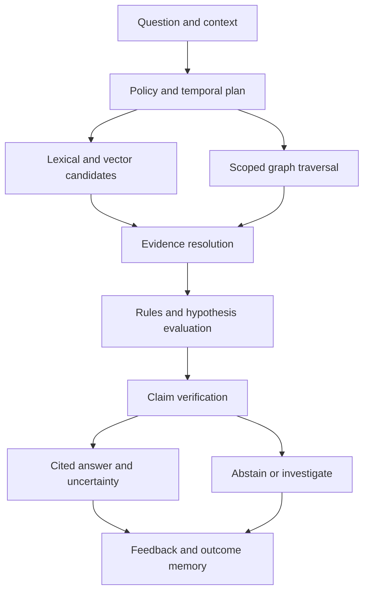

# Reasoning engines and intelligence retrieval

## Service decomposition

Knowledge Registry owns ontology/identity. Journal owns canonical observations/assertions. Temporal View composes snapshots. Memory Admission and Consolidation manage scoped memories. Retrieval Planner selects search and graph plans. Evidence Resolver fetches authorized pinned artifacts. Reasoning Runtime evaluates rules, explanations and hypotheses. Gap Engine produces coverage-conditioned findings. Evaluation Service scores answers/forecasts. All run per home cell behind the platform's policy service and immutable audit trail; they do not add a second cross-cloud writer.

## End-to-end question path

The planner resolves pronouns/entities, intent, scope, valid/known times, release/environment and permission filters. Ambiguous API names require scoped disambiguation before effects or strong conclusions. Search returns candidate identifiers; evidence resolver reads authoritative policy and source validity before exposing content to a model. Structured graph expansion uses allowlisted query templates rather than model-generated unrestricted Cypher.

Default interactive budget: graph depth 4, 1,000 nodes, 5,000 edges, 2 seconds graph work; 200 lexical plus 200 vector candidates, fused to 100, at most 30 reranked and 12 evidence chunks initially. Context target is 24,000 tokens, reduced to provider limit and tenant policy. Retrieval p95 target remains 1.5 seconds for the bounded candidate phase; full cited answers have a separate 15-second first-complete-answer target under reference workload, not guaranteed provider latency. Deep investigations become asynchronous operations with explicit cost, expansion and deadlines.

Fuse lexical and vector rankings using reciprocal rank fusion with k=60 as a tunable baseline; do not add raw BM25 and cosine values. Reranking models are replaceable, evaluated for domain/language suitability and bounded by budget. Graph facts score by evidence relevance, freshness, context match and authority. Popularity/centrality can prioritize discovery but cannot overpower permission or establish factual correctness. Evidence from diverse independent origins improves corroboration; duplicate derivations are collapsed.

## Specialized reasoning engines

| Engine | Procedure | Valid conclusion boundary |
|---|---|---|
| Structural | Typed graph traversal, reverse dependency closure, strongly connected components | Known dependencies within declared parser/runtime coverage |
| Rule | Versioned deterministic predicates with evidence bindings and applicability | Rule-derived result, not generalized causal truth |
| Temporal | Compare bitemporal snapshots and first occurrence intervals | Ordering and change association, not causation by itself |
| Decision | Traverse rationale, alternatives, accepted risks and outcome evidence | Recorded reasons; undocumented intent remains unknown |
| Diagnostic | Symptoms → dependency/telemetry correlation → competing hypotheses → discriminating tests | Root cause requires reproducible/test/intervention evidence |
| Counterfactual | Candidate removal/replacement in isolated twin, compile/test/traffic scenarios | Measured simulation outcome within fidelity/coverage limits |
| Risk | Threat/dependency/policy/ownership graph plus applicability and exposure evidence | Scoped risk findings; uncertainty attached |
| Opportunity | Gap/business objectives/experiments/market evidence → ranked proposals | Opportunity hypothesis pending validation |
| Forecast | Scenario baseline, constraints, calibrated model, horizon and assumptions | Conditional projection, never current fact |
| Deliberative | Independent specialist reviews, dissent records and accountable adjudication | Consensus records a choice; votes do not prove truth |

Rules have rule_id/version, allowed types/predicates, preconditions, confidence class, evidence requirements, materialization policy, expiry and explanation template. Evaluate recursion with stratified rule dependencies, bounded fixed points and cycle detection. Avoid unbounded OWL closure across all tenants. Derived facts retain dependency lineage and invalidate on source retraction. Negation is permitted only within declared closed coverage for that predicate/context; global world knowledge is open and incomplete.

No answer-generation agent can approve its own evidence admission, modify policy or perform remediation. Reasoning produces proposals; tool effects use the existing exact-target capability/approval system. Prompt injection in code, logs, tickets and documentation is untrusted data. Retrieval messages label origin and quoted data, separate instructions from evidence, strip executable directives from summaries, and prevent content-triggered tool grants. Suspicious material is retained only under appropriate security policy and displayed with neutral evidence context.

## Answer contract

An answer contains answer_id, question/context/time, snapshot_manifest, claims, evidence_refs, concise rationale, competing hypotheses, unknowns, retrieval coverage, projection lag, model/rule versions, confidence method, recommended next steps and expires_at. Each claim is labeled observed, recorded_decision, inferred, hypothesis or forecast. Citation selectors bind to artifact digest and exact source span. Claim verifier checks cited support, conflicting sources, context/time mismatch, numerical derivation and source accessibility. Unsupported claims are removed, reframed as hypotheses or cause abstention.

Store concise explanations and structured derivation traces, not hidden chain-of-thought. A model can summarize a trace but cannot fabricate tool results. Answers cache by tenant/principal policy fingerprint, normalized question, temporal context, source generation and model/rule version; revocation and lineage changes invalidate caches. Shared answer caches must not leak private evidence through timing, keys, existence or response counts.

## Requested questions: executable reasoning plans

| Question | Retrieval and reasoning plan | What proves it |
|---|---|---|
| Why does this exist? | Entity → requirement → decision → selected alternative → outcome | Accepted decision and cited source; otherwise undocumented rationale |
| How does this work? | Source symbols + data/control paths + API/runtime traces | Parser/build references and matching runtime context |
| What depends on this? | Reverse dependency traversal across permitted partitions | Scoped closure and explicit unresolved/dynamic coverage |
| What breaks if removed? | Impact set plus isolated build/test and contract simulation | Actual sandbox receipts; graph reachability alone is potential impact |
| What should replace this? | Requirements, candidate compatibility, cost, security and migration tests | Multi-criteria proposal with experiments and decision owner |
| Why is this API slow? | Endpoint → traces → spans → queries/indexes → deployments | Comparable telemetry and tested causal hypothesis; not simply latest commit |
| Where is this bug coming from? | Error signatures → failing tests → changed symbols → dependencies | Reproduction and controlled fix/rollback outcome |
| Who changed this logic? | Symbol lineage → source commit → identity mapping | Repository commit evidence; author/committer/deployer shown separately |
| Which decisions caused this issue? | Affected component → decision rationale → expected/actual outcomes | Linkage plus causal evidence; association labeled until tested |
| What should be built next? | Objectives → gaps → dependencies → effort/risk/value evidence | Ranked proposal with assumptions, owner and validation plan |
| What security risks exist? | Exposure/configuration/dependencies → applicable advisories/controls | Pinned revisions and validated applicability, not keyword matches alone |
| How can revenue grow? | Revenue funnel → customer interactions → product gaps → experiments | Measured business baseline and lawful data; no unsupported revenue promises |
| What should happen next? | Unresolved critical risks, accepted priorities, dependencies and budgets | Authorized recommendation; action requires separate effect approval |

For an unknown dependency or inaccessible project, disclose that visible analysis is incomplete without revealing hidden object existence. UI may say “coverage limited by available authorized sources,” not “a secret service exists.” Human correction starts a review and appends evidence; user satisfaction alone does not train factual certainty.
