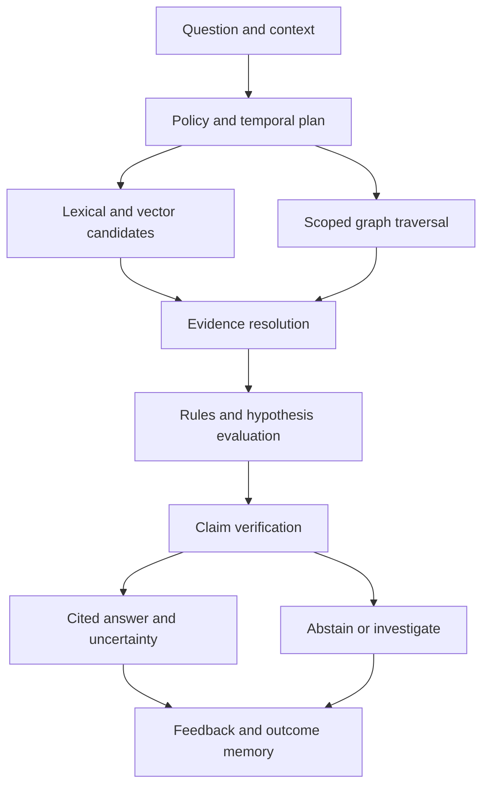

# OmniDev Swarm — full living knowledge architecture

Prompt 3. Complete target design, reference schemas and production acceptance requirements.

# Living intelligence model and graph schema

## Scope and authority

This is prompt 3's detailed knowledge architecture. It extends the production architecture's cell topology, transactional authority, projection model, bounded agents and zero-trust controls. It specifies a living development memory: observations become evidence-backed assertions; assertions become permission-scoped relationships; relationships support explanations, decisions and experiments; outcomes correct prior beliefs. It is a design specification, not a claim that the current regex analyzer implements these services or that this is the world's first such system.

The knowledge journal service owns canonical entity identities, observations and versioned assertions in PostgreSQL plus immutable object manifests. Source systems retain authority over their own facts. An observation is what a particular collector saw, not an omniscient statement about reality. Neo4j, lexical search, Qdrant and analytical rollups are rebuildable projections. No model writes directly into authoritative stores. A model proposes assertions through a validation and adjudication command.

Separate four representations: source artifacts; extracted claims; accepted knowledge views; generated answers. They have different retention, reliability and access rules. The accepted view includes disputed and unknown states rather than erasing ambiguity. Accepted means the admission criteria were satisfied, not that a statement can never be wrong.

## Canonical objects

| Object | Essential fields | Invariant |
|---|---|---|
| Entity | tenant_id, entity_id, kind, source_namespace, external_key, identity_version, lifecycle, home_partition | Names and paths are mutable attributes; identities are tenant scoped |
| EntityVersion | entity_id, version_id, source_revision, content_digest, properties_ref, valid interval, recorded interval | Immutable knowledge version; large payload in encrypted object storage |
| Observation | observation_id, source_connection, collector/version, source_revision, observed_at, coverage_manifest, artifact_id | Evidence of collection with explicit scope and failures |
| Assertion | assertion_id, subject, predicate, object entity or typed literal, modality, status, evidence_ids, confidence_record, temporal bounds | A claim never becomes a fact merely through repeated generation |
| Relationship | relationship_id, subject_id, predicate, object_id, assertion_id, context_id | Projection of a sourced assertion; not independently authoritative |
| Context | project, branch, environment, release, scenario, session, snapshot manifest | Distinguishes mutually valid claims in different circumstances |
| Evidence | evidence_id, artifact_id, digest, selector, producer, method, license, classification, ACL, retention | Stable location and integrity proof; selector resolves within a pinned artifact |
| CoverageManifest | expected domains, enumerated scope, successful/failed/excluded coverage, timestamps, collectors | Absence claims require applicable coverage, not missing search results |
| IdentityResolution | candidate identities, evidence, resolution state, reviewer, reversible merge map | No automatic irreversible merging by similar names |
| Hypothesis | testable statement, supporting/refuting evidence, proposed intervention, outcome | Remains distinct from observation and forecast |

Use UUID identities and source-local natural-key mappings. Deduplicate source observations by tenant, connection, revision, collector digest and partition. Content hashes deduplicate bytes only within the authorized encryption/deduplication boundary; identical bytes do not imply identical entities or owners. Identity mapping for functions uses repository lineage, parser-specific symbol identity and signature/context. Git rename similarity is a candidate signal; ambiguous moves remain separate entities linked by POSSIBLE_SUCCESSOR.

Every discovered item receives a structural containment link to its source/context, provenance link to an observation and an ownership state. This meets navigable connectivity without fabricating semantic dependencies. Unknown owners point to an explicitly typed UnresolvedOwner record; broken references point to UnresolvedReference. These represent missing knowledge, not real users or confirmed external services. Tenant root is the terminus of containment. Semantic isolation is measurable even when structural connectivity exists.

## Complete entity ontology

The contract catalog contains every requested type and additional evidence/operational types. Names are canonical PascalCase; adapters map synonyms without rewriting historical records.

| Family | Types | Principal relationships |
|---|---|---|
| Organization | Organization, Project, Repository, User, Team, Customer | OWNS, CONTAINS, MEMBER_OF, RESPONSIBLE_FOR, USES |
| Source structure | File, Function, Class, Module, Package | DEFINES, CONTAINS, IMPORTS, CALLS, DEPENDS_ON |
| Runtime | Service, Microservice, Container, Server, Infrastructure, CloudResource | RUNS_ON, DEPLOYS_TO, COMMUNICATES_WITH, CONFIGURES |
| Data | Database, Table, Column, Index | CONTAINS, READS, WRITES, INDEXES, MIGRATES |
| Interfaces | API, Endpoint, Event, Queue, Log | EXPOSES, IMPLEMENTS, EMITS, CONSUMES, OBSERVED_IN |
| Coordination | Ticket, Roadmap, Meeting, Conversation, Documentation, ArchitecturalDecision | DISCUSSES, RESOLVES, DOCUMENTS, DECIDES, SUPERSEDES |
| Business | BusinessProcess, RevenueSource, Competitor, CustomerInteraction | SUPPORTS, GENERATES_REVENUE, COMPETES_WITH, AFFECTS |
| Creative | DesignAsset, Asset3D, Animation | DERIVED_FROM, REFERENCES, ANIMATES, USED_BY |
| Intelligence | AIModel, AgentSwarm, Agent, AgentOutput | GENERATED_BY, REVIEWED_BY, USES_MODEL, SUPPORTS, REFUTES |
| Evidence and time | Observation, Evidence, Assertion, Snapshot, Commit, Deployment, Release, Scenario, Forecast, Experiment, Outcome | OBSERVED_IN, DERIVED_FROM, VALIDATED_BY, PREDICTS, TESTS |
| Gaps and access | KnowledgeGap, Requirement, Policy, Grant, UnresolvedReference, UnresolvedOwner | APPLIES_TO, REQUIRES, BLOCKS, GOVERNED_BY |

CloudResource has provider-qualified subtype and external ID; Container records image digest and runtime occurrence, not merely image tag. Logs are indexed batches and selected evidence spans, not billions of individual graph nodes by default. Customer interactions minimize personal data and retain authorized source pointers. 3D assets map scene hierarchy, mesh/material/rig, dependencies, license and exporter revision through extension subtypes. AIModel identifies weights/provider revision, capabilities, license and evaluation context; a marketing model name alone is not reproducible identity.

## Relationship semantics and constraints

CONTAINS is an acyclic structural parent relation within a context; CALLS and DEPENDS_ON may legitimately cycle. Track cycle meaning by strongly connected components, not by globally banning cycles. CALLS requires parser/static-analysis/runtime evidence; MENTIONS is textual mention and cannot be promoted to dependency. READS/WRITES attach operation and environment context. RESPONSIBLE_FOR is explicit ownership, not inferred from a single commit. CHANGED_BY records commit authorship separately from deployment actor and decision maker. Business AFFECTS relationships need measured evidence or hypothesis modality.

All edges carry source assertion ID, evidence, validity, modality and access scope. Relationship visibility requires authorization on both endpoints and the relation/evidence. Projection filters must not expose denied endpoint names, counts, degree, paths or inferred membership. Shared public dependencies are public corpus entities; tenant-private usage edges remain private.

Ontology migrations are versioned: additive labels first, adapters dual-read old and new representations, replay into shadow projections, compare semantics and coverage, then promote. Unknown extension types stay namespaced and quarantined from strong reasoning rules until reviewed. Extensions declare property types, relation domain/range, cardinality, required evidence and license. Keep original extracted type alongside normalization to preserve fidelity.

## Provenance and epistemic states

Represent observed, human_asserted, inferred and predicted modalities, with proposed, accepted, disputed, superseded and retracted lifecycle states. A collector can assert an observation accurately while its underlying source is wrong. Confidence stores method, calibration dataset/version, evidence quality, freshness and uncertainty; an uncalibrated language-model percentage is not a probability. Evidence independence tracks common origins so ten summaries of one ticket do not count as ten corroborations.

PROV-compatible export maps source objects to entities, extraction/evaluation operations to activities and responsible principals to agents. This is interoperability mapping, not a claim of complete OWL reasoning support. Sign journal batch manifests, preserve extractor and model versions and content hashes, and record derivation DAGs. Do not store private model chain-of-thought; preserve concise rationales, evidence references, rule executions and reviewer decisions sufficient to explain outputs.

# Eight memory layers and decision memory

## Memory record schema

Each memory record contains tenant_id, memory_id, layer, scope_id, subject_entity_ids, memory_kind, modality, state, content_artifact, source_assertion_ids, evidence_ids, created_by, created_at, valid_range, recorded_range, confidence_method, salience, sensitivity, access_policy_id, retention_policy_id, consent_basis, supersedes_id and retrieval_generation. Summaries additionally declare input manifests, compression version, covered intervals, omissions and summary fidelity evaluation. Memory is indexed by reference; raw documents are not duplicated indiscriminately into every layer.

Memory kinds include episode, semantic_fact, procedural_lesson, decision, hypothesis, preference, outcome, innovation and forecast. Embeddings help retrieval but do not define truth or identity. Procedural lessons cannot expand tool permissions. A stored user instruction is content until separately admitted into the applicable instruction/policy system; connector documents cannot silently override platform or user authorization.

## Layer boundaries

| Layer | Scope and content | Admission and retention | Retrieval boundary |
|---|---|---|---|
| 1 Session | Current conversation, selected sources, tool receipts and unresolved questions | Checkpoint durable episodes; ephemeral scratch TTL 24 hours by default | Participant/resource grants; session membership alone cannot expose underlying sources |
| 2 Agent | Specialized procedures, evaluations and reviewed individual lessons | Useful episodes admitted after evidence validation; task scratch expires | Agent identity plus current delegated scope; identity is not a private-data wildcard |
| 3 Swarm | Shared investigation, hypotheses, disagreements and review outcomes | Append collaboration episodes; compact after run closure | Each reader's current grants; shared summaries obey restrictive source policy |
| 4 Project | Architecture, source history, bugs, tests, deployments, business context | Durable under project retention; correction chains preserved | Project role plus source/object/branch/environment restrictions |
| 5 Organization | Company decisions, approved operating practices and cross-project patterns | Explicit aggregation, steward review and lawful retention | Org policy and project-specific restrictions; org membership is insufficient |
| 6 Global Pattern | Public lessons and consented, reviewed generalized patterns | Separate publication workflow; privacy review, leakage testing, withdrawal support | Public corpus or explicitly scoped sharing grants; no raw private tenant data |
| 7 Innovation | Opportunities, invention hypotheses, novelty searches and experiments | Record authorship, source rights, confidentiality and test outcomes | Project/org or approved publication scope; patentability remains an unverified legal question |
| 8 Future | Scenario assumptions, forecasts, roadmap branches and predicted outcomes | Retain issued forecast unchanged; attach later evaluations and replacements | Source-derived access plus scenario policy; future memory never replaces observed present |

Decision memory is a cross-cutting kind available within these layers, not a ninth layer or separate source of contradictory truth. Research memory maps to semantic/episode records in agent, swarm, project or organization scopes. The earlier production document's short-term/company/global terms map to session/organization/global pattern. Its decision and research stores become typed views; innovation remains layer 7 and future is explicitly layer 8.

## Write, consolidate, promote and correct

A memory command authenticates its writer, validates source manifests, applies classification, records consent/retention, computes idempotency key and appends a versioned entry plus outbox event. Eligible retrieval generation follows only after projection watermark advances. Rejected admission retains a minimal audit reason; harmful raw content need not be permanently preserved merely to record a rejection.

Consolidation clusters related episodes within a scope and creates an evidence-linked summary. It preserves dissent and exceptions, labels missing inputs and never deletes sources solely because a summary exists. Source retention and compaction are separate decisions. Before admitting a procedural lesson, require a generalization boundary: language/version/environment, triggering conditions, tested outcomes, contraindications and expiry/revalidation criteria.

Promotion from agent to swarm or project increases discoverability only after scope and provenance checks. Promotion to organization requires approved sharing. Global publication requires rights, explicit opt-in where applicable, confidential-data removal, membership/secret leakage testing, owner review and a withdrawal locator. Aggregation is not automatically anonymization. Do not globally train models on private memory by default. Revoked publication invalidates global indexes and downstream generated summaries identified through lineage.

Contradictions create a dispute set: conflicting assertions, overlapping context/valid intervals, evidence lineage, severity, owner and resolution criteria. Preserve both until adjudication. Human authority can settle a business choice but cannot retroactively prove a performance measurement. Retractions propagate to dependent summaries, vectors, graph projections, answers and automation prerequisites; revalidate descendants rather than silently leaving polished false memories.

## Decision schema and lifecycle

A decision stores decision_id, scope, title, problem, triggering_evidence, author/proposer, accountable_decider, participants, decided_at, effective_at, alternatives, criteria/weights, selected_option, rationale, risks, mitigations, expected_outcomes, verification_plan, review_date, related_entities, implementation_refs, actual_outcomes, lessons, status and supersedes_id. Alternatives include rejected/deferred choices and reasons. Expected outcomes are measurable metrics with baseline, target, observation window, owner and assumptions. Actual outcomes include measurement method and attribution uncertainty.

Lifecycle: draft → under_review → accepted or rejected → implemented → evaluated → superseded or retired. Reopening does not mutate the historic accepted rationale: append a reconsideration record and link it. Decisions may expire or remain implemented while failing their expected outcomes. Capture disagreement and exceptions. Sign-off records authorized principal, exact decision revision, policy version and timestamp; a generated summary of a meeting is not participant approval.

Architectural decisions link DECIDES to selected architecture, CONSIDERED to alternative designs, MOTIVATED_BY to evidence, ACCEPTS_RISK to risks and EVALUATED_BY to outcomes. A query for why an API exists follows design and decision links before offering a model's plausible explanation. If no decision exists, report undocumented rationale and optionally propose a retrospective record explicitly labeled retrospective.

## Longevity, forgetting and recovery

The design supports indefinite retained history where permitted, not unconditional permanent storage of every personal record. Retention is configurable by kind, sensitivity, tenant contract and legal basis. Legal holds apply through authorized review. User deletion, consent withdrawal and confidential-source revocation propagate through derivation lineage and indexes. Backup restoration applies tombstones before reopening query service. Audit proof can retain non-content operation evidence only when permitted; hashes may themselves be sensitive and require policy review.

Journal authority uses tenant-scoped transactions, access-aware object manifests, immutable versions and periodic signed checkpoints. Redis loss discards scratch/presence, not durable episodes. Restore canonical journal and manifests first, replay derived stores, validate counts/digests/access filters, and advertise coverage/watermarks. A memory cannot be served from a stale cached summary after its source grant is revoked.

# Timeline intelligence, indexing and ingestion

## Bitemporal and scenario semantics

Every assertion has valid time (when the claim applies in its domain) and recorded time (when OmniDev knew it). Use half-open intervals [start,end) in UTC, retaining source timezone/precision where significant. A late incident report can change today's understanding of yesterday without rewriting what engineers knew yesterday. Transaction sequence and source revision order break timestamp ties; clock time alone does not provide distributed ordering.

Queries require valid_at, known_at, branch/environment and optional scenario_id. “Current” defaults to latest committed knowledge watermark and current valid time, returned explicitly. Historical queries must still use current access permissions: possession of a past grant is not a right to see revoked data now. Graph projections materialize current state for fast reads; archival bitemporal assertions reconstruct historical snapshots on isolated analytical workers. Projection lag is explicit.

Past and current states are observations or accepted claims. Future states are scenario branches, each with assumptions, parent baseline, forecast model/version, horizon, distributions or ranges where calibrated, uncertainty and evaluation dates. Year 1/3/5/10 are horizon labels, not guarantees. Version 1/2/3 are immutable release/snapshot references; planned versions are proposed scenarios until deployed evidence establishes a release. Never connect a forecast dependency as a confirmed present dependency.

A snapshot manifest pins source revisions, event sequence per partition, extractor generations, ontology version, graph/vector/lexical watermarks, ACL epoch and source coverage. It is a consistent cut where obtainable; if sources cannot be atomically captured, label bounded skew and affected domains. Cross-store reads wait for compatible watermarks for correctness-sensitive operations, or return partial coverage for exploratory reads. Timeline comparison computes added/removed/modified claims, decision changes, risk/test coverage and deployment/outcome differences. Renames use identity lineage rather than counting every move as deletion plus invention.

## Collection pipeline

1. Authorize connection scopes and register source ownership, residency and expected coverage.
2. Collect immutable source revisions or bounded incremental batches; preserve external cursors and webhook signatures.
3. Normalize identifiers and parse in isolated workers. Language AST/LSP/build metadata outranks regex guesses; unsupported syntax reports incomplete coverage.
4. Extract typed entities/assertions with evidence spans, context and method reliability. Link structural provenance for every admitted object.
5. Resolve identities conservatively; deduplicate by collector revision; quarantine illegal relation types and malformed intervals.
6. Append canonical batch and outbox atomically. Workers apply idempotent projections with per-batch receipts and fencing.
7. Publish searchable watermark after integrity/authorization checks. Never mark unseen files deleted from a partial failed scan.
8. Run gap rules and invalidate affected summaries/answers by dependency lineage. Incremental changes reparse affected reverse dependencies under a budget.

Connector sources include source control, cloud inventories, databases, issue/design/document systems, conversations, telemetry and creative tools. Each has its own limits and permission semantics. Source deletion and revoked scope invalidate retrieval even before slow physical cleanup finishes. Secrets are redacted or quarantined before embeddings. Encrypted server-blind sources use authorized customer-side extraction; central reasoning receives only explicitly disclosed claims. End-to-end encryption does not secretly permit central plaintext indexing.

## Index plan

| Index | Key or strategy | Purpose and caveat |
|---|---|---|
| Entity lookup | tenant/source namespace/external key, unique scoped identity map | Stable exact lookup; parser identity collisions reviewed |
| Assertion lookup | tenant, subject, predicate, context, recorded sequence | Materialize accepted/current views; never drop disputed evidence |
| Temporal index | GiST range indexes on valid and recorded ranges plus tenant-selective B-tree | Historical interval intersection; benchmark multicolumn strategy and partition pruning |
| Graph adjacency | partition + entity + predicate + direction; current and selected historical projections | Bounded traversal; expand high-degree hubs with pagination |
| Lexical | authorized chunks, symbols, exact identifiers, fielded BM25 | Code identifiers and exact errors; lexical matches are not proof |
| Vector | collection generation, tenant/project/source/ACL metadata, embedding and chunk versions | Tenant/resource prefilter plus authoritative recheck; quality measured by corpus |
| Decisions | scope/status/date, alternatives, selected option, outcome metric | Rationale and outcome retrieval with evidence |
| Timeline | snapshot/release/commit manifests and partition sequence offsets | Reproducible state comparison |
| Gap/ownership | subject/rule/version, coverage, owner, freshness | Find blind spots without treating missing authorization as missing documentation |
| Answer lineage | source assertion/evidence IDs → answer IDs and summaries | Invalidation on correction, deletion, expiry and ACL changes |

Neo4j constraints enforce selected uniqueness and property contracts supported by the pinned edition. Service validation enforces domain/range, provenance, temporal consistency and cross-node policies; database constraints are not a complete ontology validator. Use version-qualified entity projection keys so historical versions do not violate current-identity uniqueness. Qdrant filtering must use trusted policy-derived filters; metadata ACL alone is not an authentication system.

## Chunking and embedding generations

Chunk source code by symbol and logical block, documents by section with heading lineage, conversations by topic episodes with speaker/time, decisions by rationale/alternatives/outcomes, and 3D assets by manifest/scene metadata plus supported multimodal features. Preserve parent IDs and exact source spans. Never split away the negation or conditions of a security policy. Large binaries remain in object storage; retrieval uses manifests/previews and authorized tool inspection.

Chunk IDs include artifact digest, selector and chunker version. Embeddings are indexed by model digest/version, dimension, tokenizer, normalization, distance metric and language/domain evaluation. Store separate generations for incompatible models. Build shadow index, replay deltas, compare recall/latency/isolation and switch a routing generation after gates; do not mix dimensions or scores across incomparable spaces. Lexical retrieval remains available when embeddings fail, within identical policy and provenance boundaries.

Cold data retains journal/object history and compressed lexical metadata; restore historical vectors on demand where cost warrants. A tenant requesting historical semantic search gets an operation handle and coverage status if restoration is necessary. Retention and legal deletion always override cold restoration.

# Reasoning engines and intelligence retrieval

## Service decomposition

Knowledge Registry owns ontology/identity. Journal owns canonical observations/assertions. Temporal View composes snapshots. Memory Admission and Consolidation manage scoped memories. Retrieval Planner selects search and graph plans. Evidence Resolver fetches authorized pinned artifacts. Reasoning Runtime evaluates rules, explanations and hypotheses. Gap Engine produces coverage-conditioned findings. Evaluation Service scores answers/forecasts. All run per home cell behind the platform's policy service and immutable audit trail; they do not add a second cross-cloud writer.

## End-to-end question path

The planner resolves pronouns/entities, intent, scope, valid/known times, release/environment and permission filters. Ambiguous API names require scoped disambiguation before effects or strong conclusions. Search returns candidate identifiers; evidence resolver reads authoritative policy and source validity before exposing content to a model. Structured graph expansion uses allowlisted query templates rather than model-generated unrestricted Cypher.

Default interactive budget: graph depth 4, 1,000 nodes, 5,000 edges, 2 seconds graph work; 200 lexical plus 200 vector candidates, fused to 100, at most 30 reranked and 12 evidence chunks initially. Context target is 24,000 tokens, reduced to provider limit and tenant policy. Retrieval p95 target remains 1.5 seconds for the bounded candidate phase; full cited answers have a separate 15-second first-complete-answer target under reference workload, not guaranteed provider latency. Deep investigations become asynchronous operations with explicit cost, expansion and deadlines.

Fuse lexical and vector rankings using reciprocal rank fusion with k=60 as a tunable baseline; do not add raw BM25 and cosine values. Reranking models are replaceable, evaluated for domain/language suitability and bounded by budget. Graph facts score by evidence relevance, freshness, context match and authority. Popularity/centrality can prioritize discovery but cannot overpower permission or establish factual correctness. Evidence from diverse independent origins improves corroboration; duplicate derivations are collapsed.

## Specialized reasoning engines

| Engine | Procedure | Valid conclusion boundary |
|---|---|---|
| Structural | Typed graph traversal, reverse dependency closure, strongly connected components | Known dependencies within declared parser/runtime coverage |
| Rule | Versioned deterministic predicates with evidence bindings and applicability | Rule-derived result, not generalized causal truth |
| Temporal | Compare bitemporal snapshots and first occurrence intervals | Ordering and change association, not causation by itself |
| Decision | Traverse rationale, alternatives, accepted risks and outcome evidence | Recorded reasons; undocumented intent remains unknown |
| Diagnostic | Symptoms → dependency/telemetry correlation → competing hypotheses → discriminating tests | Root cause requires reproducible/test/intervention evidence |
| Counterfactual | Candidate removal/replacement in isolated twin, compile/test/traffic scenarios | Measured simulation outcome within fidelity/coverage limits |
| Risk | Threat/dependency/policy/ownership graph plus applicability and exposure evidence | Scoped risk findings; uncertainty attached |
| Opportunity | Gap/business objectives/experiments/market evidence → ranked proposals | Opportunity hypothesis pending validation |
| Forecast | Scenario baseline, constraints, calibrated model, horizon and assumptions | Conditional projection, never current fact |
| Deliberative | Independent specialist reviews, dissent records and accountable adjudication | Consensus records a choice; votes do not prove truth |

Rules have rule_id/version, allowed types/predicates, preconditions, confidence class, evidence requirements, materialization policy, expiry and explanation template. Evaluate recursion with stratified rule dependencies, bounded fixed points and cycle detection. Avoid unbounded OWL closure across all tenants. Derived facts retain dependency lineage and invalidate on source retraction. Negation is permitted only within declared closed coverage for that predicate/context; global world knowledge is open and incomplete.

No answer-generation agent can approve its own evidence admission, modify policy or perform remediation. Reasoning produces proposals; tool effects use the existing exact-target capability/approval system. Prompt injection in code, logs, tickets and documentation is untrusted data. Retrieval messages label origin and quoted data, separate instructions from evidence, strip executable directives from summaries, and prevent content-triggered tool grants. Suspicious material is retained only under appropriate security policy and displayed with neutral evidence context.

## Answer contract

An answer contains answer_id, question/context/time, snapshot_manifest, claims, evidence_refs, concise rationale, competing hypotheses, unknowns, retrieval coverage, projection lag, model/rule versions, confidence method, recommended next steps and expires_at. Each claim is labeled observed, recorded_decision, inferred, hypothesis or forecast. Citation selectors bind to artifact digest and exact source span. Claim verifier checks cited support, conflicting sources, context/time mismatch, numerical derivation and source accessibility. Unsupported claims are removed, reframed as hypotheses or cause abstention.

Store concise explanations and structured derivation traces, not hidden chain-of-thought. A model can summarize a trace but cannot fabricate tool results. Answers cache by tenant/principal policy fingerprint, normalized question, temporal context, source generation and model/rule version; revocation and lineage changes invalidate caches. Shared answer caches must not leak private evidence through timing, keys, existence or response counts.

## Requested questions: executable reasoning plans

| Question | Retrieval and reasoning plan | What proves it |
|---|---|---|
| Why does this exist? | Entity → requirement → decision → selected alternative → outcome | Accepted decision and cited source; otherwise undocumented rationale |
| How does this work? | Source symbols + data/control paths + API/runtime traces | Parser/build references and matching runtime context |
| What depends on this? | Reverse dependency traversal across permitted partitions | Scoped closure and explicit unresolved/dynamic coverage |
| What breaks if removed? | Impact set plus isolated build/test and contract simulation | Actual sandbox receipts; graph reachability alone is potential impact |
| What should replace this? | Requirements, candidate compatibility, cost, security and migration tests | Multi-criteria proposal with experiments and decision owner |
| Why is this API slow? | Endpoint → traces → spans → queries/indexes → deployments | Comparable telemetry and tested causal hypothesis; not simply latest commit |
| Where is this bug coming from? | Error signatures → failing tests → changed symbols → dependencies | Reproduction and controlled fix/rollback outcome |
| Who changed this logic? | Symbol lineage → source commit → identity mapping | Repository commit evidence; author/committer/deployer shown separately |
| Which decisions caused this issue? | Affected component → decision rationale → expected/actual outcomes | Linkage plus causal evidence; association labeled until tested |
| What should be built next? | Objectives → gaps → dependencies → effort/risk/value evidence | Ranked proposal with assumptions, owner and validation plan |
| What security risks exist? | Exposure/configuration/dependencies → applicable advisories/controls | Pinned revisions and validated applicability, not keyword matches alone |
| How can revenue grow? | Revenue funnel → customer interactions → product gaps → experiments | Measured business baseline and lawful data; no unsupported revenue promises |
| What should happen next? | Unresolved critical risks, accepted priorities, dependencies and budgets | Authorized recommendation; action requires separate effect approval |

For an unknown dependency or inaccessible project, disclose that visible analysis is incomplete without revealing hidden object existence. UI may say “coverage limited by available authorized sources,” not “a secret service exists.” Human correction starts a review and appends evidence; user satisfaction alone does not train factual certainty.

# Missing knowledge and organizational blind spots

## Coverage-conditioned gap schema

A gap record contains gap_id, tenant/project/context, subject, gap_kind, rule/version, applicability, expected_evidence, observed_evidence, coverage_manifest, confidence_class, severity, impact, owner_state, proposed_resolution, detection_time, expiry, status and verification_refs. Types include knowledge, documentation, architecture, testing, business, security, team_knowledge_risk and single_point_of_failure. A failed search is a retrieval problem, not proof of absent documentation.

Classify results as confirmed_within_scope, suspected, unknown_due_to_coverage, not_applicable or resolved_with_evidence. Severity derives from impact and exposure; confidence derives from evidence. These are separate axes. Preserve a high-severity unknown instead of lowering its priority merely because evidence is incomplete. Gap resolution requires accepted evidence and rerunning the same applicability rule, not just a user clicking “done.”

## Detection engines

| Gap | Applicable rule and evidence | Resolution proof |
|---|---|---|
| Knowledge | Critical entity has unanswered required questions or disputed operational claims | Source-linked answers accepted and contradiction disposition recorded |
| Documentation | Required runbook/API/decision type absent from fully enumerated allowed source scope | Current document linked, ownership and recovery procedure validated |
| Architecture | Service/flow lacks a required boundary, interface or accountable design | Accepted architecture decision plus implementation inspection where required |
| Testing | Changed behavior lacks applicable tests or evidence of execution | Meaningful test receipt on pinned revision, including failure case |
| Business | Critical objective lacks measurable metric, baseline or experiment | Approved metric and validated measurement/experiment |
| Security | Applicable control missing or stale for actual exposure | Verified configuration/test and current source coverage |
| Team knowledge | Critical system has no reviewed handoff or only one independently verified operator | Demonstrated second operator rehearsal and maintained documentation |
| Single point of failure | Dependency/resource/ownership cut set blocks critical objective | Tested redundancy/failover or explicitly accepted risk |

Team analysis uses explicit role/ownership, runbook exercise and handoff evidence. Commit counts, meeting attendance and message volume are weak proxies and must not become employee performance rankings. Users can correct identity and ownership mappings. Exclude private personal communications without explicit authorized scope. Explain organizational risk as system continuity, not speculative judgments about individuals.

Build an objective → service → resource → owner → recovery-capability graph. Compute bounded articulation/cut-set candidates on authorized projections, then validate against runtime architecture and recovery tests. A graph articulation point is a topology signal, not proof of production outage inevitability. Model shared failure domains such as cloud region, identity service, certificate authority, vendor API, sole on-call operator and budget authority.

Blind-spot prediction combines overdue reviews, unowned changes, stale source coverage, repeated unresolved incidents and contradictory decisions. Default output is a hypothesis with an investigation plan. Forecasts require backtesting on prior incidents, calibrated uncertainty, time-separated validation and explanation of missing signals. Do not claim to predict an invisible gap without evidence of the detection method's performance.

## Workflow and safeguards

Detection emits gap.detected with exact evidence and coverage version. Triage validates applicability, assigns accountable owner and deadline, and links to ticket/workflow. A repair candidate proposes documentation, test, control or architecture changes. Verification independently checks resulting evidence and closes the finding only at the correct revision. Regression/staleness reopens it with history. Suppression requires named decision, reason, expiry and accepted risk; hidden permanent dismissals are disallowed.

Prioritization uses criticality, blast radius, uncertainty, dependency blocking, time sensitivity, business objective relevance and estimated repair effort. Weights and policy versions are visible and editable by authorized owners. Revenue opportunity predictions remain separate from confirmed engineering defects. Alert deduplication uses subject/rule/context fingerprint; meaningful scope or rule-version changes create linked revisions, not silent overwrites.

Operator dashboard shows knowledge coverage by domain, unresolved identity, stale assertions, conflicts, critical unowned systems, invalidated summaries, ingestion failures and pending adjudication. Executive dashboard presents risks with uncertainty and accountable actions. Coverage score measures enumerated evidence completeness, not “percentage of all possible knowledge.” Unknown denominator is displayed as unknown.

# Scaling, security, resilience and production acceptance

## Billion-relationship scaling

Reuse the platform's 100 mature-cell planning model: 5 billion entity nodes and 20 billion relationship edges across cells, averaging 50 million nodes and 200 million edges per cell. These are capacity targets to qualify, not measured capabilities. Further partition a cell by organization/project groups and hot workload; giant tenants receive dedicated partitions. A graph partition is not automatically a complete cell or a database per small tenant.

Route by residency, tenant home cell, entity partition and generation. Keep common repository traversals local. Cross-project references use scoped edge stubs with directory-resolved remote endpoints; cross-cell federation is explicit, budgeted and permission checked at each destination. Interactive queries contact at most four partitions by default. Wider analysis becomes an asynchronous reserved job and returns a coverage manifest. Do not send a global traversal to every shard for every question.

Canonical identity metadata and assertion journal partition by tenant/project/time as volume dictates; small tenant partitions are grouped physically. Hot current views remain in indexed transactional/graph stores. Historical revisions and extracted batches live in columnar/object archives with manifest indexes. Avoid storing source bodies or complete logs on every graph edge. Estimates for 20 billion edges at 160 bytes raw are 3.2 TB before index/metadata/replication; real storage sizing must measure typed properties, temporal versions and history retention, which can dominate current-state data.

If 200 million current edges per cell each gain five retained revisions on average, the historical assertion representation may approach one billion edge revisions per cell. Do not apply the raw current-edge estimate to history. Budget archival bytes, object operations, rebuild CPU, vector generations and backup storage separately. Each retained forecast/answer also has lineage costs. Reserve compaction/rebuild headroom and backpressure collection before queues exhaust storage.

At 10 billion vectors, 1536 float32 dimensions alone occupy 61.44 TB before graph/index/payload/replicas. Quantization may reduce vector bytes but requires measured retrieval loss and library-specific overhead; never infer quality from compression ratio. Tier by access frequency and rights. Record per-tenant cost for extraction, parsing, embedding, indexes, retrieval, model tokens, archival restore and adjudication. Root query budgets include subqueries and agent recursion, so multiplying experts cannot escape cost ceilings.

High-degree package/platform hubs use typed fanout pages, scoped materialized summaries and async dependency closure. Cache generation-keyed authorized adjacency rather than entire tenant graphs. Do not precompute all-pairs transitive closure. Incremental invalidation batches descendants and labels stale derived results during bounded recomputation; effect gates require fresh underlying evidence.

## Consistency and recovery

Home-cell journal append plus outbox is atomic; projection consumers deduplicate batch IDs and store watermark receipts. Partial graph batch writes are staged under a generation and made visible only after batch integrity commits; failed staging is replayable. Do not report projection completeness from a queue acknowledgment alone. Compaction preserves canonical version lineage, not only the latest projection.

Rebuild into new graph/vector/lexical generations from signed snapshots and journal deltas. Verify entity/edge counts by type, sampled evidence digests, temporal invariants, no dangling accepted endpoints, tenant filters and representative query equivalence. Swap generation routing atomically per scope with rollback. A vector rebuild cannot silently alter identity or source truth. Failed projection retrieval degrades to allowed source/lexical reads with explicit missing semantic/graph coverage; no broader tenant or global fallback.

Regional failover obeys the production single-writer home-epoch protocol. Journal restore cannot independently claim writer ownership; the placement authority fences the old writer. Reconciliation includes in-flight batches and source cursors. Standard regional RPO/RTO remain design targets from the production package, not new zero-loss guarantees. Restore rehearsals test revoked grants/tombstones before reopening answers.

## Authorization, confidentiality and abuse

Enforce tenant, project, branch/environment, classification, purpose and current principal grants before candidate search, before graph expansion and before evidence/context construction. Intersections apply to derivations: a summary containing confidential evidence inherits restrictions from all disclosed inputs. Redaction requires an approved transformation and new policy-reviewed artifact, not automatically a less restrictive classification. Denied content must not reach the model first and be removed afterward.

Store original sensitive artifacts with tenant keys and separated service identities. Encrypt in transit and at rest; end-to-end server-blind workspaces retain customer-controlled plaintext execution. Index secret detection results as redacted findings, not credential values. Conversation/person/customer records have purpose limitation, minimum content and retention. Security access to a document does not imply consent to globally publish its lessons.

Prevent graph inference leakage through counts, topology, ranking, errors and cached summaries. Adversarial tests compare denied object presence/absence, invalid edge endpoints, stale ACL versions, timing and pagination cursor reuse. Rate limits are weighted by traversal fanout/reranking/context/archival restore; expensive authorized queries can still be abusive. Query plan limits apply before execution. Cursor tokens bind tenant/principal/time/query hash/generation and expiry.

## Observability and evaluation

Measure ingestion lag and coverage, parser success by language, identity-resolution ambiguity, assertion dispute/retraction, projection lag, ACL rejection, stale-answer invalidation, retrieval recall, evidence-support precision, answer abstention, cost and latency by approved dimensions. Avoid entity IDs in unbounded metric labels; trace details reside in restricted logs. Observe global aggregate metrics without copying private knowledge to a global data lake.

Maintain an authorized benchmark corpus with seeded truth: multi-language repositories, rename/refactor histories, dynamic dependencies, runtime incidents, late decisions, meetings with ambiguous speakers, deleted sources, contradictory documents and forecast outcomes. Synthetic fixtures supplement but do not replace real authorized project evaluation. Split by project and time to prevent memorized answers and future leakage. Models/datasets/licenses remain separate procurement/research decisions; this design does not pretend a selected production model is validated.

| Gate | Executed proof required before production |
|---|---|
| Ontology and identity | All requested types map; invalid relation domain/range rejected; ambiguous rename remains unresolved |
| Memory scope | All eight layers survive restart; promotion never broadens permissions implicitly; sources invalidate summaries |
| Temporal correctness | Late observation and historical-known-time query differ correctly; scenario never contaminates present |
| Decision fidelity | Accepted decision retains alternatives and expected/actual outcomes across supersession |
| Retrieval | Target recall on corpus, precise citations, complete policy filtering, temporal/context correctness |
| Reasoning | Known dependency closure, honest dynamic uncertainty, reproducible root-cause tests, no fabricated causal claim |
| Gaps | Partial scan cannot assert absence; inaccessible records do not cause misleading visible gap claims |
| Security | Cross-tenant/ACL/timing/prompt-injection/deletion/cache adversarial suites; model context leak checks |
| Durability | Restore journal and projections with revoked data excluded; replay idempotency; partition/fencing failures |
| Scale and cost | Reference mixed workload at target partition size, hot hubs, rebuild load and measured resource ceilings |
| Forecast and innovation | Time-held-out forecast evaluation, uncertainty calibration, hypothesis labels and outcome tracking |

Initial proposed quality thresholds: citation-support precision ≥98%, forbidden-content disclosure zero in release corpus, entity resolution precision ≥99.5% with explicit unresolved recall, retrieval recall@50 ≥90% for answerable benchmark cases, correct abstention ≥95% on intentionally unanswerable questions. These are release targets to validate and refine by risk/domain, not achieved scores. Sampling confidence intervals, difficult slice results and false-positive/false-negative costs accompany aggregate metrics. One passing aggregate cannot hide a failing tenant-isolation or security slice.

## Migration from current app

First preserve snapshot analyzer outputs as legacy heuristic observations, not upgraded facts. Add pinned evidence selectors and coverage manifests. Introduce canonical identity and assertion admission behind existing read contracts. Populate ontology/current projection for supported parsers. Move memory into eight scoped layers with versioned decision records. Add temporal manifests, hybrid retrieval and cited answer contract. Only then enable rule-derived facts, independent diagnostics and bounded simulations. Global pattern publication and organizational-risk scoring require separate privacy/rights and calibration gates.

Run shadow queries against old and new views, compare user-visible findings and demonstrate why differences occur. Keep existing incomplete connectors labeled until live scope and extraction pass. The unfinished-work register remains the implementation authority; this package supplies specifications and acceptance tests without closing those tasks.

# Service contracts, implementation order and verification

## Knowledge APIs

All routes are versioned under /v1, authenticated and tenant context derives from the server session/capability rather than caller-chosen unrestricted tenant IDs. Commands use idempotency keys bound to principal/action/target/input hash; accepted commands return operation handles. Effectful operations require existing platform capability and approval policy. Never expose raw graph/vector database credentials to clients.

| Route | Input | Result and policy |
|---|---|---|
| POST /knowledge/observations | Pinned artifact manifests, collector version, source context and coverage | Async extraction operation; source.read plus knowledge.ingest |
| POST /knowledge/assertions | Typed sourced assertion proposal | Admission receipt; observed claims require collector evidence; inference rules versioned |
| POST /knowledge/identities/resolve | Candidate IDs, merge/split plan and evidence | Reviewed reversible mapping operation; preserves source lineage |
| GET /knowledge/entities/{id} | Context, valid_at, known_at | Authorized version plus evidence and completeness |
| POST /knowledge/traverse | Seed IDs, predicate allowlist, direction, depth and limits | Scoped nodes/edges, cursors and coverage; server applies smaller policy budget |
| POST /knowledge/timeline/compare | Two snapshot manifests, bounded scope | Temporal delta and skew; asynchronous for archived snapshots |
| POST /memory/entries | Scoped layer/kind/evidence/retention | Versioned memory receipt; no implicit promotion |
| POST /memory/entries/{id}/promote | Destination scope, purpose, evidence and consent | Policy-reviewed copy/view reference and lineage |
| POST /memory/entries/{id}/retract | Reason and evidence | Retraction operation with dependent invalidation receipts |
| POST /decisions | Problem, alternatives, criteria, risks and outcomes plan | Draft version; approval separate from create |
| POST /decisions/{id}/accept | Exact revision, accountable signer and policy | Accepted decision audit record; unauthorized signer rejected |
| POST /decisions/{id}/outcomes | Metrics, method, observation period and evidence | Outcome revision preserving expected values |
| POST /intelligence/search | Question, authorized scope, time/scenario and budget | Cited answer or async investigation; unknowns and uncertainty included |
| GET /intelligence/answers/{id} | Answer ID | Rechecked evidence policy; expired/retracted answer returned stale/redacted or recomputed |
| POST /knowledge/gaps/scan | Coverage manifest, rule set and bounded scope | Findings with applicability and confidence, not unconditional missing claims |
| POST /knowledge/publications | Generalized pattern, source rights, review and consent | Controlled global corpus publication; ordinary memory.write insufficient |
| POST /knowledge/deletions | Authorized target and legal/retention disposition | Tracked invalidation and purge workflow; not direct arbitrary storage deletion |

Errors use stable codes: scope_denied (without hidden object disclosure), temporal_context_required, snapshot_incomplete, projection_behind, evidence_unavailable, identity_ambiguous, unsupported_predicate, budget_exhausted, revision_conflict and operation_pending. Existing platform rate/idempotency/problem contracts apply. Streaming search emits retrieval_started, evidence_ready, claim_ready, verification_update and completed; intermediate generated claims remain explicitly provisional. Stop/cancel commands fence future work and reconcile costs; already published memory writes are corrected through history rather than hidden deletion.

## Events and state machines

Journal emits observation.committed, assertion.admitted, assertion.disputed, assertion.retracted, identity.resolved, projection.advanced, memory.admitted, memory.promoted, summary.invalidated, decision.accepted, decision.evaluated, gap.detected, gap.resolved, answer.invalidated, publication.approved and deletion.completed. Use the production event envelope, exact tenant/context/entity references, aggregate sequence, epoch and evidence/artifact references. No sensitive raw content in event payloads. Outbox/inbox provide at-least-once processing with idempotent receipts; external source effects do not become exactly-once through Kafka.

Ingestion lifecycle: discovered → collecting → collected → parsed → proposed → admitted → projecting → searchable; failures may enter retryable, quarantined or coverage_partial. An operation's searchable stage requires all mandatory projections for its declared retrieval mode; it may provide lexical-only mode when semantic generation is unavailable. Memory lifecycle uses proposed/accepted/disputed/superseded/retracted. Global publication uses draft → rights_review → privacy_review → owner_approved → indexed → withdrawn. Skipping reviews is a policy violation, not a performance optimization.

## Prompt requirements traceability

The ontology catalog covers all 40 requested entity types. Chapter 1 defines schemas and connected provenance. Chapter 2 defines all eight memory layers and every decision field. Chapter 3 provides past/current/future timeline, indexing and source processing. Chapter 4 defines reasoning for every requested question and retrieval stages. Chapter 5 covers all eight missing-knowledge categories and organizational blind spots. Chapter 6 defines billion-edge scaling, security, recovery, quality and production gates. This chapter defines APIs/events and implementable delivery order. Reference JSON schemas, examples and SQL supplement the prose rather than replacing all service migrations.

## Build sequence and evidence

| Stage | Deliverable | Must prove |
|---|---|---|
| K1 | Identity, ontology registry, evidence selectors and collector coverage | Required types, no fabricated semantic edges, stable revision identity |
| K2 | Canonical journal, admission, scoped RLS/ABAC and outbox | Idempotency, invalid evidence rejection, same-tenant FKs, unauthorized source rejection |
| K3 | Versioned graph/lexical projections and temporal manifests | Replay, incomplete batch isolation, current/historical distinction, bounded traversal |
| K4 | Eight memory layers, decisions and consolidation | Restart persistence, correction propagation, no scope expansion, accepted decision fidelity |
| K5 | Vector generations and hybrid retrieval | Domain benchmark, authorization prefilter/recheck, model migration, citation selectors |
| K6 | Reasoning plans, deterministic rules and cited answers | Unsupported conclusions abstain, causal hypotheses tested, context and time respected |
| K7 | Gap engines and organizational continuity | Coverage-conditioned negatives, fair owner analysis, validated failover/handoff evidence |
| K8 | Future/innovation and global pattern publication | Calibrated uncertainty, privacy/right reviews, deletion/withdrawal propagation |
| K9 | Multi-cell scale/recovery and operational readiness | Measured target workloads, hot hubs, failure injection, restore and fenced failover |

Current deliverable status is SPECIFIED: documentation and reference contracts exist and have automated checks. Reference fixtures are design examples, not production repository intelligence. Required live ingestion, graph/memory/reasoning engines, provider execution and multi-cell services remain implementation work. The existing unfinished-work register stays canonical; these stages add detail and acceptance gates to its knowledge/memory/intelligence domains.

# Research basis and architecture decisions

Inspected primary documentation October 8–9, 2026. Scope: targeted architecture research, not complete end-to-end evaluation of every database/model vendor. Production procurement, release-version pinning, performance and license review remain release gates. No untested system is labeled fully researched or operational.

| Source | Inspected technical lesson | Disposition |
|---|---|---|
| [W3C PROV-O](https://www.w3.org/TR/prov-o/) | Entity/activity/agent and derivation interoperability | ADAPT provenance mapping; no mandatory global OWL closure |
| [PostgreSQL ranges](https://www.postgresql.org/docs/current/rangetypes.html) | Range representation and indexed temporal lookup | ADOPT range primitives behind journal contract; benchmark actual partition workload |
| [Neo4j constraints](https://neo4j.com/docs/cypher-manual/current/schema/constraints/) | Uniqueness/property constraints; edition-dependent support | ADAPT projection checks; domain/range/admission enforced by OmniDev |
| [Qdrant filtering](https://qdrant.tech/documentation/search/filtering/) | Metadata-filtered vector retrieval | ADAPT trusted tenant/resource filters with authoritative recheck |
| [Earlier primary references](../PRODUCTION-ARCHITECTURE/source-references.md) | Messaging, identity, workflow and account boundaries | Reuse decisions; no new auth mechanism invented |

## Capability research packets

| Packet field | Graph/provenance | Memory/time | Retrieval/reasoning |
|---|---|---|---|
| Definition | Typed, sourced, versioned entity assertions | Scoped episodes/lessons/decisions and bitemporal history | Authorized evidence discovery and bounded explainable conclusions |
| Production use | Dependency/ownership/impact queries | Durable context, rationale and correction history | Diagnostics, planning, gap and opportunity investigation |
| Standards | PROV mapping; typed internal ontology | UTC ranges, revision manifests and access policies | JSON contracts, provider-independent model boundaries |
| Research/papers | PROV normative model used for interoperability; broader graph-reasoning literature remains qualification work | No literature claim required for interval semantics; learned consolidation methods need evaluation | No claim that generative graph reasoning is solved; deterministic rules plus tested hypotheses |
| Open implementations | Neo4j reviewed constraints; registry/journal OmniDev-owned | PostgreSQL reviewed ranges; consolidation service OmniDev-owned | Qdrant reviewed filtering; planner/verifier OmniDev-owned |
| Models | N/A for identity/provenance; extractor models optional | Optional summarizer evaluated by fidelity, not selected yet | Embedding/reranker/generator provider not locked; selection requires domain tests |
| Datasets | Authorized multilingual histories and synthetic ambiguities | Late observations, conflicting decisions and revocations | Time/project-held-out questions, negative and injection cases |
| Licensing | Source data rights plus database edition/license qualification | Tenant retention and rights govern artifacts | Model/dataset licenses evaluated separately before use |
| APIs/providers | Replaceable journal/graph adapter contracts | Memory/time APIs owned internally | Search/answer contract hides vector/model providers |
| Native alternative | Native admission, identity and ontology; avoid building a new graph storage engine | Native layered memory and decision semantics on transactional primitives | Native planner/rules/evidence verifier; use replaceable retrieval/inference |
| Hardware/runtime | Cell-isolated CPU parser/journal/graph pools; size empirically | Transactional/object capacity plus replay workers | Vector RAM/storage, reranking CPU/GPU/model API budget |
| Cost | Current plus history/index/replica bytes and extraction | Retention, summaries, restore and invalidation | Candidate fanout, embedding/reranking/tokens; exact usage attribution |
| Failure modes | Identity collision, false dependency, partial scan, projection corruption | False summary, scope leakage, clock ambiguity, deletion resurrection | Wrong context, unsupported cause, stale evidence, prompt injection |
| Evaluation | Precision/ambiguity, replay and relationship validity | Fidelity/temporal correctness and revocation | Recall/support/abstention/isolation/latency/cost corpus |
| Placement | Per-cell registry/journal and derived graph | Per-cell memory admission/time view | Per-cell retrieval/evidence/reasoning with delegated scope |
| Acceptance | Ontology/identity/projection gates in chapter 6 | Eight-layer/decision/timeline/recovery gates | Quality/security/counterfactual/causal gates |

## Locked design decisions

K-ADR-01: Journal authority, graph/vector/search derived. Reject multi-store uncontrolled source truth.

K-ADR-02: Open-world semantics and coverage-conditioned absence. Reject negative conclusions from empty search.

K-ADR-03: Structural connectivity for every discovered item; semantic links require evidence. Reject manufactured dependencies to satisfy “nothing isolated.”

K-ADR-04: Bitemporal history plus separate scenarios. Reject forecasts masquerading as present state.

K-ADR-05: Current authorization applies even to historical views and derived answers. Reject historical grant replay.

K-ADR-06: Eight memory layers with decision/research typed cross-cutting views. Reject duplicate competing memory authorities.

K-ADR-07: Native planner, ontology, admission, reasoning rules and evidence verification with replaceable stores/models. Reject provider permanence and unnecessary storage reinvention.

K-ADR-08: Conditional indefinite retention, lawful deletion and explicit global-publication consent. Reject raw cross-tenant memory pooling.

K-ADR-09: Causal claims require discriminating tests/interventions and concise evidence traces. Reject model confidence or vote counts as proof.

## Follow-up qualification queue

| ID | Capability | Status | Evidence and next action |
|---|---|---|---|
| K-R01 | Parser identity across languages/refactors | SPECIFIED | Compare real parser/build/LSP behavior and ambiguous lineage corpus |
| K-R02 | Temporal projections at target history size | SPECIFIED | Benchmark range indexes, pruning, cold reconstruction and shadow rebuild |
| K-R03 | Graph partition layout and supported edition | SPECIFIED | Pin release/license; execute hot-hub/federated workload and failover |
| K-R04 | Embedding/reranking/consolidation model selection | QUEUED | Compare licensed candidates on domain corpus, privacy, hardware and cost |
| K-R05 | Cited diagnostic causal reasoning | SPECIFIED | Execute known incidents with controlled interventions and time-held-out evaluation |
| K-R06 | Global pattern privacy and withdrawal | SPECIFIED | Test leakage, consent lineage, withdrawal and derived-output invalidation |

Architecture scope is complete; these empirical qualifications prevent design specifications being misrepresented as proven production behavior.
