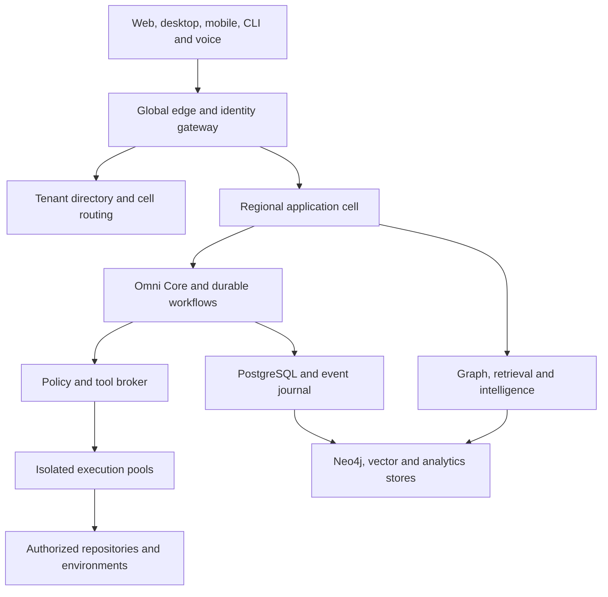

# System architecture and scale envelope

## Architecture decision

OmniDev is a cell-based distributed platform with globally routed experience services, regional control/data planes, and independently isolated execution pools. Omni Core is a logical orchestration authority implemented by partitioned services and durable workflows; it is never one global process or one master model call. Tenant routing, policy, durable state and execution fencing are infrastructure responsibilities, not decisions delegated to an LLM.

A workspace belongs to an organization. An organization has a residency boundary and home region. A project belongs to a workspace and is placed in a cell. A cell owns its project writes, workflows, connection handles and materialized intelligence. Large organizations can span multiple cells within their residency policy. Enterprise dedicated cells use the same protocols with separate network, keys and storage.

Global services contain routing, public marketplace metadata, product releases and aggregated operational health. They do not hold private repository content. Global outages must not prevent already authenticated in-region projects from performing permitted reads; sensitive writes require a valid region authority epoch and current policy.

## Design envelope: targets to validate, not achieved capacity

| Dimension | Global planning target | Placement / admission rule |
|---|---:|---|
| Registered users | 10 million | Identity directory and regional profiles; no global user-content join |
| Concurrent interactive users | 1 million | Edge connections distributed to regional BFF/realtime fleets |
| Connected repositories | 10 million | Project-home routing; hot repositories receive dedicated placement |
| Graph nodes / edges | 5 billion / 20 billion | Multiple project-local graph partitions per cell |
| Indexed semantic chunks | 10 billion active | Versioned vector partitions; cold source remains in object storage |
| Concurrent agent turns | 100,000 | Weighted admission by organization, cell, provider and compute pool |
| Concurrent sandbox jobs | 20,000 | CPU/GPU/image/licensing quotas; queue surplus work |
| Sustained business events | 100,000/second | Cell topics and partitioned aggregates; source bodies in objects |
| Business-event burst | 500,000/second for 15 minutes | Absorb queue backlog; prioritize incidents and committed delivery |
| Production footprint | Initial 3 regions, grow by cells | Three zones per region; separate permitted DR destination |

Initial expansion model: 100 cells at maturity. Average per cell: 100,000 repositories, 50 million nodes, 200 million edges, 100 million vectors, 10,000 interactive connections, 1,000 concurrent agent turns, 200 sandboxes and 1,000 sustained business events/second. These averages are placement inputs, not safe per-database limits. Start a cell substantially below its measured envelope and split before its hottest resource exhausts headroom. Graph/vector partitions inside a cell scale independently.

Hot-key admission is governed by project/repository/provider quotas. One huge monorepo or incident cannot consume the whole cell. Long-tail cold repositories retain immutable snapshots and metadata without continuously active compute. Full rescans are paced; incremental commit/path changes are preferred. Tenant placement uses weighted estimates of graph size, vector size, scan velocity, query heat and sandbox use, with migrations under an ownership epoch.

## Capacity model

Twenty billion edges at a planning assumption of 160 bytes per logical edge imply 3.2 TB before indexes, database overhead and replication. Budget 3–8 times that logical size for the first sizing experiment: 9.6–25.6 TB per complete logical copy, then account separately for replica and backup policies. Five billion nodes at 400 bytes imply 2 TB before overhead. Measure actual Neo4j store/index characteristics on the chosen schema; do not order machines from these estimates.

Ten billion vectors at 1,536 float32 dimensions imply 61.44 TB of raw dense vector values. An exploratory 8-bit representation implies 15.36 TB of vector values before indexes/payload/replication; accuracy must pass retrieval evaluation before selecting quantization. Tier active content, deduplicate within authorization scope, and price embedding refresh explicitly.

At 1 KB/event, 100,000 events/second produces 8.64 TB/day of uncompressed business envelopes. Seven-day hot retention is 60.48 TB logical; three replicas are 181.44 TB before compression and broker overhead. Use an object archive and shorter topic-specific retention where justified. Telemetry is a separate pipeline and must not multiply this journal with per-token events.

Sandbox planning example: 20,000 jobs × 2 vCPU × 40% average CPU use = 16,000 effective vCPU consumption; reserve 40,000 vCPU if every admitted job can use its limit simultaneously. GPU/render classes have distinct reservations and licensing. Provider inference quotas are independent of local compute. Idle agents are records/workflows, not permanently running containers.

## Reliability targets

| Surface | Target SLO / objective |
|---|---|
| Authenticated metadata API | 99.95% monthly availability; p95 <300 ms in home region excluding external provider work |
| Realtime accepted-state delivery | 99.9%; p95 <2 seconds after authoritative commit |
| Durable task acceptance | 99.95%; no acknowledged task lost during a zone failure |
| Interactive retrieval | p95 <1.5 seconds at defined query limits; show projection watermark |
| New commits to intelligence | p95 <5 minutes for a reference 100K-file repository delta; separate full-scan SLA |
| Security / budget enforcement | Fail closed for uncertain authority, missing grant or exhausted reservation |
| Zone failure | RPO 0 for acknowledged PostgreSQL primary/quorum operations; RTO <5 minutes target |
| Regional disaster | Standard async tier RPO ≤5 minutes / RTO ≤60 minutes; zero-RPO tier requires proven synchronous commit receipt and higher latency |

SLOs exclude tenant-disabled sources but include truthful unavailable status. Composite workflow latency depends on provider/model, repository size and approvals; do not promise a universal completion time. Prove these targets with workload suites, failure injection and recovery drills before selling guarantees.

## Invariants

1. All private operations carry tenant, workspace/project, identity and residency context derived by the server.
2. A durable aggregate has one writable home and monotonically increasing authority epoch.
3. Models propose actions; policy and capability enforcement authorize them.
4. Every external side effect has an operation ID, intent, execution receipt and reconciliation path.
5. Derived projections can lag; approved releases bind immutable snapshots and evidence versions.
6. Agent expansion never bypasses ancestor grants, deadlines or financial reservations.
7. Global pattern intelligence never consumes private cross-tenant content without explicit permission and a reviewed privacy pipeline.
8. A deployment result, test result, forecast and model proposal are different typed facts.
