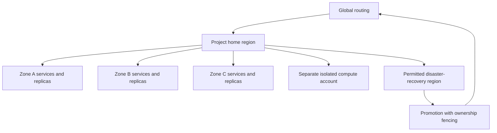

# Cloud infrastructure, global deployment and recovery

## Multi-cloud topology

Reference deployment supports AWS, Azure and Google Cloud through a portable Kubernetes/service contract. Cloud adapters provide identity, private networking, load balancing, KMS, object storage, managed PostgreSQL where suitable, DNS and observability export. Vercel is not required. Managed services may differ across providers; preserve API/consistency/backup contracts instead of pretending every cloud service is interchangeable.

Each region has at least three availability zones. Deploy stateless services across zones with topology spread, disruption budgets, readiness checks and resource requests/limits. Separate node pools for control services, data stores, ingestion, CPU sandboxes, GPU/model jobs and licensed 3D/render workloads. Untrusted execution uses a separate cloud account/subscription/project and network boundary; the orchestrator reaches it through a scoped broker/control API, never a shared host socket.

A cell contains its application services, PostgreSQL primary/failover standbys, regional Kafka/Temporal, Redis, multiple Neo4j/Qdrant partitions, object namespaces and telemetry. Cells have independent deployment versions, quotas and SLO dashboards. Tenant directory routes projects by signed placement epoch. Do not keep millions of connections or repositories in a single globally writable database.

## Infrastructure and release control

Use reviewed infrastructure-as-code modules, provider lockfiles, encrypted state and workload federation. Separate bootstrapping/migration identities from application identities. Infrastructure changes produce a plan, target/resource selector, policy checks, approval and rollback/recovery plan. Protect DNS, routing, keys and tenant-directory changes as high-impact operations.

Build once, sign artifact and SBOM, then promote the same digest through development, integration, staging, canary and production. Cells deploy in rings: internal → small reference cell → low-risk tenants → regional expansion → global rollout. GitOps reconciliation applies reviewed manifests; it cannot override a denied policy or deploy mutable image tags. Service mesh/network policies deny unnecessary east-west and egress access.

Application canaries evaluate error rate, latency, saturation, queue lag, permission failures and business-operation correctness. Database changes use expand → dual read/write where necessary → backfill → verified cutover → contract. Rollback compatibility includes data/schema and event/template versions; a container rollback alone is insufficient. Temporal workflow versions must replay existing histories correctly; retain compatible workers until old runs drain or migrate.

## Ownership, replication and failover

One project aggregate has one active home writer. PostgreSQL zone failover uses synchronous durability and a tested election/fencing configuration. Cross-region standard tier is asynchronous with explicitly declared RPO. Zero-RPO enterprise configurations require synchronous cross-region acknowledgement and measured latency/availability tradeoffs; no async replication is advertised as zero data loss.

Region promotion protocol:

1. Determine last durable replicated commit/checkpoint and report possible loss window.
2. Establish that old writers cannot dispatch: revoke/fence routing epoch, tool grants and execution authority. If old region cannot be fenced, privileged writes remain paused.
3. Promote permitted data replicas; increment cell/project authority epoch atomically in routing authority.
4. Resume compatible workflow workers from durable state; reconcile every external operation dispatched near failure.
5. Rebuild/cache/projection watermarks and serve labeled read state; resume sensitive actions only after policy/ledger readiness.
6. Verify targets, reservations and financial receipts before retrying work. Update directory and publish incident evidence.

Source artifacts and journals replicate only to permitted residency destinations. Cross-cloud disaster recovery uses portable manifests and encrypted object replication with independently verified restore capability, not an assumed universal live database replication feature. Regional analytics may produce only approved non-sensitive aggregates outside residency boundaries.

## Data recovery

PostgreSQL point-in-time recovery plus tested backups; object versioning and retention; Neo4j snapshots/journal replay; Qdrant snapshots/rebuild from embedding manifests; Kafka configuration/offset checkpoints and archive; Temporal persistence backup consistent with its event histories. Redis rebuilds from authoritative state. Backup keys have independent protected recovery procedures and separation of duties.

Recovery tests include missing keys, corrupted backup, partial event archive, incompatible parser/model generation, revoked source access and restoring a deleted tenant. Tombstone/deletion ledgers replay before restored data becomes queryable. Restoring a backup must not resurrect a revoked permission or replay an already completed financial/production operation.

## Scale and placement controls

Autoscale stateless services by concurrency/latency and workers by ready-queue age plus available reservations. Avoid autoscaling only on CPU for provider-bound workers. Database/storage scale uses measured heat, latency and projected growth; tenant migration is a workflow with source snapshot, dual projections, fenced cutover and rollback. No uncontrolled multi-cloud spillover of tenant data.

Plan headroom for a zone outage and an incident burst, not merely average CPU. Use admission to preserve status, cancellation and policy during overload. During provider outages, circuit-break the affected route, keep journals healthy and offer approved alternative models only if consent, residency, quality and billing policy permit them. Provider migration never silently changes the customer's contractual data-processing boundary.
