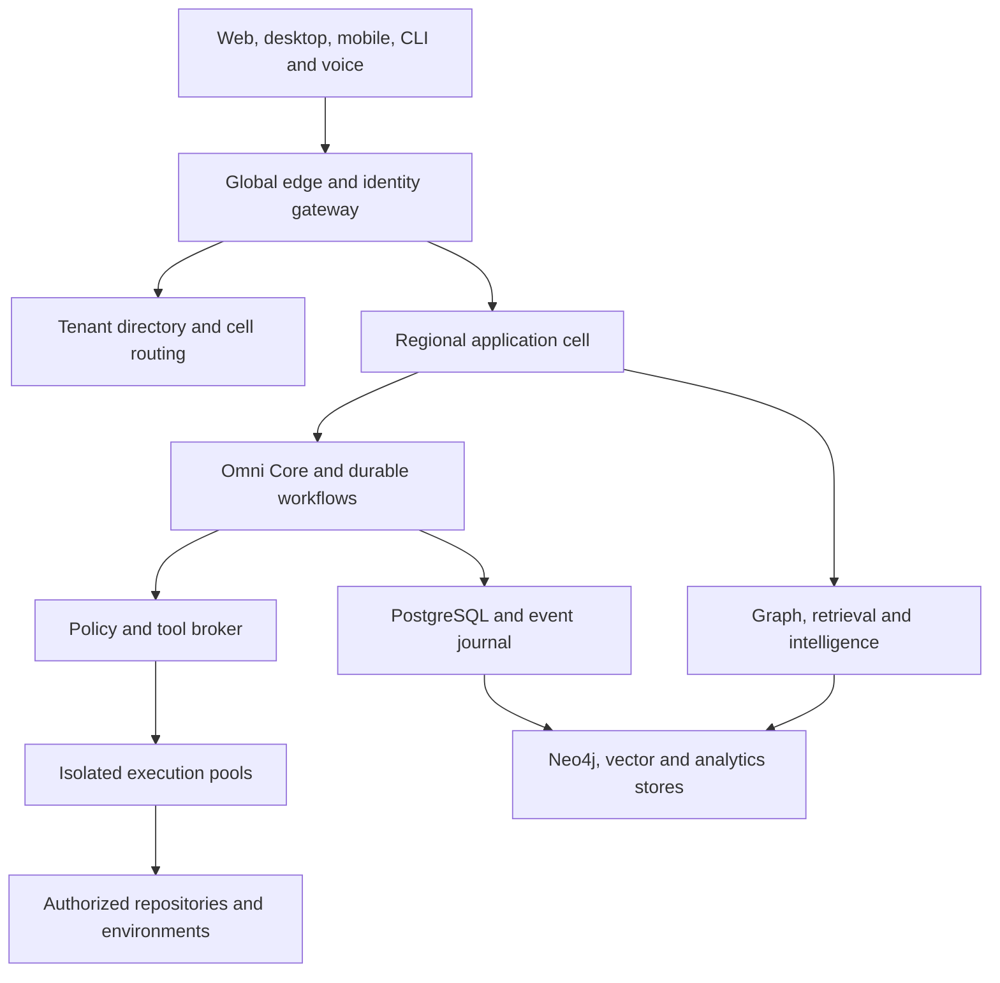
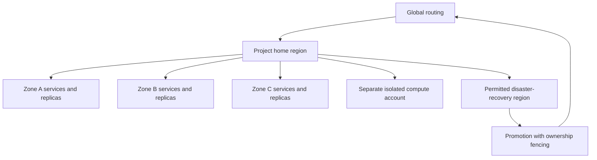

# OmniDev Swarm — complete production architecture

Target architecture and implementation specifications. Design completion does not mean production deployment or measured scale qualification. See README for reference contracts and the canonical unfinished-work register.

# System architecture and scale envelope

## Architecture decision

OmniDev is a cell-based distributed platform with globally routed experience services, regional control/data planes, and independently isolated execution pools. Omni Core is a logical orchestration authority implemented by partitioned services and durable workflows; it is never one global process or one master model call. Tenant routing, policy, durable state and execution fencing are infrastructure responsibilities, not decisions delegated to an LLM.

A workspace belongs to an organization. An organization has a residency boundary and home region. A project belongs to a workspace and is placed in a cell. A cell owns its project writes, workflows, connection handles and materialized intelligence. Large organizations can span multiple cells within their residency policy. Enterprise dedicated cells use the same protocols with separate network, keys and storage.

Global services contain routing, public marketplace metadata, product releases and aggregated operational health. They do not hold private repository content. Global outages must not prevent already authenticated in-region projects from performing permitted reads; sensitive writes require a valid region authority epoch and current policy.

## Design envelope: targets to validate, not achieved capacity

| Dimension | Global planning target | Placement / admission rule |
|---|---:|---|
| Registered users | 10 million | Identity directory and regional profiles; no global user-content join |
| Concurrent interactive users | 1 million | Edge connections distributed to regional BFF/realtime fleets |
| Connected repositories | 10 million | Project-home routing; hot repositories receive dedicated placement |
| Graph nodes / edges | 5 billion / 20 billion | Multiple project-local graph partitions per cell |
| Indexed semantic chunks | 10 billion active | Versioned vector partitions; cold source remains in object storage |
| Concurrent agent turns | 100,000 | Weighted admission by organization, cell, provider and compute pool |
| Concurrent sandbox jobs | 20,000 | CPU/GPU/image/licensing quotas; queue surplus work |
| Sustained business events | 100,000/second | Cell topics and partitioned aggregates; source bodies in objects |
| Business-event burst | 500,000/second for 15 minutes | Absorb queue backlog; prioritize incidents and committed delivery |
| Production footprint | Initial 3 regions, grow by cells | Three zones per region; separate permitted DR destination |

Initial expansion model: 100 cells at maturity. Average per cell: 100,000 repositories, 50 million nodes, 200 million edges, 100 million vectors, 10,000 interactive connections, 1,000 concurrent agent turns, 200 sandboxes and 1,000 sustained business events/second. These averages are placement inputs, not safe per-database limits. Start a cell substantially below its measured envelope and split before its hottest resource exhausts headroom. Graph/vector partitions inside a cell scale independently.

Hot-key admission is governed by project/repository/provider quotas. One huge monorepo or incident cannot consume the whole cell. Long-tail cold repositories retain immutable snapshots and metadata without continuously active compute. Full rescans are paced; incremental commit/path changes are preferred. Tenant placement uses weighted estimates of graph size, vector size, scan velocity, query heat and sandbox use, with migrations under an ownership epoch.

## Capacity model

Twenty billion edges at a planning assumption of 160 bytes per logical edge imply 3.2 TB before indexes, database overhead and replication. Budget 3–8 times that logical size for the first sizing experiment: 9.6–25.6 TB per complete logical copy, then account separately for replica and backup policies. Five billion nodes at 400 bytes imply 2 TB before overhead. Measure actual Neo4j store/index characteristics on the chosen schema; do not order machines from these estimates.

Ten billion vectors at 1,536 float32 dimensions imply 61.44 TB of raw dense vector values. An exploratory 8-bit representation implies 15.36 TB of vector values before indexes/payload/replication; accuracy must pass retrieval evaluation before selecting quantization. Tier active content, deduplicate within authorization scope, and price embedding refresh explicitly.

At 1 KB/event, 100,000 events/second produces 8.64 TB/day of uncompressed business envelopes. Seven-day hot retention is 60.48 TB logical; three replicas are 181.44 TB before compression and broker overhead. Use an object archive and shorter topic-specific retention where justified. Telemetry is a separate pipeline and must not multiply this journal with per-token events.

Sandbox planning example: 20,000 jobs × 2 vCPU × 40% average CPU use = 16,000 effective vCPU consumption; reserve 40,000 vCPU if every admitted job can use its limit simultaneously. GPU/render classes have distinct reservations and licensing. Provider inference quotas are independent of local compute. Idle agents are records/workflows, not permanently running containers.

## Reliability targets

| Surface | Target SLO / objective |
|---|---|
| Authenticated metadata API | 99.95% monthly availability; p95 <300 ms in home region excluding external provider work |
| Realtime accepted-state delivery | 99.9%; p95 <2 seconds after authoritative commit |
| Durable task acceptance | 99.95%; no acknowledged task lost during a zone failure |
| Interactive retrieval | p95 <1.5 seconds at defined query limits; show projection watermark |
| New commits to intelligence | p95 <5 minutes for a reference 100K-file repository delta; separate full-scan SLA |
| Security / budget enforcement | Fail closed for uncertain authority, missing grant or exhausted reservation |
| Zone failure | RPO 0 for acknowledged PostgreSQL primary/quorum operations; RTO <5 minutes target |
| Regional disaster | Standard async tier RPO ≤5 minutes / RTO ≤60 minutes; zero-RPO tier requires proven synchronous commit receipt and higher latency |

SLOs exclude tenant-disabled sources but include truthful unavailable status. Composite workflow latency depends on provider/model, repository size and approvals; do not promise a universal completion time. Prove these targets with workload suites, failure injection and recovery drills before selling guarantees.

## Invariants

1. All private operations carry tenant, workspace/project, identity and residency context derived by the server.
2. A durable aggregate has one writable home and monotonically increasing authority epoch.
3. Models propose actions; policy and capability enforcement authorize them.
4. Every external side effect has an operation ID, intent, execution receipt and reconciliation path.
5. Derived projections can lag; approved releases bind immutable snapshots and evidence versions.
6. Agent expansion never bypasses ancestor grants, deadlines or financial reservations.
7. Global pattern intelligence never consumes private cross-tenant content without explicit permission and a reviewed privacy pipeline.
8. A deployment result, test result, forecast and model proposal are different typed facts.

# Microservices, ownership and process boundaries

Services below are logical contracts. Deploy together where throughput and isolation allow; split process boundaries when independent scaling, residency, blast radius or operating ownership demands it. Each service owns its schema and migrations. Shared PostgreSQL infrastructure does not grant cross-service table access. Cross-service writes use APIs or committed events, not direct database mutation.

| Service | Authoritative responsibilities | Storage / contract |
|---|---|---|
| Identity & session | Human identity mapping, sessions, federation, device grants, MFA context | Regional PostgreSQL; OIDC/SAML/SCIM adapters |
| Organization & workspace | Membership, project ownership, environment classification, residency | PostgreSQL; workspace events |
| Tenant directory | Home cell, routing epoch, migration state, signed placement records | Strongly consistent routing database; locally cached signed reads |
| Policy & capability | RBAC/ABAC, action grants, approvals, delegation, revocation epoch | PostgreSQL policy revisions; decision API |
| Connections & vault | Provider registrations, scopes, account/resource mapping, token refresh | Encrypted handles; KMS/vault integration |
| Ingestion coordinator | Webhook validation, scan manifests, checkpoints, connector jobs | PostgreSQL and Kafka; immutable object references |
| Source intelligence | Parsers, dependency/data-flow/API/infrastructure extraction | Sandboxed analyzers; extraction artifacts |
| Graph writer | Canonical entity resolution, edge provenance, projection version | Neo4j partitions; source journal in objects/events |
| Graph query | Authorized bounded graph traversals and projections | Neo4j read replicas; policy-aware query planner |
| Memory | Typed assertions, decisions, provenance, scope, correction/retention | PostgreSQL metadata, objects, retrieval indexes |
| Semantic retrieval | Embeddings, hybrid retrieval, reranking, ACL filtering, citations | Qdrant and lexical index; versioned model registry |
| Omni Core planner | Task decomposition, specialist selection, conflict policy and progress | Durable workflow definitions; planner proposal artifacts |
| Workflow scheduler | Durable state machines, timers, retries, task queues and fairness | Temporal cluster with separate persistence schemas |
| Agent registry & runtime | Agent identities/templates, lineage, turns, health and evaluation | PostgreSQL agent/task aggregates; Redis presence |
| Model gateway | Supported account inference, routing, quotas, timeouts, usage receipts | Provider adapters; no generalized consumer-session scraping |
| Tool broker | Capability validation, target binding, side-effect receipts | PostgreSQL operation ledger; scoped connector executors |
| Sandbox control | Attested placement, images, CPU/GPU quotas, isolation and cleanup | Ephemeral execution pools; PostgreSQL durable manifests |
| Development delivery | Patch/commit baselines, CI evidence, reviewed branches/PRs | PostgreSQL change sets; object artifacts; repository adapters |
| Findings & gaps | Rules, triage, remediation hypotheses, coverage and deduplication | PostgreSQL findings; graph/rule evaluation artifacts |
| Security intelligence | Scanners, advisories, secrets, threat signals and supply-chain facts | Approved feeds; encrypted artifacts; scoped scanner jobs |
| Twin simulation | Twin manifests, scenario execution, calibration and impact intervals | Objects, compute workflows, timeseries/results metadata |
| Reliability & healing | Incidents, diagnosis, repair policy, rollout/health gates and learning | Incident aggregates and durable workflows |
| Future & innovation | Horizons, research, opportunity experiments and evaluations | Versioned hypotheses; evidence bundles |
| Scores & executive views | Methodology versions, coverage/confidence and score snapshots | PostgreSQL snapshots; analytical rollups |
| Realtime gateway | WebSocket subscriptions, resume cursors, presence, status fanout | Redis transient streams/cache; durable resume from event archive |
| Experience BFF | Client-specific view models, navigation and authorization-aware composition | Short-lived private caches; no source of truth |
| Marketplace & plugins | Signed releases, compatibility, installation policy, reviews, payouts | PostgreSQL registry; signed object artifacts |
| Metering & billing | Reservations, immutable usage, rate cards, ledger, invoices/reconciliation | Separate PostgreSQL financial schemas; analytical exports |
| Analytics | Product events, cohort/usage statistics, privacy-safe reporting | ClickHouse and object lake; curated cross-tenant aggregates |
| Observability | Operational metrics, logs, traces, alert routing and SLOs | VictoriaMetrics-compatible TSDB, object/log index, trace backend |
| Audit & evidence | Append-only security/operation/evaluation facts, legal hold, signatures | PostgreSQL pointers; WORM-capable object archive |
| Notification | In-app/device/email/provider notifications with explicit preferences | Delivery ledger, templates and message queues |

## Dependency discipline

A command request should synchronously cross at most gateway → owning service → policy/reservation, then commit and return an operation handle. Long inference, extraction, graph rebuild, rendering and scanning are asynchronous. Read composition uses bounded BFF fanout with deadlines and degraded per-panel states; never synchronously join every store.

Identity, policy, financial reservation and operation intent are required for sensitive writes. Graph, vector, scores and analytics can be unavailable without taking down the core task journal. If policy authority is unavailable, new privileged actions stop; running read-only jobs may use unexpired bounded capabilities where permitted. If billing reservation authority is unavailable, no new billable dispatch occurs; workers checkpoint existing reserved work.

Service schemas are defined under immutable versioned migration paths. Database credentials are service-specific and cannot own or bypass row-security policies. Privileged migration jobs are a separate identity. PostgreSQL transactions never pretend to commit Neo4j, Qdrant and a provider API atomically; committed outbox events drive projections and side effects.

## Ownership and SRE responsibilities

Identity/policy/vault and financial ledger require dedicated review ownership. Execution services own sandbox breakouts and job correctness. Intelligence services own provenance, coverage, retrieval leakage and graph freshness. Experience services own accessibility and consent UX. Platform SRE owns cell capacity, routing epochs, backups and recovery. Security signs releases with material permission/isolation changes. Billing owns reconciliation and corrections, never silently rewrites historical usage.

An incident has one operational commander, an evidence timeline and an explicit severity. Emergency agent creation does not grant break-glass rights; those require independently logged human authorization with scope and expiry.

# Agent operating system, Omni Core and fractal swarms

## Agent identity and persisted contract

Each agent is a logical principal, not a process. Identity is `{tenant_id, agent_id, template_digest, parent_agent_id, root_run_id, authority_epoch}`. Additional fields: specialization, goal/objectives, immutable context snapshot, task queue reference, working-memory handle, scoped long-term memory selectors, communication subscriptions, tool grants, model policy, cost reservation, deadline, evaluation rubric, health state and retirement policy.

A swarm is a scoped collaboration aggregate with members, parent swarm, objective, project graph snapshot, policy, supervisor and budget. Root departments include Security, Backend, Frontend, DevOps, Cloud, Database, Architecture, Testing, Documentation, Research, AI, 3D, Game Development, Business Intelligence, Revenue, Innovation and Future Prediction. The 47 detailed domains from the existing catalog specialize these departments. All share the same security/task protocol; domain prompts and tools are versioned separately.

No fixed schema depth constrains parent/child hierarchy. Execution still requires available budget and a spawn grant. Depth-sensitive operations use iterative traversal/path indexes, not application stack recursion. Huge subtrees are paginated. Per-root cumulative limits survive spawn/retry; splitting into new agents cannot reset quotas. Long-running improvement loops start new workflow generations with parent lineage and retained budget policy.

## Agent lifecycle

`defined → admitted → ready → leased → executing → checkpointed → reviewing → completed/failed/canceled → retired`.

A suspended agent has no active compute lease. A retired identity remains in the evidence ledger, with credentials revoked and memory retention governed by policy. Health distinguishes no work, waiting approval, waiting provider, unavailable worker, stalled lease, failed execution and unhealthy evaluation. Agent creation is idempotent by `{root_run, parent_task, specialization, generation}`.

The runtime uses a lease with monotonic fencing token plus heartbeats. Control state is durable; Redis presence expires and cannot establish completion. An execution result must match task ID, attempt, lease/fencing token, input digest, output digest and attested execution identity. Late results become evidence-only or are rejected, never applied to a newer revision.

## Omni Core planning algorithm

1. Freeze the objective, target resources, source revision, policy revision and coverage statement.
2. Classify project/domain using evidenced manifests and requirements. Retrieve only authorized context.
3. Generate a typed proposal DAG: inputs, tasks, dependencies, specialist roles, artifact contracts, estimates and acceptance tests.
4. Deterministically validate cycles, dependency existence, allowed targets, inherited capabilities and resource budgets. Model output cannot directly dispatch tools.
5. Reserve a root budget and allocate child allowances. Use weighted fair queues by organization and class; incidents can preempt resumable research but cannot bypass policy.
6. Execute ready tasks in isolated or model-only pools. Persist checkpoints and provenance after every material step.
7. Gather specialist reviews and conflicting evidence. Invoke conflict resolution; preserve dissent.
8. Validate code/artifact/test evidence, authorize the proposed external action and obtain approvals bound to exact digests.
9. Dispatch through tool broker; reconcile uncertain outcomes before retry.
10. Measure outcomes, retain the decision record, update project intelligence and close or continue the improvement generation.

## Collaboration, debate and votes

Agent communication uses typed proposal, question, evidence, review, dissent, escalation and completion messages. Address agents by scoped principal and run; no unrestricted broadcast of private context. A message references content-addressed evidence and a correlation ID. Debate is bounded by round/token/deadline quotas and records unresolved objections.

For a normal engineering choice, assign proposer, independent reviewer and test verifier; security-sensitive choices include the security role. A vote is a recommendation, not authorization. Count one vote per assigned role; spawning extra agents cannot create extra votes. Weighting is rubric-based and recorded before the debate. Shared-model/correlated reviewers are disclosed. A policy veto, failing test or unauthorized action overrides a majority. Conflicts escalate to Omni Core's deterministic policy or a human approver when evidence is insufficient.

Evaluation records task completion quality, regression rate, unsupported claims, security-policy violations, useful artifacts, cost, latency and reviewer disagreement. Do not reward raw agent count, token throughput or unverified self-reported success. Template promotion requires held-out tasks and rollback to a prior template digest.

## Durable workflow implementation

Select Temporal for durable orchestration. Workflow code is deterministic; external model/tool calls occur in Activities whose outputs are recorded. Child workflows correspond to bounded swarm/task groups; periodic Continue-As-New keeps long histories bounded. Large context/output data lives in immutable object storage; workflow payloads carry references and digests. Separate task queues by cell, tool class, CPU/GPU/license and priority. Provider retries respect provider limits and root budgets.

Official behavior basis: [workflow determinism](https://docs.temporal.io/workflow-definition) and [child workflows](https://docs.temporal.io/child-workflows). Product-specific retry, fairness and approval policy are design choices in this package.

## Cost and authority conservation

Child maximum capability = intersection of parent capability, agent-template capabilities, target policy and current grant. Child deadline ≤ parent deadline. Root spent + active reservations + proposed children ≤ root financial ceiling. Model/tool dispatch reserves maximum permitted usage before execution; settlement replaces reservation with signed actual receipt. Cancellation revokes descendant capabilities, stops new dispatch and compensates/reconciles already dispatched effects.

Provider account sign-in supplies only the capabilities granted by that provider. A cloud workforce identity is not a model usage grant. An agent cannot invent a new integration to bypass a missing provider authorization.

# Database, graph, memory and vector architecture

## Store ownership

| Store | Role | Authority / consistency |
|---|---|---|
| PostgreSQL | Tenants, workspaces, projects, agents/tasks, policies, approvals, connections, financial ledgers, artifact manifests | Transactional authority per home cell; service-owned schemas |
| Neo4j | Typed project/system relationships and traversals | Versioned materialized graph; rebuildable from extraction/source journal |
| Redis | Presence, session/realtime cache, local throttling and short-lived coordination hints | Ephemeral; no financial balance, durable task or permission authority |
| Object storage | Immutable source snapshots, artifacts, assets, documents, 3D scenes, event archives and backups | Content-addressed versioned manifests; tenant encryption and retention |
| Qdrant | Dense/sparse semantic retrieval | Derived versioned index; service-enforced tenant/resource filters |
| Time-series database | Metrics, workload signals, simulation telemetry | Operational telemetry; explicit retention/downsampling |
| ClickHouse | Product/usage/security analytical rollups | Derived, late-arrival-tolerant analytical projection |
| Lexical search index | Exact code/symbol/doc search and BM25 candidates | Derived; identical ACL/version constraints to semantic search |

All private records include tenant, project/resource scope, classification, residency, source version and provenance. Independent stores maintain a projection watermark. A query can return stale-but-labeled data for permitted read use; release decisions require a matching approved source and evidence watermark. Store failure never authorizes a broader fallback search.

## Knowledge graph model

Canonical node fields: `entity_id`, `tenant_id`, `project_id`, `kind`, `source_system`, `external_id`, `source_revision`, `content_digest`, `valid_from`, `valid_to`, `observed_at`, `classification`, `acl_version`, `extractor_version`, `confidence`, `artifact_ref` and small query properties. IDs are stable within tenant/source; paths/names are attributes, not global identities. Function identity accounts for language-qualified signature and file lineage. A rename creates a lineage relation rather than claiming unchanged identity without evidence.

Node types cover Organization, Workspace, Project, Repository, Commit, File, Package, Function, Method, Class, APIEndpoint, Service, Deployment, InfrastructureResource, Database, Schema, Table, Column, User, Conversation, Message, Ticket, Decision, Requirement, Test, Finding, Agent, Swarm, Run, Artifact, Asset, Model3D, DesignFile, UserFlow, BusinessObjective, CostCenter, RevenueStream and Experiment.

Edge types include `CONTAINS`, `DEFINES`, `CALLS`, `IMPORTS`, `DEPENDS_ON`, `READS`, `WRITES`, `EXPOSES`, `DEPLOYS_TO`, `IMPLEMENTS`, `TESTS`, `OWNED_BY`, `AUTHORIZES`, `MENTIONS`, `DECIDED_BY`, `DERIVED_FROM`, `SUPERSEDES`, `AFFECTS`, `FUNDS`, `GENERATES_REVENUE`, `OBSERVED_IN`, `SIMULATES` and `CONTRADICTS`. Each relationship has its own evidence digest, confidence, temporal validity, source and ACL. An edge cannot reveal a forbidden endpoint or infer one through counts.

Evidence establishes connectivity. An unresolved import/unknown service is a typed unresolved node, not an invented confirmed relationship. A project may contain isolated entities until discovery proves connections; “everything connected” is an integration objective, not permission to fabricate edges.

## Graph partitioning and queries

Partition by residency → cell → organization/project group. Co-locate most repository/package/service relationships. Use a graph partition directory for cross-project links, resolving remote edges through bounded federation. Dedicated large-tenant partitions avoid a database per tiny tenant. A cell has multiple graph databases/partitions and read replicas; route hot projects separately. No design assumes 20 billion edges in one Neo4j instance.

Neo4j composite/federated facilities may assist in-region composition where the chosen edition and deployment support them. Enterprise and hosted availability must be verified before procurement; the architecture also supports application-level federation. [Neo4j composite concepts](https://neo4j.com/docs/operations-manual/current/scalability/composite-databases/concepts/).

Public API accepts typed graph-query operations, never arbitrary untrusted Cypher. Default traversal: depth ≤4, node limit 1,000, edge limit 5,000, 2-second execution deadline; privileged analytical jobs receive separate resource reservations. Pagination uses snapshot/partition cursors. Algorithms such as dependency-centrality run asynchronously on scoped projections, not on interactive query threads. Cross-cell queries return partial coverage explicitly when a permitted shard is unavailable.

Ingestion writes extraction batches identified by `{source revision, extractor digest}`. The graph writer deduplicates by operation ID, applies a versioned batch, marks projection watermark and emits completion. Deleted source produces tombstones; authorized rebuild replays the journal into a new projection and swaps the directory only after validation.

## Memory layers

| Layer | Scope / representation | Lifetime / promotion |
|---|---|---|
| Short-term / working | Turn scratch and compact session context; Redis/object checkpoints | TTL hours; promote only reviewed useful facts |
| Swarm | Shared run hypotheses, reviews and task context | Run retention; authority no broader than participants' project grants |
| Project | Versioned architecture, bug/debt/feature/deployment history | Tenant retention; source-linked corrections |
| Company | Organization decisions, patterns and objectives | Org-authorized access; no implicit access across teams |
| Global intelligence | Public patterns and explicitly consented privacy-reviewed aggregates | Separate corpus; never raw private cross-tenant memory |
| Innovation | Opportunities, novelty research, experiments and outcomes | Versioned hypothesis/validation state |
| Research | Sources, methods, observations and competing conclusions | Source freshness and retention policy |
| Decision | ADR, rationale, approver, alternatives and later reversal | Append-only versions; supersession rather than silent rewriting |

A memory assertion is `{claim, type=fact|hypothesis|decision|observation, evidence_refs, scope, confidence, valid_time, owner, revision}`. Model summaries retain citations and may not replace the original evidence. Contradictions create linked assertions and review tasks. Retrieval marks stale, disputed, superseded and source-deleted facts. “Indefinite memory” means durable preservation when lawful and contracted; user deletion, legal retention and encryption-key revocation still apply.

## Vector and retrieval design

Embedding IDs bind tenant, resource, revision, chunk locator, content digest, embedding-model digest and index generation. Chunk by syntax/document structure; preserve file/line or document locators and source permissions. Images/3D assets have modality-specific embeddings and original-object references. Do not mix incompatible embedding dimensions/model generations in a query.

Qdrant collections are per cell/modality/model generation; small tenants share payload-filtered partitions, large/dedicated tenants receive dedicated shards/collections. The retrieval service injects mandatory tenant and authorized resource filters before nearest-neighbor search. Recheck returned citations against current policy/revocation and source version; filtering after unrestricted retrieval alone is insufficient. [Qdrant multitenancy](https://qdrant.tech/documentation/manage-data/multitenancy/).

Pipeline: authorized candidates → lexical/dense hybrid retrieval → graph expansion within limits → rerank → coverage/diversity check → cited context bundle. Query cache key includes tenant, principal/grant digest, ACL epoch, source/index generation, embedding digest and query. An index miss is not evidence of absence. Embedding refresh uses blue/green generations, held-out recall tests, cost reservation and reversible directory switch. Deletion invalidates reads immediately at policy layer and schedules physical index/object deletion; backup expiry is tracked separately.

# Security, authentication, authorization and isolation

## Trust boundaries

Separate human devices, edge/BFF, cell services, model providers, connector executors, untrusted-code sandboxes, customer environments, marketplace publishers and cross-tenant analytics. Every boundary has authenticated identity, a permitted data contract and an explicit action scope. Repository text, documentation, issues, model output, agent messages and plugins are untrusted inputs; signed provenance establishes origin, not correctness or permission.

Human authentication supports enterprise OIDC and SAML federation, passkeys/MFA and managed workforce provisioning through SCIM. Customer organization linking requires verified membership, not matching email domains alone. Desktop/mobile use authorization-code flow with PKCE in the system browser and protected OS credential storage. CLI supports browser or provider-supported device authorization. Browser sessions use HttpOnly, Secure cookies, origin/CSRF checks, short access lifetimes and server-side revocation. Workspaces never receive provider passwords.

The current Sites sign-in remains the owner-private prototype entry point. Production Identity Service maps it into an organization/session model only through a documented trusted assertion. GitHub authorization is a separate connection. ChatGPT/model account authorization is another separate grant; identity login alone does not authorize inference. Supported hosted plan usage requires the provider-approved integration. Google login can identify a person or authorize particular Google resources; it grants no blanket access to every AI provider.

## Authorization model

RBAC establishes organizational roles: owner, administrator, security administrator, billing administrator, engineer, reviewer, researcher, auditor and viewer. Agent/service principals have no default human role. ABAC evaluates tenant/project membership, environment tier, action class, resource labels, source classification, device assurance, region, approval, time window, cost and incident context. Explicit deny wins; membership alone cannot authorize production deployment.

Action tiers:

| Tier | Examples | Decision requirements |
|---|---|---|
| Read | Scoped source/graph/memory retrieval | Current resource grant and residency policy |
| Propose | Candidate code, finding, plan, report | Read grant; output classification inherited from sources |
| Sandbox | Build/test/scan in isolated replica | Approved image/tool class, compute/cost reservation, artifact policy |
| Repository write | Branch or draft PR | Target-scoped connection, exact candidate/revision digest and write grant |
| Staging release | Reviewed target changes | Test evidence, environment grant, approved plan and rollback |
| Production change | Deployment, data migration, containment | Current authorization, approval policy, maintenance/blast-radius limits and fresh health evidence |
| Financial/admin | Billing change, permission change, secret export | Strong reauthentication and dedicated role; agents cannot self-grant |

A capability is signed, audience-bound and references `{tenant, principal, project, action, targets, input_digest, authority_epoch, policy_version, grant_epoch, reservation_id, expires_at, nonce}`. Tool broker verifies it immediately before dispatch. Delegation intersects parent grant and template policy; no child can increase privilege. Production approvals bind exact artifact digest, target, plan, source revision and expiry. Any material change invalidates approval. Separation of duties prevents proposer from being its only required approver.

Revocation increments a grant epoch in authoritative storage and distributes invalidation. Sensitive dispatch performs a fresh authoritative epoch check, not just a cached JWT check. Ordinary reads may have a documented short revocation window; new release/write actions fail closed during uncertainty. Signed routing epochs and fenced control-store ownership prevent an old region from dispatching after failover.

## Multi-tenant enforcement

Tenant context is derived from authenticated membership and route ownership. Browser-supplied tenant IDs are selectors to validate, not authority. PostgreSQL service roles have no BYPASSRLS and do not own tables; enable and FORCE row security. RLS adds defense in depth, while service-level project/action checks remain mandatory. A transaction-local tenant context is set by trusted middleware and reset by pool boundaries; leaked pooled context is a test case. [PostgreSQL row security](https://www.postgresql.org/docs/current/ddl-rowsecurity.html).

Neo4j, Qdrant, object storage, Redis keys, message topics and metrics queries all require server-owned tenant/project scoping. Dedicated cells offer stronger physical isolation but still need authorization. Download URLs are short-lived, bound to current classification and permission where feasible, and never authorize listing another prefix. Egress checks cover redirects, DNS rebinding and cloud metadata endpoints. Resource counts, search suggestions and graph neighborhoods must not disclose forbidden entities.

## Encryption modes

Baseline: TLS on external paths, authenticated service-to-service encryption, envelope encryption at rest with per-tenant data keys wrapped by regional KMS. Customer-managed keys and tenant key revocation are enterprise options. Secrets use vault handles and short-lived workload credentials; source content does not enter metrics, exception text or invoice descriptions.

True end-to-end encrypted workspace mode: keys stay on approved customer clients or customer-controlled execution agents. Server stores ciphertext and minimal routing metadata. Plaintext parsing, embedding, inference and twin execution occur in the customer-controlled boundary; server-side graph/search is limited to intentionally disclosed metadata or encrypted artifacts. An external model provider receives plaintext only with an explicit customer-controlled decryption/inference grant. This mode changes available features and diagnostics.

Server-assisted confidential-processing mode is a separate option with attested compute and restricted keys. It is not described as server-blind E2EE. No architecture simultaneously promises server access to arbitrary plaintext for AI analysis and that the server cannot decrypt it. Cryptographic mode is selected per workspace and propagates through ingestion, search, jobs, support and retention.

## Workload and sandbox identity

Use SPIFFE/SPIRE-compatible short-lived workload identities and explicit trust-domain federation between approved regional services. Node/workload attestation precedes capability issuance; service accounts or Kubernetes labels alone are not proof of isolation. [SPIFFE overview](https://spiffe.io/docs/latest/spiffe-about/overview/).

Untrusted repository code runs in disposable microVMs or comparably reviewed stronger isolation on a separate node/network/account pool. Hardened containers suffice only for lower-risk trusted maintenance profiles after threat assessment; they are not the default multi-tenant hostile-code boundary. Read-only base image, unprivileged UID, restricted syscall/capability profile, no host Docker socket, no host mounts, no metadata access, no cloud credentials, bounded CPU/RAM/PIDs/disk/output/time and controlled network egress are mandatory. Kubernetes Restricted standards are a baseline for service pods, not proof of a sandbox boundary. [Pod security standards](https://kubernetes.io/docs/concepts/security/pod-security-standards/).

A sandbox receives immutable sanitized input objects and a narrow artifact upload capability. Repository write and production credentials stay outside it in the tool broker. Dependency network access uses an approved package mirror/proxy with digest records, never unrestricted internet. GPU/render/licensed runtimes have separate pools with license accounting and device-isolation tests. Artifact scanning and provenance verification happen before another tenant or a release consumes output.

## Detection, supply chain and compliance

Collect audit facts for identity, grants, consent, secret access, tools, approvals, execution admission, repository writes, deployments, billing and support access. Hash-chain or signed batch roots plus WORM-capable retention protect evidence against undetected alteration; a hash does not make a log legally compliant by itself. Regional clocks are monitored, and event sequence/receipt times preserve causality when clocks disagree.

Signed builds, SBOMs, verified source/image digests, dependency advisories, publisher identity and restricted build workers protect the supply chain. Threat detection covers token misuse, unusual extraction volumes, cross-tenant requests, suspicious model/tool instructions, sandbox network escapes and financial abuse. Support access uses time-bound reasoned grants and customer-visible audit, with no unrestricted plaintext access in E2EE mode.

Compliance is a control/evidence program with mapped scope, retention, residency, incident response and independent review. The design supports applicable standards; it does not certify them. Authorized penetration testing uses explicit target scope, safe test windows and data handling; a security agent cannot discover and attack arbitrary external systems.

# Events, messaging, streaming and workflow execution

## Separate communication classes

| Class | Transport | Durability / purpose |
|---|---|---|
| Aggregate business facts | Kafka-compatible regional event bus | Replayable committed facts; per-aggregate ordering |
| Durable task routing | Temporal task queues | Activity/workflow dispatch, retries, timers and recovery |
| Low-latency request/response | Internal gRPC over authenticated transport | Bounded command/query service calls |
| Interactive agent/status updates | WebSockets and SSE through regional gateway | Resume from durable journal; transient token/status fanout |
| Presence / short-lived collaboration | Redis pub/sub or transient streams | Loss tolerable; not task completion or permission authority |
| Telemetry | OpenTelemetry collectors and telemetry pipelines | Sampling/retention independent of business journal |
| Large artifacts | Object storage references | Signed digests; no large code blobs in messages |

Kafka is the reference event bus. Initial topic partitions are capacity-tested, not a partition per tenant: partition key is `{tenant_id, aggregate_id}`. Isolation policies control producers/consumers; application handlers revalidate scope. Dedicated enterprise cells may isolate topics physically. Incident events have a bounded separate lane so scan bursts do not delay repair control.

## Canonical envelope

Required fields: `event_id`, `type`, `schema_version`, `tenant_id`, `project_id`, `aggregate_id`, `aggregate_version`, `authority_epoch`, `occurred_at`, `recorded_at`, `producer`, `actor`, `correlation_id`, `causation_id`, `classification`, `residency`, `payload_ref` or bounded `payload`, and `trace_context`. Envelopes must contain no access tokens, credentials or raw sensitive source. A supplied tenant context is authenticated against producer scope; messages are never trusted merely because they are on a bus.

Topic families: `identity`, `workspace`, `connection`, `ingestion`, `graph`, `memory`, `agent`, `task`, `operation`, `artifact`, `finding`, `incident`, `deployment`, `twin`, `research`, `score`, `usage`, `billing`, `marketplace`. Types are past-tense facts such as `task.admitted.v1`, `operation.dispatched.v1`, `deployment.health_failed.v1`. A requested action is a command to its owner, not an already-completed event.

Default payload limit 64 KB; large content is in immutable objects with hash and authorized retrieval. Schema compatibility is checked in CI. Additive optional fields are allowed within a version; semantic changes create a new type/version and dual-read migration. Consumers reject unsupported schemas into quarantine rather than guessing meanings.

## Transactional outbox and consumer inbox

Owning service commits aggregate revision and outbox row in one PostgreSQL transaction. Outbox publisher may emit twice. Consumer records `{consumer, event_id}` and its local mutation in the same transaction, then acknowledges. Aggregate version and authority epoch detect stale/out-of-order effects. Consumers buffer bounded gaps or request replay; they do not invent missing predecessor state.

Design guarantees at-least-once delivery plus idempotent application effects. Kafka idempotent/transactional operations help within the broker pipeline, but do not make a GitHub PR, cloud change or payment exactly once. [Kafka design](https://kafka.apache.org/41/design/design/). Each external effect uses the operation ledger and provider reconciliation described in the API and deployment chapters.

Dead-letter/quarantine records preserve event ID, sanitized failure, consumer version and retry state. Replay requires an authorized operator, dry-run scope and idempotency safeguards; replay of observational events cannot automatically replay production side effects. Business events retain 7-day hot journal by default, with archive and topic-specific contracts; financial/audit retention is separately governed. Retention is not a substitute for backups.

## Durable workflow semantics

A task is admitted once, then receives attempts. Retries keep the root objective, input revision, capability scope and budget. Retryable errors include bounded network/timeouts and provider cooldowns. Invalid permissions, malformed artifacts and exhausted budgets are not retryable. A side-effect timeout enters `reconciling`, not immediate blind retry.

Workflow nodes have states `pending`, `ready`, `admitted`, `running`, `waiting_input`, `waiting_approval`, `reconciling`, `completed`, `failed`, `canceled`, `compensating`. Root cancellation stops new dispatch, signals descendants, revokes grants, records dispatched operations and performs policy-approved compensation. Successful repository/production writes cannot be canceled by deleting the job record.

Parent completion policy declares required children, optional research and tolerated failures. Compensation is explicit: delete an unused branch only if owned and unchanged; roll back deployment only to a verified compatible version; database reversal is not assumed possible. New workflow generations carry lineage and remaining long-term quota. Continue-As-New/checkpoint policies prevent unbounded histories while preserving searchable events/artifacts.

## Realtime delivery

Subscriptions bind tenant, project, allowed event types and principal. Reauthorize periodically and immediately on sensitive permission changes. Each stream uses a cursor `{cell, aggregate, event_sequence}` and a resume token scoped to the subscriber. Clients deduplicate IDs and reconcile optimistic updates against authoritative revisions. Slow consumers receive a bounded buffer, `resync_required` and a snapshot URL; no infinite server buffer.

Tokens are not put in URL query strings. WebSocket upgrade uses the authenticated session or a one-use short-lived handshake grant; origins and scopes are checked. Heartbeats distinguish disconnected clients from absent activity. SSE emits immutable status/evidence refs; model token streams are transient and clearly separate from committed task completion. Reconnect cannot replay a write automatically.

# API and SDK architecture

## Public boundaries

REST `/v1` owns resource commands and conventional reads. GraphQL composes authorized views across projects and dashboards with cost/complexity budgets; it cannot submit raw Cypher or arbitrary service fanout. WebSockets carry scoped subscriptions and collaboration; SSE carries operation progress and model output where authorized. Internal services use versioned gRPC contracts. Enterprise APIs add identity provisioning, organization policy, audit export, residency/dedicated-cell administration and financial reports.

First-party clients use the same policy and operation model as public SDKs. They have no hidden bypass endpoint. Agents use the Tool Broker API with derived capabilities; agent templates cannot directly receive an unrestricted public token. Automation API schedules a durable workflow with explicit source access, project policy, recurring budget and expiry.

## Resource families

| Family | Canonical routes / operations |
|---|---|
| Organizations/workspaces | `/v1/organizations/{id}`, `/workspaces`, `/members`, `/policies`, `/environments` |
| Connections | `/v1/connections`, `/{id}/authorize`, `/callback`, `/resources`, `/sync`, `/revoke` |
| Projects/repositories | `/v1/projects`, `/{id}/repositories`, `/snapshots`, `/intelligence`, `/roadmaps` |
| Agents/swarms | `/v1/agents`, `/swarms`, `/{id}/children`, `/tasks`, `/messages`, `/retire` |
| Runs/tasks | `/v1/projects/{id}/runs`, `/v1/runs/{id}`, `/cancel`, `/events`, `/artifacts` |
| Graph/memory/search | `/v1/projects/{id}/graph/query`, `/memory`, `/search`, `/decisions` |
| Findings/security | `/v1/projects/{id}/findings`, `/{id}/disposition`, `/scans`, `/threats` |
| Candidate delivery | `/v1/change-sets`, `/{id}/validate`, `/review`, `/pull-requests` |
| Approvals/operations | `/v1/approvals`, `/v1/operations/{id}`, `/reconcile` |
| Deployments/incidents | `/v1/environments/{id}/deployments`, `/rollbacks`, `/incidents`, `/repair-runs` |
| Twins/futures/innovation | `/v1/projects/{id}/twins`, `/scenarios`, `/forecasts`, `/opportunities`, `/experiments` |
| Scores/dashboards | `/v1/projects/{id}/scores`, `/v1/workspaces/{id}/dashboard` |
| Marketplace | `/v1/plugins`, `/releases`, `/installations`, `/agents/templates` |
| Metering/billing | `/v1/budgets`, `/usage`, `/invoices`, `/cost-allocations` |
| Automation/enterprise | `/v1/automations`, `/enterprise/scim/v2`, `/audit-exports`, `/residency` |

Paths abbreviated in this table inherit their parent scope; the owning service resolves all resource ownership. The reference OpenAPI contract covers core task/change/deployment commands; the resource catalog is the complete family boundary and must become service-specific specifications during implementation.

## Command contract

Authenticated principal must be a permitted organization/workspace member. Requests include `Idempotency-Key` for effectful POSTs, `If-Match` for updates and an optional request/correlation ID. The server derives tenant/project context. Body max is endpoint-specific: ordinary command 64 KB; snapshots/assets use reserved multipart object uploads, never unlimited API bodies.

Typical `POST /v1/projects/{project_id}/runs` body: objective, immutable source snapshot ID, typed task class, acceptance criteria, requested capabilities, execution policy and cost ceiling in exact currency units. The server checks policy, validates the plan inputs, reserves admission and commits a run/outbox event. Response `202` contains run ID, revision, status, operation URL and progress cursor. It never says code was deployed merely because a task was accepted.

A change-set submission binds parent run, base commit/snapshot digest, patch/asset manifest and evidence refs. Repository or deployment command references an approved immutable change-set; it cannot replace it with new code in the same request. Deployment additionally binds environment/target, plan digest, rollback artifact, health gate and grant/approval.

`GET /operations/{id}` returns `accepted|dispatched|reconciling|succeeded|failed|compensated|canceled`, provider receipt, output artifact and observed outcome. An uncertain side effect remains reconciling until a provider-side read establishes state. Idempotency scope includes tenant, principal/action, target and normalized payload hash; reusing a key with different input returns conflict. Retention is at least the operation reconciliation horizon; release/financial effects retain durable identities beyond ephemeral HTTP cache expiry.

## Read and streaming contracts

List APIs use opaque signed cursor, stable snapshot/watermark and bounded `limit` (default 50, max 200). Do not paginate by mutable offsets for huge changing sets. Responses include source revision, observation time, projection watermark, coverage, classification and `partial` with source-level errors. Strong read-after-write selects the owning authority or waits for a specified watermark until deadline; timeouts return pending state, not stale success.

GraphQL default maximum depth 8, field complexity 1,000 and total resolver deadline 2 seconds; expensive query/memory/graph algorithms become async jobs. DataLoader/cache keys include tenant and authorization epoch. Persisted query IDs are preferred for dashboard panels. SDKs do not cache revoked private results indefinitely.

Streaming uses event IDs and typed terminal events. A model stream has `delta`, `usage`, `completed`, `failed` or `incomplete`; only completed establishes success. A task stream has committed state transitions separate from token text. Partial provider output cannot become validated candidate code without a completed result and schema/behavior checks.

## Errors and abuse controls

Problem body: `{type, title, status, code, request_id, retryable, retry_after_ms, operation_id, details}`. Codes distinguish `unauthenticated`, `forbidden`, `consent_required`, `grant_revoked`, `residency_violation`, `budget_exhausted`, `stale_revision`, `rate_limited`, `projection_pending`, `unsupported_capability`, `invalid_artifact`, `execution_unavailable` and `outcome_unknown`. Error details are sanitized; never include upstream credential responses.

Enforce per-identity/org/project/provider rate, concurrency and resource-weight budgets. Global traffic spikes can degrade research while preserving admission/status and incidents. SDKs retry only declared retryable reads/idempotent commands with jitter and deadlines; never blindly retry a side effect after an unknown outcome. Browser CORS is explicit; CSRF checks apply to cookie mutations. Uploads verify digest, media type, malware and compressed expansion limits before processing.

## SDK design

Publish typed TypeScript, Python and Go SDKs from versioned OpenAPI/gRPC/schema contracts. Provide `createRun`, `watchRun`, `cancelRun`, `queryGraph`, `searchMemory`, `submitChangeSet`, `requestApproval`, `createDraftPR`, `planDeployment` and `observeOperation` primitives. Low-level escape hatches still enforce server policy. SDK examples show account authorization and workload federation rather than requiring user model keys.

Client compatibility policy: support the current major and previous major through a declared deprecation window; versions are pinned in plugin/template manifests. Breaking permission or artifact semantics require a new contract version. Generated client/schema conformance tests and service consumer tests gate releases. Public API documentation includes limits, consistency, residency, usage cost and actual capability availability.

# Universal integration, repository intelligence and missing-things engine

## Connector lifecycle

A connection moves through `registered → consent_required → authorized → discovering → syncing → healthy|degraded|revoked`. Record provider account, application registration, scopes, selected resource IDs, target classification, residency, last successful observation, webhook cursor, source checkpoints and granted actions. Catalog registration alone establishes no access. A source returning no data is distinct from denied access, stale sync or provider failure.

Use provider-supported OAuth/app authorization/workload identity and vault-managed refresh. No arbitrary token proxy. Local filesystem, TCP databases and licensed 3D applications use owner-approved bridges in a selected trust boundary. Bridges receive root/resource grants, independently enforce symlink/path containment and publish signed manifests; the server cannot authorize unspecified local directories. Versioned per-provider adapters are replaced without changing canonical graph identity.

## Required integration families

| Family | Adapters / ingestion evidence | Execution constraints |
|---|---|---|
| Code | GitHub, GitLab, Bitbucket, Azure DevOps; local projects/directories, monorepos | Selected repository/root, immutable commit, branch/write policy, CI receipts |
| Clouds | AWS, Azure, Google Cloud, Digital Ocean | Selected account/subscription/project, inventory/IAM/billing scope; no unbounded global admin |
| Infrastructure | Kubernetes, Docker and networking | Namespace/host/resource selector; separate read, plan and apply rights |
| Databases | PostgreSQL, MySQL, SQL Server, MariaDB, MongoDB, Neo4j, Redis, Firebase, Supabase | Metadata/read grants first; schema/data/migration privileges separately reviewed |
| Design | Figma, Adobe XD, Sketch | Supported API/export/plugin versions; file/team permissions and source locators |
| 3D/content | Blender, Maya, Cinema4D, Unity, Unreal | Versioned scene/asset bridge, licensed runtime, GPU/renderer pools and artifact validation |
| Knowledge | Notion, Confluence, internal documentation | Page/space/database ACL, version history, source deletion and attribution |
| Communication | Slack, Teams, email | Authorized channels/folders; retention; ingestion consent does not authorize messages |
| Systems/business | APIs, microservices, legacy systems, ERP and CRM | Product-specific schemas/protocols, workflow scope and sensitive business-data policy |

Dedicated implementable inventories and acceptance criteria remain in `../UNFINISHED-WORK/04-integration-inventory.md`. Support is versioned and capability-specific. Unsupported discontinued provider paths are replaced by documented exports/bridges, not fabricated endpoints.

## Repository ingestion pipeline

1. Authorize selected resources and verify branch/commit scope. Pin immutable base commit and connection grant revision.
2. Receive validated webhook or polling delta; deduplicate provider event ID and verify signature/replay window. Queue a source-snapshot workflow.
3. Create a bounded tree/content manifest with paths, blob hashes, media types and coverage exclusions. Detect archive bombs, huge binaries, submodules, symlinks and vendored content before extraction.
4. Store tenant-encrypted immutable source objects. Scan/redact secrets according to tenant policy; retain restricted original only where explicitly permitted. Parsed evidence must not leak secret values.
5. Parse supported languages and manifests; map symbols, imports, call/data flow, API contracts, database access, IaC/deployments, tests and feature/requirement links. Analyze code in controlled workers; importing a repository does not run its install scripts.
6. Persist extraction manifests, incremental graph/vector updates, scanner evidence and coverage watermark. Failed extractors produce incomplete coverage rather than “nothing missing.”
7. Generate intelligence summary, versioned score snapshots, prioritized findings and project-specific roadmap hypotheses.
8. Watch further commits and operational signals, invalidating affected entities/chunks/findings with dependency-aware scheduling.

Monorepos use package/workspace graph and affected-path/test planning. Binary/3D/model artifacts use separate modality processors. Very large trees use resumable chunk manifests, not a single giant JSON response. Deleted/renamed content carries temporal lineage. Provider pagination/rate limits are checkpointed and observable.

## Mapping contracts

Code mapping includes language, file/symbol identity, signature/location and parser coverage. Dependency mapping includes resolved package versions, source provenance, transitive graph and SBOM. Data-flow mapping records source/sink edges, validation and confidence; dynamic cases remain unknown until traces or tests establish them. Architecture mapping identifies boundaries and deployment evidence, not just directories. API mapping includes auth/schema/version and compatibility. Feature mapping links requirements, tests, user flows and behavior with evidence.

Security mapping combines scanners/advisories/IAM/configuration evidence. Cost mapping joins resource inventory and authorized billing. Performance mapping joins benchmarks and runtime signals. Risk mapping records impact, probability/uncertainty, affected assets and mitigations. No score implies a complete audit when coverage is partial.

## Continuous missing-things detector

Rules are versioned expectations with applicability predicates, required evidence, failure condition, severity/confidence, suggested remediation and counterexamples. An expectation can derive from project requirements, environment policy, language/framework, user journey, architecture and business objective. Rules cover missing tests, validation, security controls, logging, API/pages/features/business logic, integrations/docs/optimization, revenue paths, product/market opportunities and competitive advantages.

Technical gaps should be evidence-based: “No recovery test for this declared critical payment flow in the analyzed scope,” rather than “the company has no tests” after a partial import. Business opportunities are hypothesis findings with market/customer evidence and experiment plans. A missing monetization path is not automatically a defect.

Finding identity includes tenant, subject entity/revision, rule version and evidence fingerprint. Disposition states are `open`, `investigating`, `accepted_risk`, `candidate_ready`, `fixed_unverified`, `verified_fixed`, `superseded`. A manual resolved click does not verify a repair. A change-based re-evaluation updates the current finding while preserving historical state/evidence. Severity can override prioritization but cannot authorize remediation.

Repository intelligence output contains coverage, freshness, architecture/dependency maps, threat/debt findings, score confidence, roadmap alternatives and prioritized action backlog. Subscribe to source/configuration/advisory changes and schedule bounded rescans; stop when consent is revoked. Improvement proposals feed the autonomous cycle, not an unconditional deployment loop.

# Cloud infrastructure, global deployment and recovery

## Multi-cloud topology

Reference deployment supports AWS, Azure and Google Cloud through a portable Kubernetes/service contract. Cloud adapters provide identity, private networking, load balancing, KMS, object storage, managed PostgreSQL where suitable, DNS and observability export. Vercel is not required. Managed services may differ across providers; preserve API/consistency/backup contracts instead of pretending every cloud service is interchangeable.

Each region has at least three availability zones. Deploy stateless services across zones with topology spread, disruption budgets, readiness checks and resource requests/limits. Separate node pools for control services, data stores, ingestion, CPU sandboxes, GPU/model jobs and licensed 3D/render workloads. Untrusted execution uses a separate cloud account/subscription/project and network boundary; the orchestrator reaches it through a scoped broker/control API, never a shared host socket.

A cell contains its application services, PostgreSQL primary/failover standbys, regional Kafka/Temporal, Redis, multiple Neo4j/Qdrant partitions, object namespaces and telemetry. Cells have independent deployment versions, quotas and SLO dashboards. Tenant directory routes projects by signed placement epoch. Do not keep millions of connections or repositories in a single globally writable database.

## Infrastructure and release control

Use reviewed infrastructure-as-code modules, provider lockfiles, encrypted state and workload federation. Separate bootstrapping/migration identities from application identities. Infrastructure changes produce a plan, target/resource selector, policy checks, approval and rollback/recovery plan. Protect DNS, routing, keys and tenant-directory changes as high-impact operations.

Build once, sign artifact and SBOM, then promote the same digest through development, integration, staging, canary and production. Cells deploy in rings: internal → small reference cell → low-risk tenants → regional expansion → global rollout. GitOps reconciliation applies reviewed manifests; it cannot override a denied policy or deploy mutable image tags. Service mesh/network policies deny unnecessary east-west and egress access.

Application canaries evaluate error rate, latency, saturation, queue lag, permission failures and business-operation correctness. Database changes use expand → dual read/write where necessary → backfill → verified cutover → contract. Rollback compatibility includes data/schema and event/template versions; a container rollback alone is insufficient. Temporal workflow versions must replay existing histories correctly; retain compatible workers until old runs drain or migrate.

## Ownership, replication and failover

One project aggregate has one active home writer. PostgreSQL zone failover uses synchronous durability and a tested election/fencing configuration. Cross-region standard tier is asynchronous with explicitly declared RPO. Zero-RPO enterprise configurations require synchronous cross-region acknowledgement and measured latency/availability tradeoffs; no async replication is advertised as zero data loss.

Region promotion protocol:

1. Determine last durable replicated commit/checkpoint and report possible loss window.
2. Establish that old writers cannot dispatch: revoke/fence routing epoch, tool grants and execution authority. If old region cannot be fenced, privileged writes remain paused.
3. Promote permitted data replicas; increment cell/project authority epoch atomically in routing authority.
4. Resume compatible workflow workers from durable state; reconcile every external operation dispatched near failure.
5. Rebuild/cache/projection watermarks and serve labeled read state; resume sensitive actions only after policy/ledger readiness.
6. Verify targets, reservations and financial receipts before retrying work. Update directory and publish incident evidence.

Source artifacts and journals replicate only to permitted residency destinations. Cross-cloud disaster recovery uses portable manifests and encrypted object replication with independently verified restore capability, not an assumed universal live database replication feature. Regional analytics may produce only approved non-sensitive aggregates outside residency boundaries.

## Data recovery

PostgreSQL point-in-time recovery plus tested backups; object versioning and retention; Neo4j snapshots/journal replay; Qdrant snapshots/rebuild from embedding manifests; Kafka configuration/offset checkpoints and archive; Temporal persistence backup consistent with its event histories. Redis rebuilds from authoritative state. Backup keys have independent protected recovery procedures and separation of duties.

Recovery tests include missing keys, corrupted backup, partial event archive, incompatible parser/model generation, revoked source access and restoring a deleted tenant. Tombstone/deletion ledgers replay before restored data becomes queryable. Restoring a backup must not resurrect a revoked permission or replay an already completed financial/production operation.

## Scale and placement controls

Autoscale stateless services by concurrency/latency and workers by ready-queue age plus available reservations. Avoid autoscaling only on CPU for provider-bound workers. Database/storage scale uses measured heat, latency and projected growth; tenant migration is a workflow with source snapshot, dual projections, fenced cutover and rollback. No uncontrolled multi-cloud spillover of tenant data.

Plan headroom for a zone outage and an incident burst, not merely average CPU. Use admission to preserve status, cancellation and policy during overload. During provider outages, circuit-break the affected route, keep journals healthy and offer approved alternative models only if consent, residency, quality and billing policy permit them. Provider migration never silently changes the customer's contractual data-processing boundary.

# Autonomous development and self-healing systems

## Improvement cycle

The durable cycle is `observe → understand → analyze → plan → build → validate → approve/authorize → deploy → monitor → learn → repeat`. Requirements include the user's requested autonomous loop; validation/authorization are mandatory states rather than optional prose. Observation can trigger proposals automatically. Production action requires a configured policy and authorized target.

Triggers: repository/configuration change, security advisory, SLO incident, scheduled debt review, product requirement, customer feedback or validated opportunity. Deduplicate trigger/source revision and attach coverage/freshness. Rank by safety/impact, urgency, dependencies, effort, cost and confidence. Reserved incident capacity prevents research scans from starving outages.

## Development workflow contract

Input: objective, target project/environment, immutable base source, scoped grants, budget, definition of done and change risk. Plan decomposes architecture/implementation/test/docs/migration tasks. Agents retrieve scoped context and propose bounded artifacts. Compile/build/lint/scanners and behavioral tests run against immutable candidate in isolation. Independent specialists review safety and correctness with typed approvals/dissent.

Changes support additions, edits, moves/deletes, binaries/assets and generated infrastructure through explicit manifest types. A patch binds original path/blob and resulting digest. File containment, archive expansion, secret handling and artifact provenance are deterministic checks. Model output cannot request arbitrary host shell execution. Dependencies/commands are discovered and allowed by project policy and controlled images, with approved egress to package mirrors.

Delivery produces branch/PR or reviewed staging deployment. Base revision must still match target; otherwise rebase/regenerate with new evidence and approvals. CI/test evidence binds the exact commit/artifact, tool image and environment. A successful previous run is not reusable for changed code unless declared cache keys cover all relevant inputs.

## Production healing

Incident record: target/project, first/last observation, severity, SLO impact, timeline, telemetry coverage, recent deployments, graph context, suspected causes, commander and repair budget. Diagnose competing causes using evidence rather than a single model guess. Read-only investigation agents can spawn under incident scope; emergency privilege remains separately authorized.

Repair plan includes fault hypothesis, scope, intended effect, alternatives, preconditions, measurable success, blast radius, dry-run/twin evidence and compensation. Allowed automatic actions are narrow classes configured per target (for example restart a stateless unhealthy replica under existing rollout policy). Schema deletion, irreversible data changes, IAM expansion and major production migrations require stronger review. An agent cannot widen its own automatic-action policy.

Deployment uses operation intent/reservation, immutable artifacts, authority fencing, target-scoped capability and idempotent provider adapter. Canary gates use stable pre-change baseline and fresh post-change health. Validate the original fault, new errors, latency, data integrity, business invariants and cost. Stop/rollback when confidence or telemetry is inadequate, not only when an explicit error appears.

For database changes, define forward recovery and backup/checkpoint; rollback may be unsafe after new data is written. The platform must represent “irreversible” and require the configured human decision. Never promise generic rollback for every migration.

## Outcome and learning

Classify outcome as validated repair, symptom relief, regression, inconclusive or failed repair. Store evidence, diagnosis accuracy, elapsed time, user impact, cost, rollback and lessons. Promote reusable playbooks only after representative controlled experiments; do not train/publish private incident content across tenants without permission.

Recurring improvement runs retain objective/budget/stop conditions and produce new versioned proposals. Prevent oscillation with cooldown, repeated-fault correlation and bounded retries. Global/tenant/project kill switches revoke future dispatch and signal descendants. Runbooks handle unknown provider outcome, missing telemetry, sandbox compromise, cost ceiling and conflicting repairs.

## Release acceptance gates

| Gate | Required evidence |
|---|---|
| Access | Current project/target grants, residency and account/provider usage permission |
| Candidate | Exact source/artifact digests; no secret/path/policy violations |
| Behavior | Relevant isolated unit/integration/critical-flow tests; coverage statement |
| Security | Applicable scanner results and reviewed severity exceptions |
| Review | Required independent roles, no unresolved policy veto, approval bound to digest |
| Target | Safe plan, compatible deployment/migration and rollback/forward recovery |
| Outcome | Provider read-back and fresh post-change health observations |

Tests that merely prove files exist are useful integrity checks but cannot satisfy behavioral correctness or production healing. The current implementation has snapshot repairs; this target architecture adds real incident, target and outcome systems without claiming they are already deployed.

# Digital twins, future prediction, innovation and competitive intelligence

## Twin identity and modeling levels

Every connected project receives a twin descriptor, even when its evidence is incomplete. Descriptor includes source commit, infrastructure/configuration inventory version, sanitized database snapshot or synthetic data generation, workload/traffic model, business-process model, cost inputs, dependency contracts, environment image digests, permission boundary and calibration dataset. Do not label a descriptor a real-time replica before live telemetry and representative environment coverage exist.

Twin levels: inventory twin → executable staging twin → telemetry-calibrated twin → continuously reconciled project twin. Each declares supported questions and excluded dimensions. A code simulator, queueing model and customer revenue forecast have different validation requirements. External systems use mocks, recorded contracts or explicitly authorized staging endpoints, never unapproved production side effects.

## Simulation execution

Scenario binds baseline twin revision, proposed change, workload distribution, fault injection, random seed, resource budget and measurement plan. Replicate code, servers, databases, traffic, infrastructure and business-process interactions at the highest validated fidelity affordable for the question. Execute build/runtime/load/security/failure tests in dedicated sandbox pools. Isolate credentials and prohibit destructive calls to production.

Results include latency distributions, throughput, CPU/GPU/memory/storage, error/data-integrity measures, vulnerability/control deltas, cloud cost and business-process outcomes. Compare baseline and candidate under repeated representative workloads; report confidence intervals and sensitivity to inputs. A scenario may return unsupported/insufficient calibration instead of a numeric answer.

Calibration compares predictions against authorized staging/production observations over time. Store model version, error distribution, drift and validity range. Revenue predictions require actual product/customer/financial evidence and causal experiment assumptions; traffic alone cannot predict sales. Cost calculations use approved rate cards, observed resource quantities and model/provider usage.

## Future engine

Produce Year 1, 3, 5 and 10 project scenarios plus V2/V3/V5/V10 product evolution views. Horizons are alternative conditional paths, not inevitable predictions. Inputs: present architecture/health, customer requirements, dependency lifecycle, industry/source research, workload growth, budget and staffing assumptions. Outputs: technical/business risks, growth opportunities, architecture options, migrations, scaling milestones, costs, dependencies, indicators and reversible experiments.

Each forecast stores `{horizon, assumptions, evidence_cutoff, scenario, probability_interval_if_calibrated, confidence, milestones, leading_indicators, validation_plan, superseded_by}`. When probabilities are not calibrated, use explicitly qualitative likelihood; never invent percentages. Trigger reevaluation on source changes, market evidence, realized milestones or forecast drift. Evaluate prior forecasts and preserve failed assumptions.

Architecture evolution uses real bottleneck/scale evidence and migration compatibility. A longer horizon reduces certainty and increases scenario breadth. A future plan references required implementation tasks and budgets rather than merely inventing new service names.

## Innovation pipeline

Observe problems/opportunities → research alternatives → formulate hypothesis → novelty/feasibility/demand assessment → prototype → experiment → measured outcome → roadmap decision. Search products/features/automations/markets/business models/technology shifts with cited current evidence and query scope. “Unbuilt” or “undiscovered” remains a hypothesis when search coverage is incomplete.

Opportunity record contains affected customer/problem, proposed value, competing alternatives, technical feasibility, architecture/safety constraints, cost model, demand evidence, experiment metric, confidence and owner. Patent potential requires qualified novelty/legal review; the platform does not certify patentability. Innovation memory keeps negative experiments and rejected ideas to avoid repeated reinvention.

Reports include opportunity ranking, evidence freshness, alternative explanations, validation budget, customer research plan and explicit go/no-go criteria. Autonomous prototyping can build isolated artifacts under existing grants; launching a business/product or sending messages requires its own authorized action.

## Competitive intelligence

Approved public and licensed sources feed source-aware competitor/product/framework/open-source/technology/business-model records. Record publish/observed dates, methodology, source rights and uncertainty. Keep acquired private competitor data out unless lawfully authorized. Market narratives are not evidence of a product's actual capabilities.

Recommend strategic responses linked to the organization's objectives and differentiated constraints: adopt, partner, integrate, build, migrate, experiment or monitor. Each recommendation contains alternatives, switching cost, dependency risk, expected measurable benefit and invalidation triggers. Track framework adoption with an explicitly defined sample; stars, downloads, mentions and revenue are different measures.

## Research/innovation service boundary

Research agents read approved sources and produce attributed evidence bundles. Analyst agents derive hypotheses. Product/architecture reviewers assess fit. Financial/privacy/security reviewers gate experiments. Executive scorecards show both opportunity and confidence/validation status. Global intelligence shares only public or explicitly approved aggregates; private company strategy remains company memory.

# Experience, workspace, UI and dashboard architecture

## Client platforms

Web uses a typed React application with server-composed authorized view models, accessible components and virtualized large data surfaces. Preserve the current Sites console as the migration entry point; split BFF/backend contracts without rewriting working experiences unnecessarily. Desktop uses a signed native shell with local project bridge, OS credential storage, system-browser authorization and user-visible directory/device permissions. Mobile is a native/appropriate cross-platform client for monitoring, review, approvals and scoped incident control, with secure device sessions and push preferences. CLI provides scriptable commands, JSON output, resumable logs and provider-supported browser/device sign-in. Voice translates authorized intent into proposed commands; consequential actions require explicit confirmation of target and artifact through the configured policy, and voice alone is not high-assurance identity.

Shared design system defines navigation, type/color/spacing, status/evidence semantics, charts, graph views, diff, artifacts, forms, approvals and error recovery. SDK/model contracts are shared; platform-specific interaction and accessibility remain first-class. Client offline mode permits cached authorized read views with freshness labels and encrypted local storage; it cannot queue production approvals indefinitely or manufacture new capabilities. On reconnect, revalidate identity, grants and source revisions before replaying any permitted command.

## Workspace model

Organization → workspace → project → environment/resources. A user may belong to several organizations but has one explicit active context per action. A project combines repositories, services, design assets, infrastructure, documentation, business objectives and connection mappings. Project grants can be narrower than workspace membership. Environments carry risk tier, residency, action policy, deployment targets and approved data-handling modes.

Command console separates objective entry, plan/dependency view, running activity, evidence, candidate review and external action. Use a command palette for navigation/read actions; production changes open a target/evidence/approval surface. Show agent definitions, proposed agents, queued execution and completed evidence with distinct states. “Connected,” “verified,” “fresh,” “read-only” and “write-authorized” are different connection badges.

Large repository/graph surfaces are paginated/virtualized. The graph defaults to a project-centered bounded neighborhood with search, filters, temporal slider, unresolved nodes and an accessible equivalent table. Do not render billions of nodes in a browser. Selection opens provenance and authorized relationships; node/edge counts obey permission boundaries.

## Dashboard contracts

| Surface | Primary decisions / evidence |
|---|---|
| Executive | Project/business health, security, debt, innovation/revenue opportunities, scale risks, forecasts and Omni Score with coverage |
| Engineering | Tasks, candidates, reviews, CI/test evidence, repository changes and developer experience |
| Architecture | System/dependency graph, decisions, boundaries, migration plans and fitness checks |
| Security | Findings/control coverage, attack surface, threat indicators, remediation evidence and exceptions |
| Research | Sources, questions, freshness, methods, disputed claims and research memory |
| Innovation | Opportunity hypotheses, prototypes, experiments, alternatives and validation outcomes |
| Project visualization | Versioned code/services/assets/infrastructure/user-flow map with provenance |
| Realtime swarm | Lineage, goals, tasks, leases, active/waiting agents, budgets, messages, dissent and health |
| Operations | SLOs, incidents, diagnosis, deployment/rollback, target health and worker availability |
| Costs/billing | Reservations, actual spend, provider/compute breakdown, allocations and invoices |

Every panel response includes tenant/project scope, observation time, source/projection version, coverage and confidence where applicable. A partial BFF composition preserves working panels and labels failed/stale ones. Unknown data never becomes a green zero. Dashboard actions point to the relevant policy-controlled command, not direct database writes.

## User journeys and failure states

Connect account → review provider grant → select resources → inspect ingestion coverage → inspect intelligence → launch objective → inspect plan/budget → observe execution → review evidence/candidate → authorize repository or environment action → observe provider receipt and outcome. GitHub app registration, installation and account consent must be separate visible steps with a safe return path. Hosted AI account availability is explained without replacing unavailable execution with a fake login button.

Persistent activity records let a user resume after interruption. Forms preserve input on retryable failures but never retain secret values in client storage. An unknown side effect shows “reconciling” and disables duplicate dispatch. Canceled/revoked work shows actual stopped versus already-dispatched effects. Approval screens summarize target, exact change, test coverage, risks, cost, expiry and rollback/forward recovery.

## Accessibility and design verification

Semantic navigation, heading hierarchy, labels, keyboard commands, focus management, announcements, contrast, reduced motion, readable type and zoom/mobile layouts are release criteria. Graph/3D/score visualizations need text/tabular alternatives and evidence drilldown. Voice outputs are accompanied by text and explicit editable intent. Color alone cannot communicate severity, completeness or permission.

Test critical journeys on representative browsers/devices, keyboard-only and assistive technology; evaluate latency and interruptions with real backend states. Conduct usability research separately from cosmetic screenshot review. Every dashboard metric has a methodology/source tooltip or detail panel, and all simulated/forecast values are labeled. Design changes are versioned with implementation tasks and acceptance evidence.

# Plugin architecture, agent marketplace and specialist departments

## Plugin artifact contract

A plugin is a signed immutable release containing manifest, publisher identity, runtime/module digest, requested capabilities, supported API versions, configuration schema, declared tool endpoints, resource classes, data destinations, dependency/SBOM manifest, evaluation results and rollback/upgrade constraints. Components can include connector adapter, parser/scanner, sandbox tool, agent template, UI extension, twin model or domain evaluator. Each kind has a distinct capability contract.

Manifest fields include `plugin_id`, `version`, `publisher`, `artifact_digest`, `signature`, `min_platform_api`, `capabilities`, `network_destinations`, `data_classifications`, `residency_support`, `execution_profile`, `tool_schemas`, `billing_model`, `license`, `compatibility` and `provenance`. Installation pins digest/version, tenant/project scope and approved capabilities. An upgrade requesting new permissions requires fresh approval; no mutable “latest” bypasses review.

Server plugins execute in restricted services or sandbox pools through the Tool Broker. Declarative UI plugins render in isolated frames with a typed host bridge and restrictive content/security policy; they receive selected authorized view data, not ambient session tokens. Native/desktop plugins need code signing and OS grant boundaries. Prompt templates are untrusted instructions unless incorporated into a reviewed template policy; they cannot redefine platform authority.

## Marketplace workflow

Publisher registration/identity verification → signed submission → malware/dependency/license review → isolation and permission tests → domain-quality evaluations → review/risk tier → immutable published release → tenant installation consent → monitored execution → revocation/update/rollback. Security emergency revocation blocks new execution and invalidates capabilities; existing outputs retain provenance and may need re-evaluation.

Marketplace discovery shows evaluated capability, supported environments, permissions/data destinations, cost model, update history and independent review results. Ratings distinguish task evidence from subjective feedback and detect abuse/Sybil activity. Publisher payout uses the billing ledger, settlement windows, refund/chargeback reserves and verified tax/payment onboarding handled by a supported financial provider. No platform agent may autonomously accept financial/legal terms or install a privileged plugin globally.

## Agent template marketplace

An agent template supplies specialization, prompt/instruction digest, input/output schemas, required tools, memory selectors, supported models, evaluation rubric, cost limits and collaboration policy. It has no credentials or inherited grants. Tenant administrators can restrict models/tools/publishers and require internal review before use. Agent templates are data consumed by the Agent OS; purchasing a template does not grant production deployment authority.

A template promotion compares held-out task quality, unsupported claims, security violations, regression rate, latency and cost against the prior version. Correlated model reviewers and contaminated evaluation sets are disclosed. Enterprise private marketplace supports organization-specific templates with no public leakage of source or business strategies.

## Domain framework

All 47 domains in `../UNFINISHED-WORK/11-specialist-domains.md` use the same agent/task/evidence protocol. Root swarms group execution capability without forcing every specialty into a separate service. Security/Cyber Defense/Penetration Testing require authorized targets and reviewed tools. Backend/Frontend/Mobile/Testing/QA produce behavioral implementation and tests. DevOps/Cloud/Infrastructure/Networking produce scoped plans and deployment evidence. Database specialists validate integrity/migrations/recovery. AI/ML/LLM/RAG/vector specialists evaluate data/model/retrieval quality and privacy.

3D/Blender/Maya/Unity/Unreal/Game specialists use version-aware scene/asset adapters, sandboxed GPU/licensed pools, deterministic artifact manifests and render/playability/performance checks. UI/UX/Accessibility use task journeys and assistive evidence. Documentation/Research/Open Source/Dependency specialists retain source/version/licensing provenance. Business/Product/Customer/Revenue/Competitive/Innovation/Future specialists distinguish observations, hypotheses and validated experiments. Compliance/Legal specialists map scoped controls and qualified-review requirements rather than certify outcomes autonomously.

New technologies create proposed domain/template registrations, not instant privileged tools. The discovery workflow gathers references, drafts schemas/evaluations, performs review and then admits a versioned specialist. Emergency/investigation agents inherit incident scope, expiry and budget and retire after the incident. Temporary agents and permanent departments share retained lineage and auditable retirement.

# Cost tracking, metering, billing and analytics

## Financial authority

Cost is an execution admission constraint, not a dashboard estimate added after agents run. Root runs reserve maximum permitted model, compute, storage, connector and paid-plugin usage. Child reservations allocate the same root ceiling; spawning agents cannot create new credit. Organization budgets, project/environment caps, daily/monthly limits and recurring automation ceilings apply concurrently.

Use PostgreSQL immutable double-entry ledger with exact integer micro-currency units (`numeric(20,0)`) and explicit ISO currency. Every balanced journal group sums to zero per currency. Foreign exchange creates separately valued entries with rate/source/time; never sum currencies without conversion. Ledger corrections are compensating entries, not historical UPDATEs. Economic state is not stored authoritatively in Redis or ClickHouse.

Accounts include customer receivable/credits, reserved capacity, earned service revenue, provider/compute payable, marketplace payable, tax liability, refunds and internal allocation accounts. Operational reservations are distinct from actual financial settlement; the accounting mapping is reviewed before invoices are produced. User-facing spend and provider invoices are different reconciliation facts.

## Reservation and settlement lifecycle

1. Admission validates plan/entitlement and estimates a bounded maximum from requested output tokens, input size, compute limits, paid tools and rate-card version.
2. Atomically reserve against root and organization/project available balance using row locks or serializable control transactions. Reservation ID follows every descendant dispatch.
3. Execute allowed work with enforced limits and collect usage receipts: provider input/output/cache token categories, model/region, duration/CPU/GPU/memory, object bytes/retention, paid plugin calls and operation ID.
4. Verify/deduplicate receipts, compute cost using the dispatch-bound rate card and settle consumed portion. Release unused reservation at terminal state, retaining pending amounts for unresolved provider outcomes.
5. Reconcile provider/cloud/plugin billing exports against recorded receipts; append adjustments with provenance and customer policy.

An unknown provider response can consume billable usage. Do not release its full reservation or blindly call again until reconciled or the unresolved liability is explicitly accounted for. A small internal exposure reserve can cover legitimate post-dispatch price/usage variance; do not silently enlarge the user's approved root budget. Stop future dispatch if exposure exceeds policy.

Use `usage_receipt_id`/provider request ID uniqueness and exact dimensions to prevent replay charges. One model call's streamed tokens are one usage receipt, not a billable event for every delta. Rate-card revisions are immutable with effective dates and customer contract overrides. Retries are visible in actual cost attribution and do not hide wasted spend.

## Plans and billing paths

Support organization subscriptions/seats, consumption credits, enterprise committed use, dedicated infrastructure charges and marketplace tool/template charges. Entitlements define allowed capabilities and quotas, not security permissions. Seat ownership/provisioning reconciles with organization membership; removing a user need not erase their historical audit.

Account-based model plan usage is metered separately from platform fees. If a customer's ChatGPT or other eligible account plan pays the model provider, OmniDev must not label that usage as its own API charge or bill twice for the same pass-through item. Display actual billing path, any separate platform/compute/plugin charges and remaining provider-plan availability if supported. A provider plan limit cannot trigger silent API-key fallback or a new financial obligation.

Payment/invoice integration uses a supported payment service provider, idempotent invoice/payment operations and signature-validated webhook ingestion. Tax, payment onboarding and contractual credit/refund rules require qualified implementation/review. No real financial account or spending authority is established by this design.

## Cost allocation and executive controls

Dimensions: tenant, workspace, project, repository, root run, agent/template, swarm, provider/model, tool/plugin, environment, region/cell, resource class and initiative. Provide actual, reserved, estimated and reconciled values separately. Identify repeated failed runs, low-quality expensive templates, embedding refresh waste, idle compute and cross-cloud egress. Cost recommendations include expected savings, switching/quality/residency risk and verification experiments.

Threshold policies can pause optional work, lower configured concurrency, require review or schedule off-peak compute. They cannot switch models, reduce security checks or export data to another region without compatible explicit policy. Enterprise chargeback uses declared allocation rules and includes shared infrastructure overhead with an explainable basis.

## Analytics architecture

Product events use versioned schemas, minimum necessary properties, tenant consent/residency and deletion identifiers. Source code, prompts, secrets and raw private conversations are excluded by default. Ingest separately from control facts into regional ClickHouse/object lake; curated materializations power cohorts, funnels, task success, latency/cost, plugin quality and business KPIs.

Analytical results tolerate late arrivals and explicit corrections; financial ledger remains the authoritative billed amount. Query quotas and suppression/minimum-group rules protect shared/global aggregates. Attribution and causality are distinct: a conversion correlated with a feature is not proven caused by it. Customer/business analytics sources retain their own permissions and retention.

Quality controls reconcile event counts, duplicate IDs, schema drift, missing usage receipts and tenant deletion propagation. Platform-growth metrics never replace task correctness, security or actual customer outcomes as agent evaluation goals.

# Monitoring, executive intelligence, scoring and operating systems

## Operational telemetry

Use OpenTelemetry-compatible trace/metric/log contracts across edge, BFF, service, workflow/activity, model/tool dispatch and sandbox execution. Propagate trace and correlation IDs through event envelopes without credentials. Sensitive source/prompt bodies are excluded by default; diagnostics access is tenant-scoped and audited. Regional collectors redact, sample and route before export.

Metrics cover API availability/latency, auth/policy failures, queue ready age, active/reserved work, workflow retries/history growth, model quota/errors, sandbox capacity/cleanup, ingestion lag, graph/vector watermarks, datastore saturation, budget/receipt mismatch and deployment health. Agent health distinguishes waiting states from stalled or failed work. Cardinality budget prevents arbitrary task/file/user IDs as global metric labels; detailed lineage lives in traces/events.

Select a horizontally scalable time-series implementation with verified tenancy, retention and HA behavior; VictoriaMetrics-compatible regional deployment is the reference family, subject to a specific version/replication design during provisioning. Keep metrics, log and trace storage independently sized. Initial metrics: high-resolution 30 days, downsampled 13 months; debug logs 7 days, ordinary operational logs 30 days, traces 7–30 days by sampling. Audit/financial evidence follows separate retention/legal policy. These are proposed defaults, configurable by residency and contract.

Alert on user-visible SLO burn rate, stale workers, policy authority/fencing failure, duplicate external operations, ledger imbalance, source/graph staleness, excessive output/egress and sandbox anomalies. Thresholds derive from measured baseline; silence is not a green health state. Alerts carry affected projects, severity, evidence links, owner and runbook. Incident/notification connectors require selected recipients/channels and do not send arbitrary autonomous messages.

## Score definitions

Scores are versioned measurements with coverage and uncertainty, not model confidence dressed as arithmetic. An evidence metric states data source, normalization, age, applicability, sample size and adverse thresholds. Each dimension returns `{value|null, coverage, confidence, freshness, methodology_version, evidence_refs, critical_flags}`. Null means unassessed.

| Requested dimension | Representative measurable inputs |
|---|---|
| Security | Verified vulnerabilities/control coverage, secrets/IAM exposure, remediation age; critical risk flags |
| Architecture | Boundary/dependency fitness, coupling, cycles, decision quality, change blast radius |
| Code Quality | Supported static quality checks, duplication, correctness signals and evaluated regressions |
| Innovation | Validated opportunity/experiment quality and outcomes, not idea quantity |
| Performance | Measured latency/throughput/resource efficiency against declared workloads |
| Scalability | Calibrated capacity headroom, bottlenecks and tested scaling behavior |
| Reliability | SLO/error-budget adherence, recovery/failure tests and incident recurrence |
| Maintainability | Change lead time, testability, ownership, debt trend and dependency support |
| Developer Experience | Measured build/test feedback, onboarding/task friction and developer research |
| User Experience | Task success, usability/accessibility evidence and real user feedback |
| AI Readiness | Data/provenance/tool/policy/evaluation readiness, not number of AI packages |
| Business Opportunity | Validated demand/unit economics/market opportunity and uncertainty |
| Future Readiness | Tested evolution paths, lifecycle risks, milestone evidence and forecast calibration |

Original executive dimensions also remain available: Revenue Potential, Technical Debt, Operational Excellence and Business Health, plus accessibility/testing/docs observability submetrics. Map overlap explicitly; do not silently replace Business Health with Business Opportunity or invert Technical Debt without labels.

Reference Omni Score weights for the thirteen requested dimensions: Security 15, Architecture 10, Code Quality 8, Innovation 5, Performance 8, Scalability 8, Reliability 12, Maintainability 7, Developer Experience 5, User Experience 5, AI Readiness 5, Business Opportunity 7, Future Readiness 5 (sum 100). Tenant methodology may override with a versioned approved profile.

For eligible dimensions, aggregate `sum(weight × coverage × value) / sum(weight × coverage)` and separately display weighted coverage. Do not impute missing dimensions as 100. Score is provisional unless weighted coverage ≥80% and required security/reliability evidence is fresh. An unresolved verified critical risk adds a prominent blocker and reference policy caps Omni Score at 49; accepted risk remains visible and its governance is explicit. Calibration and fairness across project types require evaluation before using scores for commercial guarantees or employee assessment.

Repository intelligence score applies the technical subset with coverage normalization and methodology version; business dimensions remain unassessed unless data exists. Score histories bind source and measurement windows so trend changes distinguish real improvement from a new scoring algorithm.

## Executive command center

Show project/security/architecture health, debt, innovation and revenue opportunities, scaling risks, future projections and Omni Score. Drilldown traces every number to evidence, coverage, source revision and action. Separate measured current health, incomplete scan, proposed opportunity and future scenario. Ranking across projects uses comparable methodology and flags incomparable coverage. A revenue hypothesis never becomes booked revenue.

Engineering/architecture/security dashboards share the same snapshots but expose role-appropriate detail. Real-time swarm dashboards show actual leases, tasks, cost reservations and dissent. Executives can set objectives/budgets; this cannot override forbidden targets or grant an agent more permission.

## Runbooks and operating evidence

Required playbooks: region/cell outage; database failover/restore; graph/vector rebuild; provider outage; OAuth revocation/refresh failures; sandbox escape; secret exposure; runaway agent/cost; duplicate/unresolved external side effect; bad deployment; schema/event version mismatch; deletion/retention incident; compromised marketplace release.

Runbooks specify detection, stop conditions, authority/owners, safe actions, customer communication, recovery/read-back and evidence closure. Quarterly recovery/isolation exercises and release-ring failure drills are design gates, with cadence refined by enterprise contracts. Track real RPO/RTO and task outcome quality, not just component uptime.

# Relational database design and data lifecycle

## Key and transaction conventions

Use application-generated UUIDs for entity IDs and exact numeric financial quantities. Tenant-local primary keys include `tenant_id`; resource references carry tenant plus entity ID. IDs are opaque, not authorization. Entities include created/updated timestamps, optimistic revision, classification and residency where relevant. Home-cell authority epoch and source/artifact hashes bind workflows and external operations.

Partition high-volume task/events/usage/audit tables by time with tenant-aware indexes and retention automation. Placement directory and service-owned shard maps distribute organizations/projects across PostgreSQL clusters. Dedicated enterprise tenants may move to isolated clusters. A project does not scatter transactional writes across shards for one command. Financial reservations within a root run/org budget use one authoritative shard/transaction; allocation across cells uses explicitly reserved sub-budgets, not concurrent writable balance replicas.

Use transaction-local tenant context, RLS and service role grants. Index common reads by tenant/project/status/time and prohibit unbounded scans. Cursor queries use deterministic time/ID keys. Cross-service IDs are validated by owning APIs rather than arbitrary joins; local relational constraints guard same-tenant relationships. Limit JSON to versioned extension/plan metadata, not a universal unindexed entity dump.

## Logical service schemas

| Owner / tables | Essential columns and constraints |
|---|---|
| Identity: principals, external_identities, sessions, devices | Tenant/principal, provider issuer+subject uniqueness, session digest/expiry/revocation, assurance and device binding; no plaintext tokens |
| Workspace: organizations, memberships, workspaces, projects, environments | Tenant keys, principal/role grants, project-home routing, environment risk/residency; revisioned ownership |
| Connections: provider_registrations, connections, connection_resources, refresh_leases | Provider/application digests, encrypted vault handle, grant epoch/scopes, selected resource identity, refresh fence/expiry |
| Policy: policy_revisions, grants, approvals, revocations | Immutable policy digest, action/targets, input digest, subject, approver, expiry, grant epoch; no self-approved mandatory review |
| Orchestration: swarms, agents, runs, tasks, attempts, checkpoints, messages | Parent/root lineage, template/model policy, state/revision, lease/fence, budget/deadline, input/output refs, scoped typed messages |
| Source: repositories, snapshots, ingestion_jobs, extraction_manifests | Connection resource, immutable commit/tree, source coverage, parser digest, cursor and input/output hashes |
| Graph directory: entity_registry, graph_partitions, cross_partition_edges, projection_watermarks | Stable source IDs, partition/ownership epoch, remote-reference ACL, schema/generation/watermark |
| Memory: assertions, decisions, evidence_links, memory_scopes, corrections | Claim type, provenance, confidence, valid/observed time, retention, supersession and source deletion |
| Retrieval: chunk_manifests, embedding_generations, retrieval_evaluations | Source locator/hash/ACL revision, model/dimension/index generation, status and recall-quality evidence |
| Delivery: change_sets, reviews, repository_handoffs, operations, deployments | Base/artifact/evidence digests, required roles, target/idempotency key, dispatch/receipt/reconciliation, rollback compatibility |
| Findings: findings, finding_occurrences, dispositions, control_evidence | Rule/subject/evidence fingerprint, severity/confidence, lifecycle, signed reviewer and fixed verification |
| Reliability: incidents, diagnoses, repair_plans, health_gates, outcomes | Target, SLO timeline, candidate causes, blast radius, authority, metric baseline and outcome classification |
| Simulation: twins, scenarios, simulation_runs, calibrations | Source/config/data/workload digests, fidelity/coverage, seed/budget, measurements and predictive error |
| Research/business: sources, hypotheses, opportunities, experiments, forecasts | Source rights/freshness, assumptions, horizon, alternatives, metrics/results, confidence and validation |
| Scores: methodologies, score_snapshots, score_evidence | Versioned weights/coverage, source/time window, values/nulls, critical flags and evidence refs |
| Marketplace: publishers, plugins, releases, installations, evaluations, revocations | Signed immutable digests, capability schema, compatibility, tenant install consent and payout identity handles |
| Financial: budgets, reservations, usage_receipts, rate_cards, journal_groups, ledger_entries, invoices | Exact currency units; reservation/root uniqueness, provider receipt dedup, immutable rate version, balanced postings and adjustment lineage |
| Audit: audit_events, evidence_batches, retention_holds, deletion_jobs | Principal/action/target, digest/sequence, signed archive ref, legal scope, purge/rebuild checkpoints |
| Events: outbox, consumer_inbox | Commit-linked event ID/type/version; publisher retry lease; consumer/event uniqueness and processed watermark |

The reference SQL in `contracts/core-schema.sql` defines the core control entities, leasing, operation idempotency, reservations, receipts, outbox/inbox and RLS. It is a design artifact, not a migration already applied to the current SQLite/D1 application. Every service adds its domain schema from the table contracts above during implementation with versioned tests and scoped database grants.

## Isolation and concurrency

Run creation transaction validates project membership/policy, locks relevant budget, reserves maximum, inserts immutable input manifest/run and outbox fact. Task claim atomically increments fencing token and attempt under lease preconditions. Completion checks state, authority epoch, fence and input digest; output/artifact validation is separate from dispatch authorization. Active-job limits use a locked quota/reservation aggregate, not an unprotected COUNT query.

Repository/deployment intent records operation ID and target/payload hash before external dispatch. Unknown outcomes enter reconciliation. Provider receipt uniqueness plus effect intent protects against retries; database transactions cannot roll back a remote provider after commit. Stale approvals, source revisions and lease reports cannot overwrite newer state.

Tenant RLS does not replace fine-grained project/action policy. Tenant context is set only by trusted server code after membership authentication; end users cannot open SQL sessions. Privileged maintenance roles are separate, audited and not exposed to normal services. Backup/CDC/publication roles are reviewed for data leakage.

## Retention and deletion

Source/artifact objects are immutable by content identity within authorized tenant scope; dedup does not leak equality across private tenants. Use encryption-key scope and content manifests to track physical copies. Legal holds and contract retention apply to selected evidence, not a blanket promise of forever. Session scratch has TTL, project history retention is configurable, billing/audit follows reviewed statutory/contract requirements.

Deletion workflow: freeze new ingestion → revoke access/grants → invalidate query policy/cache immediately → tombstone entity/edge/memory/chunk references → delete derived stores/objects according to holds → record backup expiry/key destruction → replay tombstone ledger during restore → verify completion. A tombstone without physical cleanup is not a completed deletion. Analytics/global-pattern pipeline uses consent and deletion lineage; aggregate retention requires a documented privacy/legal basis.

## Schema and model evolution

Expand/contract relational schemas and version event/artifact/graph/embedding contracts independently. Source extractors write a new generation; validate counts, sampled edges and coverage before promoting. Event consumers dual-read versions during migration. Graph/vector rebuilds do not reset disposition history or authorization. Backfill jobs have quotas, checkpoints, cost reservations and cancel/restart safety.

Cell migration snapshots metadata/journal, replicates objects, rebuilds projections, compares manifests, pauses/fences old writes, switches signed directory epoch and verifies operations/ledgers. Financial balances and grants move under explicit ownership fencing. Rollback to old placement is allowed only when no unreplicated effects would be overwritten.

# Architecture decisions, evolution and implementation migration

## Decision register

| ADR | Decision | Rationale / consequence |
|---|---|---|
| ADR-001 | Cell-based regional platform | Bounded failure/scale/residency domains; placement and migration control are required |
| ADR-002 | Single home writer per aggregate | Clear transaction/side-effect ownership; regional promotion must fence old writers |
| ADR-003 | PostgreSQL authority; specialized projections | Financial/policy/task transactions stay separate from graph/vector/analytics scale |
| ADR-004 | Neo4j partitioned property graph | Typed traversal model; no assumption of one globally sharded graph database or unlimited instance capacity |
| ADR-005 | Qdrant versioned retrieval partitions | Model/modality generation separation; mandatory pre-query authorization plus current-result recheck |
| ADR-006 | Temporal durable workflows plus Kafka facts | Workflow state/retry semantics separate from replayable business events |
| ADR-007 | Agent principal distinct from worker process | Idle agents cost metadata, not permanent compute; logical hierarchies have no fixed depth |
| ADR-008 | Policy/tool broker outside models | Model proposals cannot self-authorize or acquire secrets |
| ADR-009 | Attested disposable hostile-code execution | Tenant boundaries require stronger reviewed isolation than an ordinary shared container |
| ADR-010 | Account-first supported provider authorization | Identity, resource consent and model usage are distinct; hosted provider approval cannot be invented |
| ADR-011 | Private cross-project memory scoped to organization | Global patterns use public/consented privacy-reviewed material only |
| ADR-012 | Separate E2EE and server-assisted processing modes | Server-blind data cannot also be freely parsed by server-side AI |
| ADR-013 | Exact immutable financial ledger and root reservations | Agent expansion cannot create credit; retries/uncertain outcomes require reconciliation |
| ADR-014 | Evidence-bound reviews/releases/scores | UI status and model confidence cannot establish execution, correctness or a deployment |
| ADR-015 | Portable multi-cloud contracts | No Vercel dependency; managed-service differences and cloud identity remain explicit |
| ADR-016 | Expand/contract and versioned generations | Long-term jobs/data/plugins evolve without breaking histories or wiping provenance |

These decisions are selected target architecture. Product/legal/procurement details such as provider registration, managed-service editions, locations and financial terms remain implementation prerequisites, not undecided core topology. Significant changes need a new ADR with measured evidence and migration consequences.

## Directory and ownership clarification

Use a small consensus-backed placement/ownership authority (etcd-compatible consensus service with reviewed multi-region quorum/failure behavior) for migration epochs and write leases. PostgreSQL directory catalogs and signed cached routing snapshots serve lookups; they cannot independently grant a second writer. Consensus latency affects infrequent placement/lease renewal, not every dashboard read.

A home cell holds a renewable signed ownership lease with a conservative expiry and fencing epoch. New privileged dispatch requires a valid local lease and fresh regional policy/financial authority. During loss of placement quorum, allowed reads continue; new ownership cannot be promoted, and writes stop when the home lease expires. Promotion waits for proof of old fencing or lease expiry plus clock/skew margin. A customer target adapter verifies current epoch before sensitive side effects where supported; otherwise the broker's exclusive authority and receipt reconciliation are required. This sacrifices write availability during uncertain ownership to prevent split-brain changes.

The exact quorum placement, lease duration and clock margin are validated by partition tests; reference targets are 60-second leases, renewal at 20 seconds, and bounded tolerated skew under 5 seconds. They are not vendor guarantees. Dedicated disconnected enterprise deployments use their own ownership authority and explicitly contracted offline operation.

## Current implementation boundary

Current source baseline before this documentation: `ed32f851e6a8123c51e32538187198adac6a20c9`. Owner-private Sites/Vinext application with D1 records/jobs/settings; bounded snapshot analysis, native maintenance, candidate/rollback workflow, provider adapters, GitHub OAuth account flow and portable Docker runner. Baseline evidence: 31 acceptance + 63 runtime/account checks; HTTP providers stubbed; no live isolated host, hosted model-plan activation, production healing or multi-tenant scale verification.

This target architecture does not replace the current application merely by documenting PostgreSQL/Neo4j/etc. It defines migration and implementation contracts. No cloud/database provision, billing activation or public launch is authorized or claimed by the design deliverable.

## Migration waves and evidence gates

| Wave | Engineering outcome | Exit evidence / existing backlog |
|---|---|---|
| 0. Preserve foundation | Snapshot/export current D1 and source; keep owner-private; freeze IDs and record current behavior | Restore/read-back and scoped tests; DATA-03, REL-01 |
| 1. Real authorized loop | Supported model-account path, real repository consent, isolated worker, behavior tests and PR reconciliation | Real model request and isolated fix→tests→draft PR; AUTH-01/02, RUN-01, DEV-02, QA-01/02 |
| 2. Control plane | Organization/workspace/RBAC/ABAC, tenant IDs, PostgreSQL authoritative task/grant/operation/budget schemas | Cross-tenant denial, migration parity, lease/cancel/idempotency tests; SEC-02/03, RUN-03 |
| 3. Durable orchestration | Temporal workflow versions, agent registry, bounded hierarchical specialists, outbox/Kafka | Replay/crash/budget/permission failure suites; RUN-02, INT-01 |
| 4. Intelligence stores | Typed graph, source journal, scoped memory, vector/lexical indexes and projection watermarks | Rebuild/delete/ACL/coverage tests; GRAPH-01/02, DATA-01/02, GAP-01 |
| 5. Operational changes | Telemetry, incident diagnosis, authorized staging deployment, calibrated twin and repair loop | Induced incident repair/rollback with target receipts; OPS-01/02/03/04, TWIN-01 |
| 6. Cells/global distribution | Cell directory/ownership fencing, regional/zone resilience, tenant migration and multi-cloud recovery | Load, partition/failover and restoration drills; QA-03, DATA-03 |
| 7. Business/ecosystem | Domain integrations, research/innovation/futures, executive scores, marketplace and financial settlement | Per-domain/adapter evidence and ledger/quality validation; CONN/DOM inventories, BIZ, EXEC, REL |
| 8. Enterprise experience | Desktop/mobile/local bridges, voice/CLI, accessibility, dedicated/E2EE deployment modes | Device/consent/accessibility/enterprise isolation and support runbooks; UX-01/02/03, SEC-02 |

Waves stage implementation without removing scope. Parallel work can proceed behind stable contracts; opening millions of tenants before isolation and financial controls pass is not an acceleration strategy. Do not mark the 126 unfinished items completed when their architecture is written.

## D1-to-PostgreSQL migration

Add tenant/project/resource context and stable mappings without exposing a multi-user API prematurely. Export immutable source/record snapshots and hashes. Transform generic records into service aggregates with preserved IDs/provenance/history. Import to PostgreSQL in a test cell, compare counts/digests and replay baseline routes. Use an application-owned compatibility layer while switching authority, rather than two uncontrolled writable masters.

Dual projections may compare reads, but command writes have one authority at a time. Pause/fence mutation, drain or checkpoint jobs, migrate leases/attempt history/budgets, validate source/evidence manifests, switch API routing epoch and verify read-after-write. Keep an approved fallback until no post-cutover effects would be overwritten. Encrypted secrets require supported secure key handling/re-authorization, not plaintext CSV exports.

## Long-term evolution

Release contracts include API, event, graph, artifact, agent-template, policy, embedding and twin versions. A compatibility matrix links every executable plugin/template to these versions. Deprecation is a measured migration with affected tenants/runs and rollback, not a hidden rename. Evaluate new models/parsers/algorithms against held-out task/data sets, authorization constraints, quality/cost and source licenses before promotion.

Future scale upgrades add cells and partitions with admission and measured hot-spot migration; they do not require one increasingly enormous global database. New device/cloud/domain technologies attach through versioned bridge/plugin contracts. Existing decisions and failed experiments remain searchable and can be superseded with evidence.

# Verification strategy and production gates

## Design verification versus implementation verification

This package is an engineering design. Documentation coverage, arithmetic, reference resolution and contract fixtures can be checked now. Multi-million-user capacity, zero-tenant-leakage, real OAuth grants, microVM isolation, provider billing, high availability and calibrated predictions require implemented systems and real experiments. Their status remains unverified until evidence exists.

## Required suites

| Suite | Material test cases |
|---|---|
| Tenant isolation | Cross-tenant project IDs, graph edges/counts, vector filters, pooled DB context, caches, object URLs, event consumers, support access and backups |
| Identity/authorization | OIDC issuer/audience/nonce, PKCE/state replay, account/resource scope, refresh races, revocation, approval digest/expiry, delegated escalation |
| Orchestration | Crash after reservation, after outbox commit, during activity, stale lease completion, cancellation with dispatched effect, parent/child budget conservation, poison events |
| Provider/tool effects | Timeout after provider write, duplicate webhook, concurrent PR/create, changed target/base, unknown outcome reconciliation and receipt deduplication |
| Isolation | Host/metadata/socket access, symlinks/archive bombs, package egress, syscall/device escape, resource exhaustion, image provenance, artifact poisoning and cleanup |
| Data lifecycle | Projection rebuild/version swap, source delete, revocation before index purge, backup restore with tombstones, key rotation/recovery, legal hold and residency |
| Financial | Concurrent reservation, negative balance, duplicate receipt, FX/rate-card revision, unknown usage, rounding, ledger imbalance, correction/refund and plan double-charge |
| Capacity | Reference repo sizes/hot monorepo, interactive fanout, 20B-edge partition plan, vector recall/memory, sustained event/queue load and costly graph queries |
| Resilience | Zone loss, full region partition, lost placement quorum, stale writer/fence, replica lag, cross-cloud restore, provider and model outages |
| Agent quality | Held-out behavioral tasks, hallucinated evidence, correlated reviewers, adversarial source instructions, poor specialist votes and regression cost |
| Twins/futures | Baseline/candidate repeatability, workload drift, calibration error, false causal revenue claims, forecast retrospective accuracy |
| Experience | Account/install/consent return, interrupted tasks, keyboard/screen reader/mobile/zoom, unavailable panels, unknown effects and approval clarity |
| Marketplace | Signature/digest tampering, unexpected permissions/egress, malicious UI bridge, compromised release, revocation, upgrade/rollback and publisher settlement |

## Production gates

1. No unresolved critical tenant-isolation, secret, fencing or financial-integrity issue.
2. Current supported provider/resource authorization is proven; customer-visible capabilities match real grants.
3. Exact artifact/commit, relevant behavior/security tests and required independent review are bound to every sensitive action.
4. Operating envelopes are measured on representative workload distributions with headroom and admission controls.
5. Zone/region recovery meets the sold RPO/RTO tier; uncertainty/loss windows are displayed honestly.
6. Restore and deletion drills pass; keys, backups and audit evidence remain recoverable and controlled.
7. Platform/client/plugin versions are compatible with running workflows and declared support windows.
8. Billing reconciles actual receipts, reservations and immutable ledger; model-plan users are not silently converted to a different billing path.
9. Incident runbooks, owners, kill switches and permitted auto-healing classes are exercised.
10. Accessibility/consent/recovery journeys pass before expanding audience beyond the current owner-private foundation.

## Capacity experiment design

Benchmark resource envelopes per store/workload rather than treating marketing maximums as budgets. Use realistic tenant/repo-size skew, hot keys, ACL distributions, parser languages, modality mix, index generations and long-lived workflows. Measure p50/p95/p99, queue age, failure rates, cost, storage/index overhead and recovery at sustained and burst load. Establish supported maximums from the weakest critical subsystem.

Example stages: 10K reference repositories → 100K/cell with incremental ingestion → multi-cell placement/migration → 1M repositories across cells → 10M repository envelope through tested cells plus workload-scaled aggregate model. Billions of relationships are verified through partition/shard load and query correctness, not an unbounded full-graph browser rendering. Synthetic capacity tests and real customer observations remain separately labeled.

## Architecture consistency checks

All command APIs map to owning services and scoped identities. All effectful operations have durable intent and reconciliation. All private stores/indexes have authorization/deletion strategy. Each HA promise declares writer ownership, replication and fencing. Each long-running/recursive flow has bounded resource admission. E2EE mode states where plaintext computation occurs. Score/forecast/business outputs distinguish evidence, unknowns and hypotheses. Reference arithmetic and schema examples are validated as design artifacts.

Deployment manifests, full domain migrations and complete service-specific API specs are implementation deliverables derived from this package; the core reference contracts are not advertised as an already running production platform.
